# Xiao K

## Overview

Xiao K is an application built on artificial intelligence technologies, designed to provide users with intelligent help and support through natural language processing, machine learning, computer vision, and more. Xiao K is capable of performing a wide range of tasks.

Xiao K provides multi-function entry buttons in the sidebar, allowing users to access corresponding feature pages by clicking different buttons for Q&A interaction, knowledge management, chat history viewing, and system settings.

The sidebar layout is clear and intuitive. After clicking the corresponding icon, users are redirected to the respective page. Each page functions independently while also working collaboratively. For example, knowledge base content can be referenced during Q&A, chat history can be used for review and continued conversation, and the settings page allows personalized configuration of the overall experience.

Through the sidebar navigation, users can quickly switch between different functional modules, forming a complete and efficient workflow to meet diverse office and learning needs.

### How to Open

After launching Xiao K, it can be activated in the following ways:

(1) Click the Xiao K icon on the right side of the system tray.

(2) Use the shortcut key **Super + C**.

(3) Click any command on the text selection floating bar.

(4) Right-click in a system document and select "Send to Xiao K".

### Homepage Display

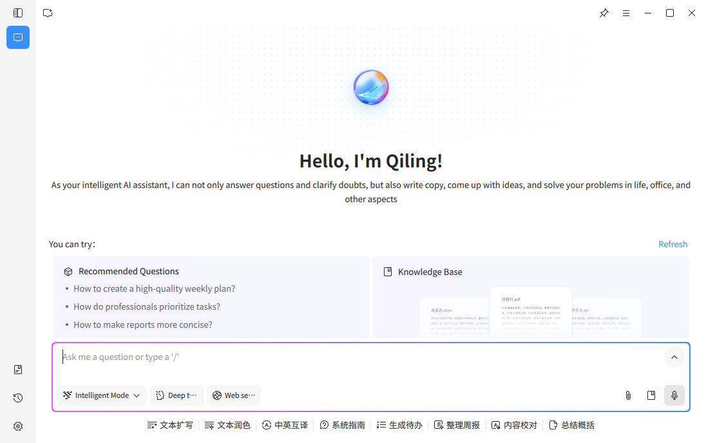

The homepage prominently displays AI plugin entries, making it easy for users to find and quickly access various AI plugins, improving operational convenience.

#### Left Navigation Bar

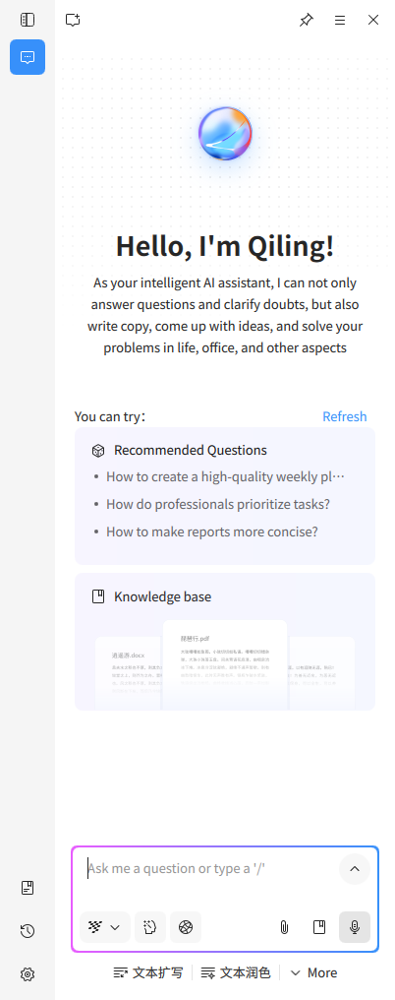

The left navigation bar provides multiple function entry buttons, including the Sidebar button, Q&A button, Knowledge Base button, Chat History button, and Settings button. Users can quickly access the corresponding feature pages by clicking different buttons, enabling convenient switching between modules.

**Sidebar Button**: Click to expand or collapse the left navigation bar, allowing users to collapse it for more display space or expand it when switching functions.

**Q&A Button**: Click to enter the Xiao K Q&A homepage, where users can interact with Xiao K via text to complete tasks such as question consulting, information retrieval, and content generation.

**Knowledge Base Button**: Click to enter the knowledge base management page, where users can upload and manage personal documents to build a dedicated knowledge base for Xiao K to reference during conversations.

**Chat History Button**: Click to view all historical conversation records with Xiao K, supporting time-based browsing, keyword search, bookmark management, and other operations for easy review and continuation of previous conversations.

**Settings Button**: Click to enter the system settings page, where users can personalize configurations for general settings, Q&A commands, and global text selection features.

### I. Xiao K Q&A Page

The upper section of the homepage displays a recommended questions area, containing several built-in suggested questions to help users quickly understand Xiao K's capabilities and start a conversation. A "Refresh" button is available next to the recommended questions to load new suggestions. The homepage also provides a Knowledge Base button entry for quick access to the knowledge base module.

The lower section contains the Q&A input area, where users can type questions or requests to interact with Xiao K. The bottom-left corner of the input box provides the following function buttons:

**Model Switch Button**: Users can select different AI models as needed to match different complexity levels and usage scenarios.

**Deep Thinking Button**: When enabled, Xiao K will perform deeper logical reasoning, suitable for handling complex problems.

**Web Search Button**: When enabled, Xiao K can access real-time web information to improve the timeliness and accuracy of responses.

The bottom-right corner of the input box provides the following function buttons:

**Add File Button**: Supports uploading local files for Xiao K to reference during conversations.

**Select Knowledge Base Document Button**: Click to select all or specific files from the knowledge base as reference sources for the current conversation.

**Voice Input Button**: Supports two activation methods — users can click the button to activate voice input directly, or select the input box and long-press the space bar to activate it, converting speech to text in real time.

#### Quick Text Processing

##### Supported Commands

The system supports a variety of intelligent commands, including but not limited to:

**Generate To-Do**: Automatically creates to-do items based on user needs, helping users plan tasks clearly.

**System Guide**: Provides intelligent guidance and help related to system operations, assisting users in quickly understanding and using system functions.

**Text Expansion**: Automatically expands and optimizes text content to enrich language expression.

**Text Polishing**: Improves the fluency and professionalism of text, correcting grammar and spelling errors.

**Chinese-English Translation**: Enables quick translation between Chinese and English, supporting multi-language translation.

**Weekly Report Organization**: Quickly organizes and generates weekly reports, automatically summarizing the week's work progress.

**Content Proofreading**: Performs detailed proofreading of text content, correcting errors and optimizing expression.

**Summarization**: Generates concise and clear summaries based on user-provided text.

#### Text Conversation

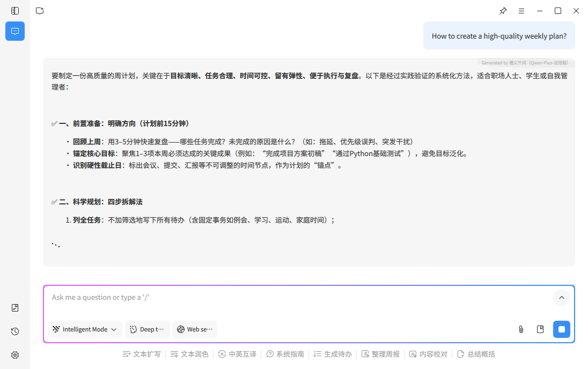
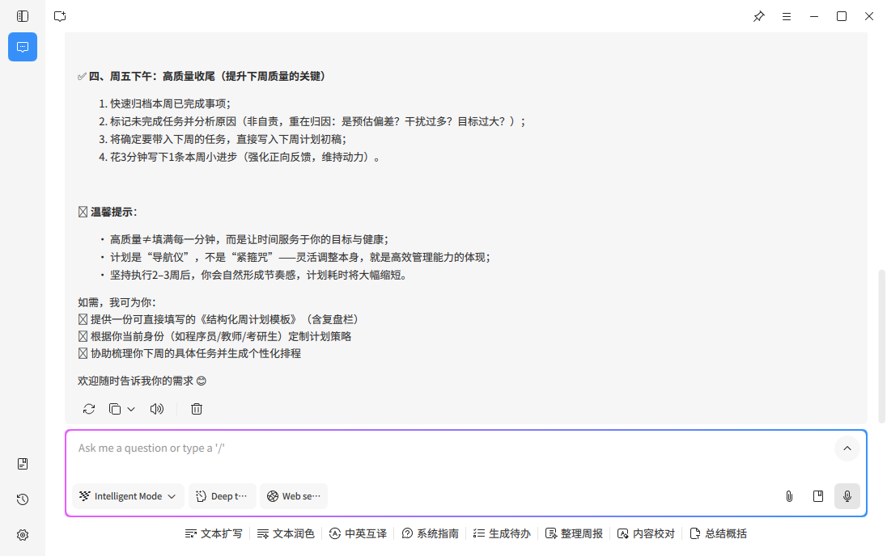

Users type questions or requests in the input box, and Xiao K generates corresponding text replies. The following action buttons are provided below each AI response:

**Regenerate**: When unsatisfied with AI's response, click to request a new answer for a more accurate or complete reply.

**Copy**: One-click copy of AI-generated response content to the clipboard for easy pasting in other applications or documents.

**Read Aloud**: Converts AI's text response to speech playback, allowing users to receive information through audio for a more convenient interaction experience.

**Delete**: Deletes the current AI response to help users clean up unwanted conversation records.

##### Text-to-Image

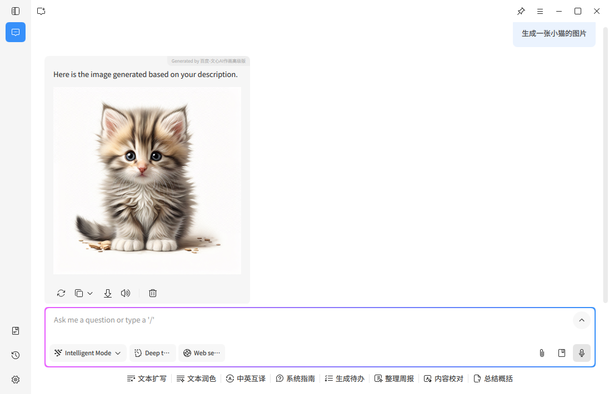

**Xiao K Text-to-Image** is an AI-based technology that automatically generates corresponding images based on text descriptions provided by users. By combining natural language processing and computer vision, AI can understand the content described in text and transform it into matching visual images.

##### Image Processing

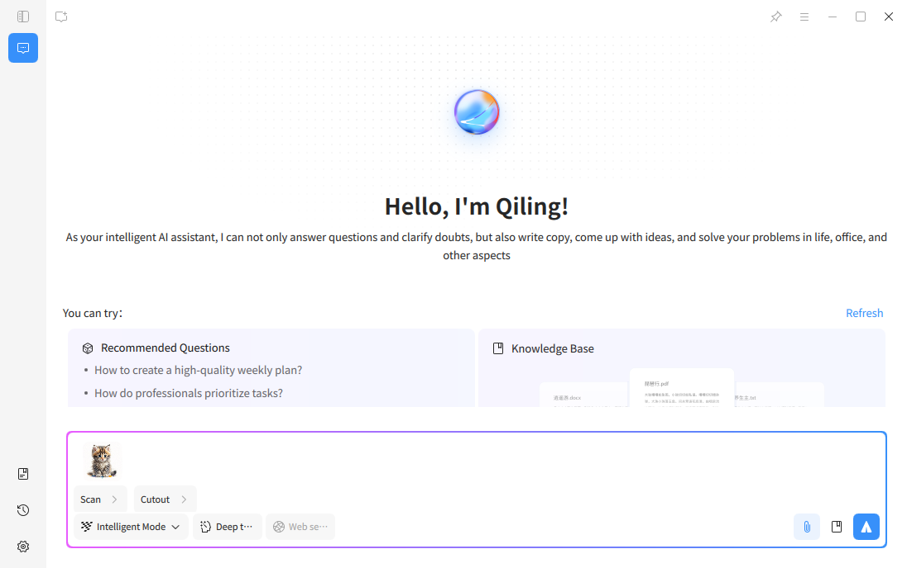

The **Image Processing** feature supports users in uploading image files, and Xiao K can perform intelligent processing on images. Main functions include:

- **Black & White Scan**: Converts color images into high-quality black and white scan effects, removing background noise and enhancing text clarity, suitable for document digitization and archiving
- **Smart Cutout**: Automatically identifies the main subject in an image, precisely separates foreground from background, and generates PNG images with transparent backgrounds, supporting smart cutout for various object types including portraits and items

### II. Xiao K Knowledge Base Page

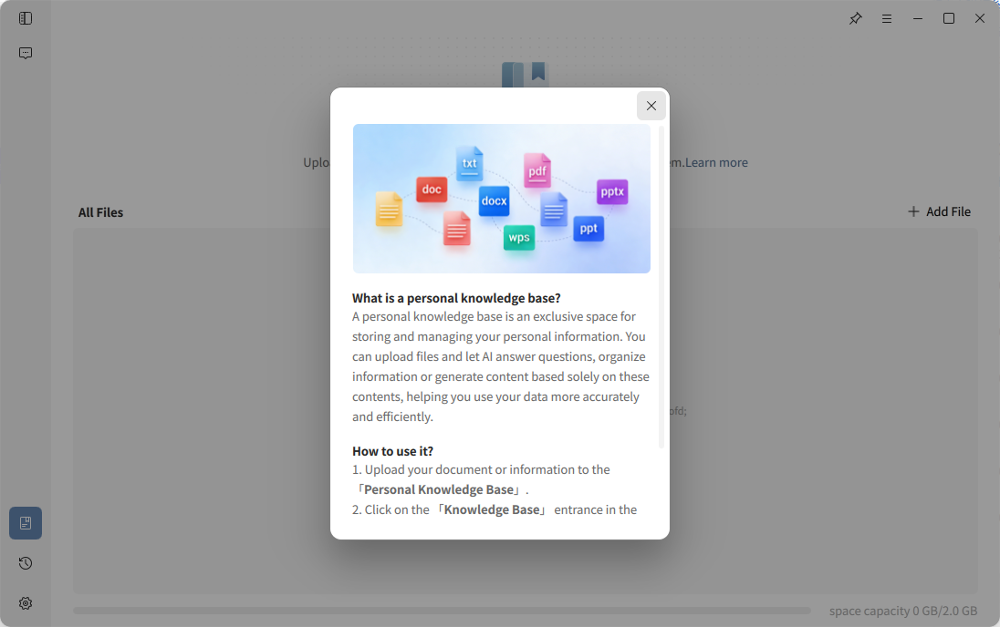

#### 1. Feature Overview

The Knowledge Base page is used to manage users' personal files and document content, helping users build a dedicated knowledge base for knowledge accumulation and efficient utilization. Users can upload frequently used materials and document files to the knowledge base as reference sources for subsequent Q&A sessions.

Content in the knowledge base can be accessed by Xiao K during conversations to provide responses and generated content that better align with the user's reference materials.

#### 2. Knowledge Base Usage

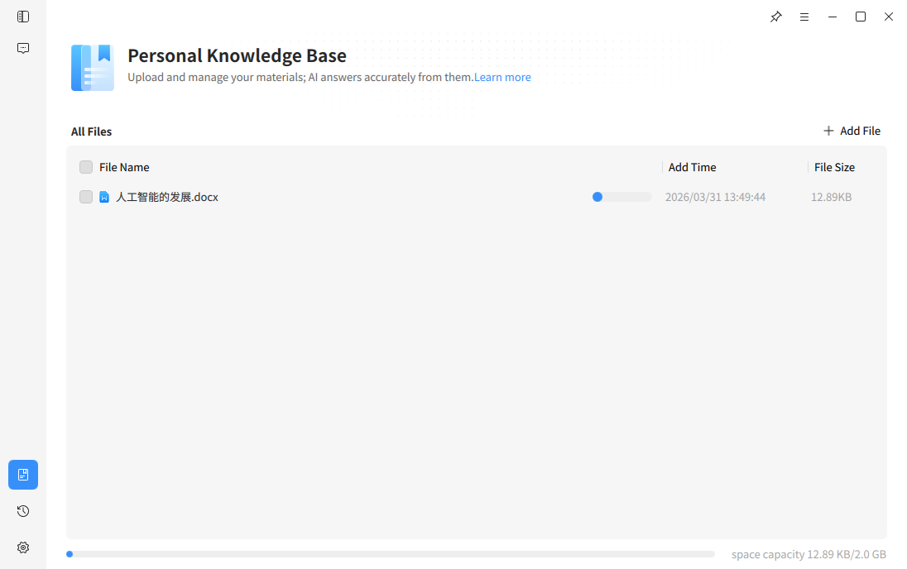

- File Upload and Management

Users can upload local files on the Knowledge Base page to store materials in their personal knowledge base. The system supports common document format files.

After uploading, files are displayed in a list where users can view file names, creation dates, and file sizes for easy management and retrieval.

The page supports creating new folders, allowing users to categorize files for improved organization efficiency.

- Knowledge Base Q&A

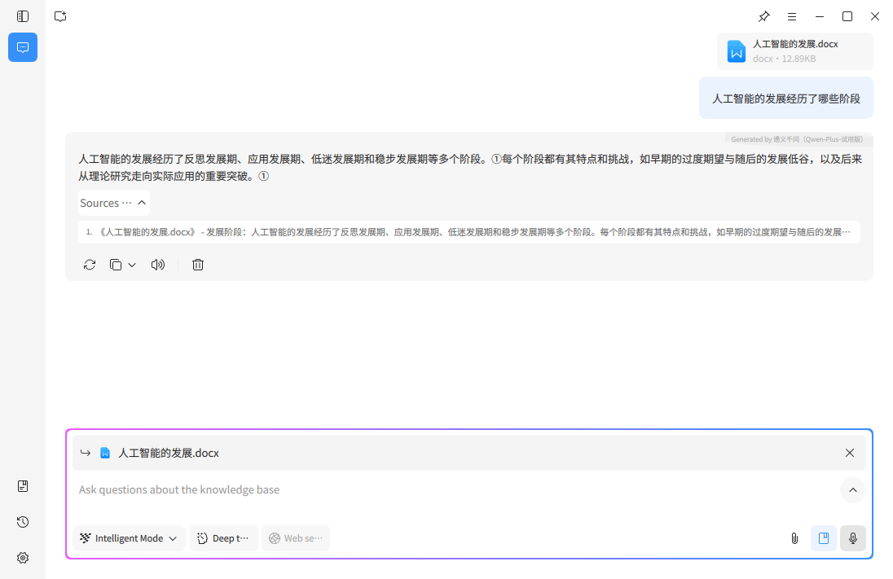

When files exist in the knowledge base, users can directly conduct knowledge base Q&A on the Q&A homepage. Xiao K will reference the knowledge base content when answering questions, generating responses related to the user's materials.

- Source Information Viewing

In knowledge base Q&A scenarios, Xiao K will display corresponding source information after providing a response. Users can click on the source information to directly open the corresponding file and view the relevant content location for easy verification and tracing.

### III. Xiao K Chat History Page

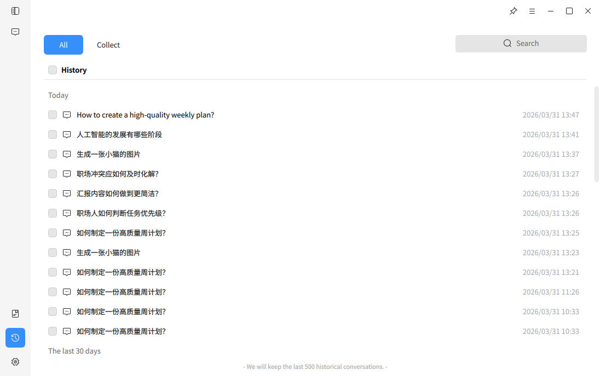

#### 1. Feature Overview

The Chat History page is used to display and manage users' historical conversation records with Xiao K, allowing users to view, review, or continue previous conversations at any time. Through this page, users can quickly locate past conversations to improve information retrieval and usage efficiency.

The system automatically saves user conversation records and displays them categorized by time.

#### 2. Chat History Usage

- View History

After entering the Chat History page, the system displays historical conversations in chronological order, typically categorized by "Today", "Last 7 Days", etc., for quick retrieval.

Users can click on any historical conversation to open its content and continue the exchange.

- Search Conversations

The page provides a search function to quickly locate target records and improve retrieval efficiency.

- Bookmarks and Management

Users can bookmark important conversations for quick future access. The page also supports deletion management of historical conversations to help users organize their records.

- Storage Capacity Notice

When the number of historical conversations approaches the system storage limit, the page will display a notification. After reaching the limit, the system may automatically overwrite older conversation records.

### IV. Xiao K Settings Page

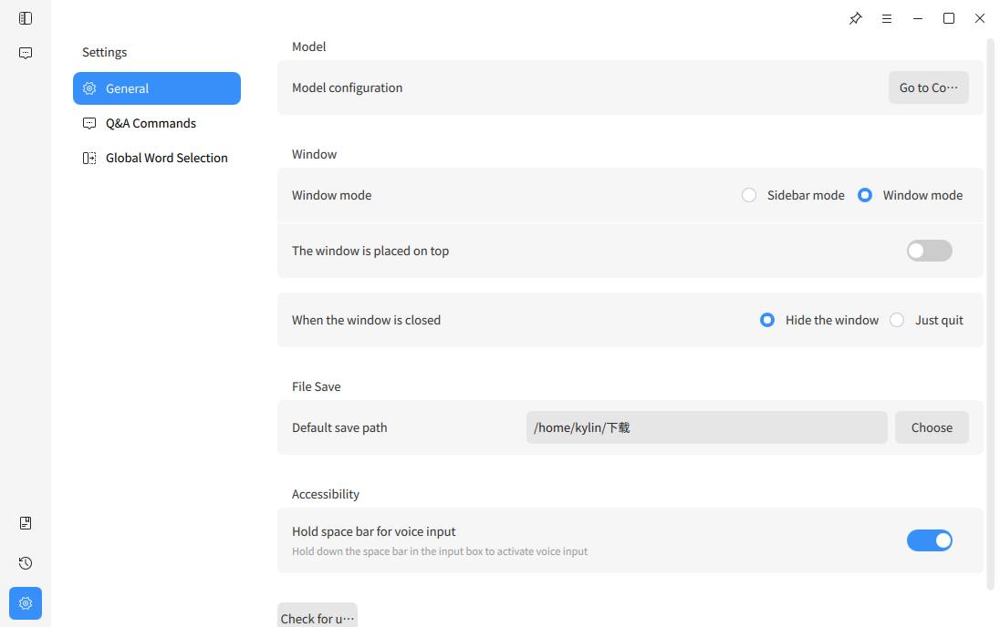

#### 1. Feature Overview

The Settings page is used to configure and manage Xiao K's functional behavior, usage methods, and personalization options. Users can adjust Q&A and system behavior settings based on personal habits and usage needs to achieve a more tailored experience.

The Settings page mainly includes General Settings, Q&A Commands, Tone & Style, and Global Text Selection modules.

#### 2. Feature Instructions

- General Settings

General Settings is used to manage basic system functions and operation modes, including model-related settings, window mode selection and always-on-top settings, window close behavior settings, default file save path settings, system update checks, and accessibility features (supports enabling long-press space bar voice input).

Users can adjust the above options based on their usage habits to optimize the overall experience.

- Q&A Commands

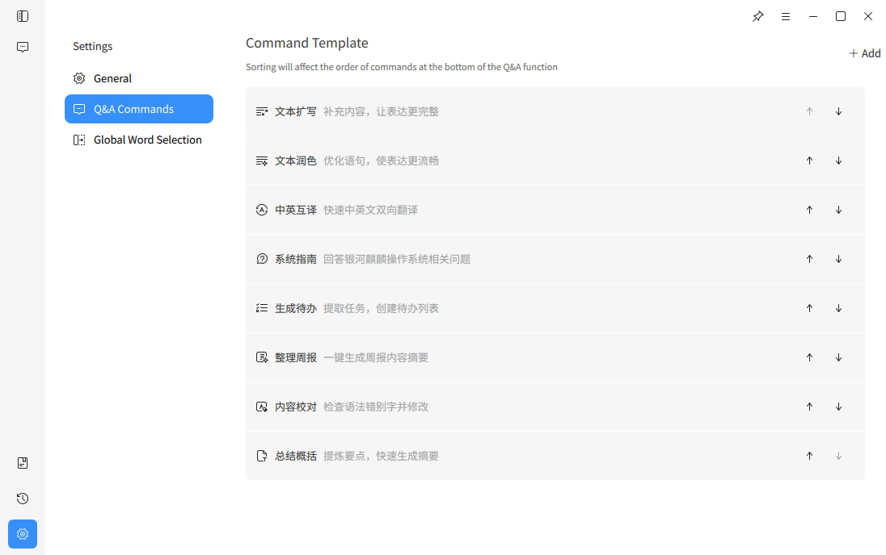

Q&A Commands is used to manage command templates in Q&A scenarios. Users can view or add command templates and adjust command order. Command templates help Xiao K understand user needs more accurately in specific scenarios, improving Q&A efficiency and quality.

- Global Text Selection

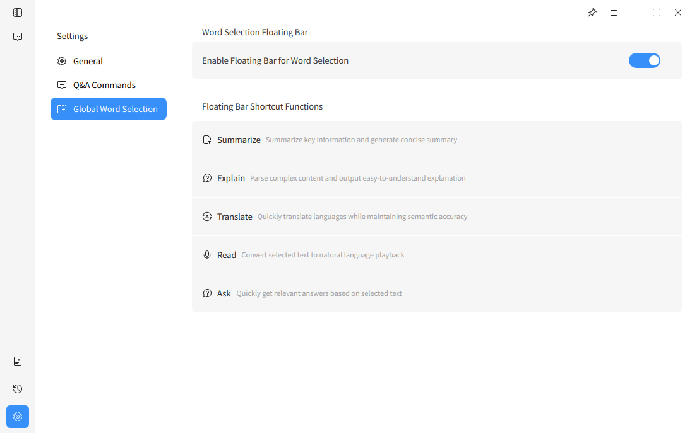

The Global Text Selection feature supports quickly invoking Xiao K capabilities after selecting text in the system. Users can enable or disable this feature and use text selection shortcuts for content summarization, content explanation, translation, read aloud, and Q&A.

### Smart Text Selection

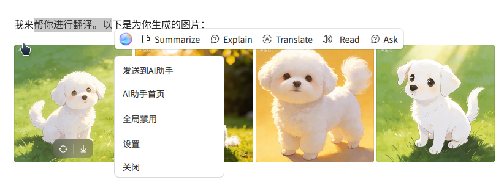

Text selection activates the floating bar, which displays intelligently based on position. Preset command templates include: Generate To-Do, System Guide, Text Expansion, Text Polishing, Chinese-English Translation, Weekly Report Organization, Content Proofreading, and Summarization. The floating bar also provides a direct AI conversation entry. The floating bar right-click menu includes: Go to Send to Xiao K, Xiao K Homepage, Disable Text Selection Floating Bar, Settings, and Close.

Default pinned: Generate To-Do, System Guide, Text Expansion, Text Polishing.
More commands: Chinese-English Translation, Weekly Report Organization, Content Proofreading, Summarization.

### Right-Click Menu

Click to see the "Send to Xiao K" prompt. Left-click to execute the selected content with AI tools; right-click to open the context menu.
