# 小K

## 概述

小K是一种基于人工智能技术的应用程序或工具，旨在通过自然语言处理、机器学习、计算机视觉等技术，为用户提供智能化的帮助和支持。小K可以执行多种任务。

小K在界面侧边栏提供多功能入口按钮，用户可通过点击不同按钮进入对应功能页面，实现问答交流、知识管理、历史记录查看及系统设置等操作。

侧边栏功能入口布局清晰，用户点击相应图标后即可跳转至对应页面，各页面功能相互独立又可协同使用。例如，知识库内容可在问答中调用，历史对话可用于回顾与继续交流，设置页可对整体使用方式进行个性化配置。

通过侧边栏导航，用户可在不同功能模块之间快速切换，形成完整、高效的使用流程，满足多样化办公与学习需求。

### 打开方式

小K启动后通过以下方式唤起：

（1）点击托盘区右侧的小K图标。

（2）使用快捷键 **Super + C**。

（3）点击划词悬浮条上的任意指令。

（4）在系统文档中右键选择"发送到小K"。

### 主页展示

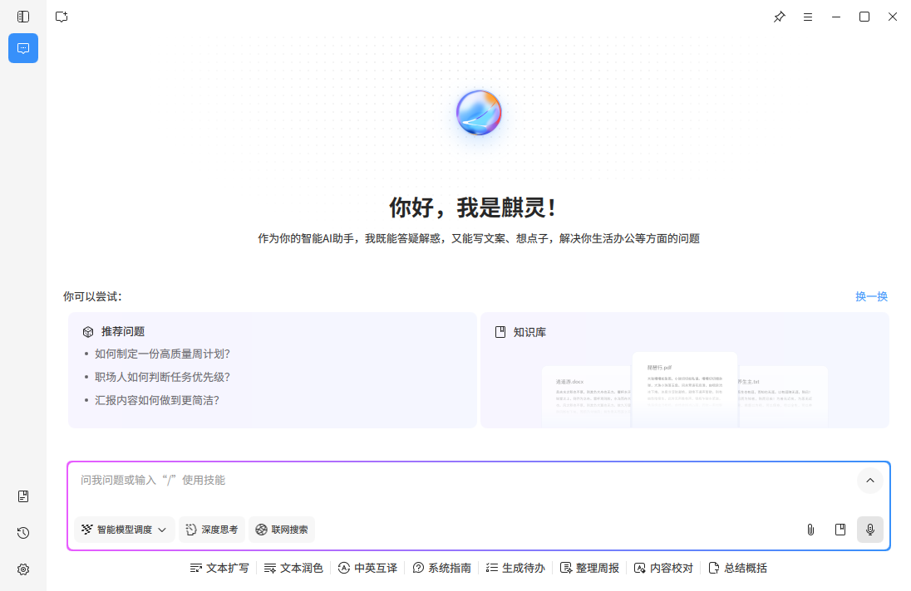

主页界面突出显示AI插件入口，方便用户一目了然地找到并快速访问各种AI插件，提升操作的便捷性。

#### 左侧导航栏

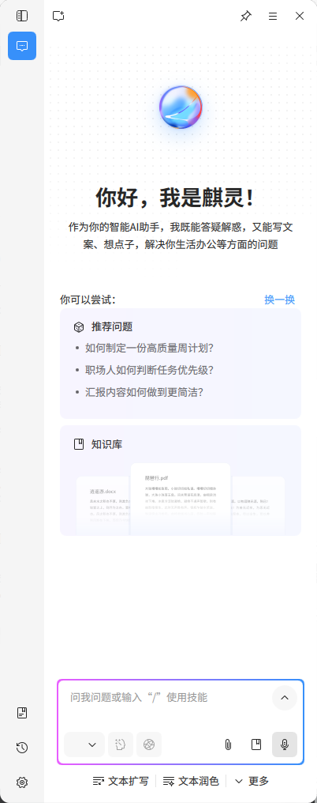

左侧导航栏提供多个功能入口按钮，包括侧边栏按钮、问答按钮、知识库按钮、历史对话按钮和设置页按钮。用户可通过点击不同按钮快速进入对应功能页面，实现模块间的便捷切换。

**侧边栏按钮**：点击可展开或收起左侧导航栏，方便用户在需要更多显示空间时收起导航栏，或在需要切换功能时快速展开。

**问答按钮**：点击可进入小K问答主页，用户可在该页面与小K进行文字交互，完成问题咨询、信息获取、内容生成等操作。

**知识库按钮**：点击可进入知识库管理页面，用户可上传和管理个人文档资料，构建专属知识库，供小K在对话中调用参考。

**历史对话按钮**：点击可查看与小K的所有历史交流记录，支持按时间分类浏览、关键词搜索、收藏管理等操作，方便用户回顾和继续之前的对话。

**设置页按钮**：点击可进入系统设置页面，用户可对小K的常规设置、问答指令、全局划词等功能进行个性化配置。

### 一、小K问答页

主页上方展示推荐问题区域，包含若干内置推荐问题，帮助用户快速了解小K的能力并发起对话。推荐问题旁设有"换一换"按钮，点击可刷新推荐问题内容。主页同时提供知识库按钮入口，方便用户快速进入知识库功能模块。

主页下方为问答输入框区域，用户可在此输入问题或需求与小K交互。输入框左下角提供以下功能按钮：

**模型切换按钮**：用户可根据需要选择不同的AI模型，以适配不同复杂度和使用场景。

**深度思考按钮**：开启后小K将进行更深入的逻辑推理，适合处理复杂问题。

**联网搜索按钮**：开启后小K可获取实时网络信息，提高回答的时效性与准确性。

输入框右下角提供以下功能按钮：

**添加文件按钮**：支持上传本地文件，供小K在对话中参考使用。

**选择知识库文档按钮**：点击后可选中知识库中的全部文件或指定文件，作为当前对话的参考来源。

**语音输入按钮**：支持两种激活方式，用户可点击按钮直接激活语音输入，也可选中对话框后长按空格键激活，将语音实时转换为文字输入。

#### 快捷文本处理

##### 支持的指令功能

系统支持多种智能指令，包括但不限于：

**生成待办**：根据用户的需求自动创建待办事项，帮助用户清晰规划任务。

**系统指南**：提供系统操作相关的智能引导和帮助，协助用户快速了解和使用系统功能。

**文本扩写**：自动扩展并优化文本内容，丰富语言表达。

**文本润色**：提升文本的流畅度和专业性，纠正语法和拼写错误。

**中英互译**：实现中英文之间的快速翻译，支持多种语言互译功能。

**整理周报**：快速整理和生成周报，自动总结一周的工作进展。

**内容校对**：对文本内容进行详细校对，纠正错误并优化表达。

**总结概括**：根据用户提供的文本，生成简洁明了的概述或总结。

#### 文本对话

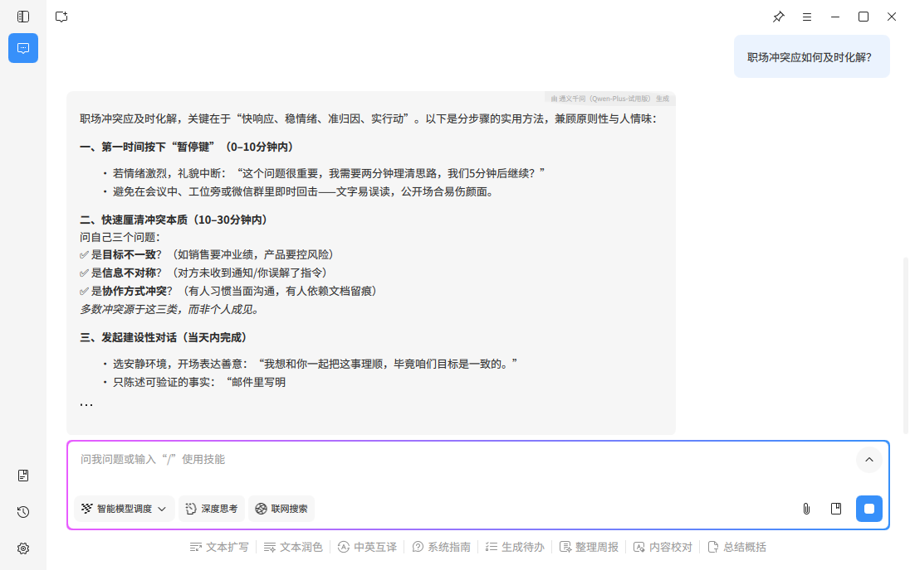
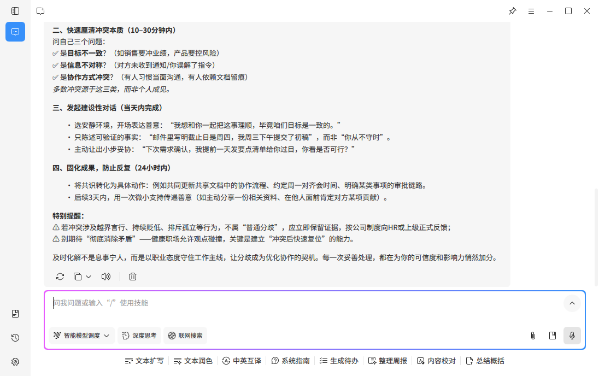

用户通过输入框输入问题或需求，小K会生成对应的文本回复。每条AI回复下方提供以下操作按钮：

**重新回答**：对AI的回答不满意时，点击可请求AI重新生成一个回答，以获得更准确或更完整的响应。

**复制**：一键复制AI生成的回答内容到剪贴板，方便在其他应用程序或文档中粘贴使用。

**朗读**：将AI的文字回答转换为语音播放，支持用户通过听觉获取信息，提供更便捷的交互体验。

**删除**：删除当前这条AI回复内容，帮助用户清理不需要的对话记录。

##### 文生图

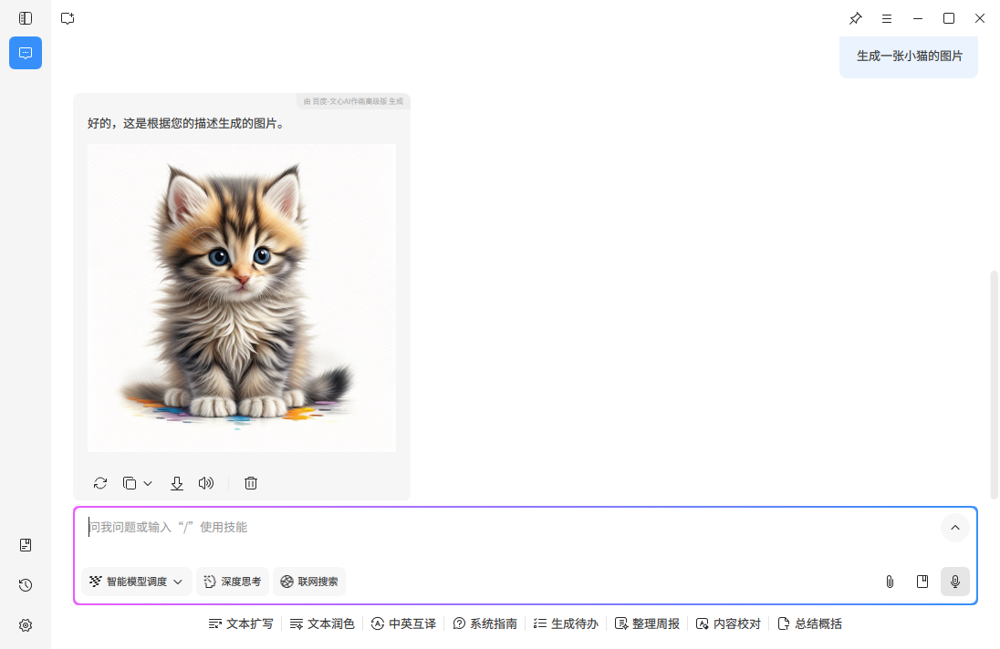

**小K文生图**（即文本生成图像）是一项基于人工智能的技术，能够根据用户提供的文本描述自动生成相应的图像。通过自然语言处理和计算机视觉的结合，AI能够理解文字中的内容，并将其转化为符合描述的视觉图像。

##### 图片处理

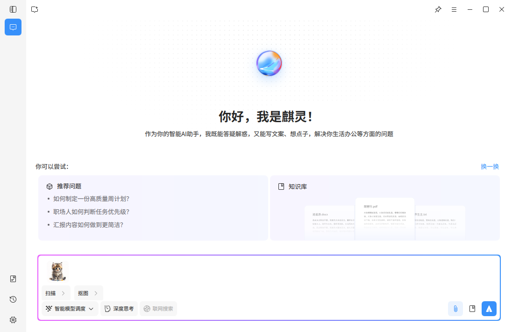

**图片处理**功能支持用户上传图片文件，小K能够对图片进行智能处理，主要功能包括：

- **扫描黑白件**：将彩色图片转换为高质量的黑白扫描件效果，去除背景噪点，增强文字清晰度，适用于文档数字化和存档
- **智能抠图**：自动识别图片主体对象，精准分离前景和背景，生成透明背景的PNG图片，支持人像、物品等多种对象类型的智能抠图
  
  

### 二、小K知识库页

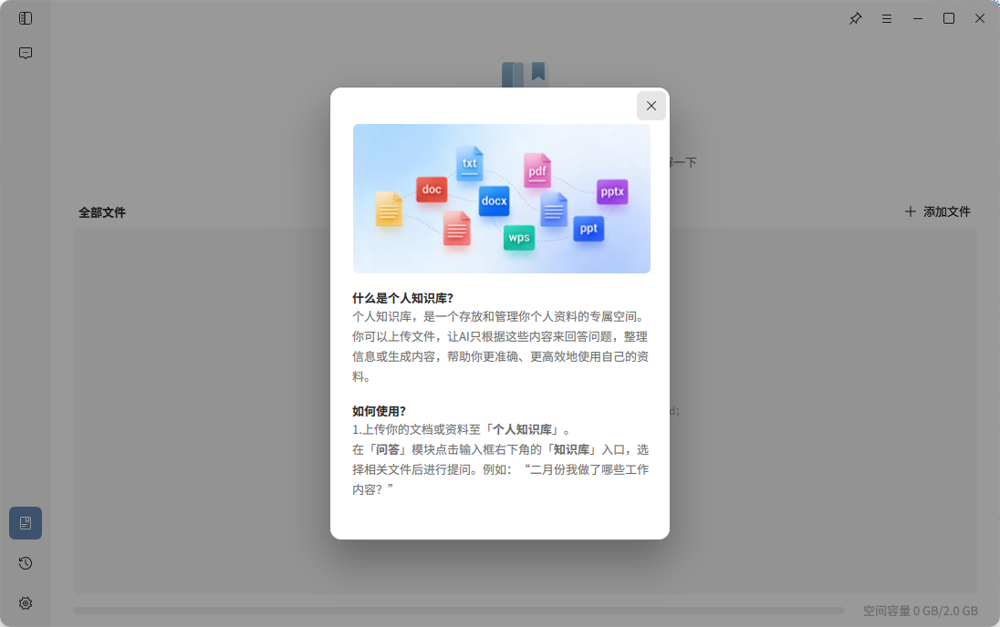

#### 1. 页面功能概述

知识库页用于管理用户个人资料与文档内容，帮助用户构建专属知识库，实现知识沉淀与高效利用。用户可将常用资料、文档文件上传至知识库，作为后续问答的参考来源。

知识库中的内容可被小K在对话过程中调用，用于提供更贴合用户资料背景的回答与生成内容。

#### 2. 知识库使用方式

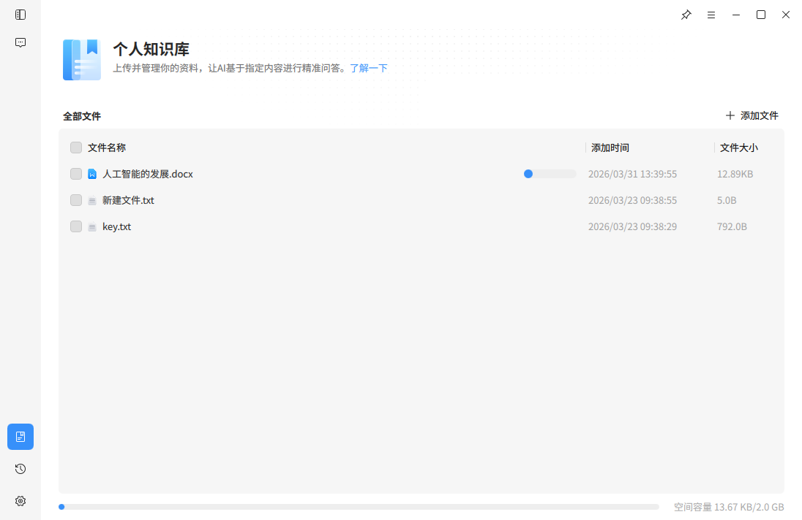

- 文件上传与管理

用户可在知识库页上传本地文件，将资料存入个人知识库，系统支持常见文档格式文件。

上传完成后，文件会在列表中展示，用户可查看文件名称、创建时间及文件大小，便于管理与查找。

页面支持新建文件夹功能，用户可对文件进行分类管理，提高资料整理效率。

- 知识库问答

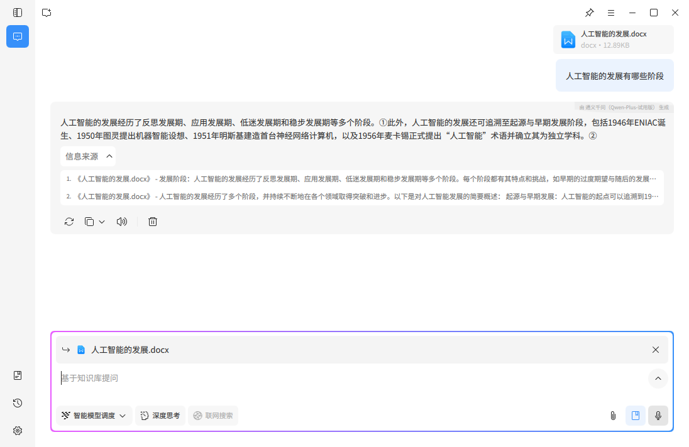

当知识库中存在文件资料时，用户可在问答主页直接进行知识库问答。小K在回答问题时，会参考知识库内容，生成与用户资料相关的回答。

- 信息来源查看

在知识库问答场景下，小K回复内容后会显示对应的信息来源。用户点击信息来源后，可直接打开对应文件并查看相关内容位置，方便核对与追溯。

### 三、小K历史对话页

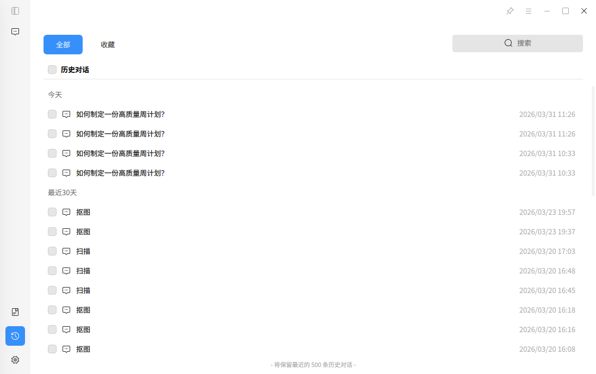

#### 1. 页面功能概述

历史对话页用于展示和管理用户与小K的历史交流记录，方便用户随时查看、回顾或继续之前的对话内容。通过该页面，用户可以快速定位过往对话，提高信息查找与使用效率。

系统会自动保存用户的对话记录，并按时间进行分类展示。

#### 2. 历史对话使用方式

- 查看历史记录

进入历史对话页后，系统会按时间顺序展示历史对话内容，通常以"今天""最近7天"等方式进行分类，便于快速查找。

用户点击任一历史对话，即可打开该对话内容并继续交流。

- 搜索对话

页面提供搜索功能，快速定位目标记录，提高查找效率。

- 收藏与管理

用户可对重要对话进行收藏，便于后续快速访问。同时支持对历史对话进行删除管理，帮助用户整理记录内容。

- 存储容量提示

当历史对话数量接近系统存储上限时，页面会进行提示说明。达到上限后，系统可能自动覆盖较早的对话记录。

### 四、小K设置页

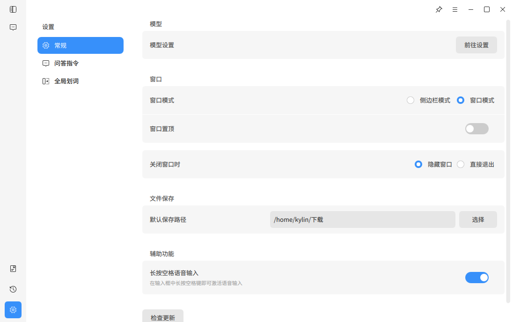

#### 1. 页面功能概述

设置页用于对小K的功能行为、使用方式及个性化选项进行配置管理。用户可根据个人习惯和使用需求，对问答及系统行为进行调整，从而获得更符合自身需求的使用体验。

设置页主要包含常规设置、问答指令、语气风格和全局划词等功能模块。

#### 2. 功能使用说明

- 常规设置

常规设置用于管理系统基础功能与运行方式，包括模型相关设置、窗口模式选择与窗口置顶设置、关闭窗口时的行为设置、文件默认保存路径设置、系统更新检查以及辅助功能（支持开启长按空格语音输入功能）。

用户可根据使用习惯调整上述选项，以优化整体使用体验。

- 问答指令

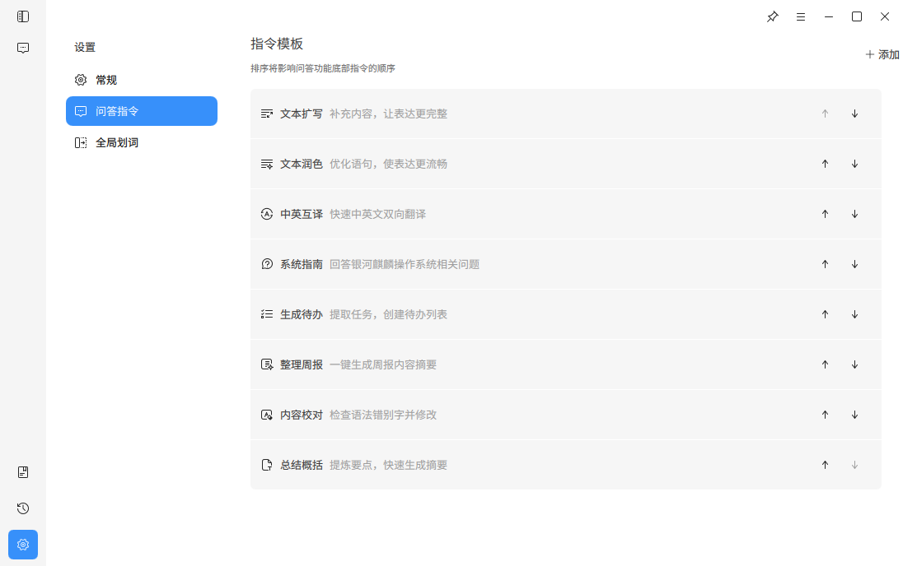

问答指令用于管理问答场景中的指令模板。用户可查看或新增指令模板，并对指令顺序进行调整。指令模板可帮助小K在特定场景下更准确地理解用户需求，提高问答效率与质量。

- 全局划词

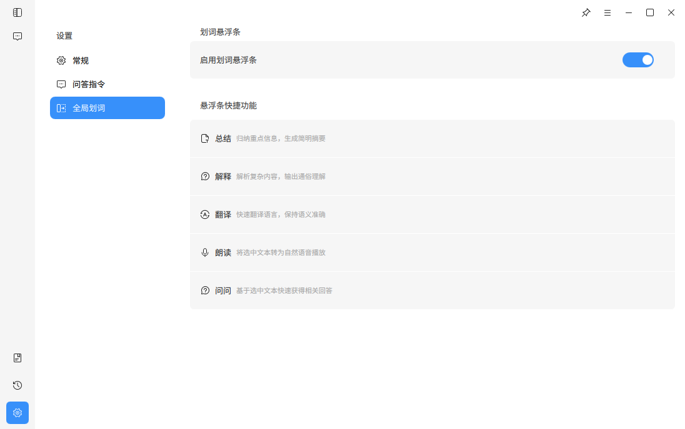

全局划词功能支持在系统中选中文本后快速调用小K能力。用户可启用或关闭该功能，并使用划词快捷操作进行内容总结、内容解释、翻译、朗读和问答。

### 智能划词

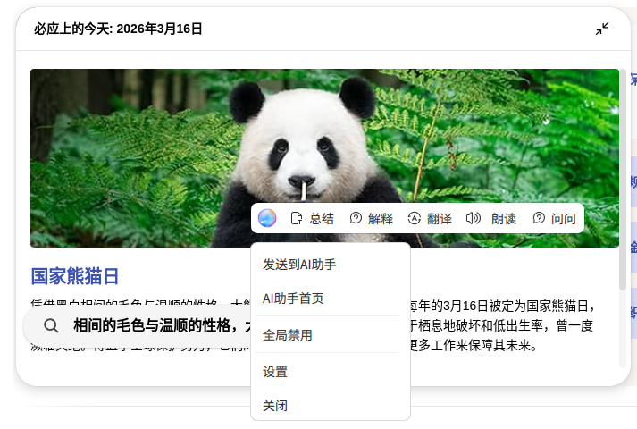

划词唤起悬浮条，悬浮条智能位置显示。预设指令模板提供：生成待办、系统指南、文本扩写、文本润色、中英互译、整理周报、内容校对、总结概括。悬浮条 AI 直接对话入口。悬浮条右键菜单：跳转至发送到小K、小K首页、禁用划词悬浮条、设置、关闭。

默认固定：生成待办、系统指南、文本扩写、文本润色。
更多指令：中英互译、整理周报、内容校对、总结概括。

### 右键菜单

鼠标点击提示"发送到小K"。左键，用 AI 工具执行所选内容；右键，唤起右键菜单。
