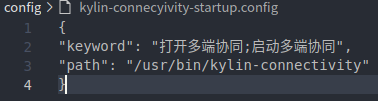

# Asr assistant

#### introduce

**Asr assistant** is an application developed based on Baidu open source model library paddlespeech, which is convenient for users to operate quickly.

#### Main function

To recognize the user's speech input.

Quick-opening applications is currently supported.


#### move

Default power-on since the start, placed to the system tray

#### Instructions for use

For example, open the **Asr assistant**, say "open the calculator," and you can quickly open the calculator

#### Voice pull configuration

Create a new **xxx-startup.config** file in the project, and put the config file under the **/usr/share/kylin-asrassistant/config/** directory when you install the app.

The file format is as follows：

```json
{

"keyword": "唤醒关键词1;唤醒关键词2",

"path": "可执行文件路径， 可加参数"

}
```

如：

You need to pull up **kylin-connectivity**

Create a new **kylin-connectivity-startup.config** file in the project


The file adds the following json fields:



Finally, add the following items to the install file

```
config/kylin-connectivity-startup.config /usr/share/kylin-asrassistant/config/
```

Or are added in the CMakeLists.txt

```
install(FILES ${CMAKE_CURRENT_SOURCE_DIR}/config/kylin-connectivity-startup.config DESTINATION  /usr/share/kylin-asrassistant/config/)
```

#### compile

```
cd kylin-asrassistant
mkdir build
cd build
cmake ..
make
sudo make install
```

#### run command

```
./kylin-asrassistant
```

#### shakedown test

The **Asr assistant** currently and adopts the logging function of the kui-log4qt module. The log is saved by default at **~ /. In the log/kylin-asrassistant.log**

#### Participated in and contributed

1. Fork is present in this warehouse
2. Create a new Feat _ xxx branch
3. Submit the code
4. Create a new Pull Request