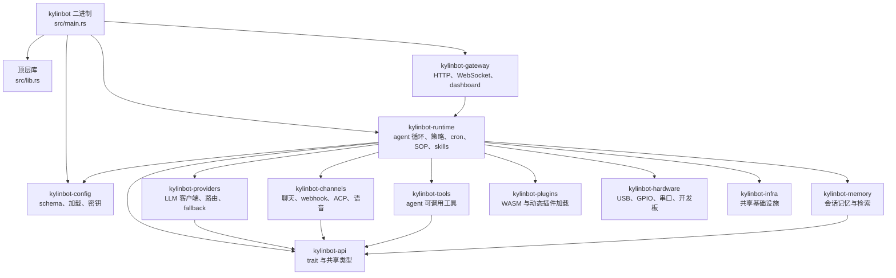

# 详细架构

在对 KylinBot 做非平凡改动之前，应先阅读本页。本文概述当前架构、预期的 crate 边界，以及安全、运行时、模型提供方、通道、工具和记忆层之间发生行为交叉的位置。

## 当前形态

KylinBot 是一个正在向微内核架构演进的 Rust workspace。稳定方向是 trait 驱动：公共契约位于 `kylinbot-api`，运行时编排位于 `kylinbot-runtime`，具体集成位于边缘 crate，支撑 crate 提供持久化、配置、遥测、插件和硬件服务。

顶层 `kylinbot` crate 仍然很重要。它负责 CLI 二进制入口、命令枚举、功能开关接线、兼容模块，以及 workspace 拆分过程中的部分 feature-gated 运行时路径。不要假设所有行为都已经从 `src/` 迁移到 `crates/`。

## 架构规则

- `kylinbot-api` 定义契约。它不应依赖具体 provider、channel、tool、runtime 实现或 UI 表面。
- `kylinbot-runtime` 编排策略与状态。它可以组合 providers、channels、tools、memory、skills、hooks、cron、SOP 和 observability，但新的平台集成通常应放在 runtime 之外。
- `kylinbot-providers`、`kylinbot-channels` 和 `kylinbot-tools` 是边缘 crate。它们与外部系统交互，并实现 `kylinbot-api` 中的 trait。
- `kylinbot-config` 是配置 schema 与校验的事实来源。没有具体用例和对应的生成/参考文档更新，不要添加配置项。
- 安全策略属于 runtime 的安全层。边缘 crate 可以做本地校验，但不能绕过 runtime 对工具执行、workspace 边界、配对、IAM 或自治能力的策略检查。
- 面向用户的 CLI 输出、工具描述和 onboarding 文本必须通过 Fluent 本地化。日志、tracing 事件、`error_key` 和 panic 文本保持英文。

## 主运行时流程

普通用户消息路径如下：

1. channel、gateway route、ACP client 或 CLI command 接收外部事件。
2. adapter 规范化事件，并在适用时执行早期配对、去重和 allowed-user 检查。
3. runtime 加载会话上下文和记忆。
4. provider 接收 prompt、tool specs 和历史消息。
5. provider streaming 产出文本增量和可选 tool calls。
6. 每个 tool call 都由 runtime 安全策略校验。
7. 已批准的 tool call 被分发给已注册的 `Tool` 实现。
8. 工具结果和 receipts 被持久化。
9. provider 携带工具结果继续生成，并输出最终文本。
10. 原始 channel 或 gateway 发送最终回复。

序列图见 [Request lifecycle](./request-lifecycle.md)。

## 核心契约

公共扩展 trait 位于 `crates/kylinbot-api/src/`：

| Trait | 文件 | 职责 |
|---|---|---|
| `Provider` | `provider.rs` | 模型聊天、streaming、原生工具能力、provider 默认值 |
| `Channel` | `channel.rs` | 入站/出站消息、草稿更新、操作者审批路径 |
| `Tool` | `tool.rs` | agent 可调用能力的 schema 与调用 |
| `Memory` | `memory_traits.rs` | 会话与事实持久化后端 |
| `Observer` | `observability_traits.rs` | runtime 遥测后端 |
| `RuntimeAdapter` | `runtime_traits.rs` | 替代执行环境 |
| `Peripheral` | `peripherals_traits.rs` | 暴露能力的硬件开发板 |
| `Vad` | `vad.rs` | 语音活动检测 |

新增实现时，应从 trait 入手，再找到将具体实现接入 runtime 的本地 factory 或 registry。

## Crate 职责

### 顶层 `kylinbot`

`src/main.rs` 是 CLI 入口。`src/lib.rs` 暴露命令枚举，以及二进制和兼容路径使用的 feature-gated 模块。该 crate 负责命令路由、feature 接线、schema 导出 hook 和 CLI 行为。

由于微内核拆分仍在进行，一些模块同时存在于顶层 `src/` 和 `crates/kylinbot-runtime/src/`。移动代码前，应同时检查两处的调用点和 feature gate。

本 crate 还负责把 CLI 子命令接入 gateway/runtime 能力。例如 `kylinbot channel reload` 通过 gateway 的 channel reload API 通知 daemon 重新读取配置并重启相关子系统。

### `kylinbot-runtime`

runtime 是编排层：

- `agent/` 构造 prompt，加载 memory，流式调用 provider，处理 tool calls，分发 tools，记录 receipts，并管理 channel handles。
- `security/` 负责自治策略、sandbox 检测、IAM、pairing、OTP、emergency stop、prompt guard、secrets 处理和 workspace 边界。
- `tools/` 包含 runtime 拥有的工具，如 cron、SOP、调度、skill、模型切换、shell 和安全操作。
- `skills/`、`skillforge/` 和 `sop/` 将本地操作知识转换为 prompt context 和可调用工具。
- `cron/`、`routines/`、`heartbeat/` 和 `service/` 处理后台任务和 daemon 化运行。
- `observability/`、`hooks/` 和 `health/` 报告 runtime 状态与事件。

涉及工具执行、策略决策、审批流、workspace 访问、daemon 行为或长时间后台任务的 runtime 改动属于高风险。

### `kylinbot-providers`

provider 实现把统一的 `Provider` 契约转换为 provider 特定的 HTTP、OAuth、streaming 和 tool-call 格式。

重要模块：

- `compatible.rs` 处理多个 provider 共享的 OpenAI-compatible endpoint。
- `router.rs` 按任务提示做 provider 路由。
- `reliable.rs` 实现 fallback 链。
- streaming 逻辑要么是 provider 特定实现，要么位于共享的 compatible 解析代码。
- `auth/` 包含 OAuth 和 token 辅助逻辑。

provider 改动必须保持 streaming 语义、tool-call 规范化、超时/错误行为和 fallback 兼容性。

### `kylinbot-channels`

channels 将外部消息系统适配为 runtime 事件和出站回复。`orchestrator/` 模块处理生命周期、路由、媒体流水线和 ACP server 行为。

channel 实现应把平台特定细节留在边缘：payload 解码、重试、去重、限流、草稿更新和平台媒体处理。消息到达 agent loop 后，工具审批和访问控制仍由 runtime policy 负责。

channel 配置的启停由 `kylinbot-config` 的 typed schema 表示，由 gateway 或 CLI 修改配置后通过 daemon reload 生效。channel crate 不应直接解析 dashboard 提交的 TOML，也不应自行决定重载 daemon。

### `kylinbot-tools`

tools 是模型可调用能力，例如 browser、HTTP、file、memory、cloud、MCP、image、search、workspace 和 integration tools。工具实现必须返回结构化结果，并明确描述副作用。

读取或修改本地状态、执行命令、访问凭据或发起网络请求的工具需要特别谨慎。runtime 安全层必须拥有足够元数据来分类和执行策略。

### `kylinbot-config`

config 拥有 schema、typed values、注释、secrets、migration 和 workspace 解析。CLI、gateway、onboarding 和 runtime 代码应使用共享配置 API，而不是独立解析 TOML。

dashboard 对配置的修改应最终进入 `Config` typed schema，经过 `validate()` 和 `save()` 后落盘。涉及 secrets 的配置展示必须先 mask，保存时再恢复当前内存中已有的真实 secret。channel 绑定、断开连接和手动配置更新应复用同一份 `config_path`，避免写入文件和 daemon reload 读取文件不一致。

### `kylinbot-memory`

memory 持久化会话、事实、embeddings 和检索状态。runtime 代码把 memory 组合进 prompt context，而该 crate 负责后端特定的存储行为。

### `kylinbot-gateway`

gateway 通过 HTTP、WebSocket、dashboard assets 和 webhooks 暴露 runtime 行为。公开绑定、pairing、authentication 和 streaming responses 都是安全敏感区域。

gateway 是 dashboard 配置操作的服务端边界：它负责鉴权、读取 typed `Config`、返回配置摘要、保存配置并触发 daemon reload。channel dashboard 相关 API 包括：

- `GET /api/channels`：返回 channel 状态、健康信息和 dashboard 展示用 identifier。
- `DELETE /api/channels/{channel}`：移除指定 channel 配置，必要时清理 channel state，并触发 reload。
- `POST /api/channels/reload`：兼容 CLI/dashboard 的 channel reload 入口，复用 daemon 级 reload 机制。
- 绑定类 API（如 WeChat、WeCom、DingTalk、Feishu）在成功写入配置后应触发 reload，使新配置无需手动重启即可生效。

dashboard 前端不应自行拼装重要运行时状态作为最终事实来源。需要展示已配置 channel 的 ID、账号或 bot 标识时，优先使用 gateway 返回的结构化字段，而不是在浏览器里解析完整 TOML。

### `kylinbot-plugins`

plugins 提供动态扩展。稳定设计方向是：动态插件通过与内置 providers、tools、channels 或 runtime adapters 相同的契约暴露能力。

### `kylinbot-hardware`

hardware 代码发现设备，并通过 USB、串口、GPIO、I2C 和 SPI 暴露 peripherals。由 agent 调用的硬件工具仍需要遵循正常 runtime policy 和 receipts。

## 扩展工作流

### 新增 provider

1. 实现 `kylinbot-api` 中的 `Provider`。
2. 对 OpenAI-compatible API 尽量复用 `compatible.rs`。
3. 在 provider factory 中注册 provider。
4. 为具体面向用户的配置添加 schema 和文档。
5. 如果支持 streaming 或 tool calling，添加 factory resolution、默认模型行为、streaming 和 tool calling 测试。

### 新增 channel

1. 实现 `Channel`。
2. 将平台认证、webhook/polling 细节和 payload 转换留在 channel crate。
3. 接入 channel factory 和 feature flags。
4. 记录所需配置和 pairing 行为。
5. 测试入站规范化、出站发送/更新行为和授权检查。
6. 若 dashboard 需要配置、绑定、断开或展示标识，应通过 gateway API 暴露结构化字段，并让 gateway 负责保存配置和触发 reload。

### 新增 tool

1. 实现 `Tool`，提供清晰 schema 和本地化的用户可见描述。
2. 在正确的 registry 或 factory 中注册。
3. 分类副作用，并确保 security policy 可以拦截。
4. 添加聚焦测试，覆盖参数校验、成功、失败和拒绝路径。
5. 对有意义的副作用记录 receipts。

### 新增配置

1. 在 `kylinbot-config` 中添加 typed schema 字段。
2. 添加 validation、migration 和默认行为。
3. 按配置工具要求更新生成/参考文档。
4. 仅当该配置面向用户时，更新 onboarding 或 CLI 代码。

## 高风险边界

除非证明不是，否则以下位置按高风险处理：

- `crates/kylinbot-runtime/src/security/**`
- tool dispatch、tool receipts 和审批流
- `crates/kylinbot-tools/src/**` 中具有文件、shell、browser、cloud、memory、credential 或 network 副作用的工具
- `crates/kylinbot-gateway/src/**` 和 webhook authentication
- channel pairing、IAM、allowed users 和 webhook signature verification
- provider streaming 和 tool-call parsing
- config schema migrations 和 secret handling
- `.github/workflows/**`、release scripts 和 install/bootstrap scripts

高风险改动应先阅读相邻测试和文档，添加或更新聚焦测试，并在 PR 中记录行为、影响、副作用和回滚说明。

## 任务开始检查清单

开始新任务前：

1. 阅读本文档。
2. 阅读 [Architecture overview](./overview.md) 和相关聚焦文档：request lifecycle、crates、providers、channels、tools、security、gateway 或 hardware。
3. 编辑前定位所属 crate 和 factory/registry。
4. 按 `AGENTS.md` 评估风险等级。
5. 检查相邻测试和 feature gates。
6. 保持补丁聚焦于一个关注点。
7. 按风险等级运行验证。

## 验证指南

- 仅文档改动：在可用时运行仓库 markdown 和 link 检查。
- Rust 代码：运行 `cargo fmt --all -- --check`、`cargo clippy --all-targets -- -D warnings`，以及 `cargo test`；迭代时可使用有理由的更窄子集。
- PR 前完整验证：运行 `./dev/ci.sh all`。
- 若改动 bootstrap scripts：运行 `bash -n install.sh`。
