# Burner
## Overview
Burner is a simple interface, complete basic functions of Linux CD burning software, its main business includes the creation of mirror image, data burning, data additional burning, mirror burning, image extraction and CD replication, the main interface is shown in Figure 1.

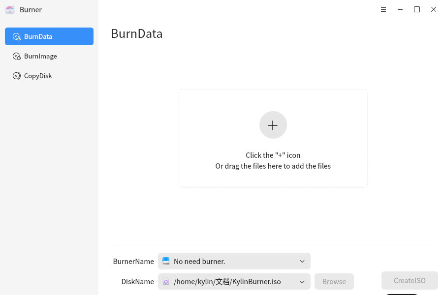

 

## Basic Functions
### Burn Data
The function of data burning integrates the function of creating image, data burning and data additional burning.

The user can click the "Add" button to add any files and folders to the software, and can delete the selected and unwanted data through the "Delete" button, or delete all the data under the current position through the "Empty" button.
Note: no files or folders can be append to the CD folder. The original data in the CD can not be deleted or erased.

Users can click [new folder] button to achieve custom new node to create a mirror file, or to burn in the CD. Because the folder node does not actually exist in the operating system file structure, it is not supported to open it locally.

Users can also drag and drop files or folders to the blank area of the data display to realize the addition of files or folders.

The data burning interface will display the total size of all files that have been added to the burning software at present. It is displayed in the position of project size at the upper right corner. When the display color is red, it means that there are too many files added or no files, so business operations cannot be carried out. When green, business operations are available.

The interface will display the name, type, size and path of the added file; The bottom will display the current model of the recorder and CD (if a mirror file is generated, "mirror file" will be displayed).

The details are shown in the red box in Figure 2.

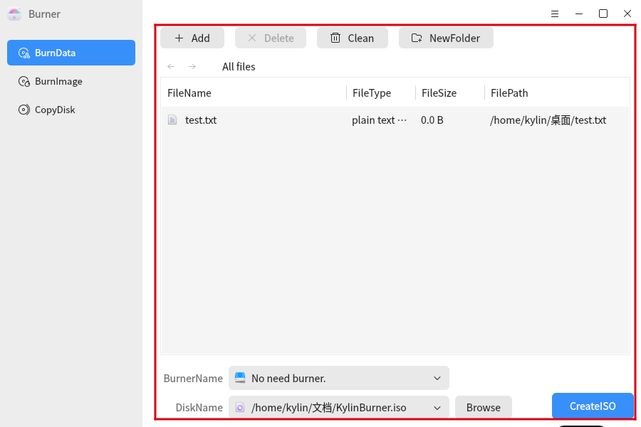

When the user is executing the mirroring business, he can click the [Browse] button below to customize the path to store the mirroring file. When the name of the mirroring file needs to be modified, the user needs to modify the name of the mirroring file in the menu burn setting.

Its specific operation is shown in Figure 3 and Figure 4:

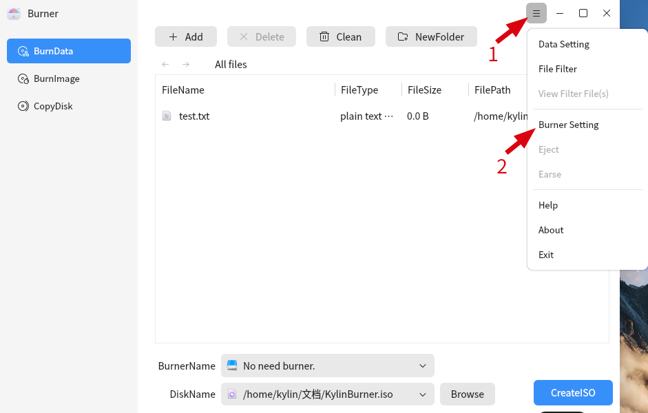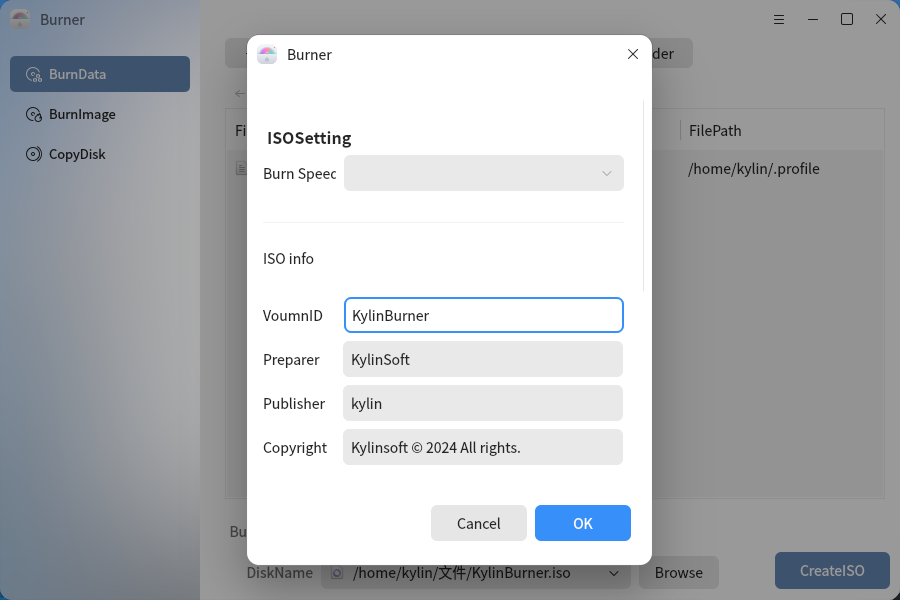

At the same time, users can also set other information of the mirror according to their own needs.

Users can switch the executed business logic according to the drop-down option (the drop-down option of the recorder is linked to the drop-down option of the disc name). When the blank disc is selected, the burning logic will be automatically switched to data burning. When you select the option [No need for recorder], automatically switch logic to create image; Similarly, switch to Appendable
When burning a CD, the automatic switch logic to add data to the burn. At the same time, the name of the business button in the lower right corner of the interface will be changed to:

Create image: handle the business logic of creating image, and the added file will be encapsulated as ISO image file conforming to ISO 9660 standard;

Data burning: Procure the data burning business logic. The added file will be burned to the blank disc of the drive selected in the current drop-down option, and name the disc with the contents filled in [Mirror Name] in the burning setting.

Additional burning: processing data additional burning business logic, the added file will be added to the selected CD, will not modify the original CD (including name, etc.) all the content; (Note: If you add files that conflict with the original contents of the CD, the same contents of the CD will be erased. Please be careful to add data.)

Unable to burn: indicates that the currently selected CD is fully burned CD, and cannot continue to burn any additional content.

### Burn Image

Burn Image is a function that enables users to select and customize ISO 9660 standard ISO image files and burn them to a blank disc.

The burning image interface is shown in Figure 5
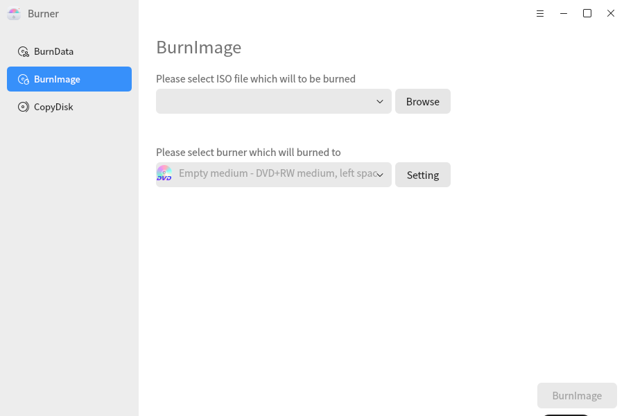

Users can refer to the following steps to complete the burn image:

1) Click the [Browse] button to select the ISO image file existing in the current operating system, and the image name and size will be displayed in the software;

2) The burning software will automatically identify whether the current linked disc in the physical disc drive is a blank disc;

3) If the image file is valid and the disc is cut to empty, the user can click [BurnImage] button to achieve burn image.

### Copy Disk

Copy disk is to facilitate the user to extract the contents of the disc into ISO 9660-compliant ISO image file, or additional blank disc.

The interface is shown in Figure 6

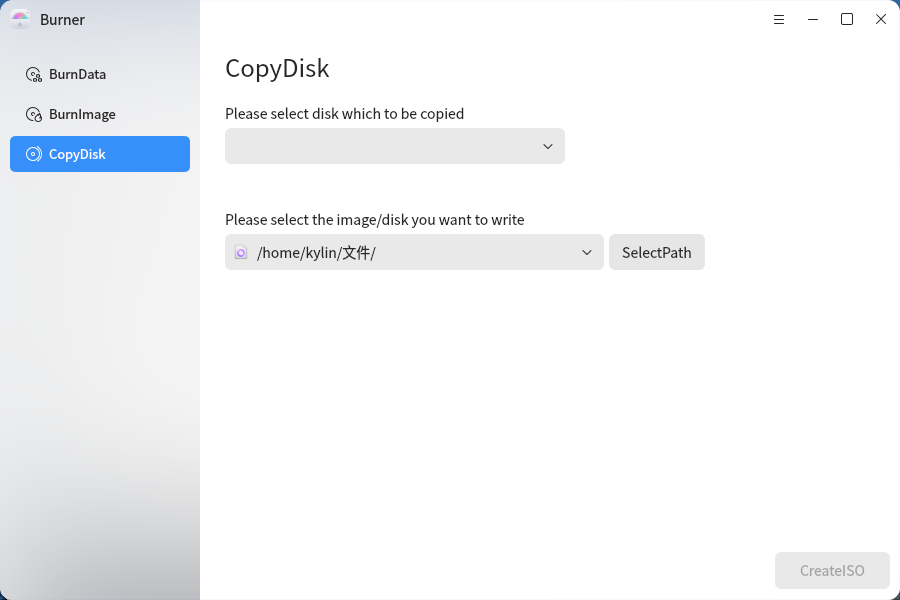

The top drop-down box represents the source, and the bottom drop-down box represents the target, that is, the user operation will burn the information carried by the CD in the source to the position carried by the target (the position is the position in the system or the blank CD).

Users can refer to the following steps to try to complete the image extraction or disc copying:

1) The burning software itself will identify the CD content in the CD drive and distribute the CD with content to the source location and the blank CD to the target location;

2) The user can choose the source to copy by himself;

3) If the user wants to extract the files in the source as ISO image files, the user can browse the image storage location by himself; If you want to copy the disc, you can select the blank disc in the target position;

4) When ready, the user can click the business button in the lower right corner to realize the corresponding business logic.

Note: the image file name extracted from the image extraction is the same as the name of the disc, the user does not support the definition of the file name.

## Advanced Features
Click on the " "icon for other actions.

### Data Settings

Burn software in the operation of [data burning] function, provide [data setting] option, in order to facilitate the user to achieve fast data operation and processing. Its specific functions are as follows:

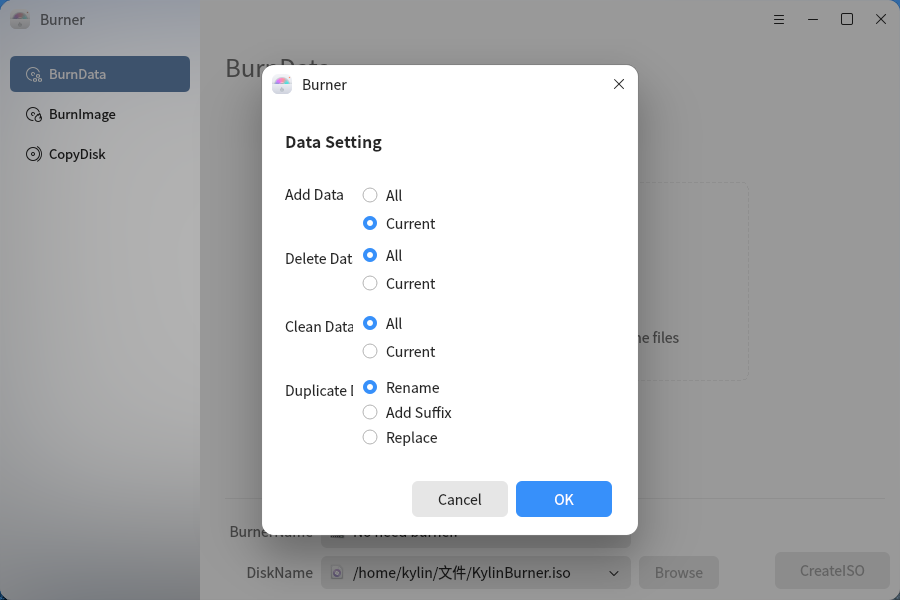

When [Data Burning] supports multiple services, users can tick the "All" option after the corresponding label to realize the rapid addition, deletion and emptying of data. (Synchronization of file nodes corresponding to multiple drop-down menus)

When dealing with files with conflicting names, three options of "rename", "add suffix" and "replace" are provided for users to choose.

Rename: Rename the file to be added by the user himself (it is not recommended to check this option for bulk addition)

Suffix: The burning software automatically adds "_X" type suffix to the filename to distinguish, "X" represents a number.

Replacement: the burning software automatically replaces the old duplicate file by adding the later file, but will not replace the original file of the disc.

Note: when performing an append burn, duplicate folders may cause the contents of the folder to be damaged after append burn. It is not recommended to implement the option of "rename" or "add suffix" to resolve such similar conflicting files.

### File Filtering

In order to facilitate the user to operate the data, the burning software provides the file filtering function, which allows the user to filter some specific file contents out of the data set and save them in the software at the same time for the user to recover at any time.

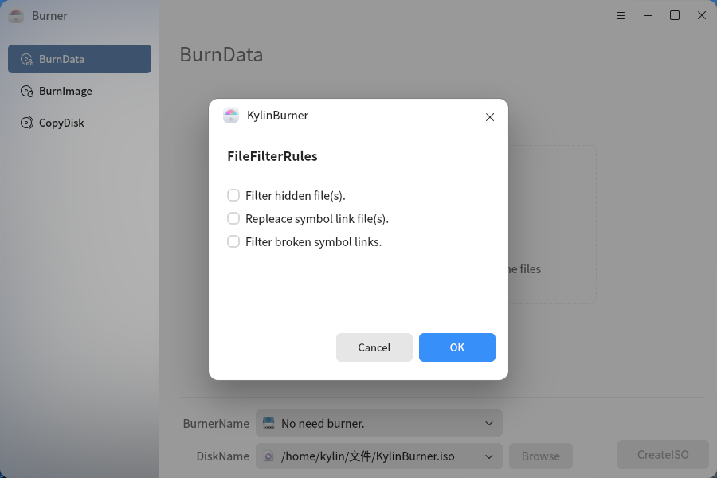

Filtering hidden files: Filters hidden properties of files or folders out of the data set;

Filtering bad link files: Filters link files that have no target out of the data set;

Replace the linked file: Replace the target file of the linked file with its own location in the data set.

### View Filter File

View the dataset of files that have been filtered after file filtering has been performed.

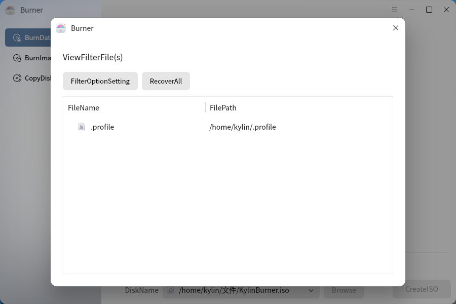

### Burn Settings

Burnout can be selected in the burn setting, change the mirror information (including the issuer, subscription party, mirror name, copyright information) and the temporary path. As shown in Figure 10:

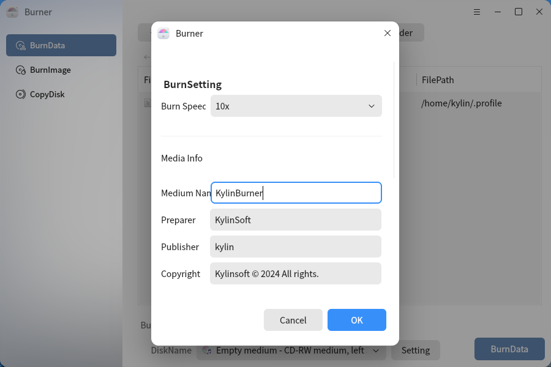

### The Eject

When there is a disc in the record machine, [Eject] button is available, as shown in Figure 11, the user can manually eject the disc; when there is no disc in the record, the [Eject] button is not available in the setting, as shown in the figure 12 shown.

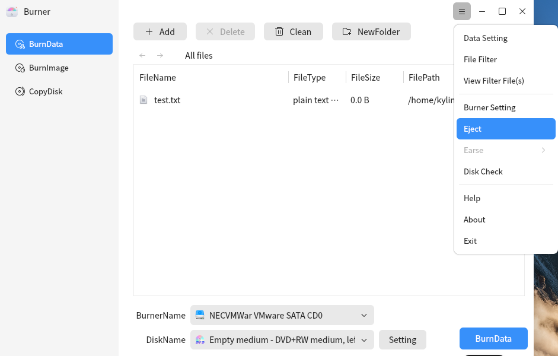

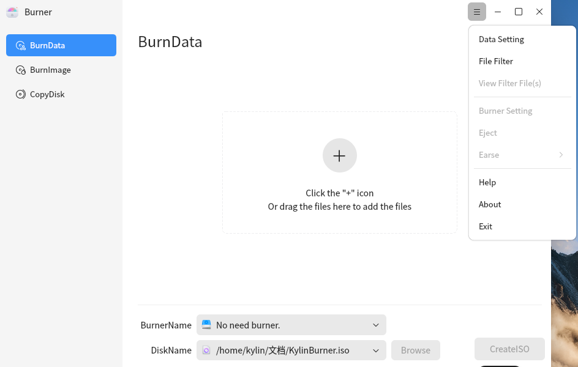

### Erasure

When the type of the disc in the recorder is the RW disk and the optical disk is available, the erase button is available, as shown in Figure 13; other cases the erase button is unavailable and placed. The erase button can erase all data in the disc and burn to the image file of the disc.

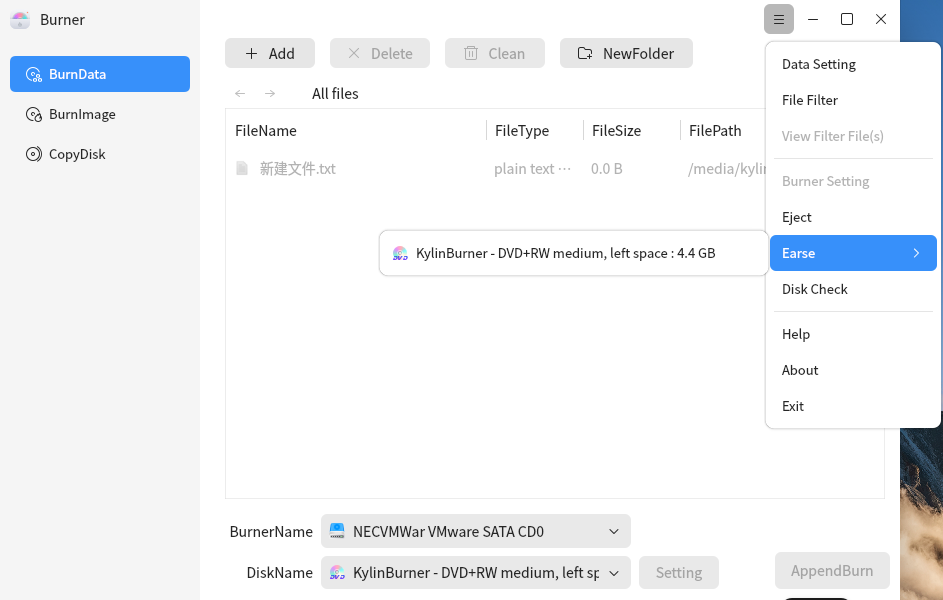

## The Attached Record
### Note
1) Mirror burn can only burn. ISO suffix files.

2) The erase function can only be used for readable and write CD-ROM, CD-ROM can not be erased.

3) When appending the burning, it is not recommended to add the folder or file renamed with the original CD, because the contents in the original folder may be emptied after appending the burning.

### Shortcuts

|shortcuts | functions|
| :-------| :---------|
| Enter | Open folder |
| Ctrl + Enter | Open using local application |
|Alt + a |  Add file |
|Alt + d/Delete  | Delete selected files |
|Alt + c  | Empty file |
|Alt + n  | New folder |
| F1  | Help |
| F2  | Rename |
| F5  | File property |
| Alt + F4 | Exit |
| shift + F10| Open right-click menu |
