# 刻录
## 概 述
刻录是一款界面简洁，基础功能齐全的Linux下光盘刻录软件，其主要实现业务包含创建镜像，数据刻录，数据追加刻录，镜像刻录，镜像提取及光盘复制，其主界面如图1所示。

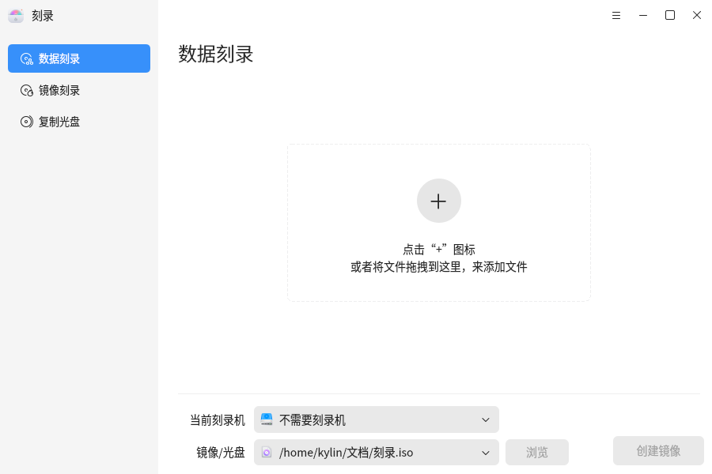
 

## 基本功能
### 数据刻录
数据刻录功能集成了创建镜像，数据刻录及数据追加刻录功能。

用户可点击[添加]按钮来实现添加任意的文件及文件夹到软件内，并可以通过[删除]按钮删除用户选中的不想要的数据，也可以通过[清空]按钮实现删除当前位置下的所有数据。
注意：光盘文件夹下不能再追加文件或文件夹，光盘内原始数据不支持删除或清空操作。

用户可点击[新建文件夹]按钮实现自定义新增节点到要创建的镜像文件，或要刻录的光盘内。由于该文件夹节点不是真实的存在于操作系统文件结构中，所以不支持在本地打开。

用户同样可以拖拽文件或文件夹到数据展示的空白区域，实现文件或文件夹的添加。

数据刻录界面会展示当前已添加到刻录软件内所有文件的总大小，其展示在右上角项目大小位置，当其展示颜色为红色时，表示添加的文件过多或没有文件，不能进行业务操作；为绿色时，表示可以进行业务操作。

界面中会显示添加的文件名称、类型、大小和路径；下方会显示当前刻录机、光盘型号（如果生成镜像文件，则显示“镜像文件”）。

其具体细节信息如图2红色框内所示。

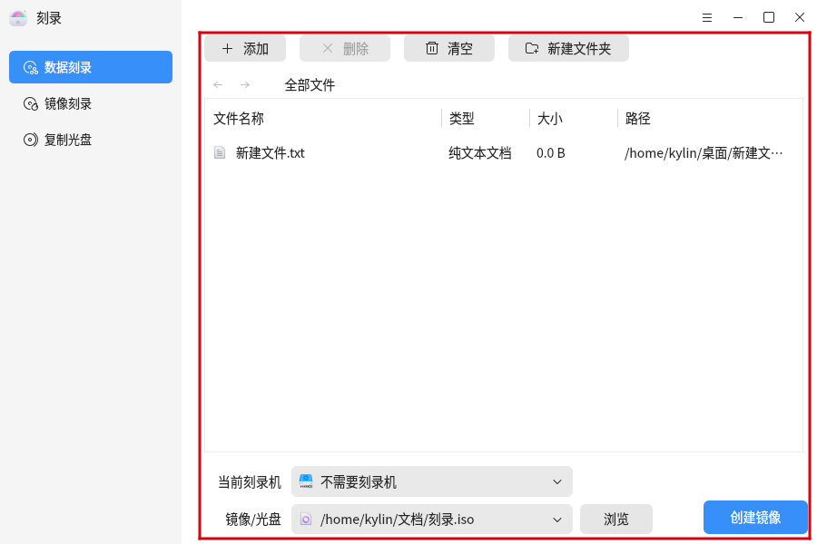

当用户在执行创建镜像业务时，可点击下方[浏览]按钮自定义存放镜像文件的路径，而在需要修改存放镜像的名称时，需要用户在菜单刻录设置中进行镜像名称的修改。

其具体操作如图3，图4 所示：

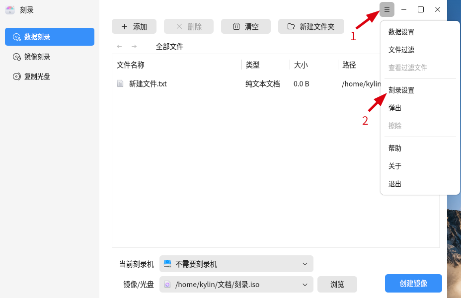 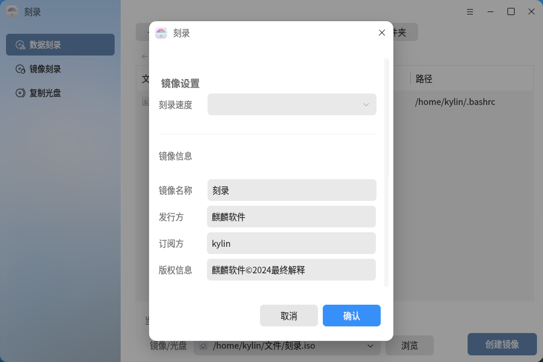

同时，用户也可以根据自身需要，设置镜像的其他信息。

用户可以根据下方下拉选项（刻录机下拉选项与光盘名称下拉选项联动）的不同，切换所执行业务逻辑，当选择空白光盘时，刻录会自动切换处理逻辑到数据刻录；选择[不需要刻录机]选项时，自动切换逻辑为创建镜像；同理，切换到可追加刻录光盘时，自动切换逻辑为数据追加刻录。与此同时，界面右下角的业务按钮名称也会随之改变为：

创建镜像：处理创建镜像业务逻辑，所添加文件会封装为符合ISO 9660 标准的ISO镜像文件；

数据刻录：处理数据刻录业务逻辑，所添加文件会刻录到当前下拉选项所选中的光驱的空白光盘内，并以刻录设置中[镜像名称]所填内容命名光盘；

追加刻录：处理数据追加刻录业务逻辑，所添加文件会追加刻录到所选中光盘中，并不会修改光盘原有（包含名称等）所有内容；（注意：若添加与光盘原内容冲突的文件，会导致光盘原有相同内容被擦除的操作，请谨慎添加数据）

无法刻录：表示当前选中光盘为完整刻录光盘，无法再继续追加刻录任何内容。

### 刻录镜像

刻录镜像是以方便用户选择自定义ISO 9660 标准的ISO镜像文件，刻录到空白光盘的功能。

刻录镜像界面如图5所示

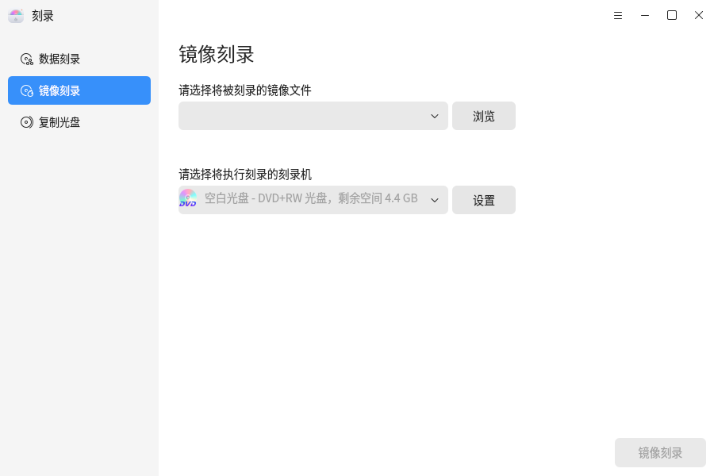

用户可参考以下步骤完成镜像刻录：

1）点击[浏览]按钮，选择存在于当前操作系统内的ISO镜像文件，并会在软件中显示镜像名称及大小；

2）刻录软件会自动识别当前链接的物理光驱内光盘是否为空白光盘；

3）若镜像文件有效，切光盘为空，用户通过点击[刻录镜像]按钮，实现镜像刻录。

### 复制光盘

复制光盘是方便用户将光盘中内容提取到遵从ISO 9660 标准的ISO镜像文件，或额外的空白光盘中。

其界面展示如图6所示

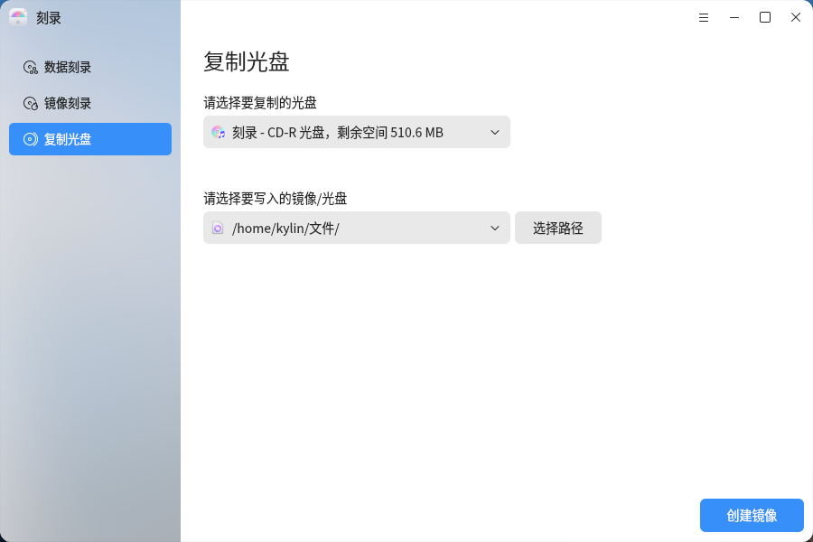

其中上方下拉框表示源，下方下拉框表示目标，即用户操作会将源内光盘所承载信息刻录至目标内所承载位置（位置为系统内位置或空白光盘）。

用户可参考以下步骤，尝试完成提取镜像或光盘复制：

1）刻录软件自身会识别光驱中光盘内容，将有内容的光盘分发到源位置，空白光盘分发到目标位置；

2）用户可自行选择要复制的源；

3）若用户希望将源内文件提取为ISO镜像文件，用户可自行浏览镜像存储位置；若希望实现光盘复制，则可选择目标位置内的空白光盘；

4）待准备就绪后，用户可点击右下角业务按钮，实现对应业务逻辑。

注意：镜像提取提取出的镜像文件名同源光盘名称，不支持用户自定义其文件名。

 

## 高级功能
点击右上角的“”图标，可进行其他操作。

### 数据设置 

刻录软件在操作[数据刻录]功能时，提供[数据设置]选项，以方便用户实现数据的快速操作处理。其具体功能如下图：

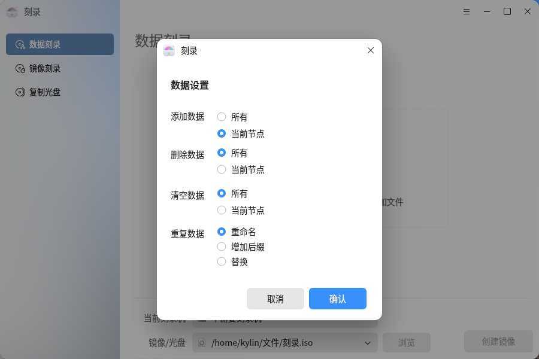

当[数据刻录]支撑多业务时，用户可在对应标签后勾选“全部”选项，实现数据的快速添加，删除及清空。（多个下拉菜单对应的文件节点同步实现）

在处理命名有冲突的文件时，提供“重命名”，“添加后缀”及替换三种方案供用户选择。

重命名：由用户自身重新命名要添加的文件（不建议批量添加时勾选此选项）

添加后缀：刻录软件自动在文件名后添加“_X”型的后缀已区分，“X”表示数字。

替换：刻录软件自动由后添加文件替换旧的重复文件，但不会替换光盘原有文件。

注意：在执行追加刻录时，当出现重复文件夹时，可能导致追加刻录后，文件夹内内容损坏，不建议执行“重命名”或“添加后缀”选项来解决此种类似冲突文件。

### 文件过滤

刻录软件为了方便用户操作数据，特提供文件过滤功能，供用户将某些特定文件内容过滤出数据集中，并同时保存在软件内，供用户随时恢复。

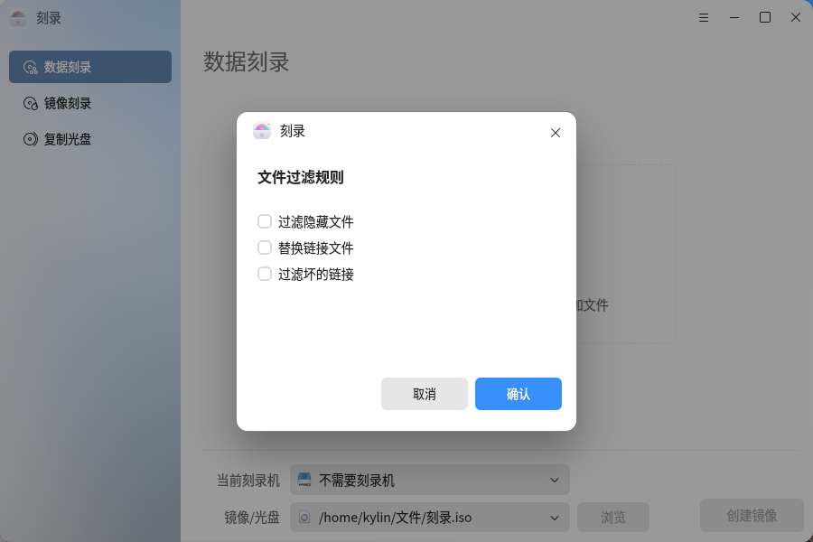

过滤隐藏文件：将隐藏属性的文件或文件夹过滤出数据集；

过滤坏的链接文件：将没有目标的链接文件过滤出数据集；

替换链接文件：用链接文件的目标文件替换其自身在数据集中的位置。

### 查看过滤文件

查看执行文件过滤后，被过滤的文件组成的数据集。

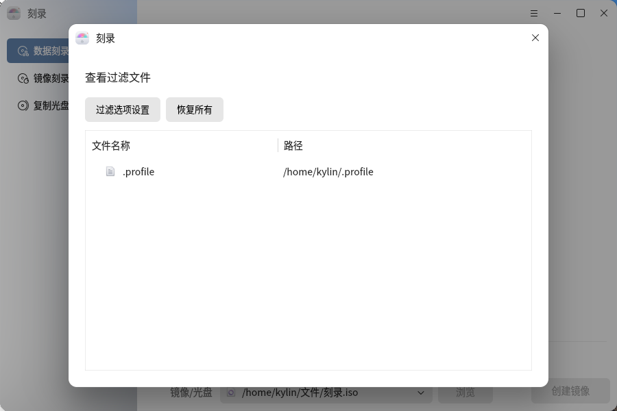

### 刻录设置 

刻录设置中可以选择刻录速度，更改镜像信息（包括发行方、订阅方、镜像名称和版权信息）以及临时路径。如图10所示：

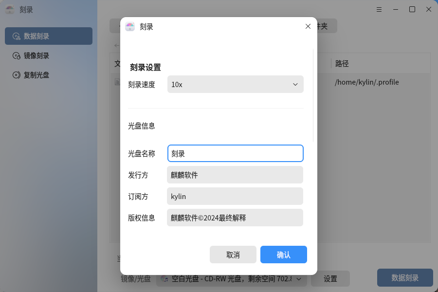

### 弹 出 

当刻录机中有光盘时，[弹出]按钮可用，如图11所示，用户可以手动弹出光盘；当刻录机中没有光盘时，在设置中的[弹出]按钮不可用且置灰，如图12所示。

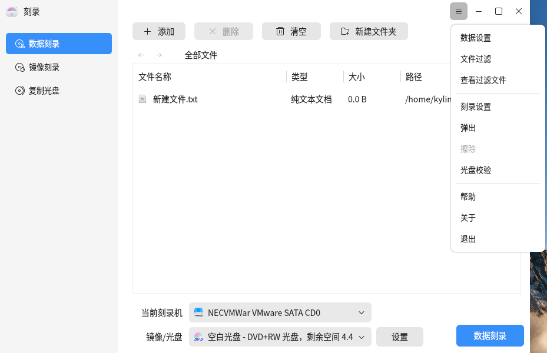

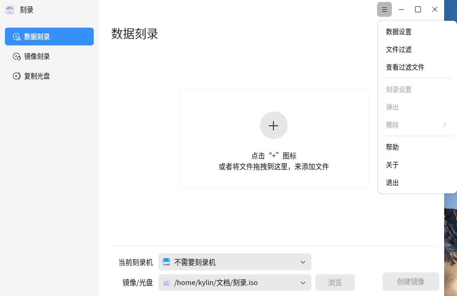

### 擦 除 

当刻录机中的光盘的类型是RW盘且光盘有数据或刻录好的镜像存在时，擦除按钮可用，如图13所示；其他情况下擦除按钮不可用且置灰。擦除按钮可以擦除光盘中的所有数据和刻录到光盘的镜像文件。

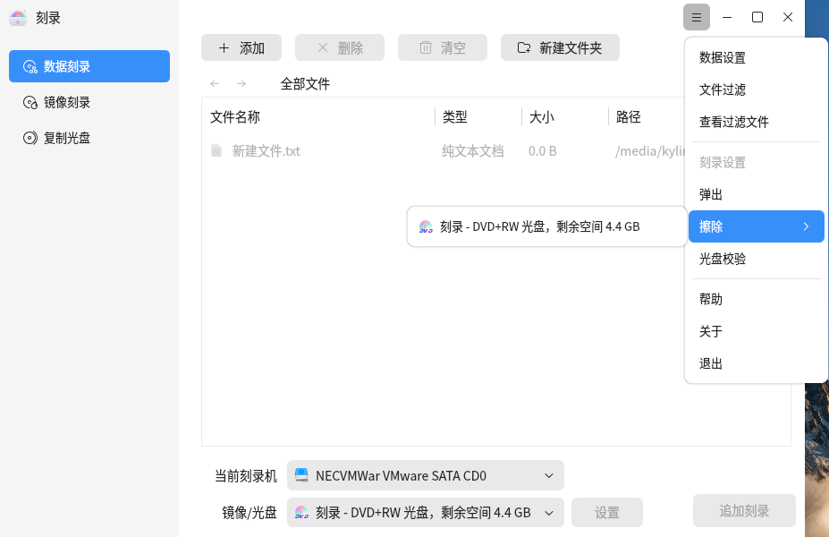

 

## 附 录
### 注意事项
1）镜像刻录只能刻录.iso后缀的文件。

2）清除功能只可以用于可读可写的光盘，只读光盘不能进行擦除操作。

3) 追加刻录时，不建议添加与原光盘内重命名的文件夹或文件，可能导致追加刻录后原文件夹内内容清空。

### 快捷键

| 快捷键 | 功能 |
| :------------ | :------------ |
| Enter | 打开文件夹 |
| Ctrl + Enter | 使用本地应用打开 |
| Alt + a | 添加文件 |
| Alt + d / Delete | 删除选中文件 |
| Alt + c | 清空文件 |
| Alt + n | 新建文件夹 |
| F1      | 帮助 |
| F2      | 重命名 |
| F5      | 文件属性 |
| Alt + F4| 退出 |
| shift + F10| 展开右键菜单 |

