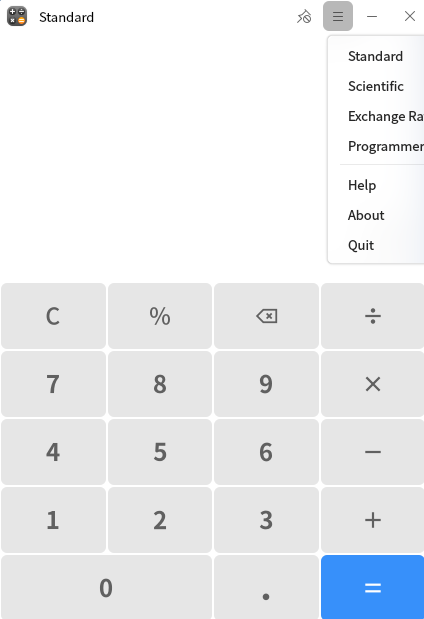
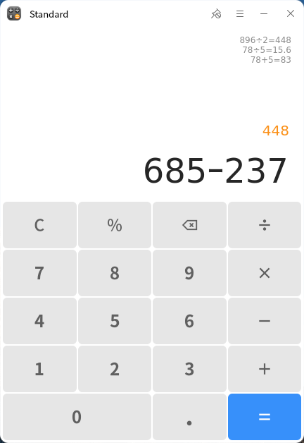
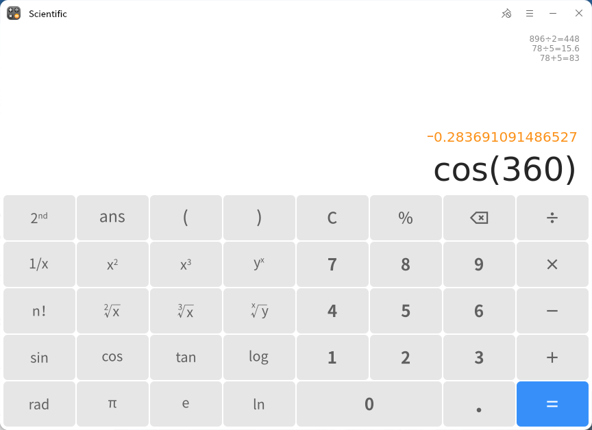
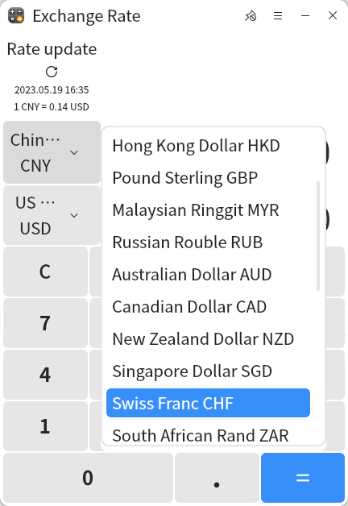
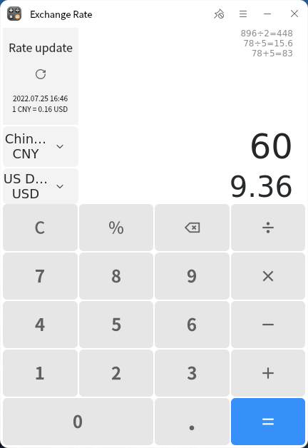
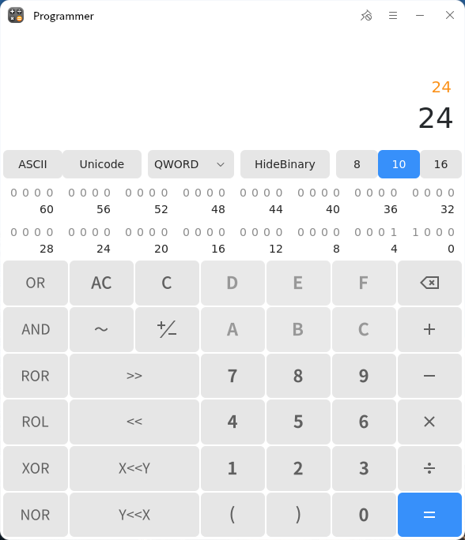

# calculator
## Summary
Calculator is an efficient and practical desktop computing tool developed by ourselves. It provides standard calculation, scientific calculation, exchange rate conversion and programmer calculation mode, and can complete complex mathematical calculation, currency conversion and programming calculation; It supports complete records of the calculation process, which is convenient for viewing and editing the calculation process at any time.
 

### Open mode

"Start menu">"Calculator" or "taskbar">"Search">"Calculator"

### Basic operation

The calculator integrates standard calculation, scientific calculation, exchange rate conversion and programmer calculation modes. It can switch to the corresponding calculation mode according to different needs. At the same time, it supports three ways of typing numbers, operators and expressions with mouse and keyboard:

Click the virtual key on the calculator interface with the mouse;

Select the calculator interface symbol with "↑", "↓", "→" and "←" on the keyboard, and then press "enter" to type;

Directly type numbers or operators through the keyboard (Note: the keyboard of operators needs to use the combination of "shift" + "symbol", such as typing" ×" Press the "shift" + "*" key.

After typing the formula, press the "enter" key or click "=" in the calculator to display the calculation results. The symbol "C" on the calculator interface is the clear key. Click "C" to clear all the currently entered contents to 0; Click "AC" in programmer's calculation to clear all historical calculation records; "" is the delete key. Click forward to delete one number or character at a time.

In the calculator interface, click""You can place the calculator on the desktop and click""Cancel topping. Click""The calculator menu bar can be opened, and the calculator calculation mode can be switched in the menu bar. Click "help" to automatically jump to the user manual to view the operation instructions of the tool, and click "about" to view the current version information.

### Standard calculation

Under the standard calculation mode, basic mathematical operations (+, -, ×, ÷, %, supports displaying historical calculation records, copying and pasting calculation results.

### Scientific computing

Under the scientific computing mode, basic mathematical operations (+, -, ×, ÷, %) and advanced function operations (COS, sin, Tan, log, rad, LN, n!...), support the display of historical calculation records, and support the copying and pasting of calculation results.

### Currency converter

In the exchange rate conversion mode, global exchange rate query, real-time exchange rate update and exchange rate conversion are supported, historical conversion records are displayed, and calculation results are copied and pasted.

Select the currency to be converted in the calculator interface and click in exchange rate update""You can view the latest exchange rate, enter the converted currency value, press "enter" or click "=" to get the conversion result.

### Programmer computing

In programmer computing mode, it supports:

ASCII encoding conversion;

Data width selection (byte, word, DWORD, qword);

Binary, octal, decimal, hexadecimal conversion;

Logical operation (or), and, XOR, nor;

Bit operation (~ (reverse by bit) < < (LSH, word bit left), > > (RSH, word bit right), ror (cyclic right), rol (cyclic left));

Displays historical calculation records, and supports copying and pasting calculation results.

