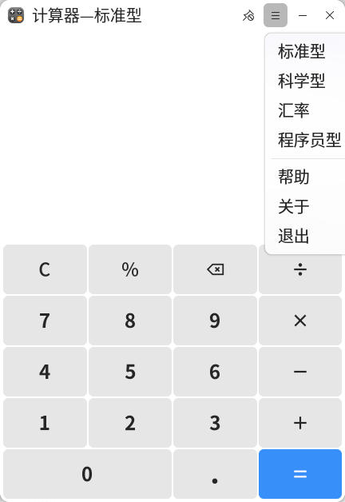
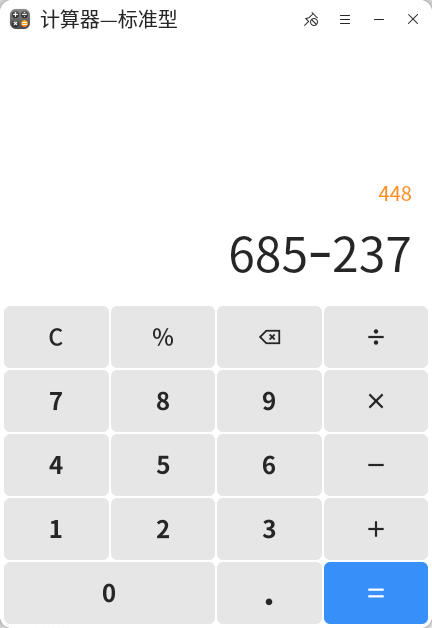
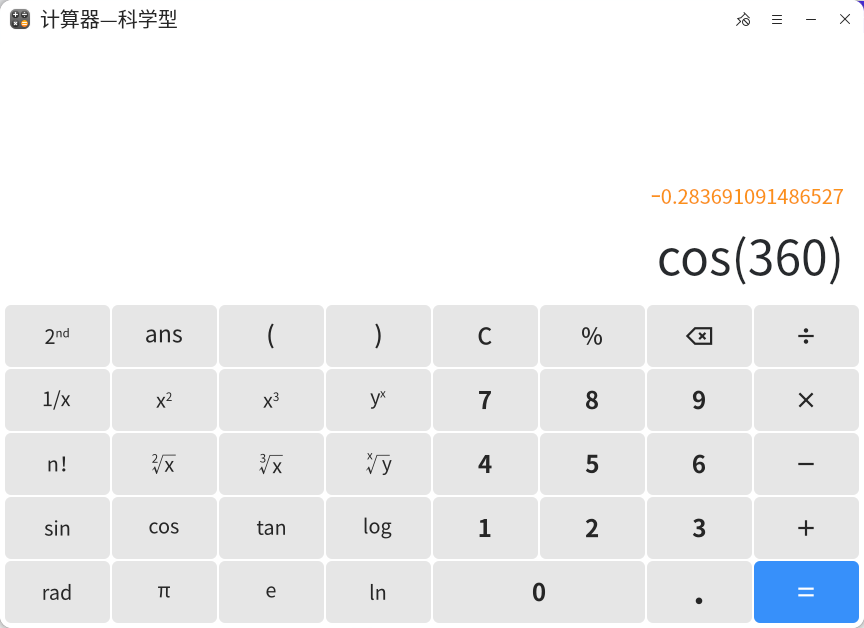
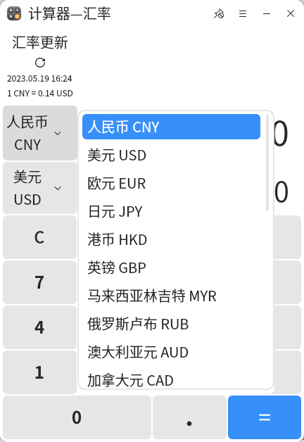
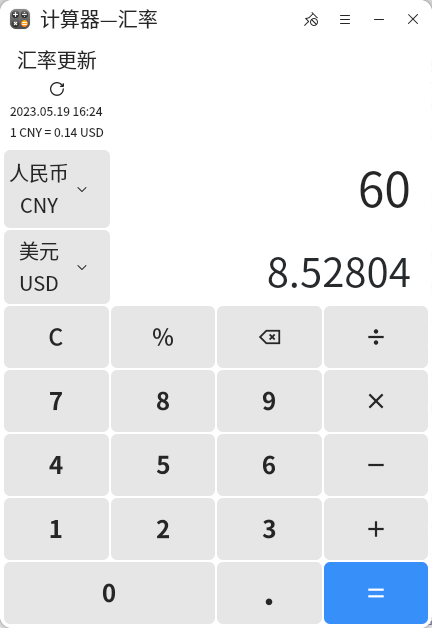
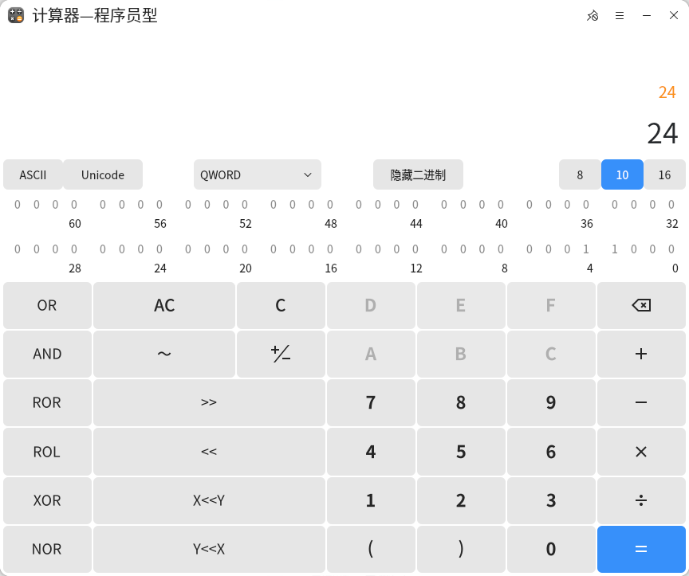

# 计算器
## 概 述
计算器是自研的一款高效、实用的桌面计算工具，提供标准计算、科学计算、汇率换算和程序员计算模式，可完成复杂的数学计算、货币换算、编程计算；支持计算过程完整记录，方便随时查阅编辑运算过程。
 

### 打开方式

“开始菜单”>“计算器”或“任务栏”>“搜索”>“计算器”

### 基本操作

计算器集成了标准计算、科学计算、汇率换算和程序员计算模式，可根据不同需求切换至对应的计算模式，同时支持使用鼠标和键盘键入数字和运算符，键入运算式的三种方式：

通过鼠标点击计算器界面的虚拟键；

通过键盘“↑”、“↓”、“→”、“←”键选择计算器界面符号后按“Enter”键入；

通过键盘直接键入数字或运算符（注意：运算符的键盘键入需使用“shift”+“符号”的组合，如键入“×”需按下“shift”+“*”键）;

键入运算式后，按下“Enter”键或点击计算器中的“=”即可显示计算结果。计算器界面符号“C”为清除键，点击“C”可清除当前输入的全部内容为0；点击程序员计算中的“AC”可清除所有历史计算记录；“”为删除键，点击一次向前删除一个数字或字符。

在计算器界面，点击“”可将计算器置顶在桌面，点击“”取消置顶。点击“”可打开计算器菜单栏，在菜单栏中可切换计算器计算模式。点击“帮助”将自动跳转至用户手册中，可查看该工具的操作说明，点击“关于”可查看当前版本信息。

### 标准计算

标准计算模式下，可进行数学基本运算（＋、－、×、÷、%），支持显示历史计算记录，支持复制、粘贴计算结果。

### 科学计算

科学计算模式下，可进行数学基本运算（＋、－、×、÷、%）和高级函数运算（cos、sin、tan、log、rad、ln、n!...），支持显示历史计算记录，支持复制、粘贴计算结果。

### 汇率换算

汇率换算模式下，支持全球汇率查询、汇率实时更新、汇率换算，支持显示历史换算记录，支持复制、粘贴计算结果。

在计算器界面选择待换算的货币，在汇率更新中点击“”可查看最新汇率，输入换算的货币数值，按“Enter”键或点击“=”可得到换算结果。

### 程序员计算

程序员计算模式下，支持：

ASCII编码转换；

数据宽度选择（BYTE（字节）、WORD（字）、 DWORD（双字） QWORD（四字））；

二进制、八进制、十进制、十六进制转换；

逻辑运算（OR（或）、AND（与）、XOR（异或）、NOR（或非）；

位运算（~（按位取反）<<（Lsh，字位左移），>>（Rsh，字位右移），ROR（循环右移）、ROL（循环左移））；

显示历史计算记录，支持复制、粘贴计算结果。

