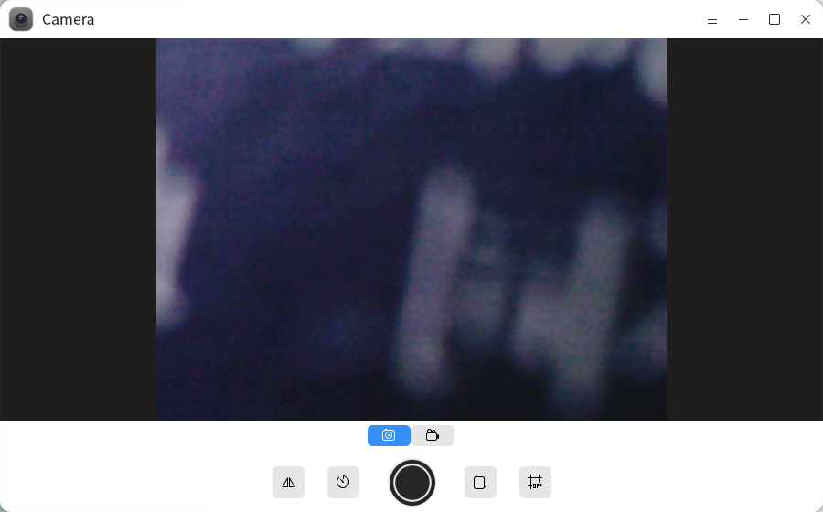
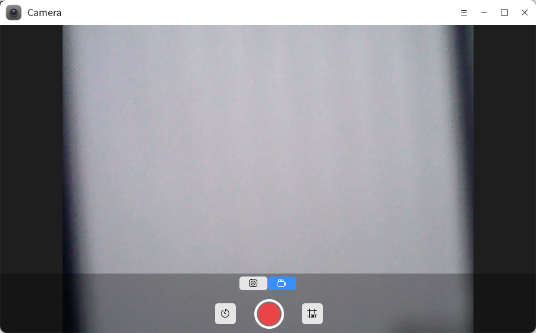
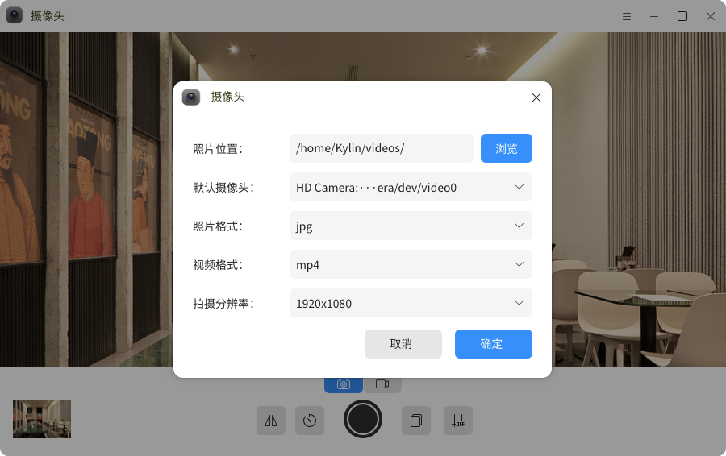

# Camera
## Overview

The camera is a camera tool that comes with the system. It provides two shooting modes, namely, camera and video recording. It supports the functions of setting continuous shooting, delayed shooting, mirror flip shooting, and grid line shooting.

## How to open

-"Start Menu">"Camera"

-"Taskbar">"Search">"Camera"

## Basic operation

Select "" to open the camera mode. Click the capture button to obtain the current photo displayed by the camera and save it to the default storage path. The camera mode supports continuous shooting, delayed shooting, mirror shooting and grid reference line setting. The corresponding function description is shown in the table.

Photo mode function description

|Icon | Name | Description|
| ---------------------- | ------ | -------------- |
|  | Serial shoot | Take multiple pictures in succession|
|  | Delay | Delay shooting|
|  | Mirror | Mirror shooting|
|  | Grid | Set gridline shooting|

Select "" to switch to the recording mode, click the shooting button to start recording, click "" to pause recording, click "" to continue recording, and click "" to end recording. After recording, the recording file will be automatically saved to the default storage path.

Function description of video recording mode

|Icon | Name | Description|
| ---------------------- | ------ | -------------- |
|  | Delay | Delay shooting|
|  | Grid | Set gridline shooting|

Click "" to open the camera menu bar. Click **Set** to open the camera setting window, where you can set the default storage path, default camera, photo format, video format, and shooting resolution of the captured photos or videos. Click **Help** to automatically jump to the user manual, click **About** to view the current version information, and click **Quit** to exit the application.

