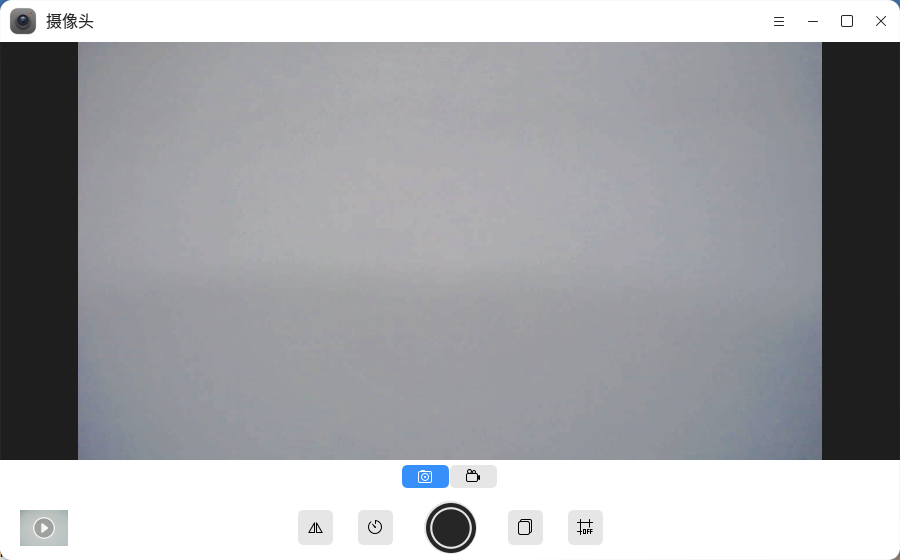
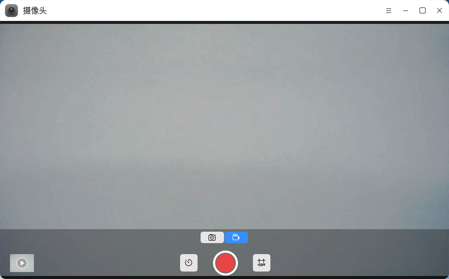
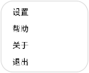
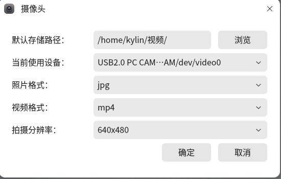

# 相机
## 概 述

相机是一款系统自带的拍摄工具，提供照相和录像两种拍摄模式，支持设置连拍、延时拍摄、镜像翻转拍摄、设置参考线拍摄等功能。

## 打开方式

- “开始菜单”>“相机”
- “任务栏">“搜索">“相机”

## 基本操作

选择“”可打开照相模式，点击拍摄按钮可获得相机显示的当前照片，并保存至默认的存储路径中。照相模式支持连拍、延时拍摄、镜像拍摄和设置网格参考线，对应功能说明如表中所示。

照相模式功能说明

| 图标                   | 名称   | 描述           |
| ---------------------- | ------ | -------------- |
|  | 连拍   | 连续拍摄多张   |
|  | 延时   | 延时拍摄       |
|  | 镜像   | 镜像拍摄       |
|  | 参考线 | 设置参考线拍摄 |

选择“”可切换至录像模式，点击拍摄按钮即开始录像，录像过程中点击“”暂停录像，点击“”继续录像，点击“”结束录像。结束录像后，录像文件将自动保存至默认的存储路径中。

录像模式功能说明

| 图标                   | 名称   | 描述           |
| ---------------------- | ------ | -------------- |
|  | 延时   | 延时拍摄       |
|  | 参考线 | 设置参考线拍摄 |

点击“”可打开相机菜单栏，点击“**选项**”后将弹出相机设置窗口，可对拍摄的照片或录像的默认存储路径、默认摄像头、照片格式、视频格式、拍摄分辨率进行设置。点击“**帮助**”将自动跳转至用户手册中，点击“**关于**”可以查看当前版本信息，点击“**退出**”可以退出应用。

