# 多端协同
## 概述

多端协同是一款能够帮助用户在同一局域网下将麒麟设备以及安卓设备进行快速发现并且进行互联的工具，实现了麒麟设备之间以及麒麟设备与安卓设备之间的快速发现、设备连接、文件共享、屏幕共享、反向控制等基础能力。

## 连接方式

多端协同支持多种连接方式，打开多端协同，点击立即连接，进入连接界面，可以选择多种连接方式，包括设备发现、扫码连接、usb连接以及设备码连接。

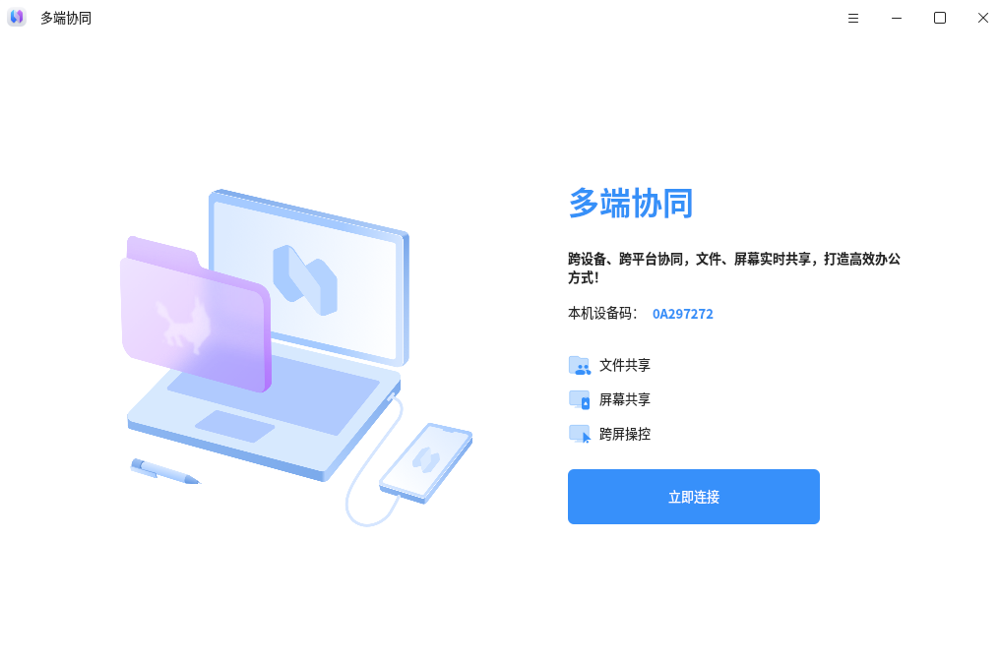
#### 设备发现

打开设备发现，可以发现当前局域网下所有开启多端协同的麒麟设备以及开启多端协同手机app的安卓设备。

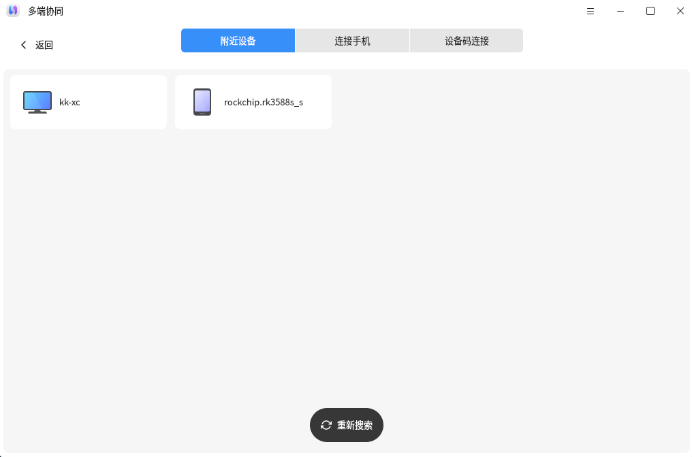

### 扫码连接

进入连接手机页面，可以使用多端协同app扫描多端协同显示的二维码进行连接。

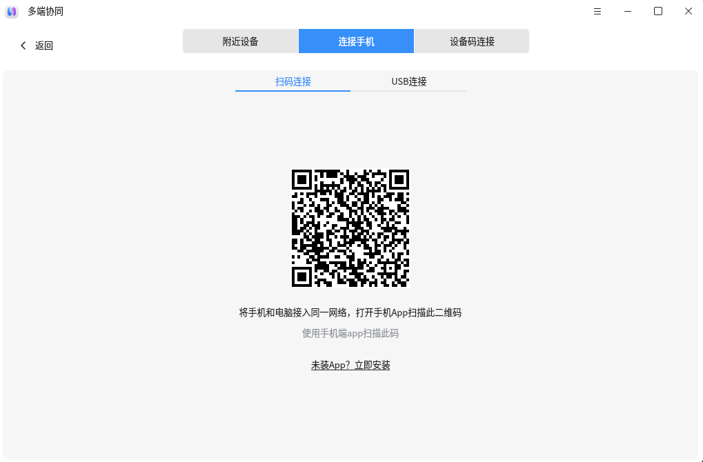

### USB连接

进入USB连接，选择对应设备机型配置教程对设备的USB进行设置，设置完成连接USB并且麒麟设备识别后点击立即连接按钮进行连接。

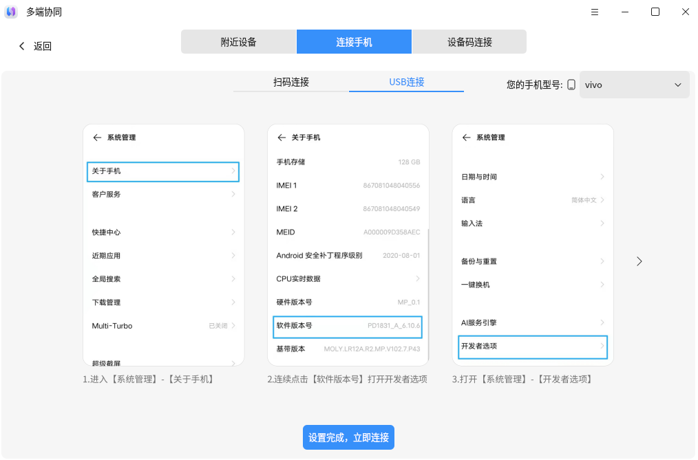

### 设备码连接

进入设备码连接界面，输入在多端协同首页或app首页显示的设备码，然后点击立即连接。

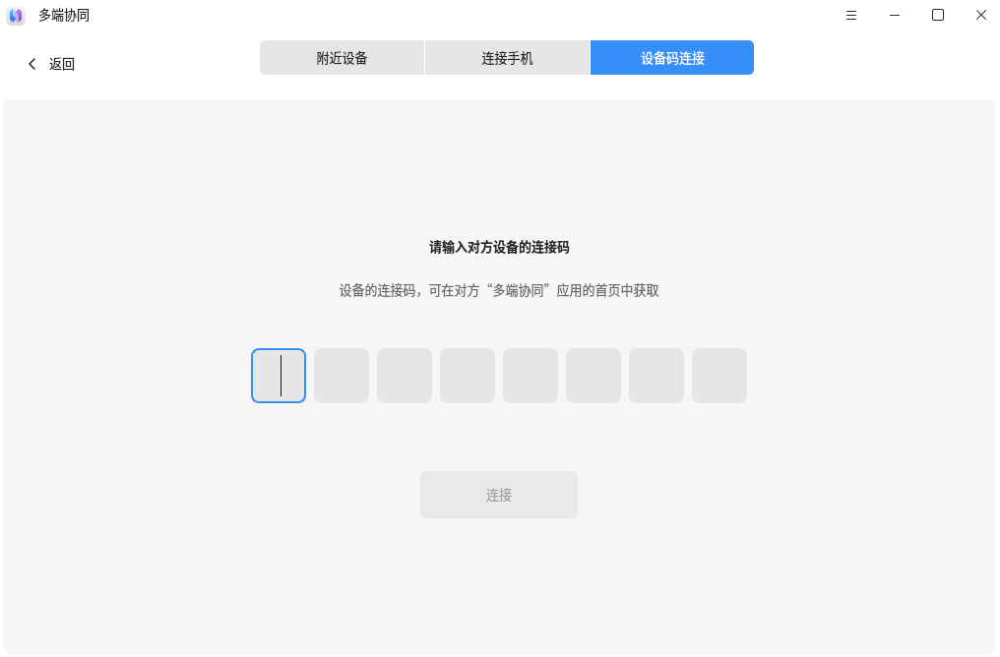

## 文件共享

设备连接成功后，多端协同支持文件搜索、打开文件进行查看以及文件的下载与上传等基础能力。

### 文件搜索

点击搜索导航栏搜索按钮，弹出搜索框，可以搜索已连接设备的所有可访问文件。

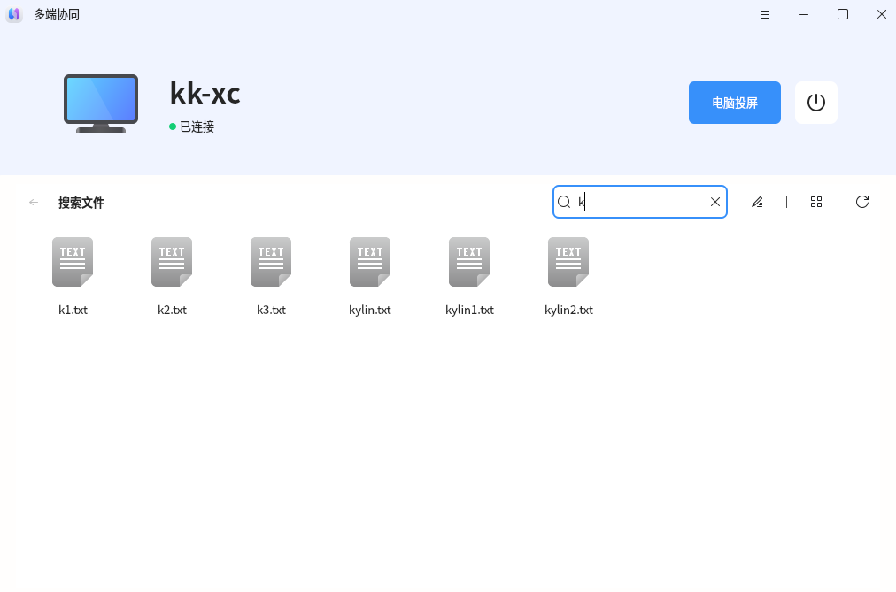

### 文件查看

麒麟设备会显示安卓设备上的多媒体文件以及手机内部存储文件，方便快速浏览。麒麟设备与麒麟设备之间只会显示用户目录下的文件进行共享，双击文件或者右键菜单就可以打开文件进行查看。

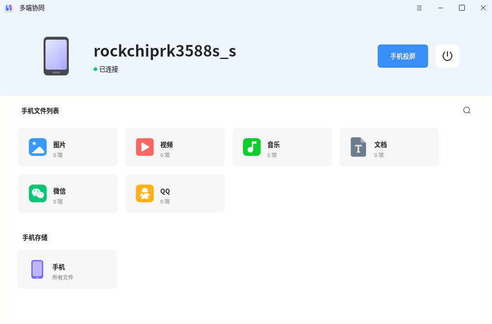

### 文件上传与下载

多端协同连接设备之后，可以选择多端协同中对端设备的文件，点击下载到本地按钮将文件下载到本地，也可以将本地文件拖入多端协同存储目录中将文件上传到对端设备。

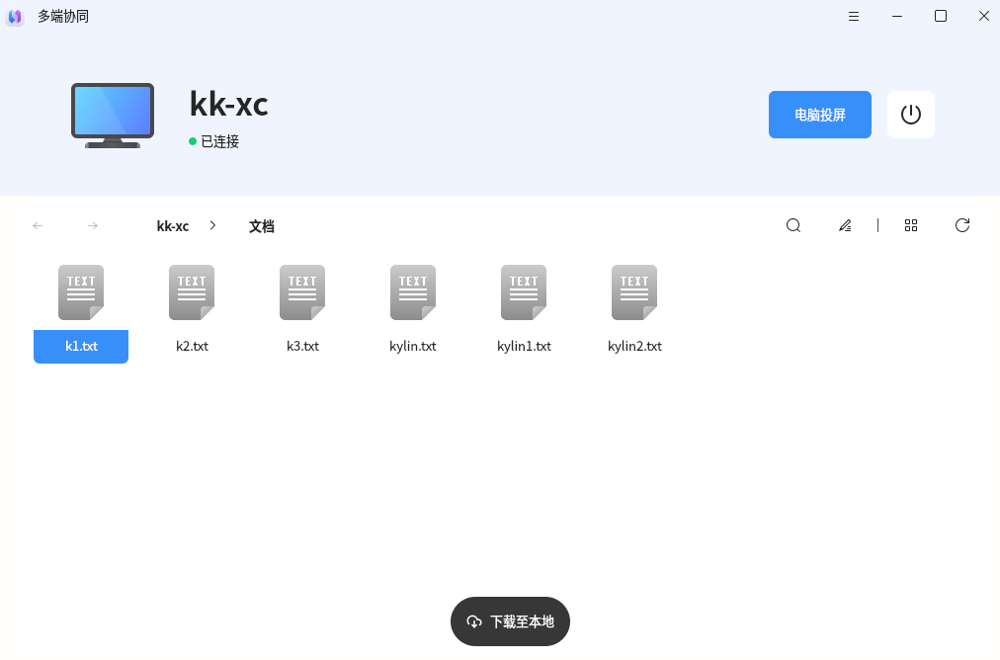

### 文件管理器插件

在文件管理器中存在多端协同的第二个入口，在连接成功之后，可以在文件管理器的左侧导航栏的多端协同选项进入，可以快捷查看对端设备的文件信息。

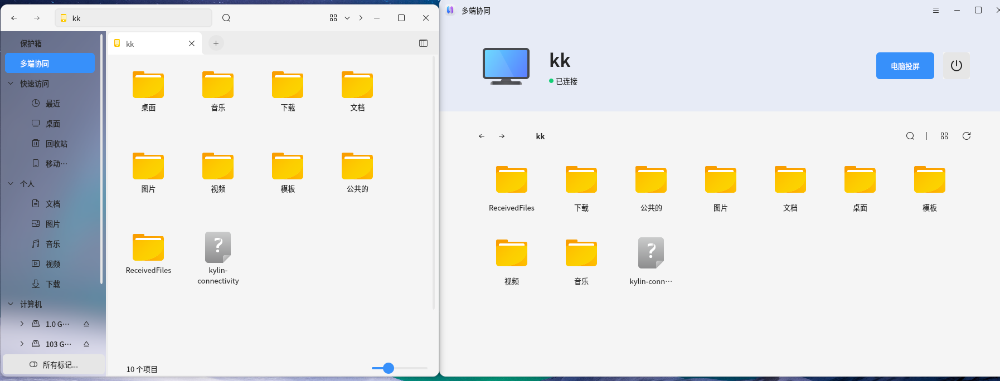

## 屏幕共享&反向控制

对于屏幕共享，需要区分安卓设备与麒麟设备。

### 安卓设备&麒麟设备

安卓设备和麒麟设备连接成功后，点击手机投屏，可将手机屏幕和声音（Android Q以上同步系统声音，Android Q以下同步mic声音），同步到电脑。投屏窗口显示底部三键导航栏代表支持反控操作（ADB连接），点击X可关闭投屏和声音同步，支持全屏和置顶等操作，屏幕可随手机屏幕旋转而旋转。

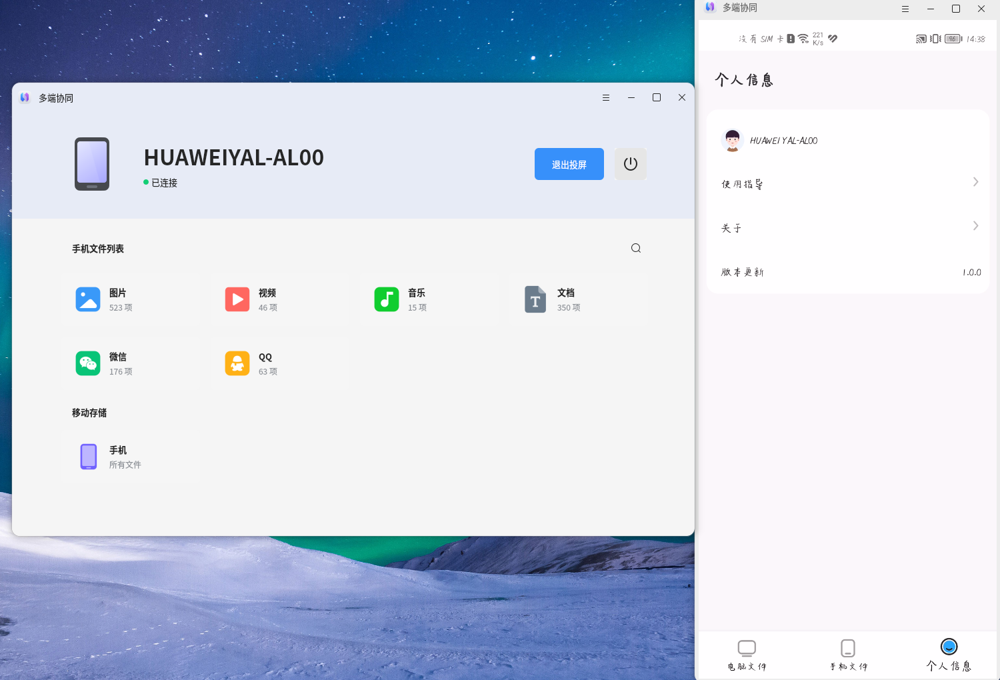

### 麒麟设备与麒麟设备

麒麟设备与麒麟设备连接不同于安卓设备连接，连接发起方点击电脑投屏，会将自己的屏幕分享到对端设备。接收方可以使用上方的悬浮tab对屏幕进行反控、返回桌面以及结束屏幕共享等操作。

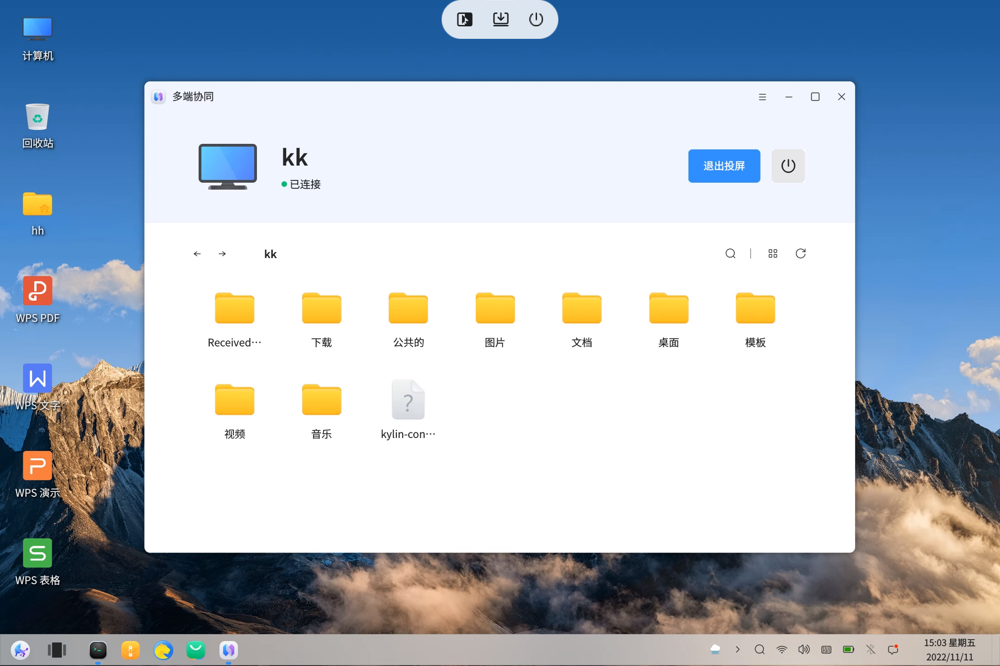

## 断开连接

点击断开连接按钮即可断开连接