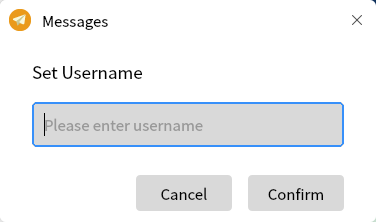
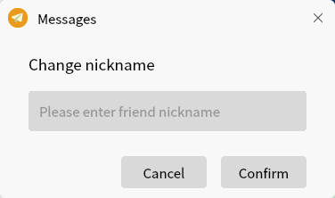
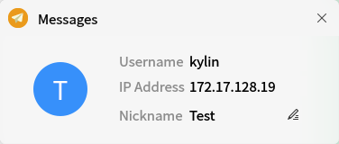
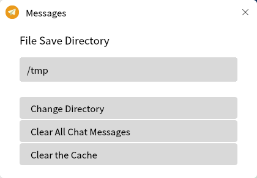
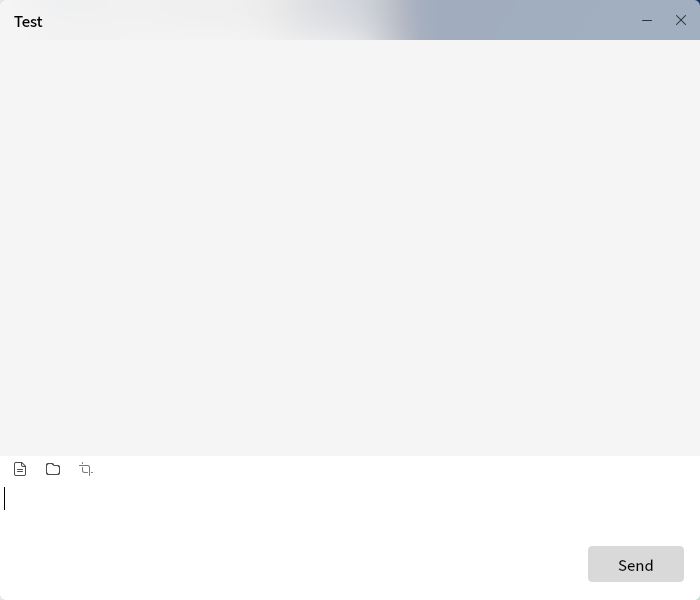

# Messages
## Summary

Transmittal is a cross platform and efficient text / file transmission tool. When users transfer files, they will compare with the local file names to avoid overwriting the original files and losing important information.

There is no server design for book transmission, and all functions are completed through the client

 

### Modify user name

Click""icon to modify the user name.

### Modify friends notes

Right click the friend list to pop up a menu, where you can modify friend notes and view friend information.

### Set up

Click the setting option in the menu bar to make corresponding settings.

### Send message

Double click the friends list to open the chat window. There are three buttons at the bottom of the chat window. You can chat with friends and transfer screenshots, files and folders.

### Help and about

Click Help in the menu bar to open the help manual of the book.

Click "about" to view the information about the leaflet.