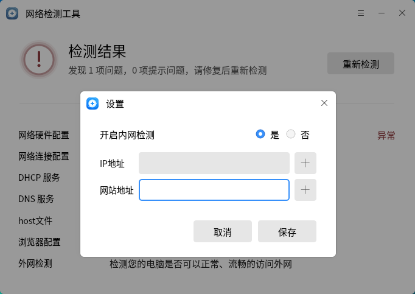

# 网络诊断工具
## 概 述
网络诊断工具是一款网络故障检测工具，可帮助您一键全面诊断网络故障，解决无法上网的问题。同时支持定制化检测内网 IP 是否可达、网站是否能正常服务。
 

## 打开方式
“开始菜单”>“网络诊断工具”或“任务栏”>“搜索”>“网络诊断工具”

## 基本操作
1.外网检测：

打开网络诊断工具，点击“网络检测”一键全面诊断网络故障，解决无法上网的问题（如图1 所示）。

在检测过程中，点击“取消”按钮可手动终止检测。终止后，点击“重新检测”按钮可重新开始检测（如图3 所示）。

查看检测结果，“未发现问题”则表明电脑软硬件配置正常，可正常上网（如图4 所示）；

如网络检测未通过，请查看并修复相关检查项（如图5 所示）。提示:“网络硬件配置”异常时，系统会自动停止其它项目检测。

2.内网检测：

打开“网络诊断工具”，点击右上角更多菜单中“设置”选项，在弹出对话框中选中“是”，配置IP地址和网站地址，点击“保存”按钮，开启内网检测（如图6 所示）。
注：内网检测最多支持输入5个IP 地址和5个网站地址。

开启内网检测后，首页检测项目最下方出现“内网检测”项目（如图8 所示）。点击“网络检测”按钮开始检测。

查看检测结果，点击“查看详情”可查看指定IP地址/网站地址连接状态详情（如图9 所示）。

注：设置了多个IP地址/网站地址时，只要有1个IP地址/网站地址通过检测，内网检测结果即判定为正常。

 

