# Kylin Os Manager
## Summary
kylin os manager is an application that provides computer troubleshooting, fault repair, computer garbage cleaning and system gadgets to help you use your computer better.

## Open mode
Click the "**Start Menu**" of the operating system, select and click "**kylin os manager**".

## Basic operation

### Service support

kylin os manager service and support provide functions such as problem feedback, online customer service, self-service, and feedback history, which can be switched by clicking on the top navigation bar.

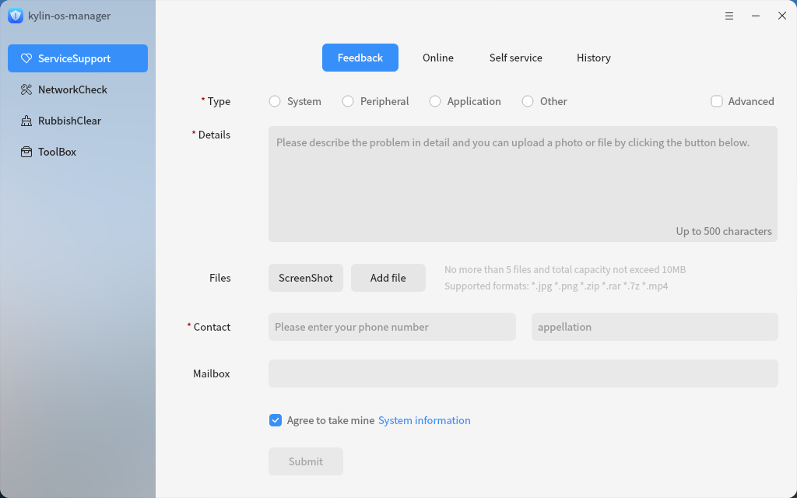

Fill in the problem type, problem description, contact information, email, and other information in the problem feedback interface, and add screenshots or files in the upload attachment. After completing the form, click on the "**Submit**" button below to submit the question.

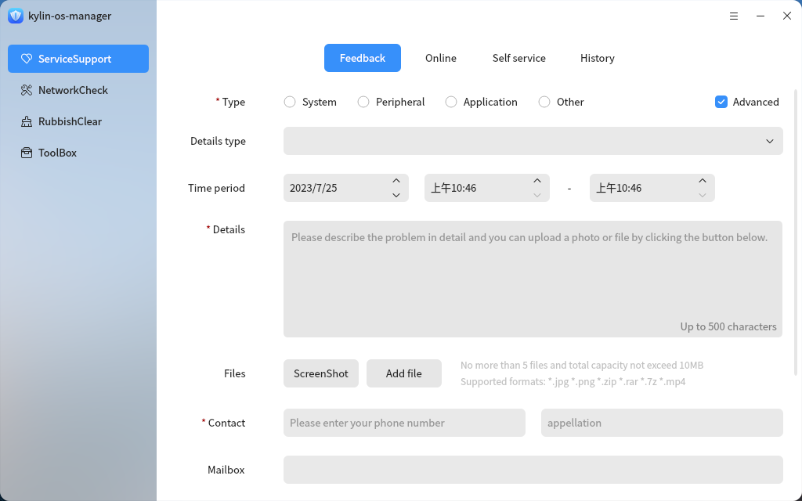

Check the "**Advanced Mode**" checkbox in the upper right corner to fill in more information and provide a more detailed description of the problem.

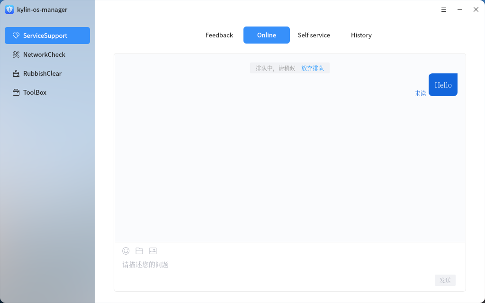

After selecting the corresponding product in the online customer service interface, online problem feedback can be provided.

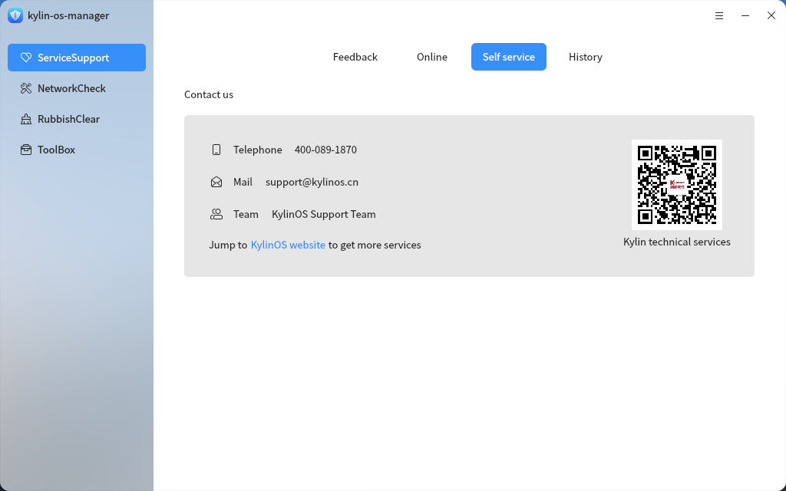

The self-service interface allows for more feedback channels.

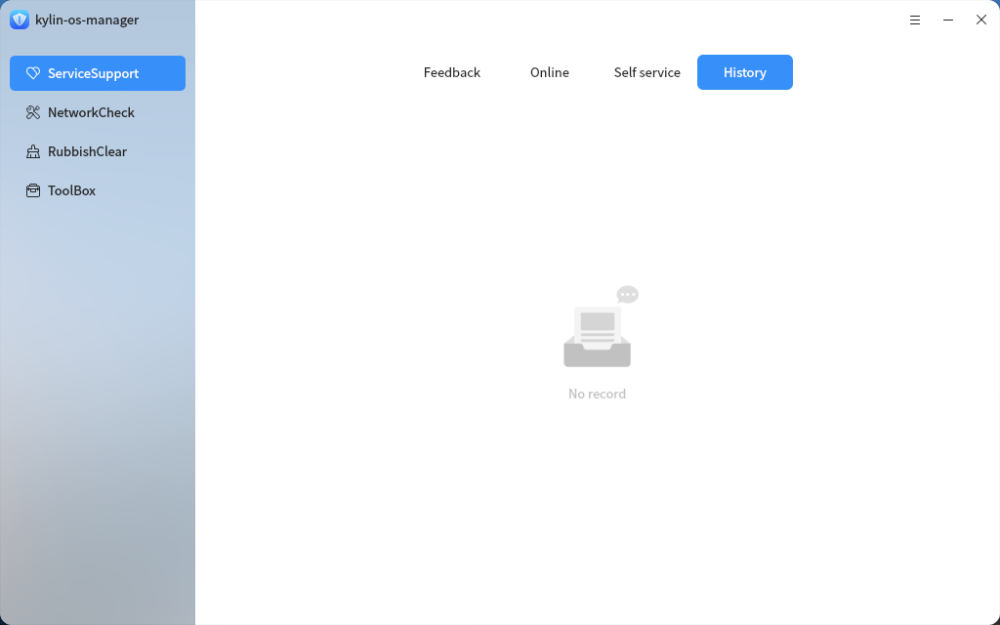

The feedback history interface allows you to view feedback records.

### Fault detection
Click "**Start**" in "**Fault detection**" to start detection.

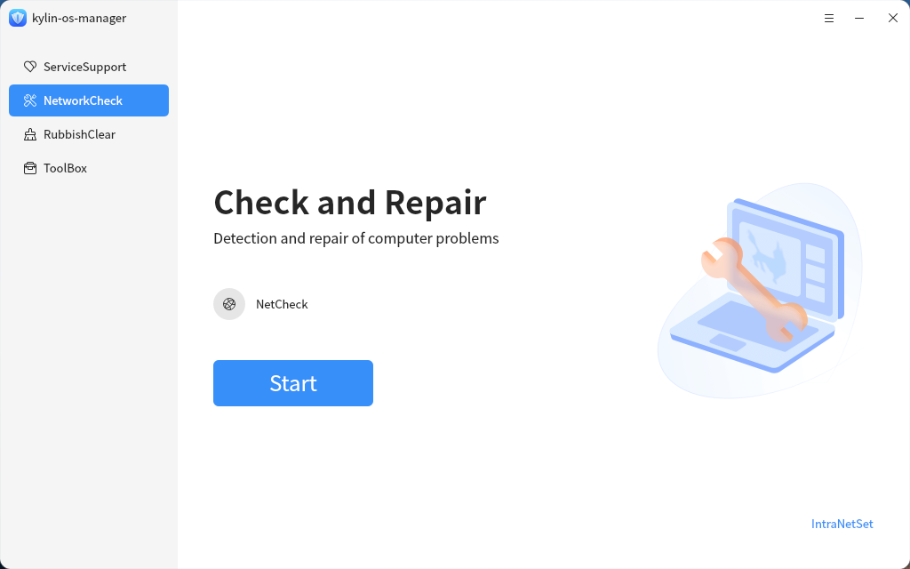

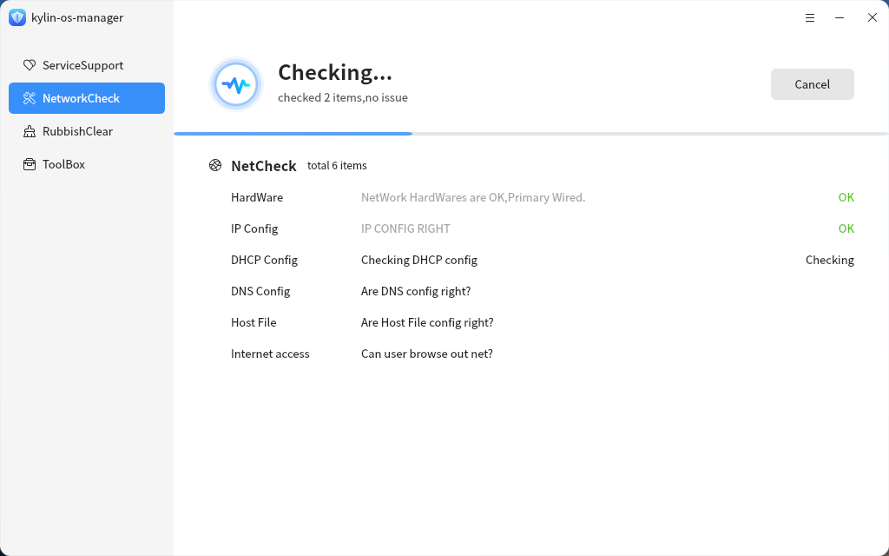

The test results and items shall be provided after the test. The detection items include: HardWare, IP Config, DHCP Config, DNS Config, Host File and AccessNet Check.

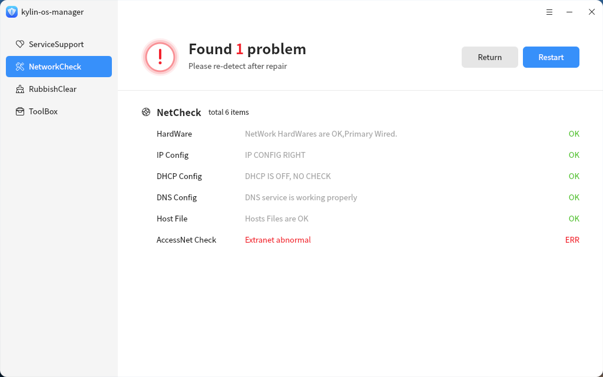

kylin os manager also supports intranet detection. Click "Intranet Detection Settings" in the lower right corner and select "Yes" to enable intranet detection and configure IP address and website address for saving.

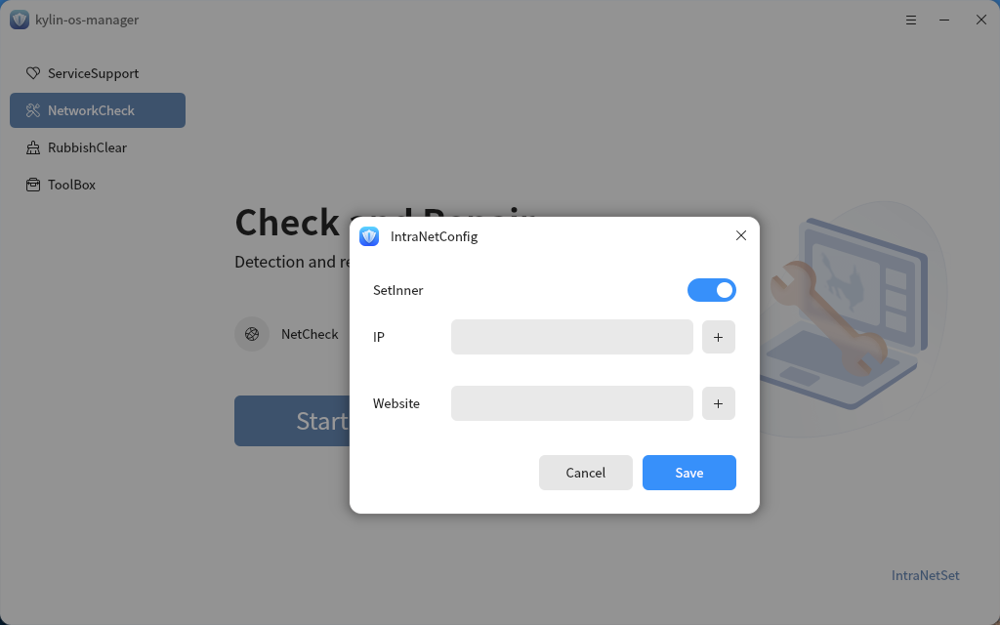

### Garbage removal
kylin os manager supports system garbage cleaning, system cache cleaning, cookies cleaning and historical traces cleaning. You can click the corresponding cleaning item to select the sub items under each cleaning item. The sub items will be displayed according to the current computer environment and user permissions.

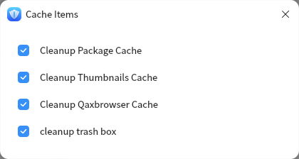 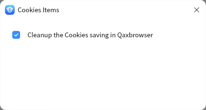 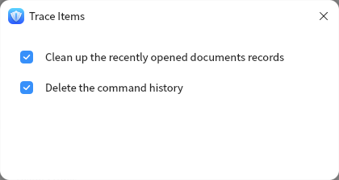

Click "**StartClear**" to start scanning.

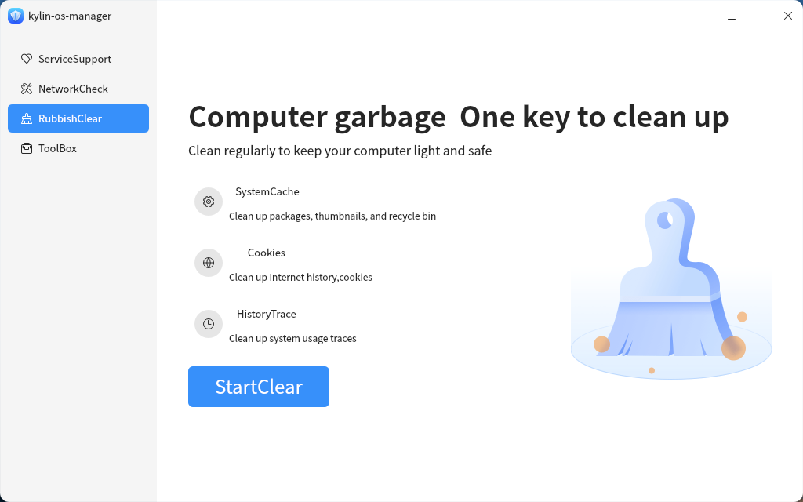

After scanning, the scanning items and cleanable items will be displayed. Click the details to view the detailed cleanable items. Click "**One click cleaning**" to start cleaning

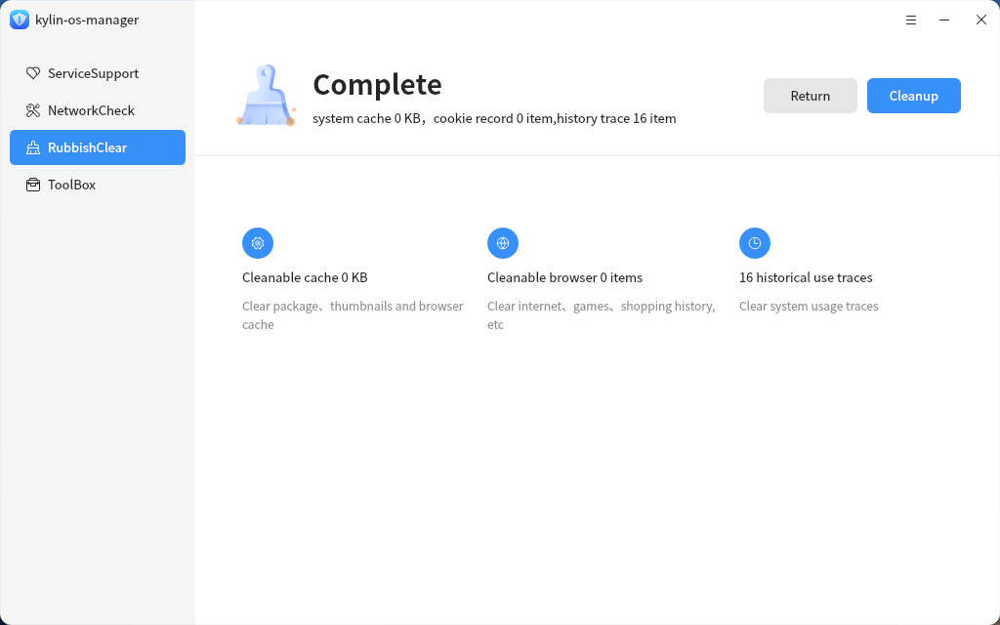

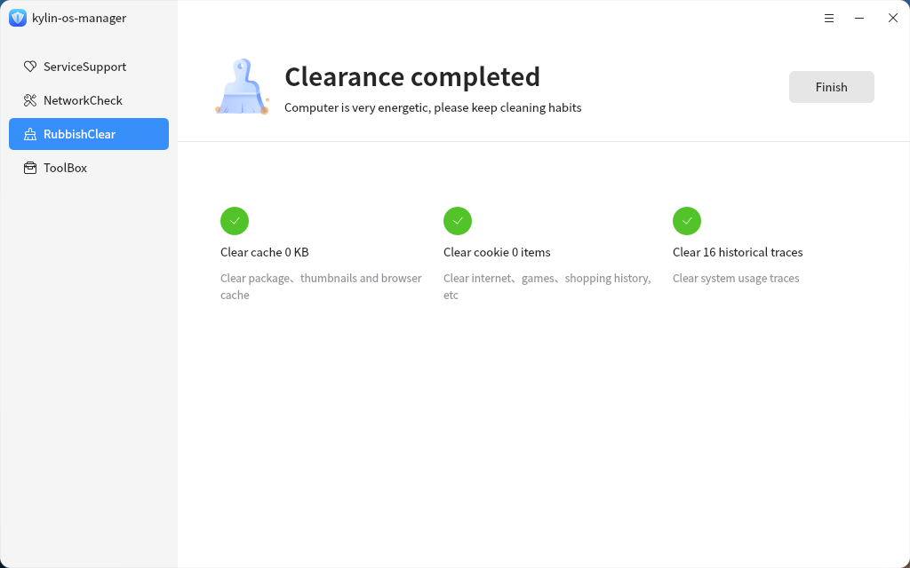

## Treasure chest
The Gallery is used to store all kinds of small tools. Click the interface of the corresponding tool to start the small tools.

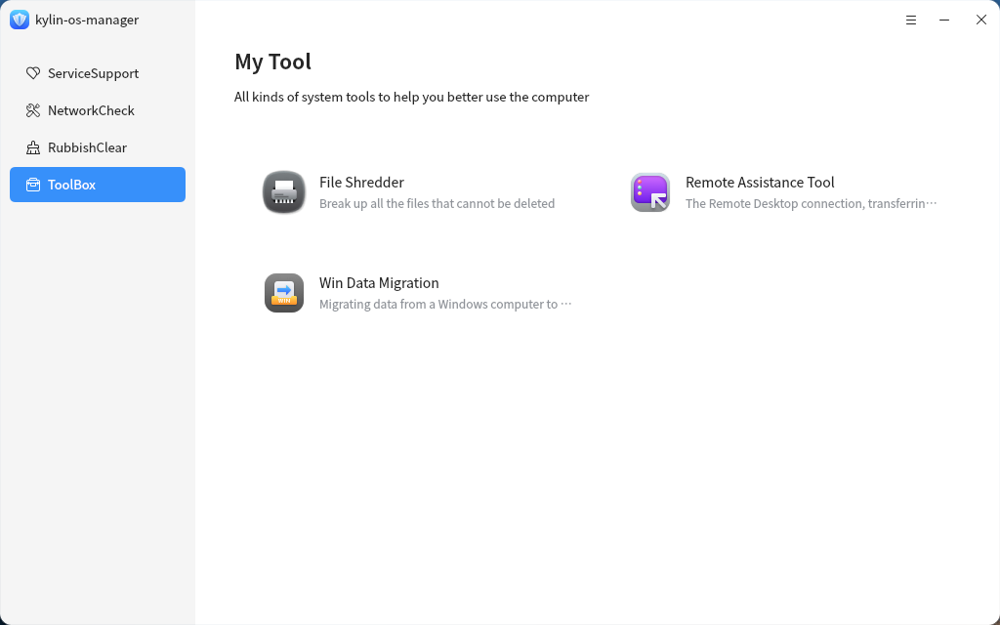
