# 麒麟管家

## 概述
麒麟管家是一款提供问题反馈、电脑故障排查、故障修复、电脑垃圾清理及系统小工具的应用，可以帮助您更好的使用电脑。

## 打开方式
点击操作系统“开始菜单”，选择并点击“麒麟管家”。

## 基本操作

### 服务与支持

麒麟管家服务与支持提供问题反馈、在线客服、自助服务、反馈历史等功能，可以通过点击顶部导航栏来进行切换。

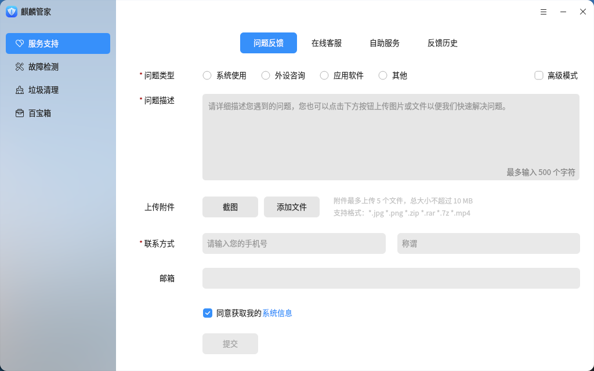

在问题反馈界面填写问题类型、问题描述、联系方式、邮箱等信息，同时在上传附件处添加截图或文件。填写完成后点击下方的“**提交**”按钮即可提交问题。

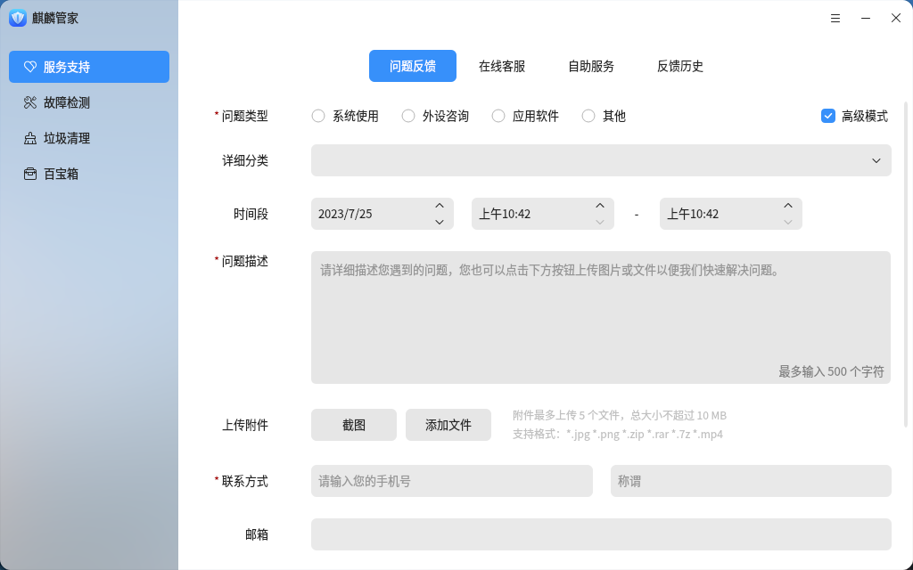

勾选右上方的“**高级模式**”复选框，可以填写更多信息，进行更细致的问题描述。

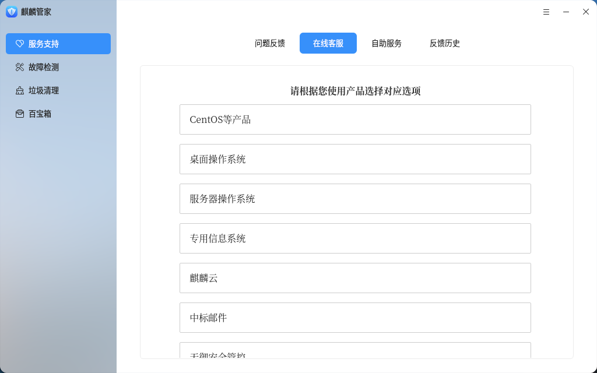

在线客服界面选择对应的产品后，可以进行在线问题反馈。

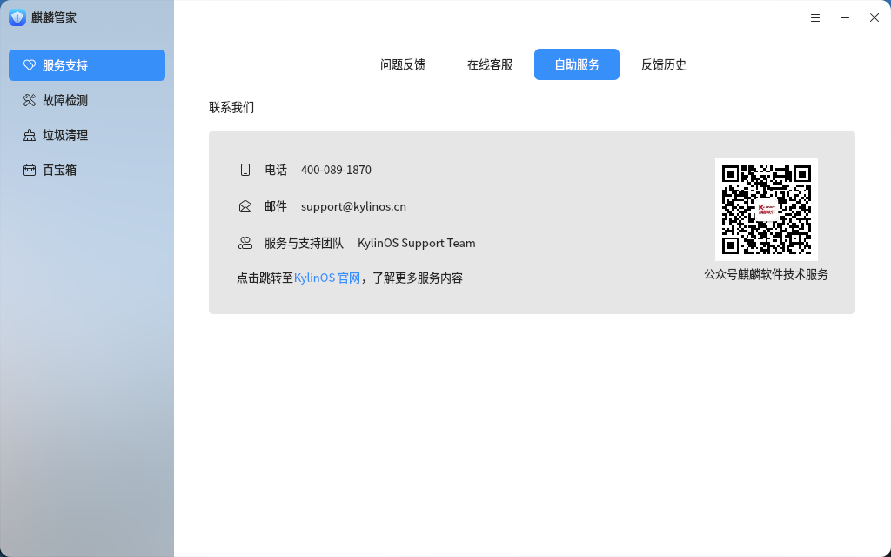

自助服务界面可以获取更多反馈渠道。

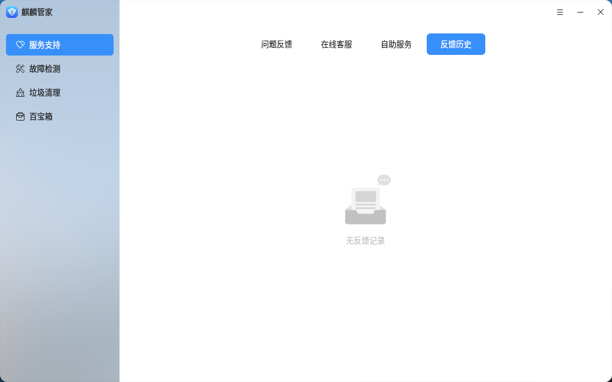

反馈历史界面可以查看反馈记录。

### 故障检测
在“**故障检测**”中点击“**一键检测**”后开启检测。

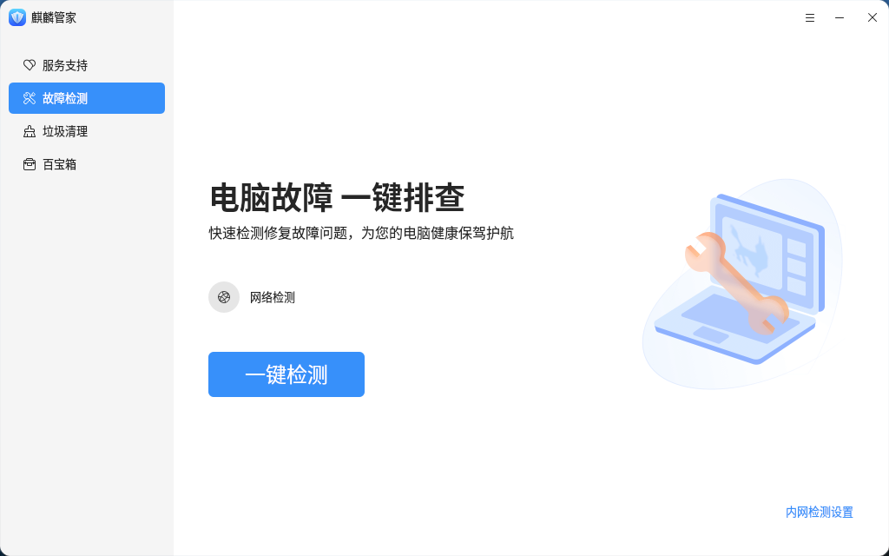

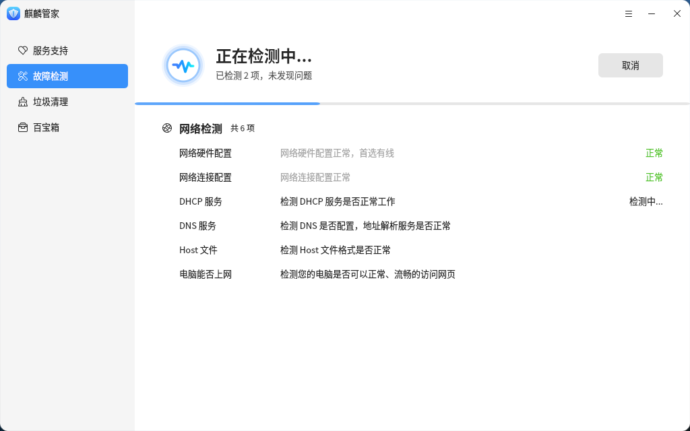

检测结束后提供检测结果及检测项。检测项包括：网络硬件配置、网络连接配置、DHCP 服务、DNS 服务、host 文件、电脑能否上网 6 项。

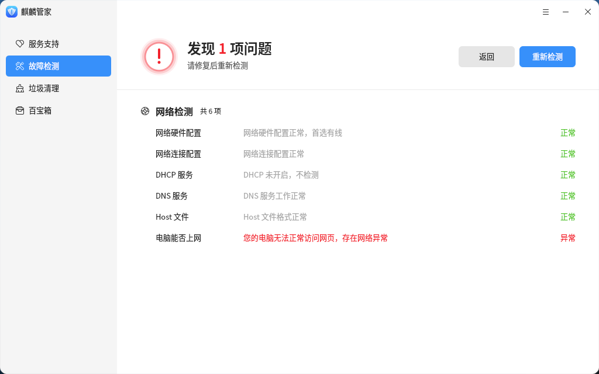

麒麟管家还支持内网检测故障，点击右下角的“内网检测设置”并选择“是”来开启内网检测并配置 IP 地址和网站地址进行保存。

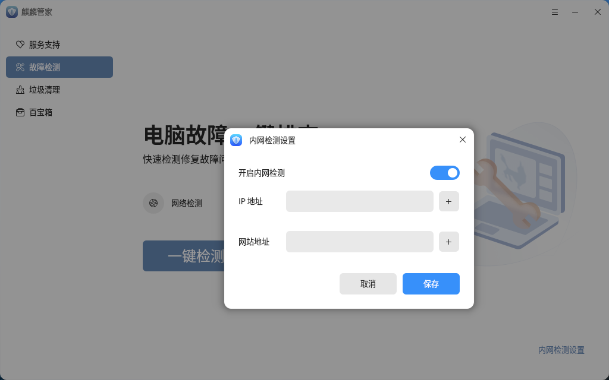

### 垃圾清理
麒麟管家支持系统垃圾清理，支持清理系统缓存、Cookies、历史痕迹，可以点击相应的清理项来选择每个清理项下边的子项，子项会根据当前电脑环境及用户权限来进行相应的显示。

  

点击“**开始扫描**”开启扫描。

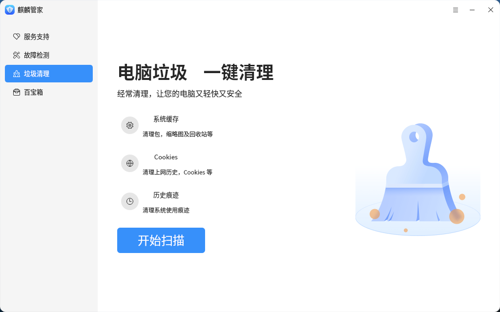

扫描完成后显示扫描项及可清理项，点击详情可以查看详细的可清理项。点击“**一键清理**”开启清理

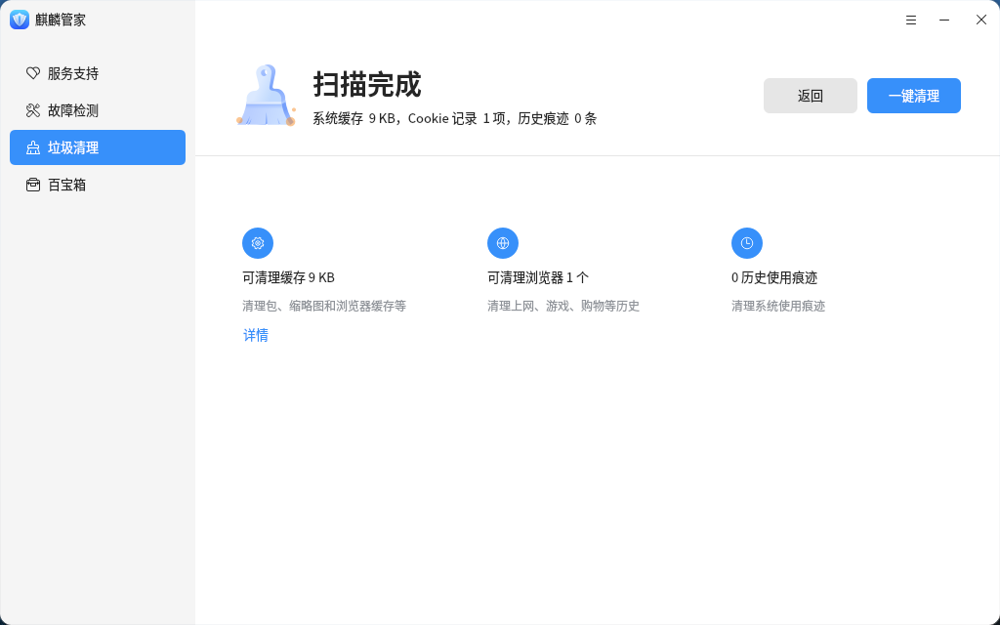

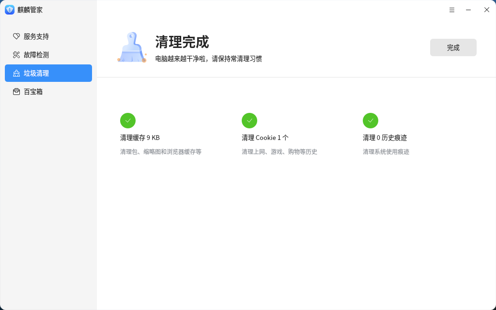

## 百宝箱
百宝箱中用于存放各种各样的小工具，点击相应工具的界面可以启动小工具。

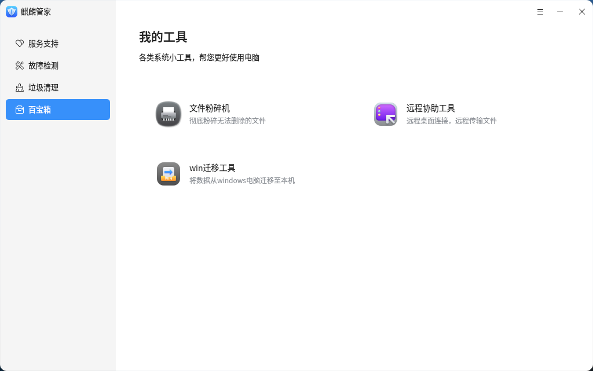
