# 桌面管家

## 概述
桌面管家是一款提供问题反馈、电脑故障排查、故障修复、电脑垃圾清理、设备管理及系统小工具的应用，可以帮助您更好的使用电脑。

## 打开方式
点击操作系统“开始菜单”，选择并点击“桌面管家”。

## 服务支持

桌面管家服务支持提供使用反馈功能，可以点击页面底部的使用反馈选项进入页面。

在使用反馈界面可以填写情况描述同时在上传附件处添加截图或文件。填写完成后点击下方的“**提交申请**”按钮即可提交问题，也可以点击“**仅生成日志**”按钮将日志生成到桌面。

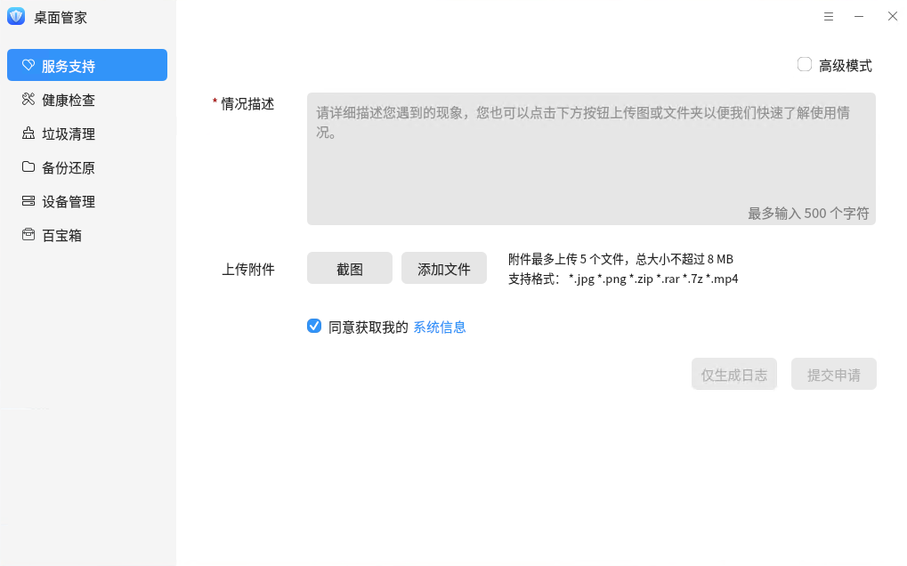

勾选右上方的“**高级模式**”复选框，可以选择是否添加日志。

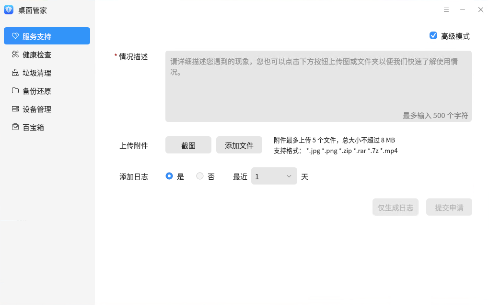

## 健康检查

在“**健康检查**”中点击“**一键检测**”后开启检测。

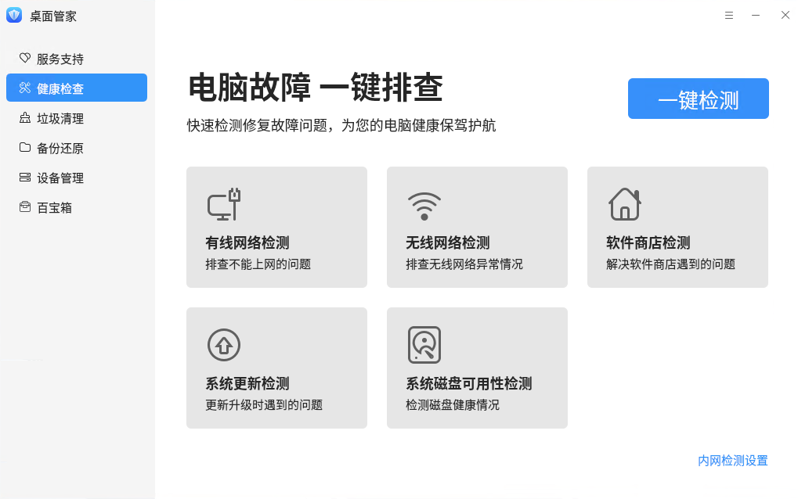

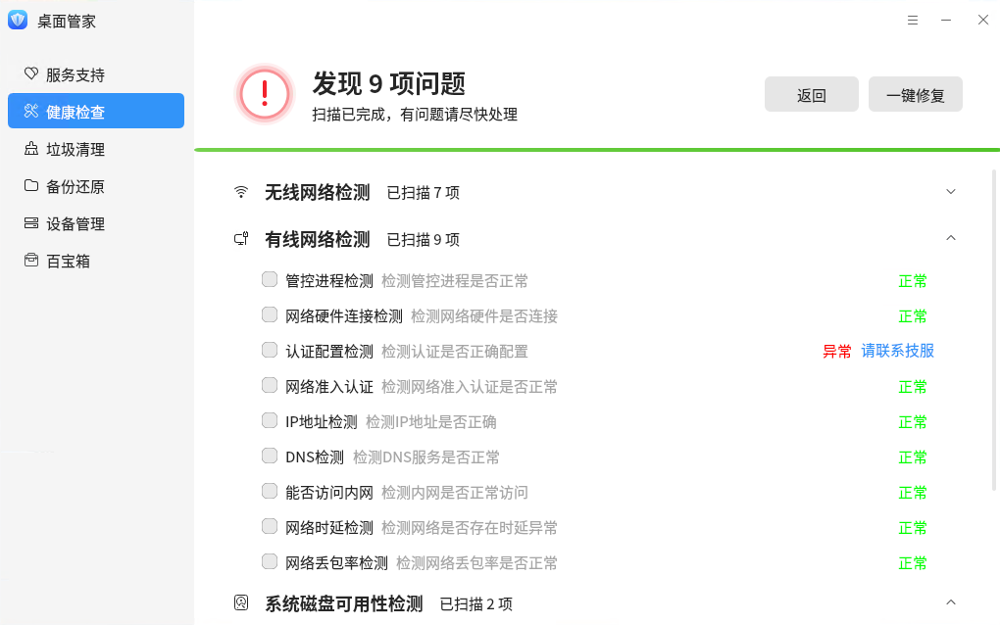

检测结束后会显示检测结果。

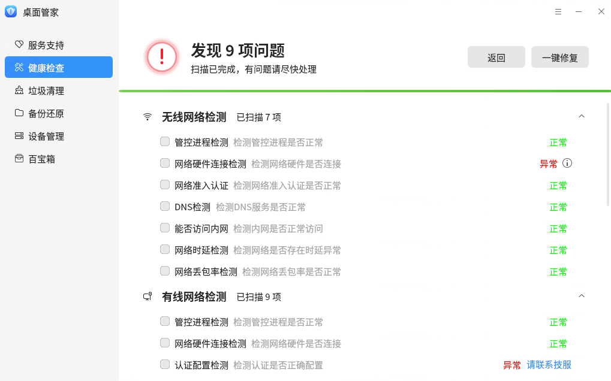

健康检查支持专项检查，点击下方对应的选项卡即可进行专项检查。

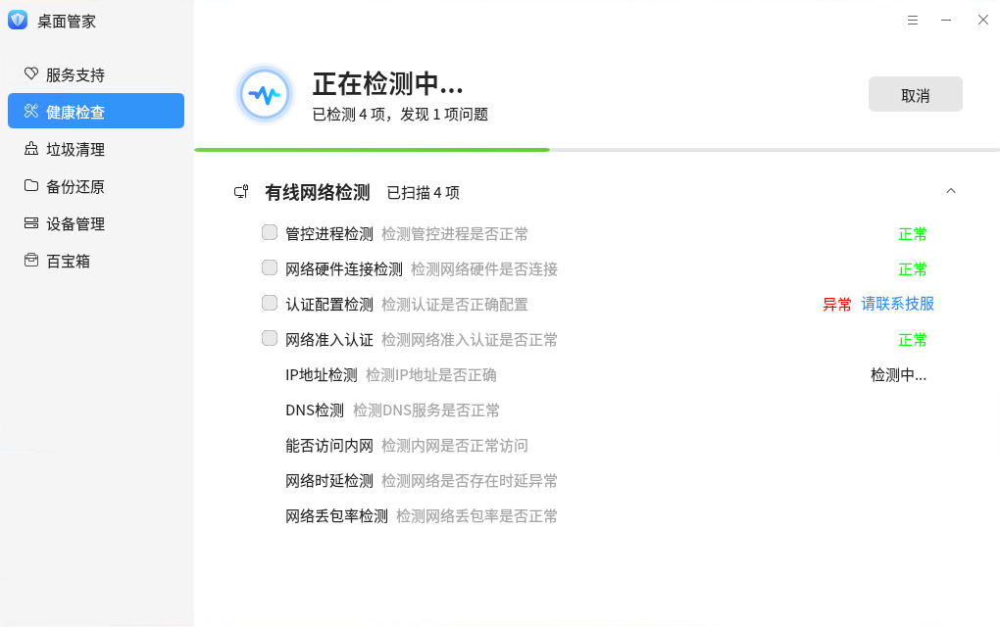

健康检查还支持内网检测，点击右下角的“内网检测设置”并选择“是”来开启内网检测并配置 IP 地址和网站地址进行保存。

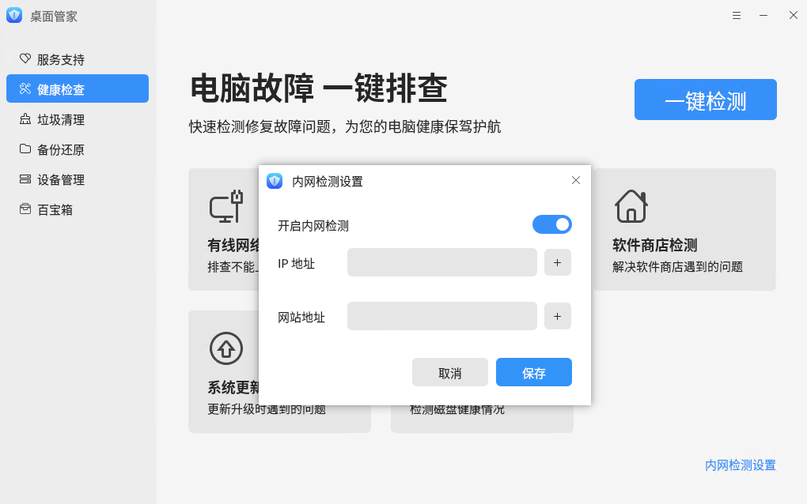

## 垃圾清理

桌面管家支持清理系统垃圾、上网垃圾、使用痕迹。 点击“**开始扫描**”开启扫描。

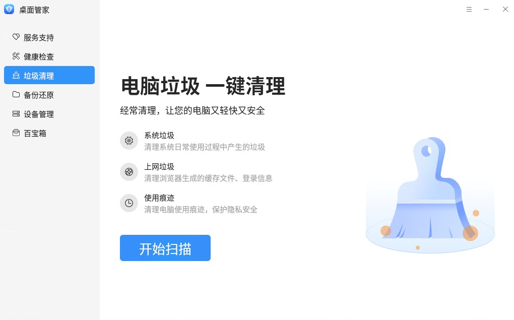

扫描完成后显示扫描项及可清理项，点击右侧下拉按钮可以查看具体的可清理项。点击“**一键清理**”开启清理

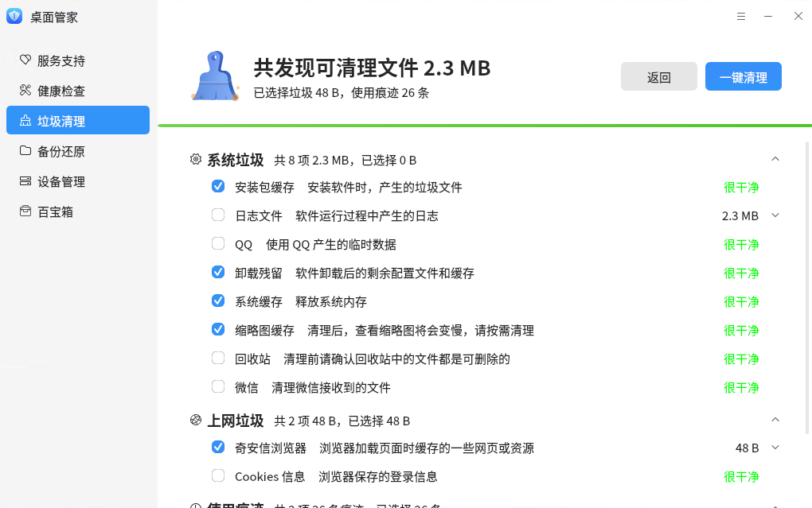

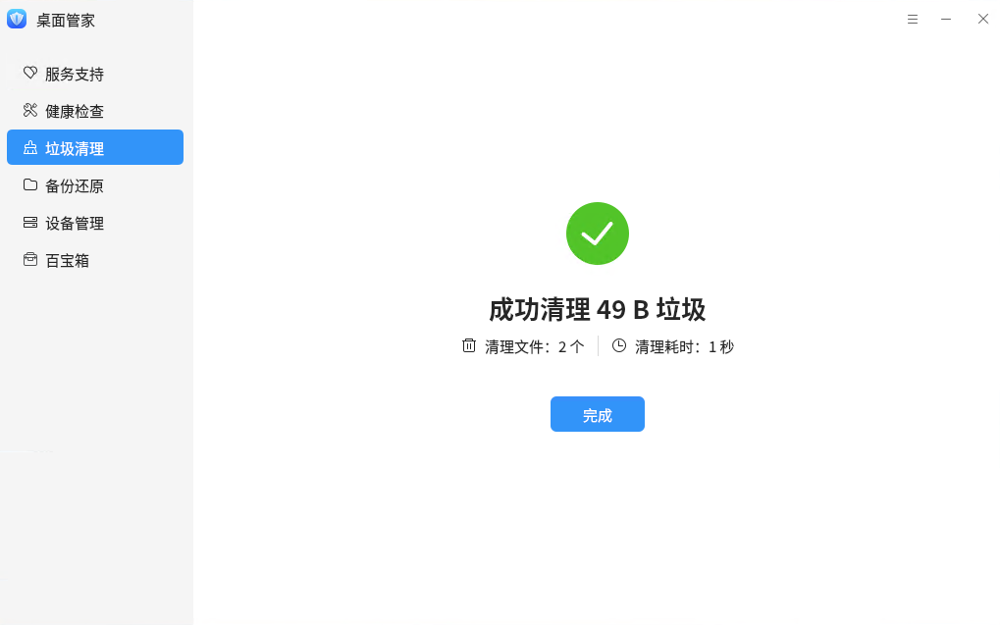

## 备份还原

点击左侧“**备份还原**”可以打开备份还原应用。

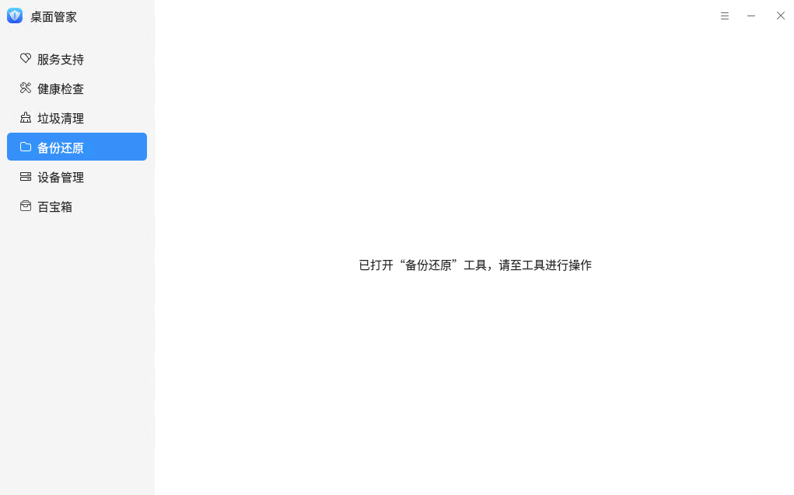

## 设备管理

设备管理用于查询和管理硬件设备，包括硬件信息的查看、导出，设备的启用、禁用，还包括了驱动管理功能，可以对外设驱动进行安装升级和卸载。

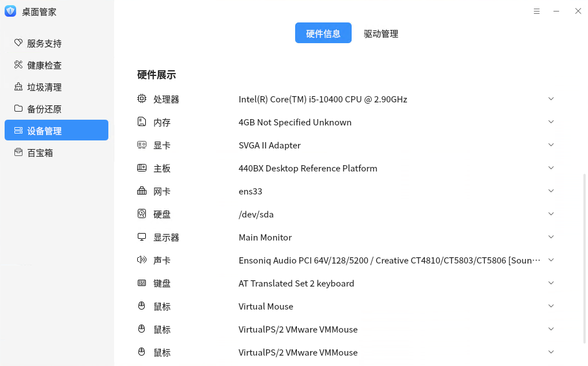

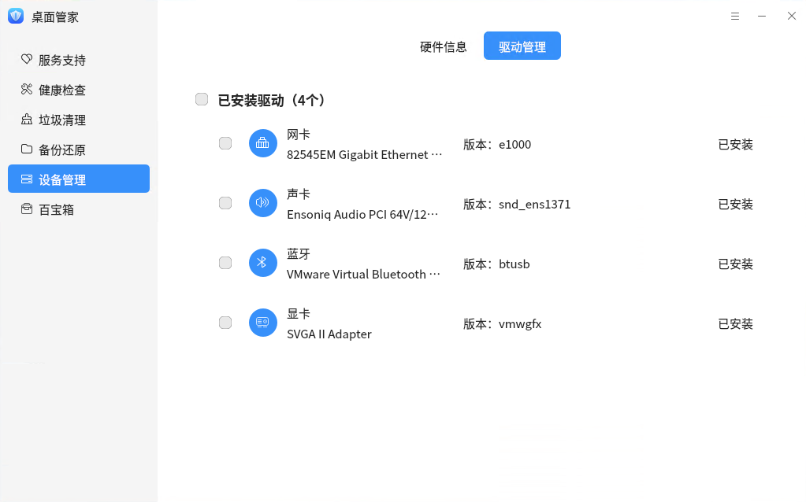

## 百宝箱

百宝箱中用于存放各种各样的小工具，点击相应工具的界面可以启动小工具。

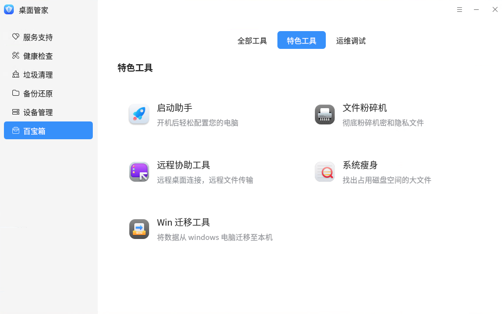