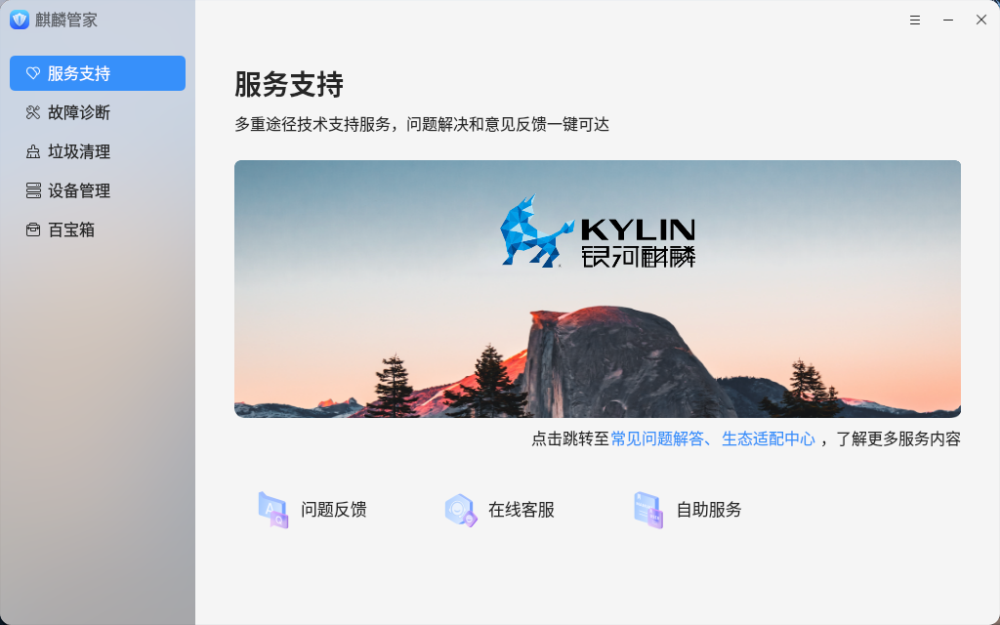
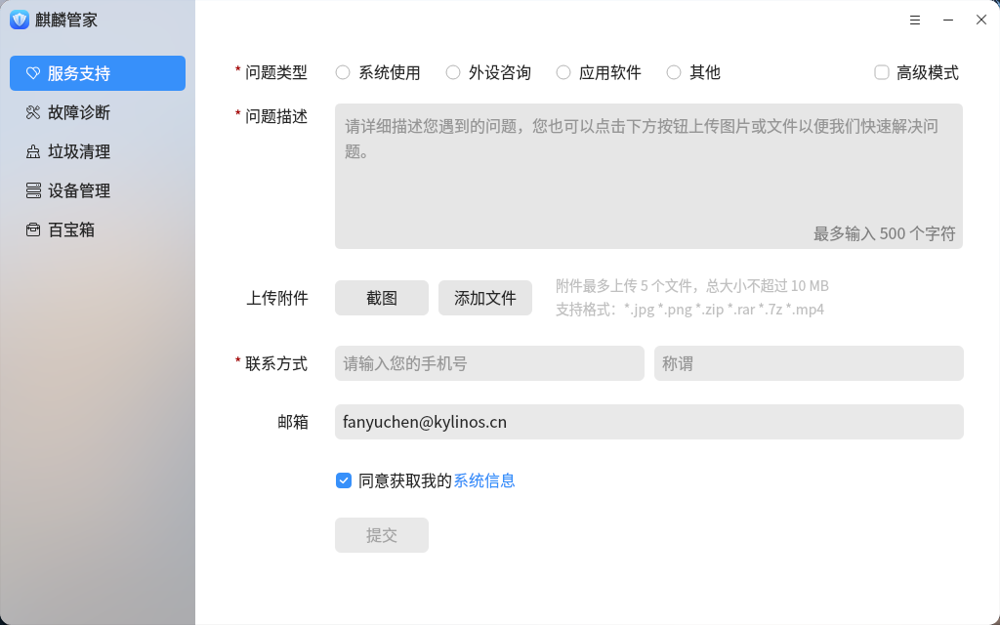
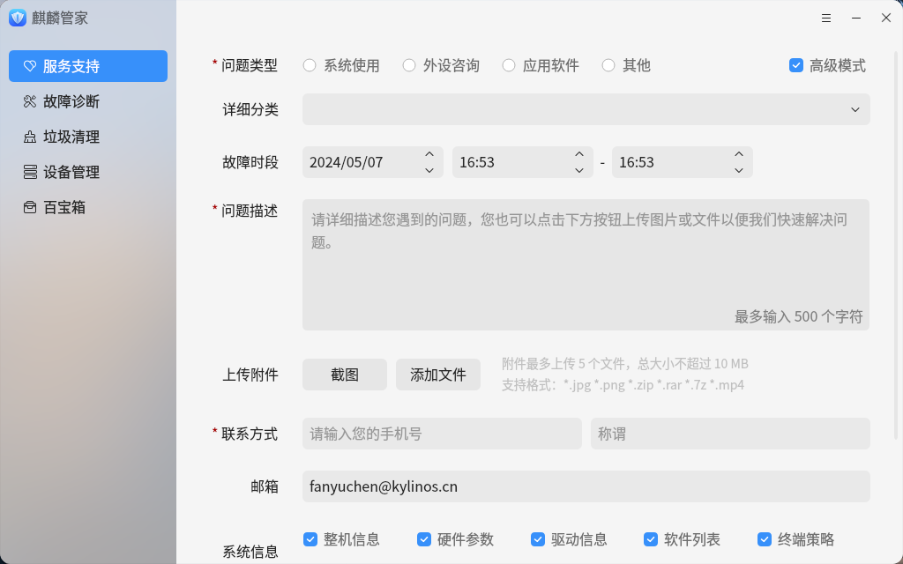
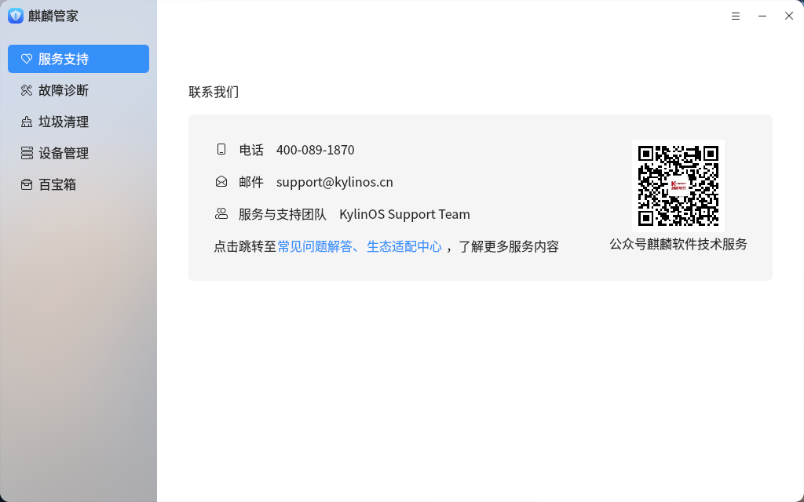
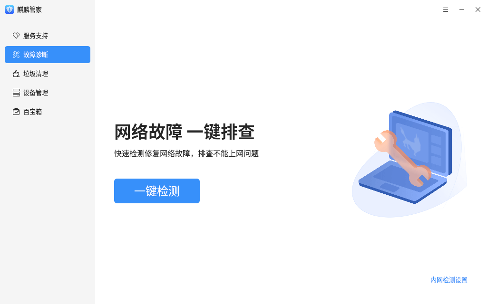
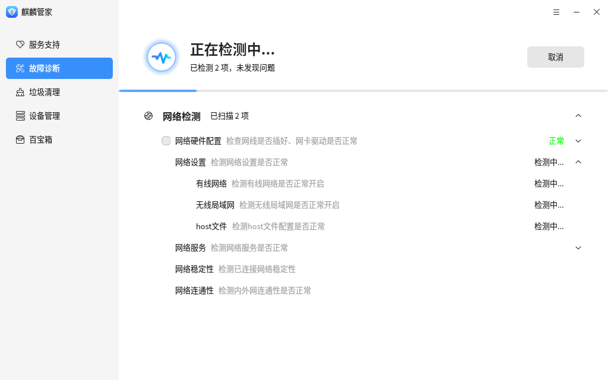
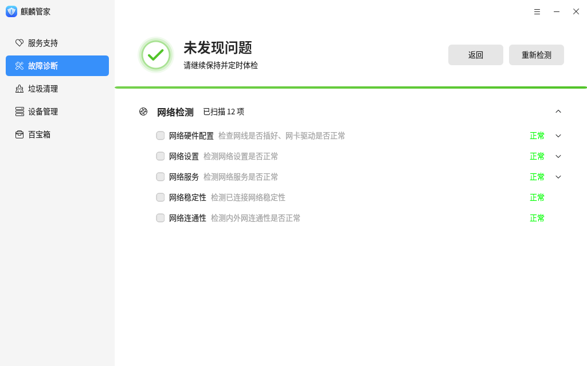
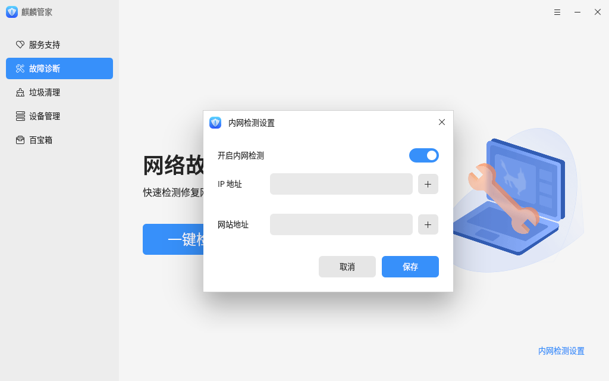
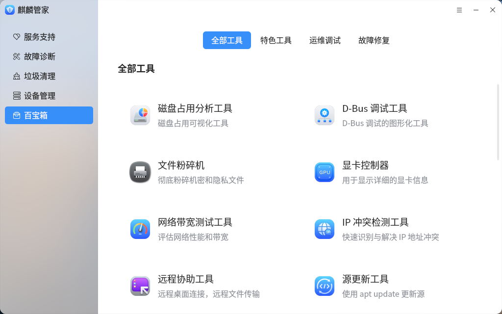

# 麒麟管家

## 概述
麒麟管家是一款提供问题反馈、电脑故障排查、故障修复、电脑垃圾清理、设备管理及系统小工具的应用，可以帮助您更好的使用电脑。

## 打开方式
点击操作系统“开始菜单”，选择并点击“麒麟管家”。

## 基本操作

### 服务与支持

麒麟管家服务与支持提供问题反馈、在线客服、自助服务等功能，可以通过页面底部的选项进行选择。

在问题反馈界面填写问题类型、问题描述、联系方式、邮箱等信息，同时在上传附件处添加截图或文件。填写完成后点击下方的“**提交**”按钮即可提交问题。

勾选右上方的“**高级模式**”复选框，可以填写更多信息，进行更细致的问题描述。

在线客服界面选择对应的产品后，可以进行在线问题反馈。

自助服务界面可以获取更多反馈渠道。

### 故障检测
在“**故障检测**”中点击“**一键检测**”后开启检测。

检测结束后会显示检测结果。

麒麟管家还支持内网检测，点击右下角的“内网检测设置”并选择“是”来开启内网检测并配置 IP 地址和网站地址进行保存。

### 垃圾清理

麒麟管家支持清理系统垃圾、上网垃圾、历史痕迹。 点击“**开始扫描**”开启扫描。

扫描完成后显示扫描项及可清理项，点击右侧下拉按钮可以查看具体的可清理项。点击“**一键清理**”开启清理

## 设备管理

设备管理用于查询和管理硬件设备，包括硬件信息的查看、导出，设备的启用、禁用，还包括了驱动管理功能，可以对外设驱动进行安装升级和卸载。

## 百宝箱

百宝箱中用于存放各种各样的小工具，点击相应工具的界面可以启动小工具。

