# Kylin Os Manager
## Summary

Kylin os manager is an application that provides problem feedback, computer troubleshooting, troubleshooting, computer garbage cleaning, device management, and system tools, which can help you better use your computer.

## Open mode
Click the "**Start Menu**" of the operating system, select and click "**kylin os manager**".

## Basic operation

### Service support

Kylin os manager service and support provide functions such as problem feedback, online customer service, and self-service, which can be selected through the options at the bottom of the page.

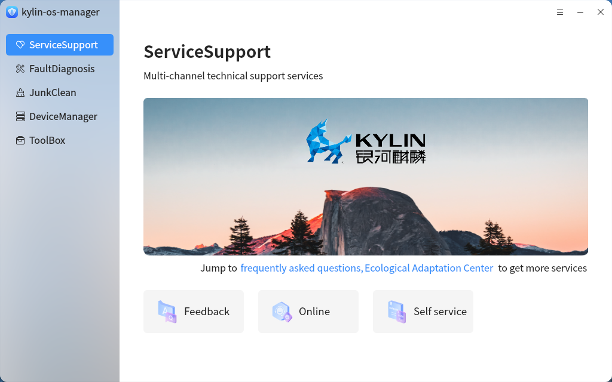

Fill in the problem type, problem description, contact information, email, and other information in the problem feedback interface, and add screenshots or files in the upload attachment. After completing the form, click on the "**Submit**" button below to submit the question.

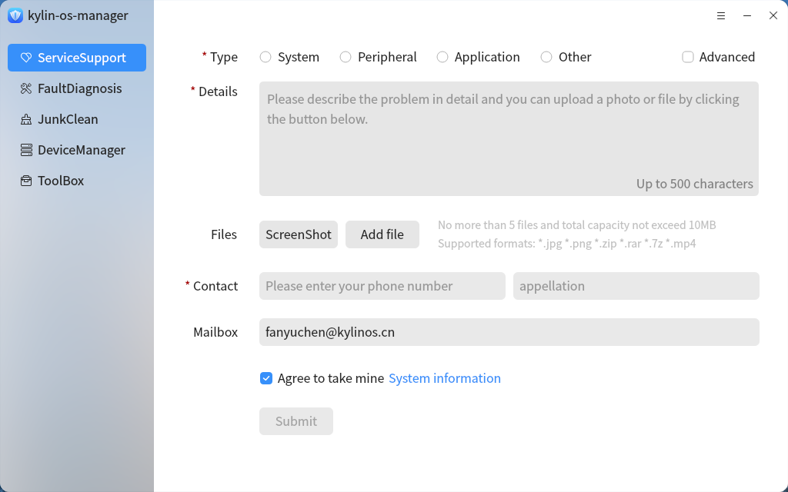

Check the "**Advanced Mode**" checkbox in the upper right corner to fill in more information and provide a more detailed description of the problem.

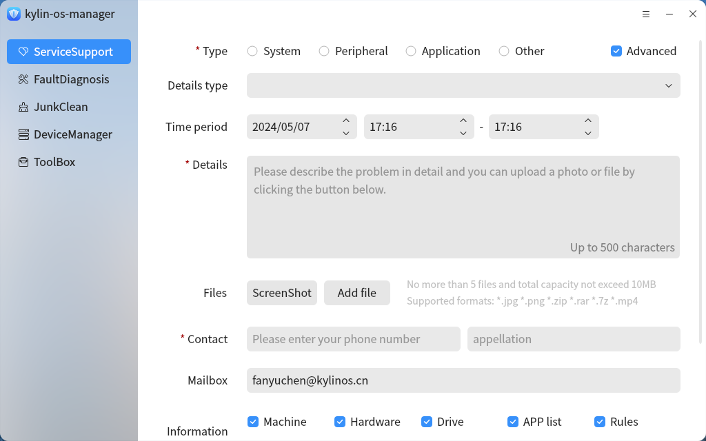

After selecting the corresponding product in the online customer service interface, online problem feedback can be provided.

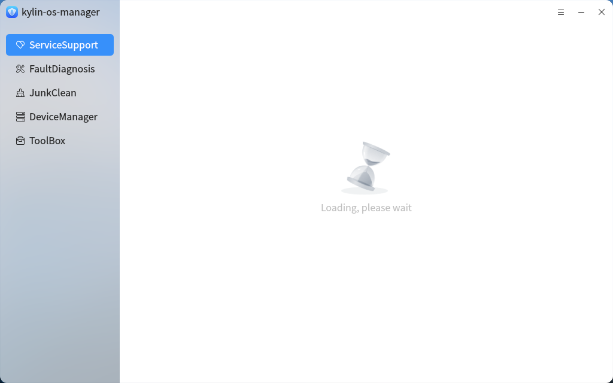

The self-service interface allows for more feedback channels.

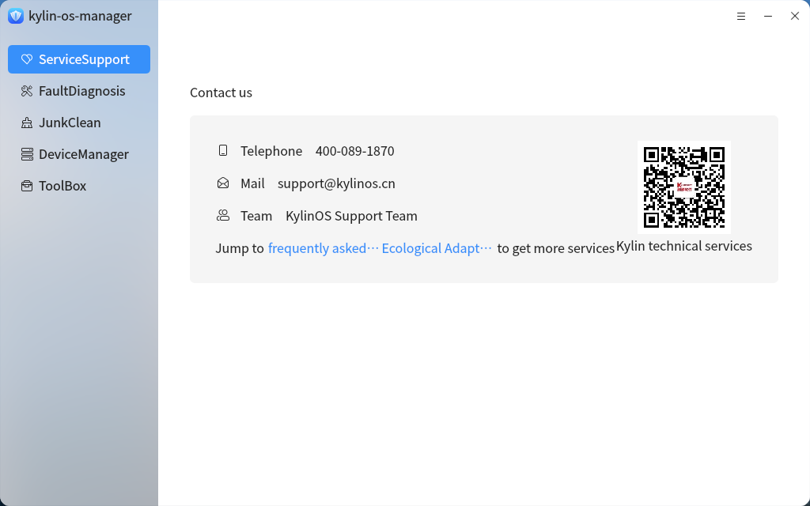

### Fault detection
Click "**Start**" in "**Fault detection**" to start detection.

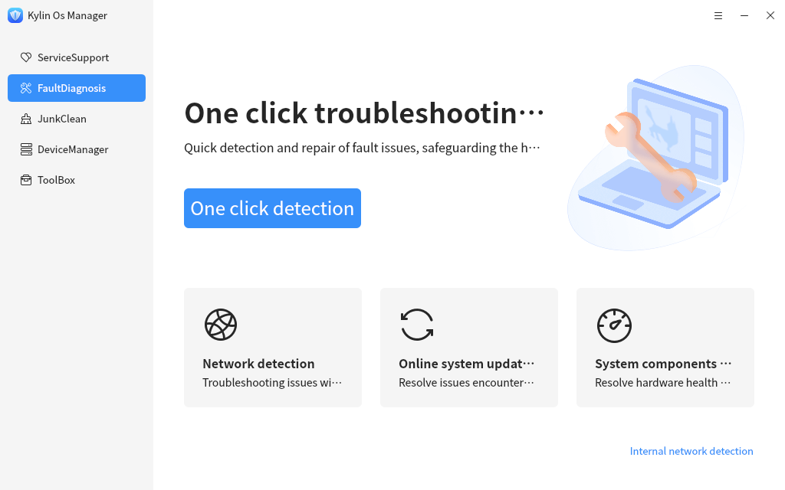

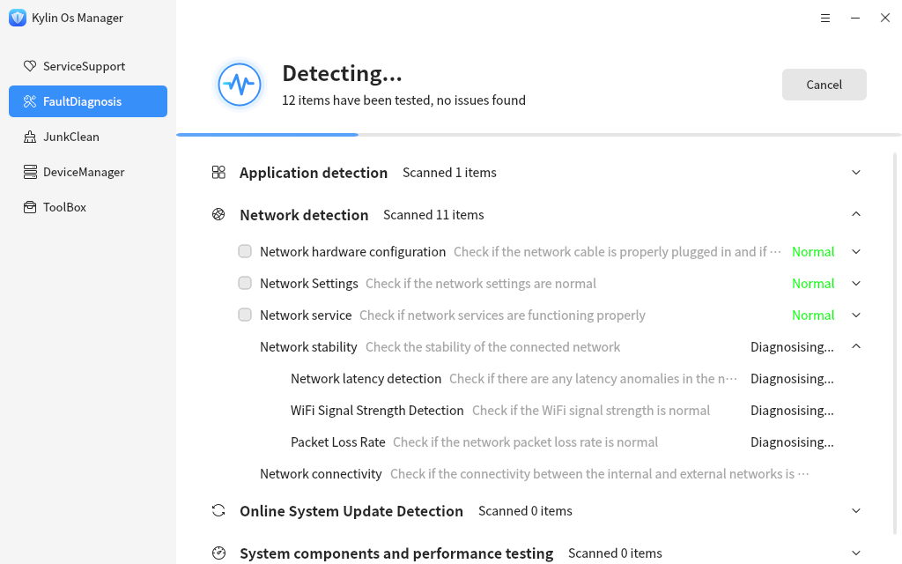

After the detection is completed, the detection result will be displayed.

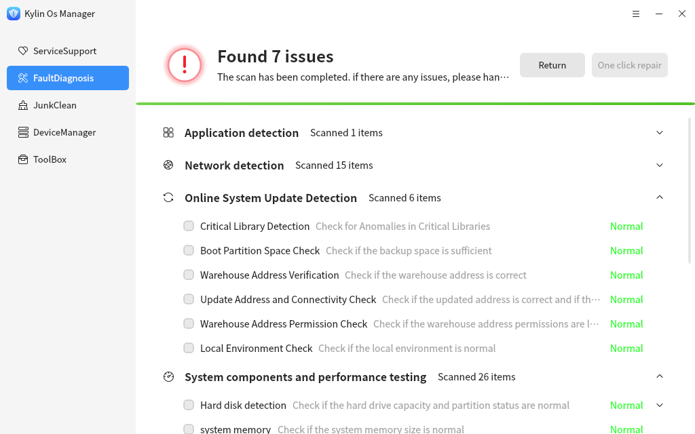

Kylin os manager also supports internal network detection. Click on "Internal Network Detection Settings" in the bottom right corner and select "Yes" to enable internal network detection and configure IP and website addresses for saving.

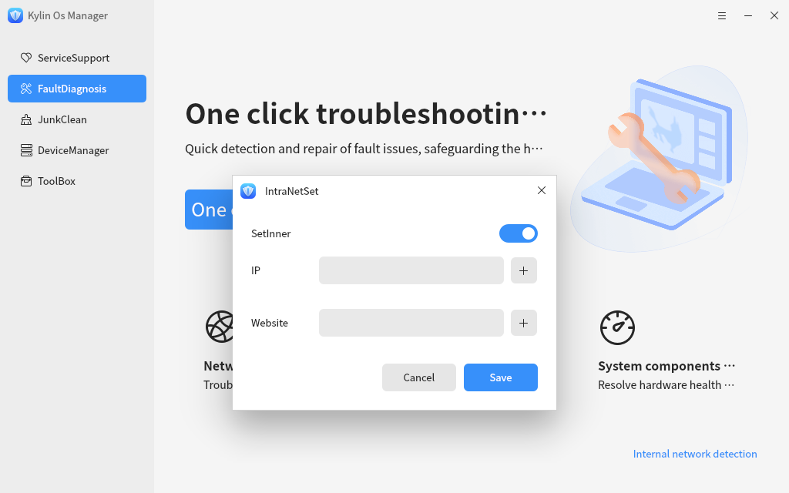

### Garbage removal

Kylin os manager supports cleaning system junk, internet junk, and historical traces. Click "**Start Scanning**" to start scanning.

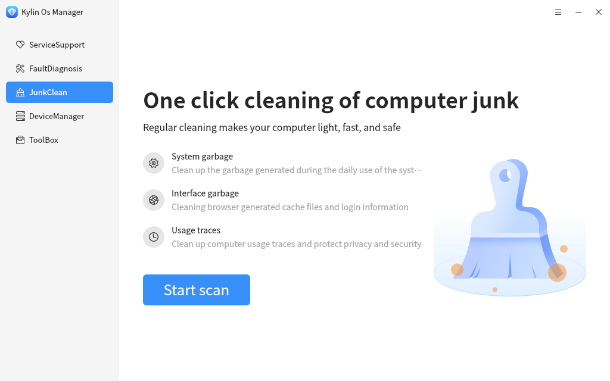

After the scan is completed, the scan items and cleanable items will be displayed. Click the dropdown button on the right to view the specific cleanable items. Click "**One click cleaning**" to start cleaning.

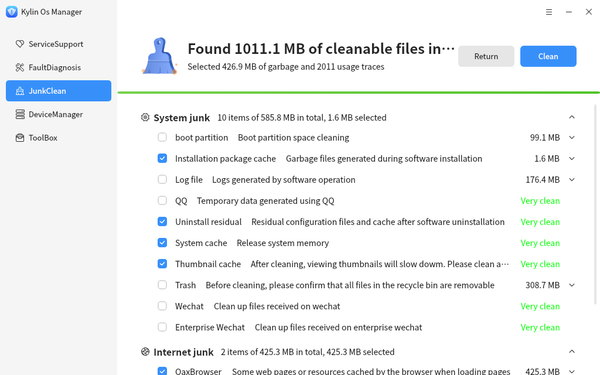

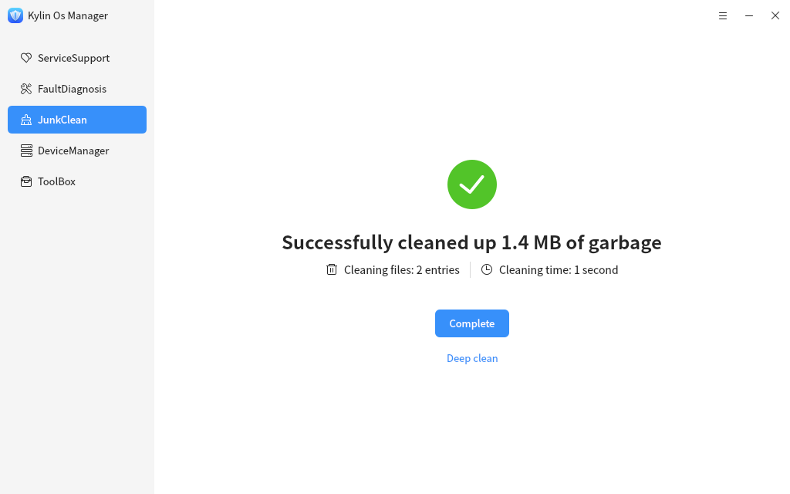

## Device Manager

Device management is used to query and manage hardware devices, including viewing and exporting hardware information, enabling and disabling devices, as well as driver management functions. It can also install, upgrade, and uninstall external device drivers.

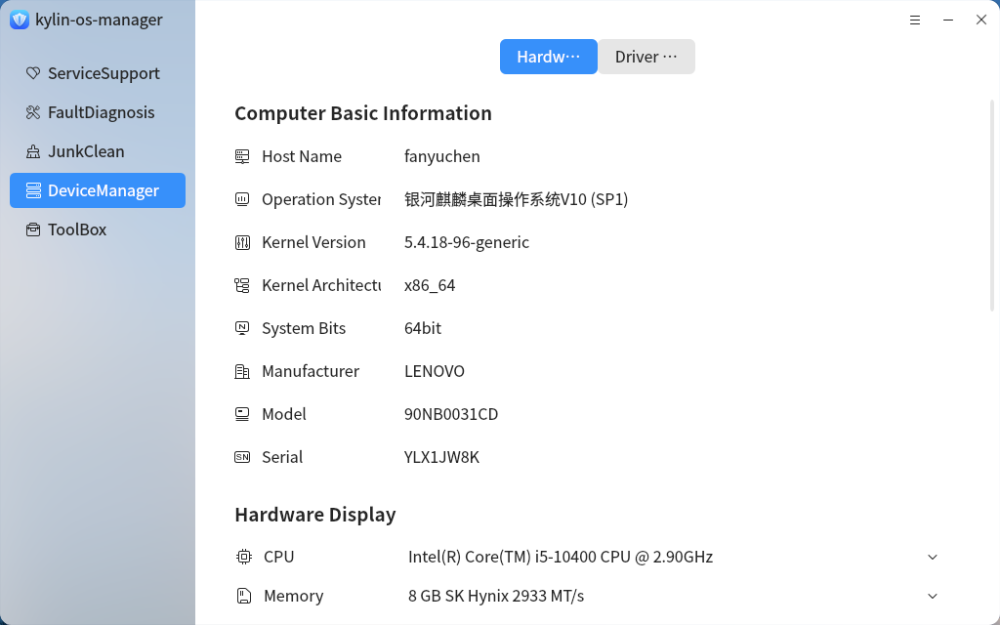

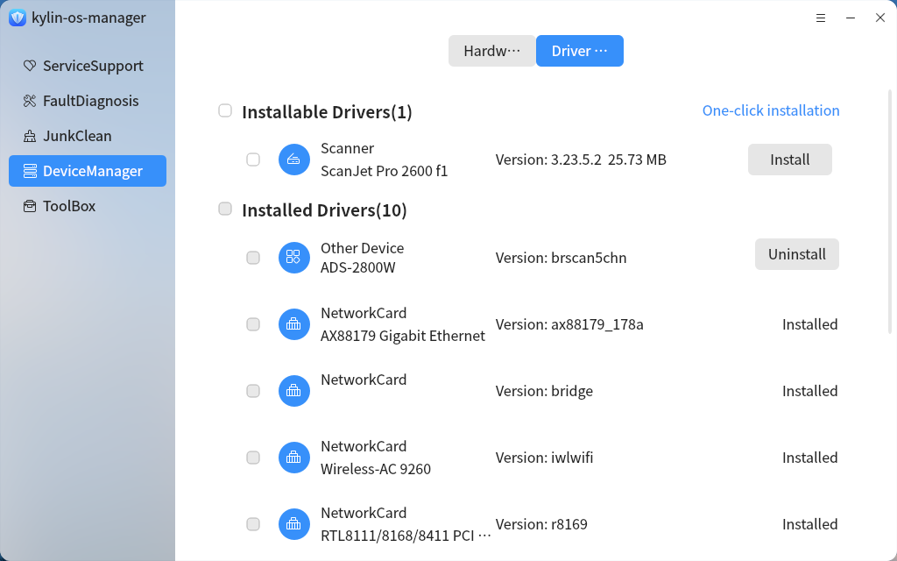

## Treasure chest

The Gallery is used to store all kinds of small tools. Click the interface of the corresponding tool to start the small tools.

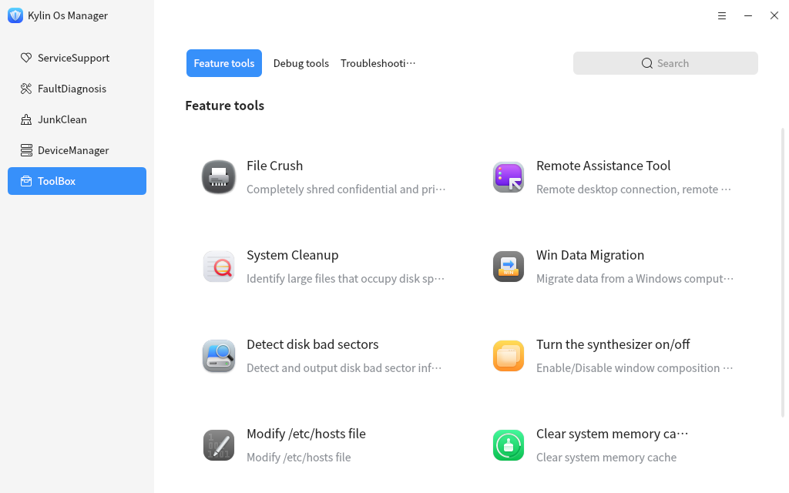