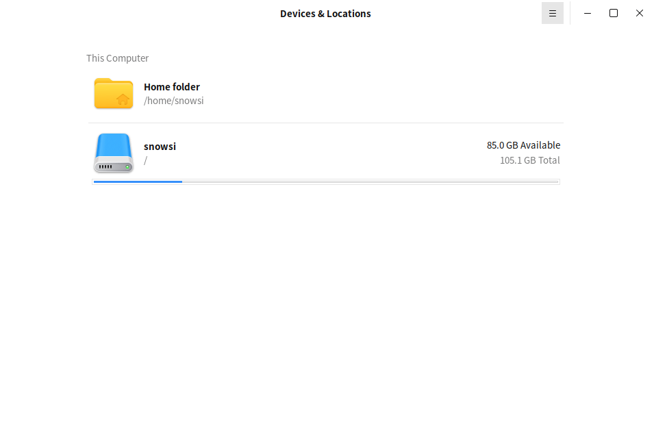
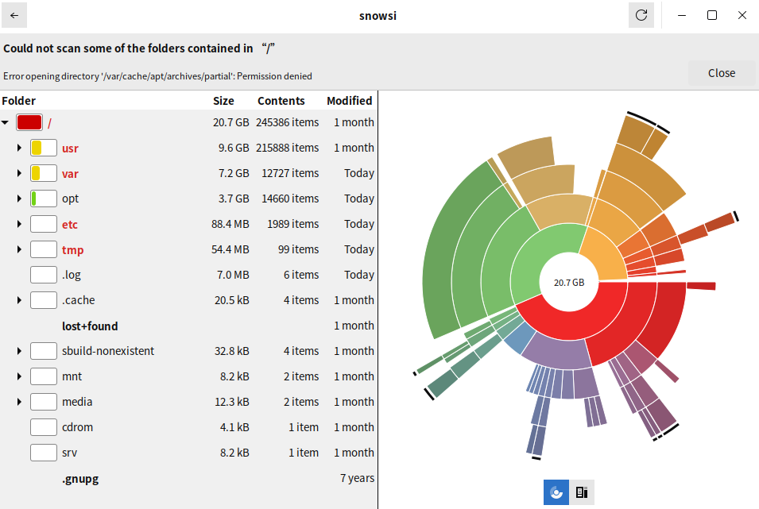

# Disk Usage Analyzer

## Summary

Disk Usage Analyzer is a graphical disk usage analysis tool that helps users visualize the usage of disk space for easy identification and management of large files or folders.

## Open mode

Click on the "Start Menu" of the operating system, select and click on "Kylin Os Manager" -> "Tool Box" -> "Disk Usage Analyzer".

## Basic operation

After startup, you can choose the scanning range and directly scan the entire disk or select specific folders for analysis.

After scanning is completed, a visual graph will be displayed showing the proportion of each directory.

Clicking on any part of the chart allows for a deeper view of the size of subdirectories and files.

