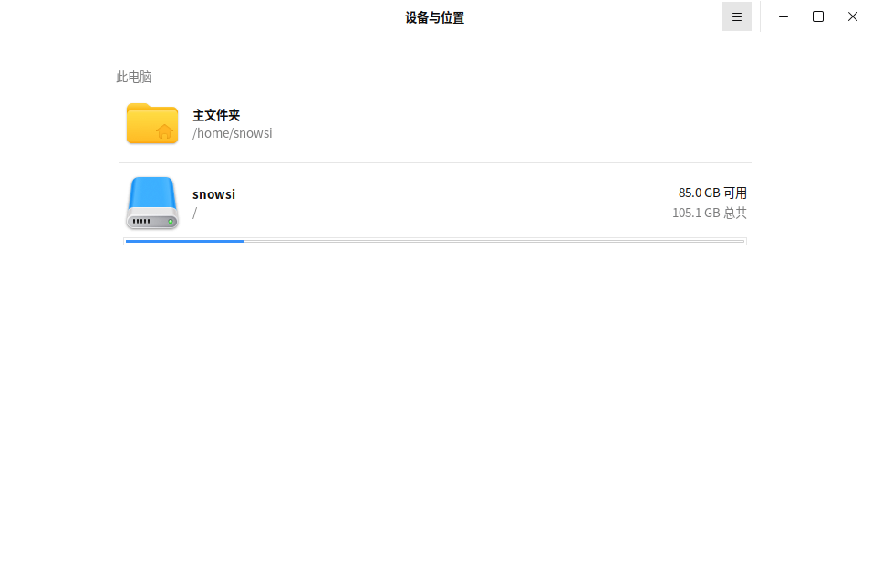
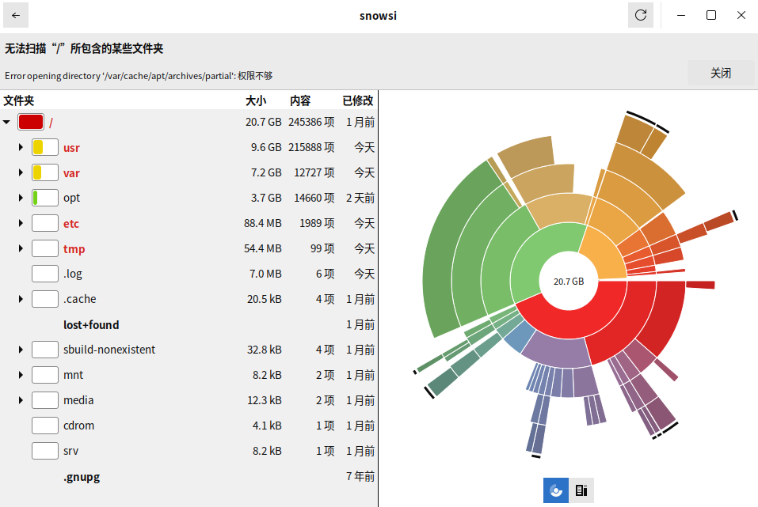

# 磁盘使用情况分析器

## 概述

磁盘使用情况分析器是一个图形化的磁盘使用分析工具，它可以帮助用户可视化磁盘空间的使用情况，以便轻松识别和管理大文件或文件夹。

## 打开方式

点击操作系统“开始菜单”，选择并点击 “麒麟管家” -> “百宝箱” -> “磁盘使用情况分析器”

## 基本操作

启动后，您可以选择扫描的范围，可以直接扫描整个磁盘或选择特定的文件夹进行分析。

扫描完成后，会显示一个可视化图形，展示各目录所占的比例。

点击图表中的任一部分，可以深入查看子目录和文件的大小。

