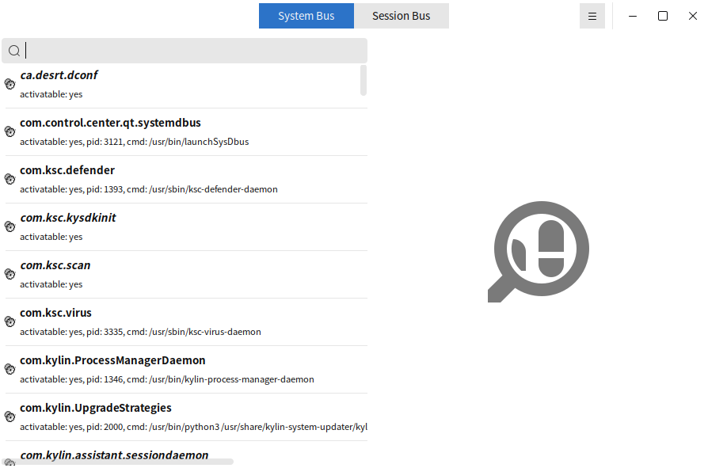
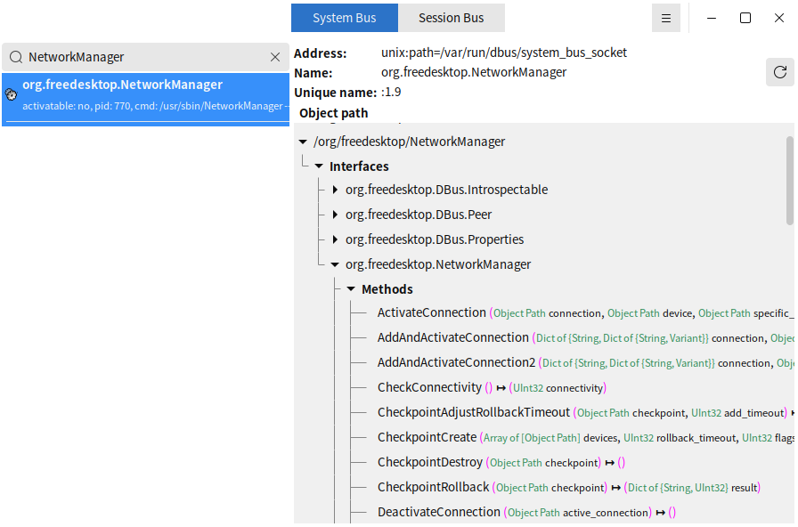
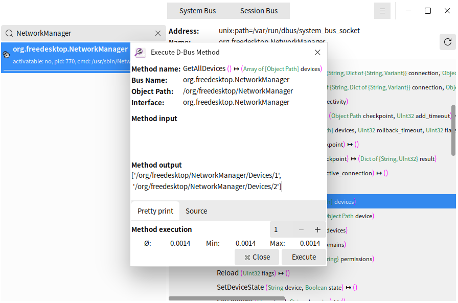

# D-Feet

## Summary

D-Feet is a powerful graphical tool designed specifically for D-Bus system services on the Linux platform. It allows users to browse the D-Bus interface on the system and session bus, view and call methods, signals, properties, etc. D-Feet provides an intuitive user interface that enables developers and system administrators to easily debug and test D-Bus services.

## Open mode

Click on the "Start Menu" of the operating system, select and click on "Kylin Os Manager" -> "Tool Box" -> "D-Feet"

## Basic operation

After startup, D-Feet will automatically connect to the system bus and session bus, and can be switched by pressing the button above to view the currently active D-Bus services.

Find the corresponding service through the search box, click on the service, and its interface and object path will be displayed in the right panel.

Clicking on a specific interface will list the methods, signals, and properties provided by that interface.

Select a method by entering the necessary parameters and clicking the 'Run' button to execute the method.

