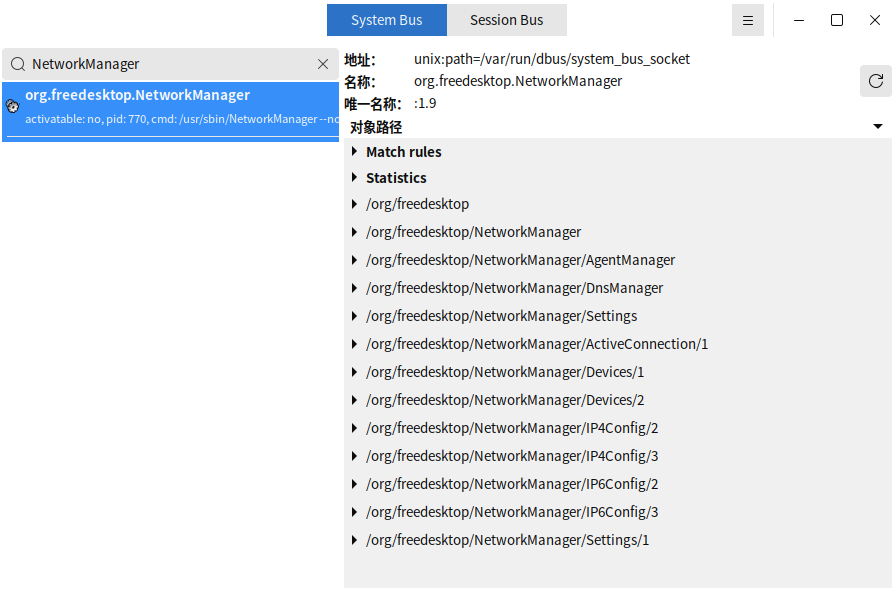
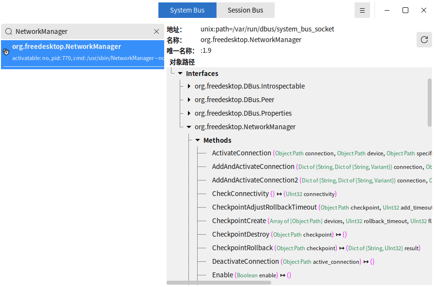

# D-Feet

## 概述

D-Feet 是一个强大的图形工具，专为 Linux 平台上的 D-Bus 系统服务设计。它允许用户浏览系统和会话总线上的 D-Bus 接口，查看和调用方法、信号、属性等。D-Feet 提供了直观的用户界面，使开发者和系统管理员能够轻松地调试和测试 D-Bus 服务。

## 打开方式

点击操作系统“开始菜单”，选择并点击 “麒麟管家” -> “百宝箱” -> “D-Feet”

## 基本操作

启动后，D-Feet 会自动连接到系统总线和会话总线，可以通过上方的按钮进行切换，查看当前活动的 D-Bus 服务。

通过搜索框找到对应的服务，点击服务，它的接口和对象路径会显示在右侧面板中。

点击特定的接口，会列出该接口提供的方法、信号和属性。

选择一个方法，可以输入必要的参数然后点击 “运行” 按钮来执行该方法。

