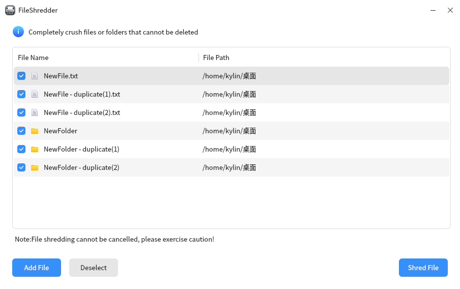
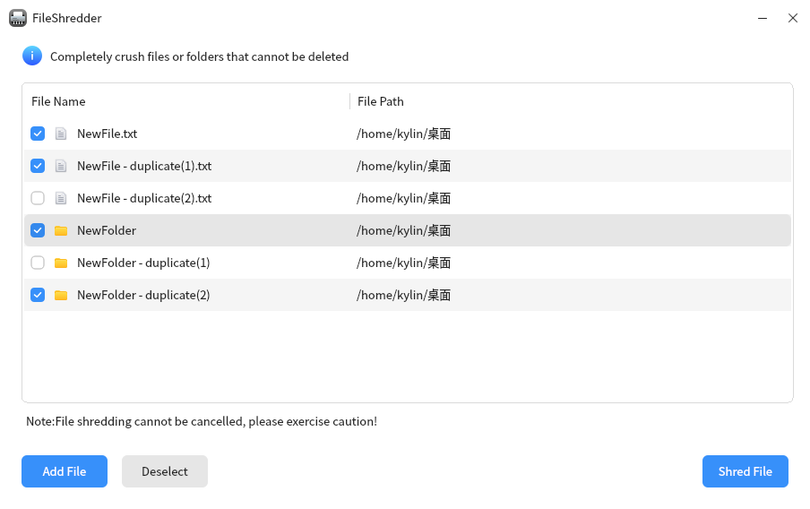

# Kylin File Crush

## Summary

A file shredder is a tool designed to completely erase files from a disk and make them unrecoverable. Its main design purpose is to protect sensitive data from malicious theft and exploitation. The file shredder uses advanced algorithms and techniques to ensure that files are overwritten and unrecoverable.

## Open mode

Click on the "Start Menu" of the operating system, select and click on "Kylin Os Manager" ->"Treasure Chest" ->"File Crusher".

## Basic operation

After opening the file shredder, you can click the "+" button in the middle of the interface or the "Add" button in the bottom left corner to add files or folders, and it also supports drag and drop addition.

After adding, if you want to remove certain items, you can check the checkbox at the front and click the "Remove" button below.

Check the items that need to be crushed, click the "Crush" button in the bottom right corner, and a pop-up window will appear to confirm whether to crush them. Click the "OK" button to crush the file.

