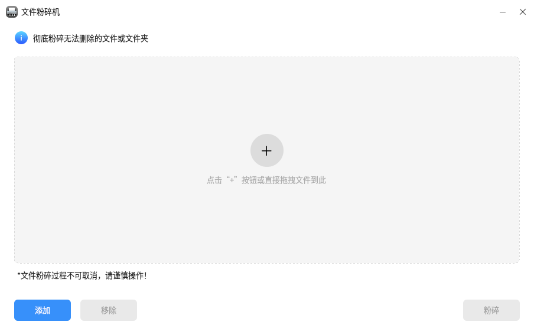
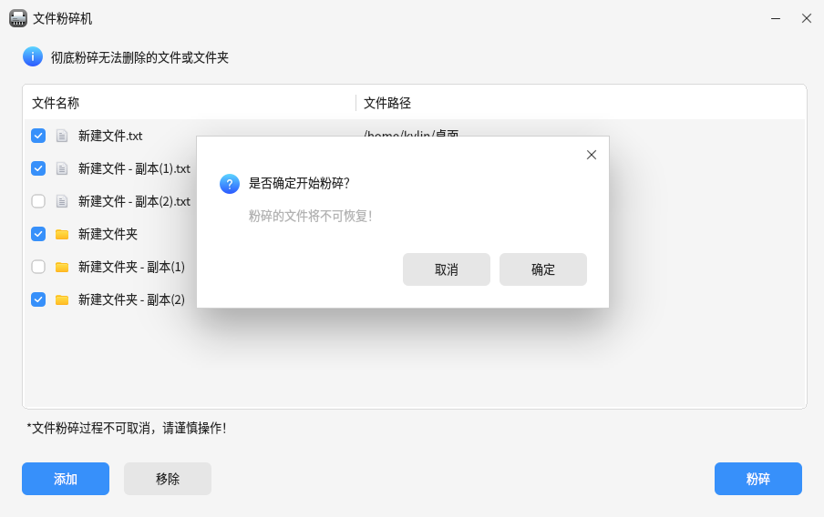

# 文件粉碎机

## 概述
文件粉碎机是一种旨在彻底清除磁盘上的文件并使其不可恢复的工具。其主要设计目的在于保护敏感数据免受恶意窃取和利用。文件粉碎机使用一些高级的算法和技术，以确保文件被覆盖并且不可恢复。

## 打开方式
点击操作系统“开始菜单”，选择并点击“麒麟管家” -> “百宝箱” -> “文件粉碎机” 。

## 基本操作

打开文件粉碎机后可以点击界面中间的 “+” 按钮或者左下角的“添加”按钮来添加文件或文件夹，同时也支持拖拽添加。

添加完成后如果想要移除掉某些项，可以勾选前边的复选框然后点击下方的“移除”按钮。

勾选需要粉碎的项，点击右下角“粉碎”按钮，会弹窗确认是否要粉碎，点击“确定”按钮文件将被粉碎。

