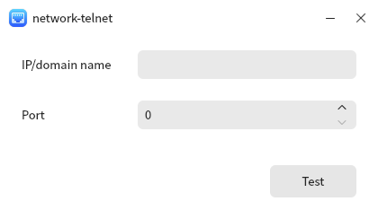

# Network Connectivity Detection Tools

## Summary

Network connectivity detection tools can quickly detect whether the network is unobstructed, helping you easily grasp the network status.

## Open mode

Click on the "Start Menu" of the operating system, select and click on "Kylin Os Manager" ->"Treasure Chest" ->"Network Connectivity Detection Tool".

## Basic operation

Open the network connectivity testing tool, enter the IP or domain name, port number that needs to be tested, and click the test button in the bottom right corner.

If the network is unobstructed, a pop-up window will display a successful connection.

If the network is not connected, a pop-up window will display connection failure.

