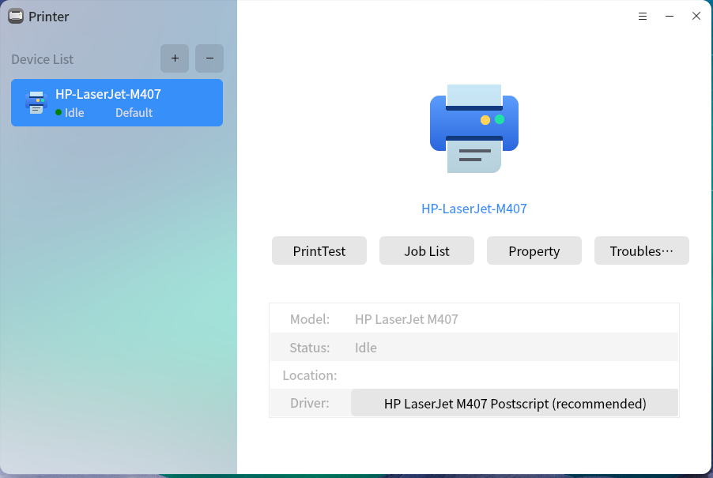
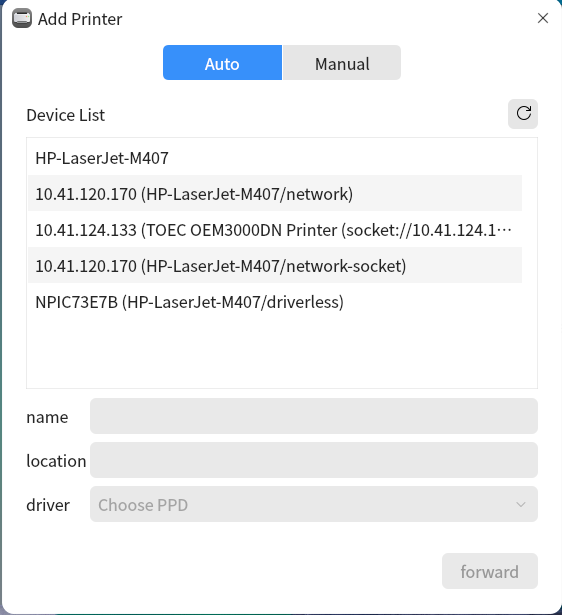
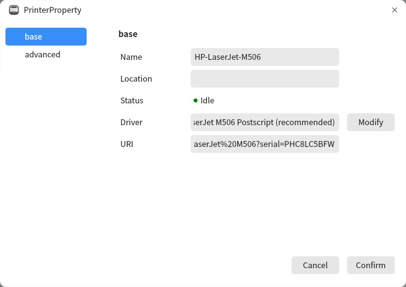
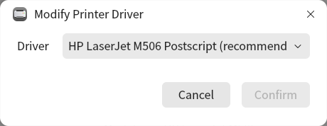
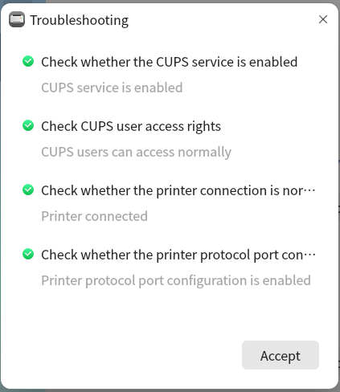
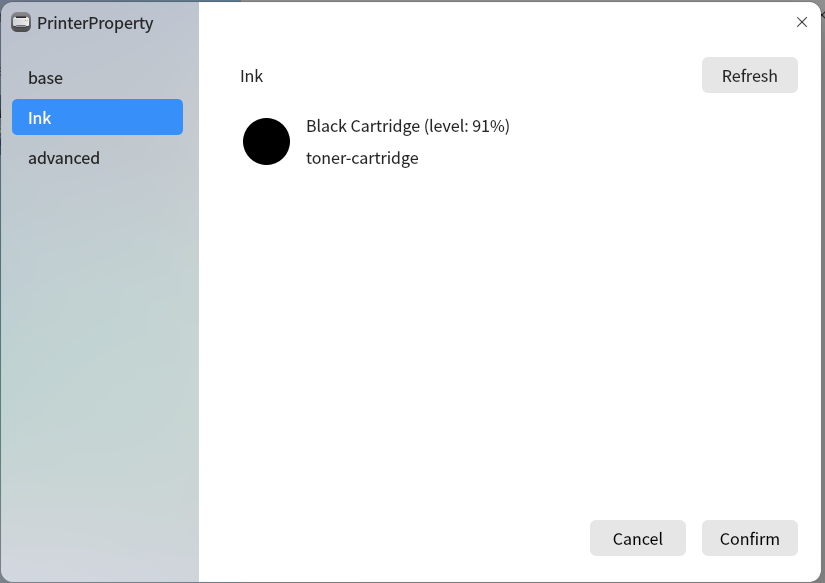
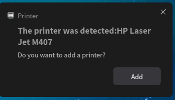
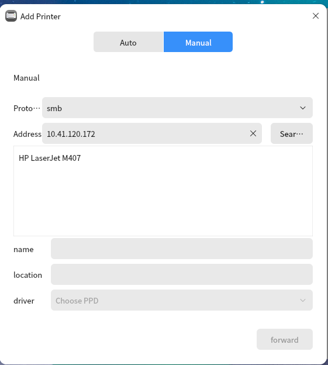

# Printer
## Overview
The printer is a printer installation software developed based on qt5, which can provide manual installation of USB/network printer drivers. It has the advantages of simple and easy-to-use, friendly interface and so on. 

 

### Manually add printer 
Click , as shown in Fig 2.

### View printer properties 
Click , as shown in Fig 3.

### Modify the driver
Click  to modify the driver.

### Print test page
Click , as shown in Fig 5.

### Troubleshooting
Click  to display the troubleshooting interface.

### Ink/toner properties
For some printers that support displaying ink/toner properties, the relevant ink/toner property information can be seen in the properties.

### USB printer plug and play
For USB printers, after plugging in the USB cable, the automatic installation process can be performed to realize plug-and-play of the printer.

### Samba printer on remote server
For samba printers on the remote server, you can add them using the smb protocol in manual addition.

