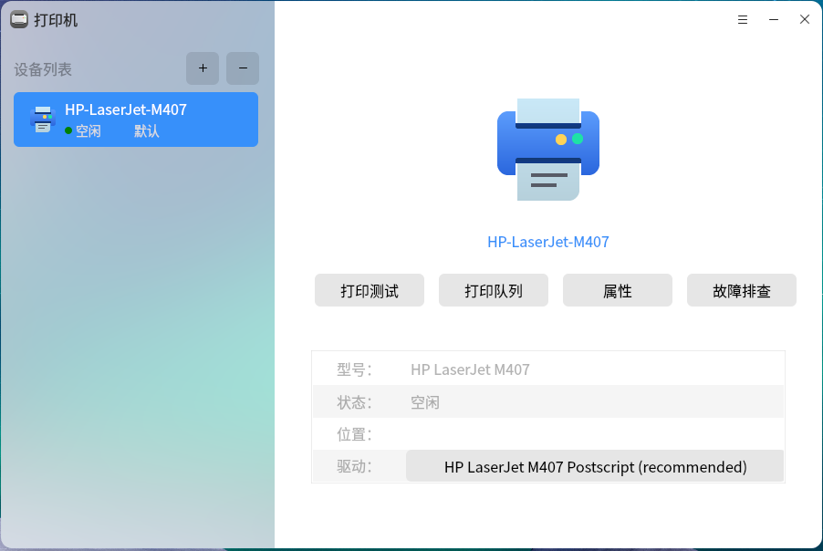
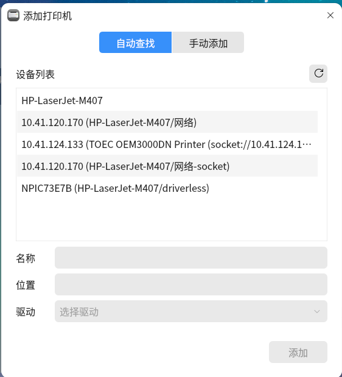
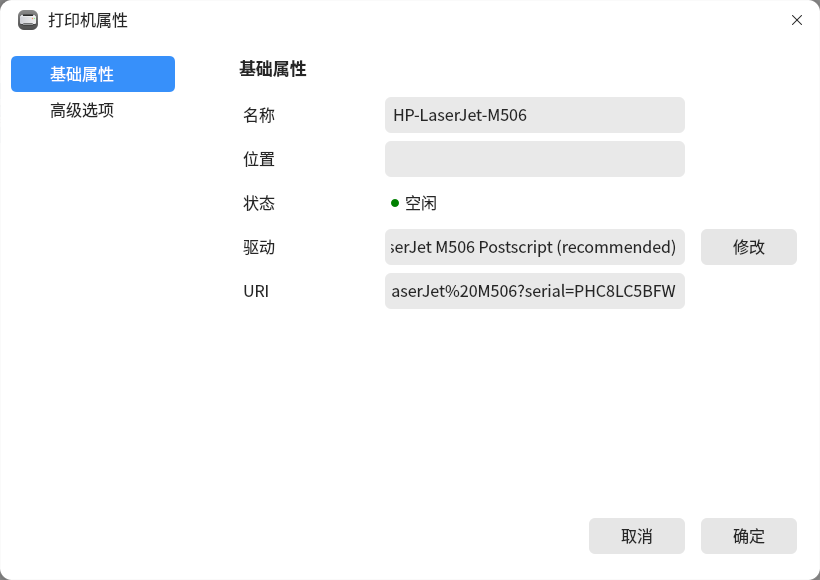
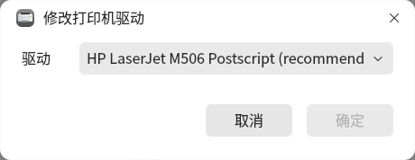
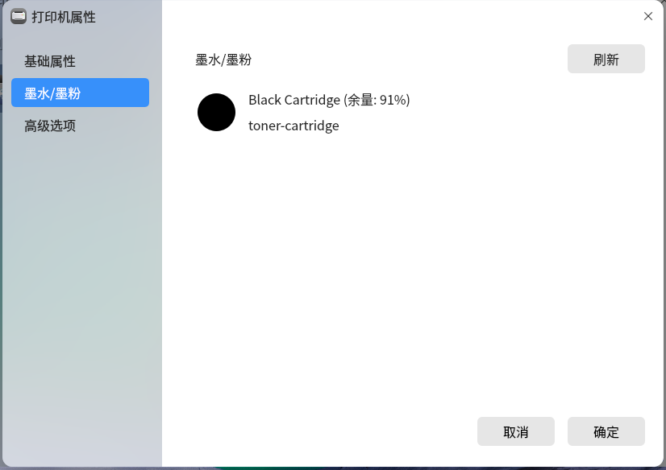
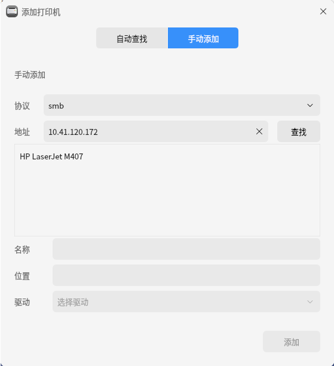

# 打印机
## 概 述
打印机是一款基于qt5开发的打印机安装软件，可以提供手动安装USB/网络打印机驱动的功能，具有简单易用，界面友好等优点。

### 手动添加打印机
点击“”图标，手动添加打印机，如图2所示。

### 查看打印机属性
点击“”图标，查看打印机属性。

### 修改驱动界面
点击“”，修改打印机驱动。

### 打印测试页
点击“”图标，打印测试页面。

### 故障排查
点击“”图标，显示故障排查界面。

### 墨水/墨粉属性
对于一些支持显示墨水/墨粉属性的打印机，属性中可以看到相关的墨水/墨粉属性信息。

### USB打印机即插即用
对于USB打印机，插入USB线后，可以执行自动安装流程，实现打印机的即插即用。

### 远程服务器上的samba打印机
对于远程服务器上的samba打印机,可以在手动添加中使用smb协议进行添加。

