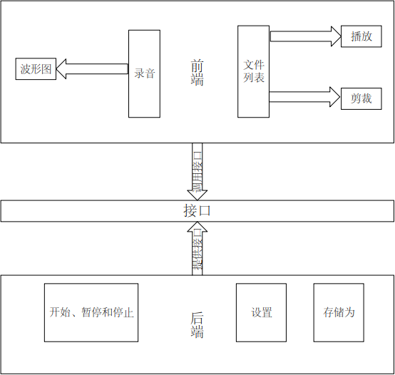
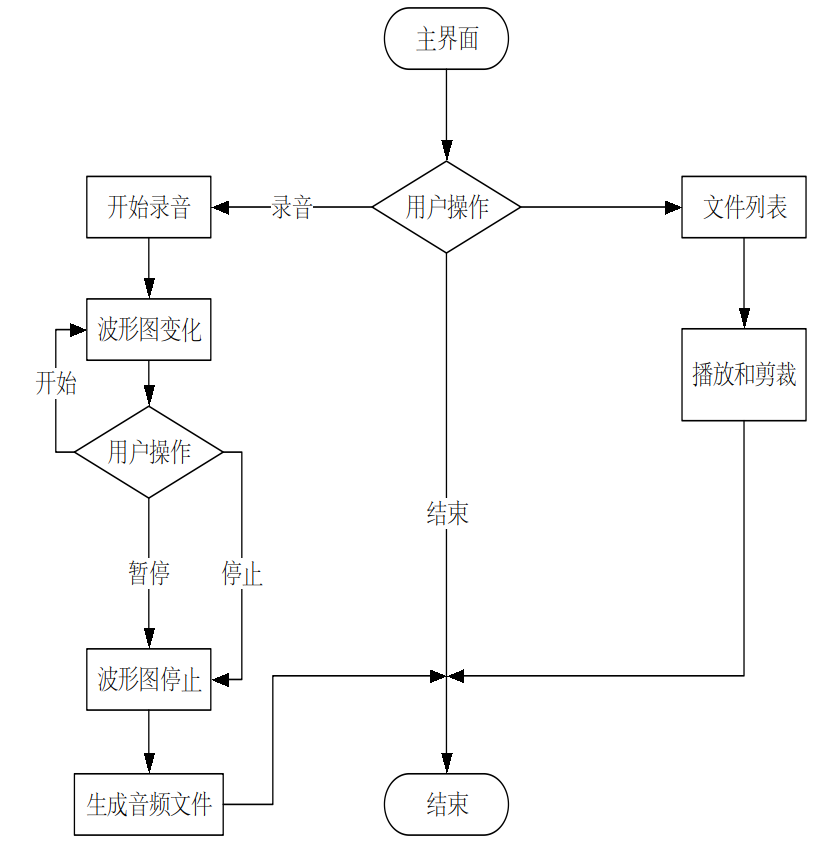
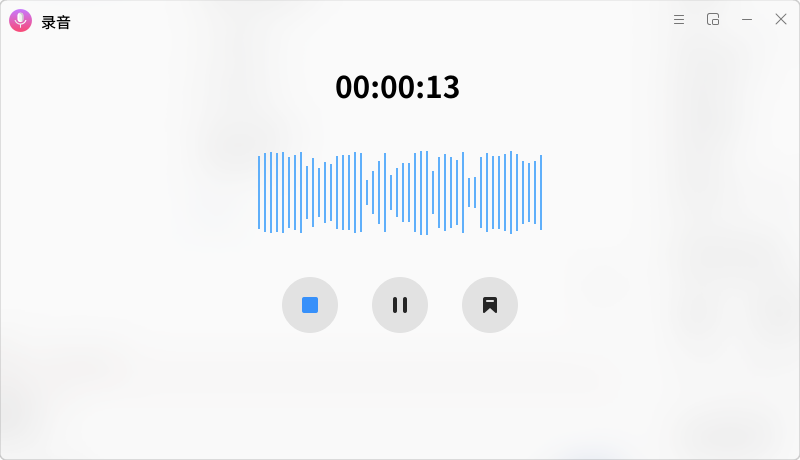
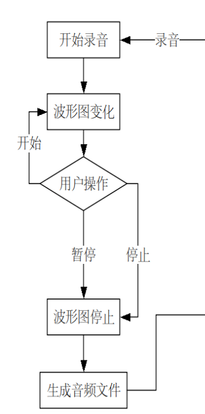
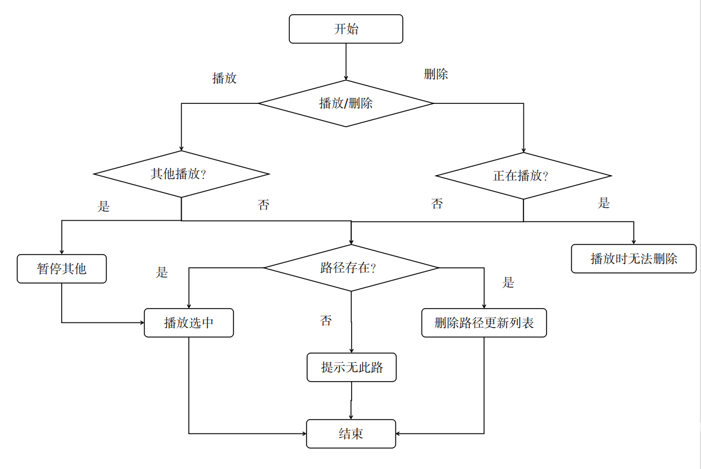
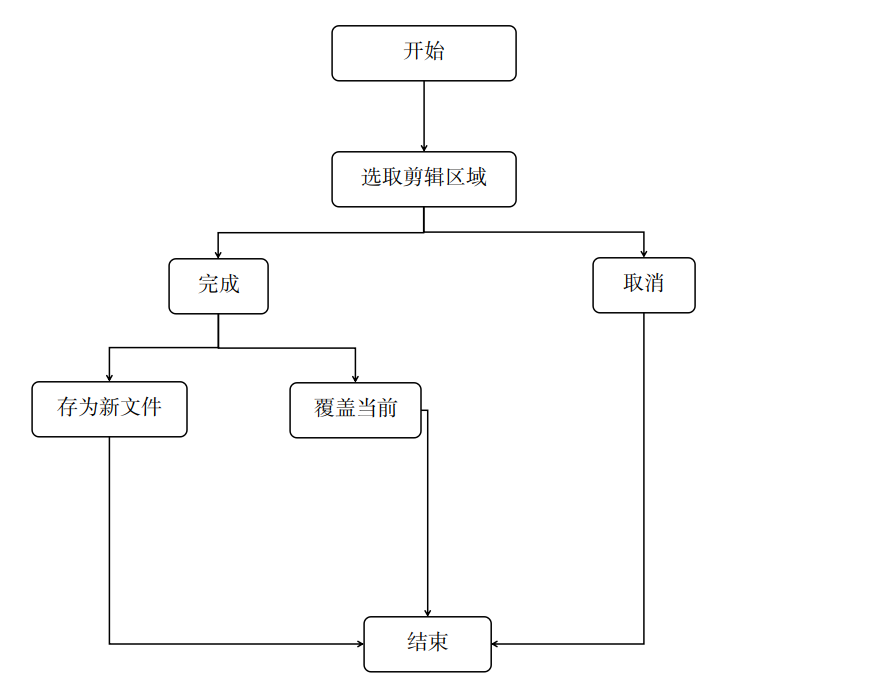
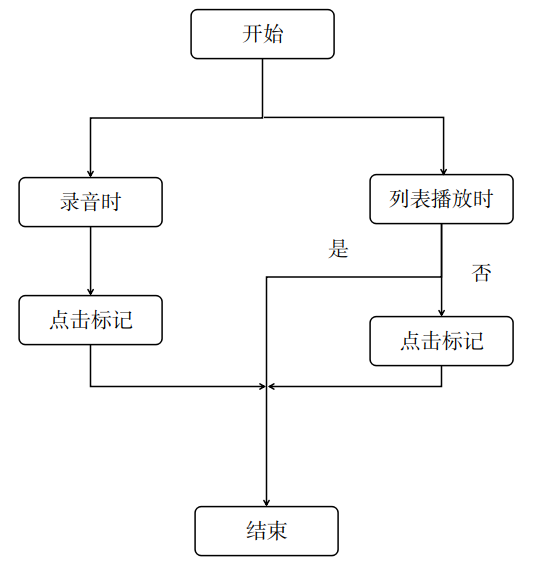

# Kylin-recorder

## 一．引言

### 1.编写目的

此文档编写是为了方便开发者熟悉此录音软件的实现流程以及技术点。通过此文档可以直观的看出该应用的设计方案、模块流程以及核心的代码实现。

### 2.项目背景

鉴于开源软件的难维护性，开发一款操作系统原生的易于维护的自研录音软件显得尤为重要。同样也是让国产操作系统不再受制于人的重要法宝之一。

## 二．总体设计  

### 1.需求概述

录音软件大致的核心功能有：**开始录音、继续、暂停和完成**以及**本地播放**。

### 2.软件结构

项目的总体结构图

[]

## 三．主要模块流程图

### 1．主界面流程

[]

### 2．主界面

[]

### 3．录音时

[]

## 四．程序描述

### 1.开始录音

#### 1.1 功能 

打开录音

方式：点击主界面的录音大按钮

#### 1.2 性能

#### 1.3 输入项目 

参数描述：音频数据输入流

参数类型：无

#### 1.4 输出项目 

```c++
struct WAVFILEHEADER
{
    char RiffName[4];// RIFF 头(标志)
    uint32_t RiffLength;//从下一个开始到文件结尾的字节数
    char WavName[4];// WAVE 文件
    char FmtName[4];// fmt 波形格式

    uint32_t FmtLength;// 数据格式
    uint16_t AudioFormat;//音频格式是否是压缩的PCM编码，1无压缩，大于1有压缩
    uint16_t ChannleNumber;//声道数量
    uint32_t SampleRate;//采样频率
    uint32_t BytesPerSecond;// byterate(每秒字节数) = 采样率(Hz)*样本数据位数(bit)*声道数/8
    uint16_t BytesPerSample;//块对齐/帧大小 framesize = 通道数 * 数据位数
    uint16_t BitsPerSample; //样本数据位数

    char DATANAME[4];//catheFileName , QString wav数据块中的块头
    uint32_t DataLength;//实际音频数据的大小
};
```

#### 1.5 算法

1：获取音频文件缓存路径；

2：此路径传递给后端转码方法中进行转码。

#### 1.6 程序逻辑

[]

1.生成原汁原味的裸流文件

```c++
    rawFileName = QDateTime::currentDateTime().toString("yyyyMMddhhmmss") + ".raw";
    QString str = QStandardPaths::writableLocation(QStandardPaths::HomeLocation);
    absolutionPath = str + "/.cache/"+rawFileName;//raw缓存文件放在绝对路径
    qDebug()<<"绝对路径:"<<absolutionPath;
    file->setFileName(absolutionPath);
    bool is_open =file->open(QIODevice::WriteOnly | QIODevice::Truncate);
    if(!is_open)
    {
        qDebug()<<"打开失败";
        exit(1);
    }
    audioDev = monitorVoiceSource(recordData->get("source").toInt());
    if(audioDev.isNull()){
        audioDev = inputDevice;     
    }
    //检测波形
    InitMonitor();
    audioInputFile->start(file);
```

2.传入转码方法中

```c++
    // 先将wav文件头信息写入，再将音频数据写入;
    wavFile.write((const char *)&WavFileHeader,nSize);
    wavFile.write(cacheFile.readAll());
```

### 2.文件列表

#### 2.1 功能 

文件列表：主要功能是可以点击播放、暂停和删除。

#### 2.2 性能

#### 2.3 输入项目 

参数描述：文件路径

参数类型：QString

#### 2.4 程序逻辑

[]

```c++
    PlayControl::getInstance().play_Audio(m_filePath);//播放
    PlayControl::getInstance().pause_Audio(m_filePath);//暂停
    deleteFile(delFilePath);//移入回收站
    m_Wavefile->wavFile_Analy(clipPath);//剪辑
    displayFlag(m_filePath);//标记
```

### 3.剪辑

#### 3.1 功能 

剪辑：顾名思义就是剪辑录制好的音频文件，选择好时间节点剪辑出想要的音频文件。

#### 3.2 性能

#### 3.3 输入项目 

参数描述：文件路径

参数类型：QString

#### 3.4 程序逻辑

[]

```c++
m_Wavefile->wavFile_Analy(clipPath);
```

### 4.标记

#### 4.1 功能 

标记：顾名思义就是标记重点的时间节点。可以方便记录某一时刻的重要信息。

#### 4.2 性能

#### 4.3 输入项目 

参数描述：文件路径

参数类型：QString

#### 4.4 程序逻辑

[]

```c++
    QFileInfo fileInfo(m_filePath);
    qDebug()<<"获取当前无后缀的文件名："<<fileInfo.baseName()<<"获取当前时间:"<<timeStr;
    emit DATABASE_INSTANCE.insertDataSignal(fileInfo.baseName(),timeStr);
    if(DATABASE_INSTANCE.getStatus() == DB_OP_SUCC){
        qDebug()<<"添加成功";
        displayFlag(m_filePath);
    }
```
