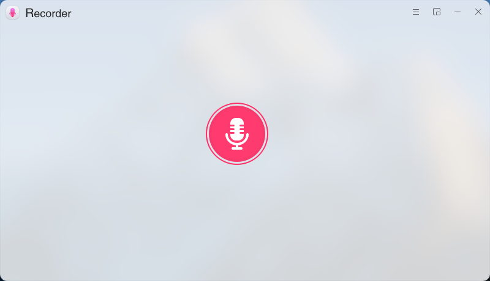
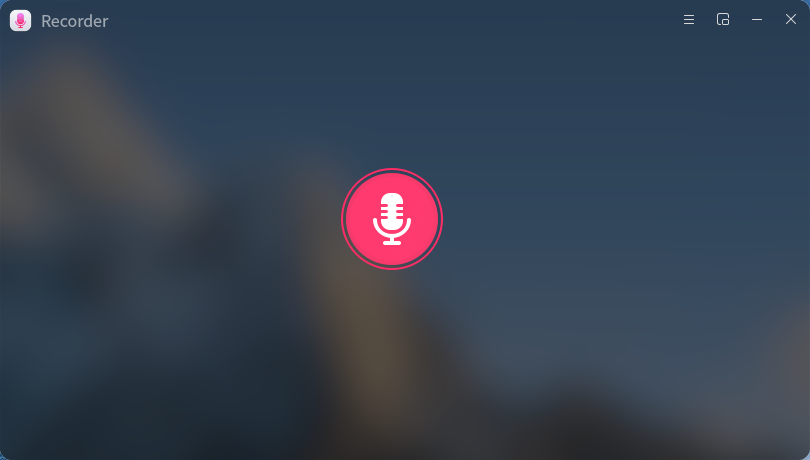
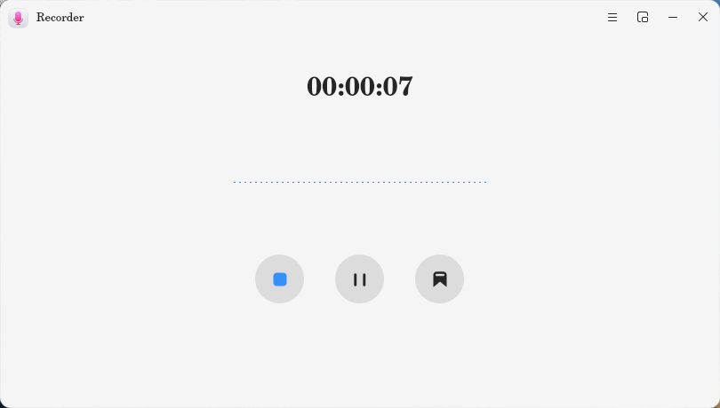
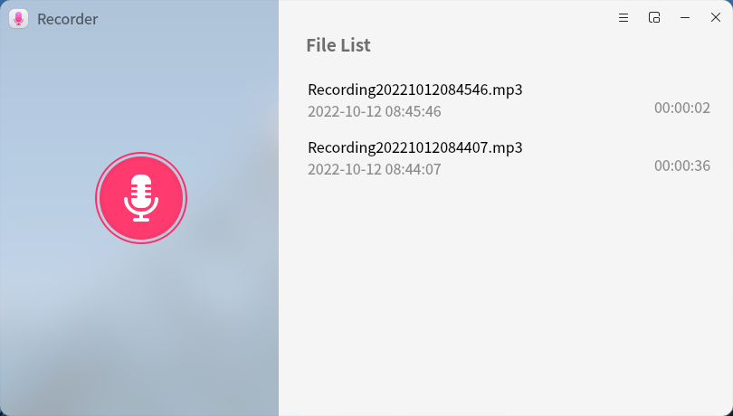
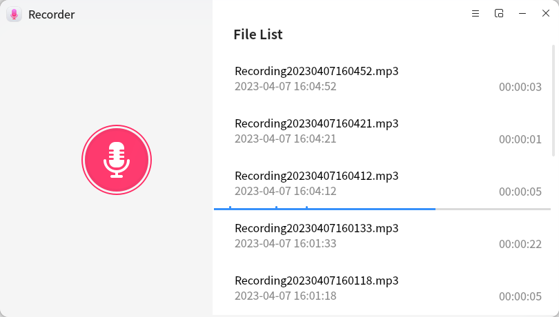
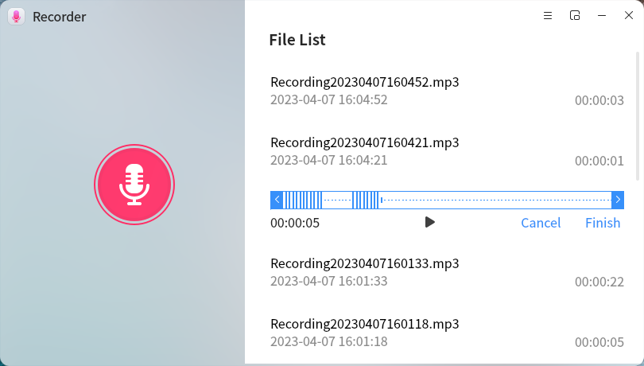
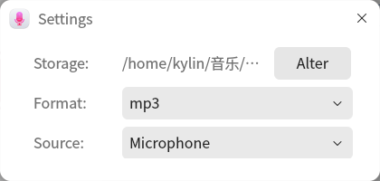

# Recorder

## Summary
Recorder is an audio recording application with friendly interface and convenient operation. It provides microphone recording voice function, which can quickly record and playback audio content. It also provides multiple audio format selection, file list playback, audio clip, audio tag, mini window recording/playback and other functions.

## Open Method
- “**open menu**”“**recorder**” 
- “**taskbar**”“**find**”“**recorder**”select“**open**”

## Basic Operation

After opening the recorder, click the recording button to start recording. During the recording process, a sound waveform is generated in real time. Hover over different buttons to display their corresponding function descriptions. Click the corresponding buttons to pause recording, resume recording, complete recording, and mark audio.

After recording, the audio is saved to the default storage path by default, and the recording file is automatically displayed in the file list in the recording interface.

Select the recording file in the file list, click the "**Play**" button to play the recorded audio, click the "**Clip** *" button to clip the audio, and click the "* **Delete**" button to delete the audio file.

If the mark operation is performed during recording, the corresponding mark will be displayed in the progress bar of playing the recording file. Click the mark to quickly jump to the mark for playing.

When editing audio, drag the start and end buttons in the progress bar to select the part to be edited, and click "" at the bottom of the window to listen. After editing, click "**Finish**" to save as a new file or overwrite the current file.

​		Click the "" button to open the recording menu bar. Select "**Setting**" in the menu bar to open the recording setting window, where you can customize the storage path, file format, and recording source of the recording file.

Click "**Help**" in the menu bar to automatically jump to the user manual to view the operating instructions of the tool. Click "**About**" in the menu bar to view the current version information, and select "Exit" to close the application.

## mini Window

Click "" on the navigation bar of the recording interface to narrow the recording interface to a mini window, which is convenient for operating other windows on the desktop while recording or playing audio.

