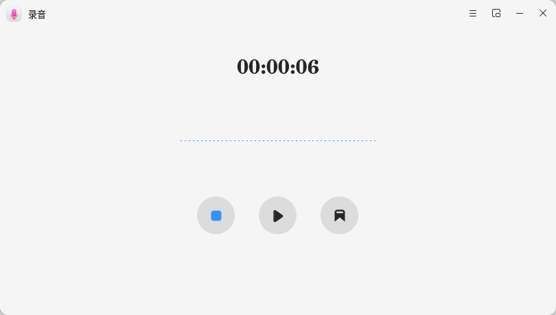
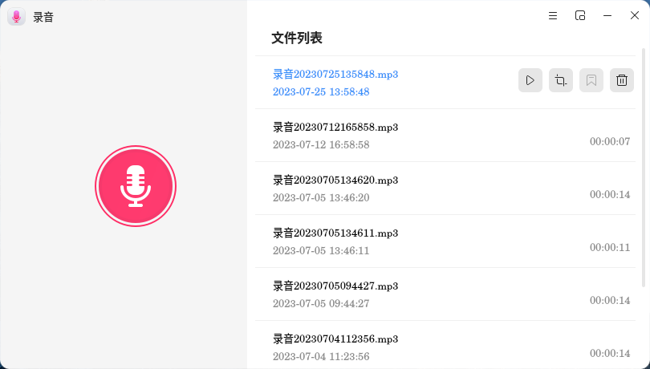
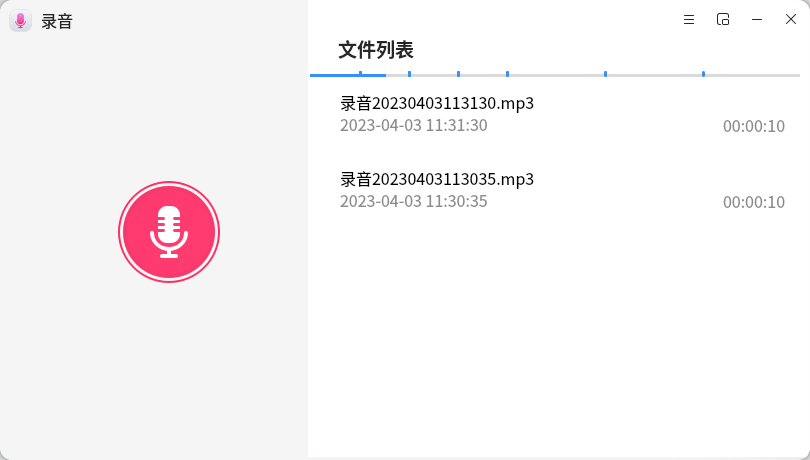
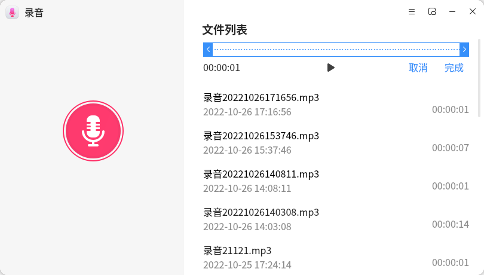
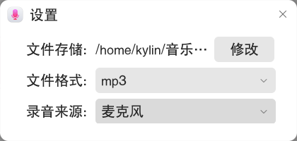

# 录音

## 概 述

​		录音为一款界面友好、操作便捷的音频录制应用，提供麦克风录制语音功能，可快捷地录制和回放音频内容，同时提供多种音频格式选择、文件列表播放、音频剪辑、音频标记、迷你窗口录制/播放等功能。

## 打开方式

- “**开始菜单**”“**录音**”
- “**任务栏**”“**搜索**”“**录音**”选择“**打开**”

  

  

## 基本操作

​		打开录音后，点击录音按钮开始进行录制，录制过程中实时生成声音波形图。鼠标悬停在不同的按钮上可显示按钮对应的功能说明，点击对应的按钮可进行暂停录制、继续录制、完成录制和音频标记的操作。

​		完成录制后，音频默认保存至默认的存储路径中，并且录音文件自动显示在录音界面的文件列表中。

​		选中文件列表中的录音文件，点击“**播放**”按钮将播放录制的音频，点击“**剪辑**”按钮可以对音频进行剪辑操作，点击“**删除**”按钮删除音频文件。

​		若在录音时进行了标记的操作，播放录音文件的进度条中会显示对应的标记，点击标记处可以快速跳转至标记处进行播放。

​		剪辑音频时，拖动进度条中的开始和结束按钮选择需要剪辑的部分，点击窗口下方的“”可以试听。剪辑完成后点击“**完成**”可以选择存为新文件或覆盖当前文件。

​		点击“”按钮可以打开录音菜单栏，在菜单栏中选择“**设置**”后将弹出录音设置窗口，可以自定义录音文件的存储路径、选择文件格式、录音来源。

​		点击菜单栏中的“**帮助**”将自动跳转至用户手册中，可以查看该工具的操作说明。点击菜单栏中的“**关于**”可以查看当前版本信息，选择“**退出**”即可关闭应用。

## 迷你窗口

​		点击录音界面导航栏的“”，可缩小录音界面至迷你窗口，方便在录制或播放音频的同时对桌面其他窗口进行操作。

