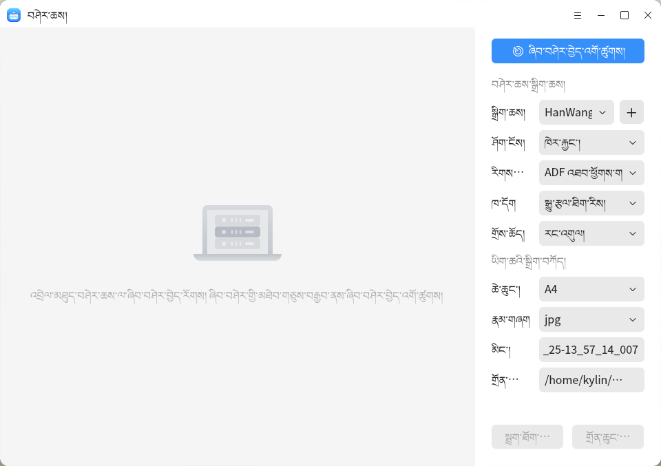
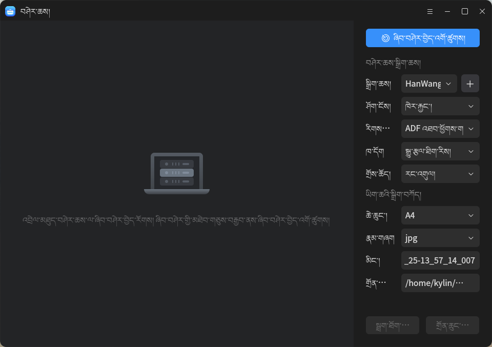
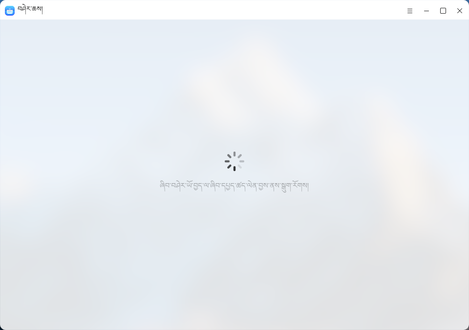
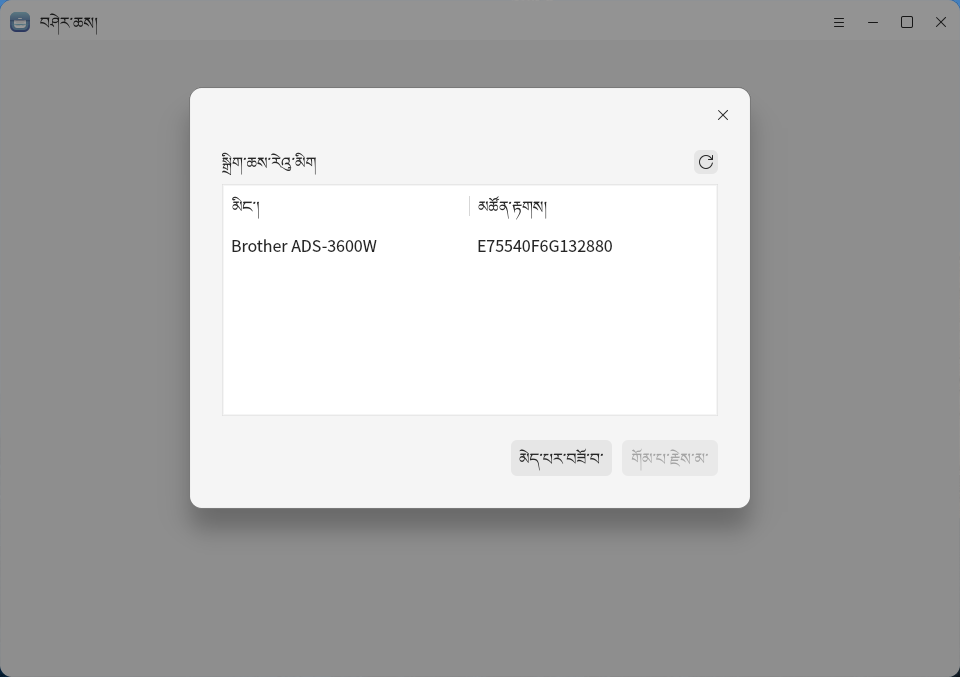

# བཤར་འབེབས་

## རགས་བཤད།
​	བཤར་འབེབས་ནི་རང་གིས་ཞིབ་འཇུག་བྱེད་པའི་སྟབས་བདེའི་བཤར་འབེབས་ལག་ཆ་ཞིག་ཡིན་ཞིང་།ཤོག་རིགས་ཡིག་ཚགས་བཤར་འབེབས་བྱས་རྗེས་ཀྱི་གློག་རྡུལ་ཡིག་ཚགས་དེ་རྒྱུད་ཁོངས་ཡིག་ཁུག་ནང་ཉར་ཚགས་བྱས་ནས་རྒྱབ་སྐྱོར་ཡིག་ཆ་སྔོན་ལ་བཟོ་དགོས་པ་དང་།ཡིག་ཚགས་རྩོམ་སྒྲིག་དང་།མཐེབ་གཅིག་མཛེས་བཟོ།རིག་ནུས་ཡོ་བཅོས།ཡི་གེ་དབྱེ་འབྱེད་སོགས་སྣ་མང་བཀོལ་སྤྱོད་བྱེད་ཆོག་གི་ཡོད་པ་རེད།

 

## ཁ་ཕྱེ་སྟངས།

- “འགོ་འཛུགས་འདེམས་བྱང་”>>“བཤར་འབེབས་”
- "ལས་འགན་སྡེ་">"བཤེར་འཚོལ་"> "བཤར་འབེབས་"

 

 

 

 

## གཞི་རྩའི་བཀོལ་སྤྱོད།

- ### བཤེར་འཇལ་བཤར་འབེབས་ཆས་

​	བཤར་འབེབས་མཉེན་ཆས་ཁ་ཕྱེ་རྗེས།རང་འགུལ་ཞིབ་དཔྱད་ཚད་ལེན་བརྒྱུད་USBཐད་འབྲེལ་ཡང་ན་དྲ་རྒྱ་འབྲེལ་མཐུད་ཀྱི་བཤར་འབེབས་ཆས་བཙུགས་ཡོད།

**མཉམ་འཇོག་དགོས་པ་ཞིག་ལ།སྒྲིག་ཆས་ལ་ཞིབ་དཔྱད་ཚད་ལེན་མ་བྱས་ཚེ།དེ་ལ་ལྟོས་བའི་སྐུལ་ཤུགས་སྒྲིག་སྦྱོར་བྱས་ཡོད་མེད་དང་།ཡང་ནUSBསྐུད་པ་སྒྲིག་སྦྱོར་བྱས་ཡོད་མེད་གཏན་འཁེལ་བྱེད་དགོས།བསྲེས་སྤྱོད་བྱས་ན་རྟོགས་དཀའ་བའི་ནོར་འཁྲུལ་འབྱུང་སྲིད་པ་དཔེར་ན་ioནོར་འཁྲུལ་ལྟ་བུ་ཡིན།**

 

 

- #### བཤར་འབེབས་ཡོ་ཆས་སྒྲིག་སྦྱོར་ལ་བརྟེན་ནས་།

​	བཤར་འབེབས་མཉེན་ཆས་ཁ་ཕྱེ་རྗེས།རང་འགུལ་ཞིབ་དཔྱད་ཚད་ལེན་USBབརྒྱུད་པའམ་ཡང་ན་དྲ་རྒྱའི་སྦྲེལ་མཐུད་ཀྱི་བཤར་འབེབས་ཡོ་ཆས་བཙུགས་ནས་སྤྱོད་རུང་སྒྲིག་ཆས་ལ་ཞིབ་དཔྱད་ཚད་ལེན་མ་བྱས་ཚེ།སྒུལ་གཏོང་སྒྲིག་ཆས་སྒྲིག་སྦྱོར་མ་བྱས་པའི་ཞིབ་དཔྱད་ཚད་ལེན་གོ་རིམ་འཕྲད་ཀྱི་ཡོད།གལ་ཏེ་སྒུལ་གཏོང་རྣམ་པའི་བཤར་འབེབས་ཡོ་ཆས་མཐོང་ཚེ།སྒུལ་གཏོང་རྣམ་པའི་སྒུལ་གཏོང་རྣམ་པའི་རང་འགུལ་སྒྲིག་སྦྱོར་བྱེད་ཀྱི་ཡོད།

 

 

- **བཤར་འབེབས་ཡོ་ཆས་སྒྲིག་འགོད།**

​	ཞིབ་བཤེར་བྱས་ནས་བཤར་འབེབས་སྒྲིག་ཆས་དང་རང་འགུལ་ངང་སྦྲེལ་མཐུད་བྱས་རྗེས།གཡས་ཀྱི་ལེ་ཚན་ནང་བཤར་འབེབས་ཡོ་ཆས་སྒྲིག་ཆས་ཀྱི་འབྲེལ་ཡོད་ཞུགས་གྲངས（སྒྲིག་ཆས་དང་།ཤོག་གྲངས།རིགས།ཚོན་མདོགདབྱེ་འབྱེད་ཚད་བཅད）དང་ཡིག་ཆའི་ནང་ཞུགས་གྲངས་སྔོན་འགོད་བྱས་ནས（ཆེ་ཆུང་དང་།རྣམ་པ།མིང་།དེ་བཞིན་གསོག་ཉར་ཐབས་ལམ་བཅས）བཀོད་སྒྲིག་བྱས་རྗེས།བཀོད་སྒྲིག་བྱས་ཟིན་རྗེས།“བཤར་འབེབས་བྱེད་འགོ་འཛུགས་པའི”ཡིག་ཚགས་བཤར་འབེབས་བྱེད་དགོས།

 

 

​	བཤར་འབེབས་འགྲུབ་རྗེས་ཡིག་ཚགས་ལ་རྩོམ་སྒྲིག་བཀོལ་སྤྱོད་བྱེད་ཆོག རྩོམ་སྒྲིག་བྱས་ཚར་རྗེས།མཐུད་མཚམས་ཀྱི་གཡས་སྒྲོམ་ནང་གི་སྦྲག་རྫས་ལ་སྐུར་དགོས།

​	གཤམ་གྱི་རེའུ་མིག་ནང་དུ་བཤར་འབེབས་བཀོད་སྒྲིག་དང་ཞིབ་འབྲི་བཀོད་འདུག

|   གསར་འཛུགས་   | ཞིབ་བརྗོད།                                                      |
| :-----------: | :----------------------------------------------------------- |
|    སྒྲིག་ཆས།     | བཤར་འབེབས་སྒྲིག་ཆས་འདེམས་པ།                                       |
|  ལྡེབ་ངོས་གྲངས་   | 1. ལྡེབ་གཅིག་བཤར་འབེབས།བཤར་འབེབས་ཐེངས་གཅིག་མ་གཏོགས་བྱས་མི་ཆོགབཤར་འབེབས་མཇུག་བསྒྲིལ་རྗེས་རང་འགུལ་གྱིས་བཤར་འབེབས་མི་བྱེད། 2. ཤོག་ངོས་མང་པོའི་བཤར་འབེབས།བྱབས་འབེབས་ཐེངས་མང་བྱས་ཆོག་སྟེ།ཐེངས་དང་པོར་བཤར་འབེབས་མཇུག་བསྒྲིལ་རྗེས།བཀོད་སྒྲིག་བྱས་པའི་དུས་འགྱངས་དུས་ཚོད་ལྟར་ཐེངས་རྗེས་མའི་བཤར་འབེབས་བྱས་ཆོག་སྟེ།སྤྱོད་མཁན་གྱིས་རང་འགུལ་ངང་བཤར་འབེབས་མཇུག་བསྒྲིལ་བའམ་རྒྱུན་ལྡན་མིན་པའི་གནས་ཚུལ་ལ་འཕྲད་རག་བར་དུ་ཆོག 3. ADFངོས་གཉིས་དང་ADFཡི་དྲང་ཕྱོགས་དང་ལྡོག་ཕྱོགས་གཉིས་ནས་ཕྱོགས་གཉིས་དང་ལྡོག་ཕྱོགས་ནས་བཤར་ཕབ་བྱས་ཆོག རྒྱུན་མཐོང་གི་རྒྱུན་ལྡན་མིན་པའི་གནས་ཚུལ་ནི།བཤར་འབེབས་ཆས་ནང་དུ་མེད་པའི་བཤར་འབེབས་ཡིག་ཚགས་དང་བཤར་འབེབས་ཞུགས་གྲངས་ནོར་འཁྲུལ།བཤར་འབེབས་ioནོར་འཁྲུལ་སོགས་ཡོད། |
|     རིགས་      | འདེམ་བསལ་གཏན་ཁེལ་བྱས་པའི་བཤར་འབེབས་ཆས་ལ་གཞིགས་ནས་བསྡུ་ལེན་བྱས་རིགས།འདེམས་རུང་བའི་ཞུགས་གྲངས་ལ་སྙོམས་ངོས་རྣམ་པ་དང་ཤོག་སྙོད་རྣམ་པ་གཉིས་ཡོད། བཤར་འབེབས་ཆས་མི་འདྲ་བས་རྒྱབ་སྐྱོར་བྱས་པའི་བཤར་འབེབས་ཆས་ཀྱི་རིགས་མི་འདྲ་སྟེ། 1. སྙོམས་ངོས་ཁོ་ནར་རྒྱབ་སྐྱོར་བྱེད་ཀྱི་ཡོད་པ་སྟེ།Canon li214，Canon lia 300，Canon lid400སོགས། 2. ཤོག་སྙོད་རྣམ་པ་ལ་རྒྱབ་སྐྱོར་བྱེད་པ།：hp OfficeJet_250_Mobile_seriesསོགས་； 3.ཤོག་སྙོད་རྣམ་པ་དང་ADFངོ་གཉིས་དང་།Brther ADS-3600W HanWang HW 3130སོགས་ལ་རྒྱབ་སྐྱོར་བྱས་པ། 4. ངོས་ལེབ་དང་ཤོག་སྙོད་རྣམ་པ་ལ་རྒྱབ་སྐྱོར་བྱེད་དགོས།：hp Color LaserJet Pro MFP M281fdwསོགས。 |
|      མདོག      | བཤར་འབེབས་ཡིག་ཆ་བཟོ་མདོག་དང་།ཚོན་མདོགདཀར་ནག་ཡང་ན་སྐྱ་ཚའི་ཚད།          |
|  ཤན་འབྱེད་ཕྱོད་   | བཤར་འབེབས་ཆས་མི་འདྲ་བ་བཙུགས་པའི་དབྱེ་འབྱེད་ཚད་ནི།ཞུགས་གྲངས་དེ་ཡང་དམིགས་འཛུགས་བཤར་འབེབས་ཆས་ལ་གཞིགས་ནས་ཐོབ་པ་ཡིན་ལ།དབྱེ་འབྱེད་ཚད་འདེམས་ཆོག་པ་གཤམ་གསལ། 75， 100， 150， 200， 300， 600， 1200， 2400。 ཤན་འབྱེད་ཕྱོད་ཇི་ལྟར་མཐོ་ན་བྱབས་འབེབས་དུས་ཡུན་ཇི་ལྟར་རིང་ན་བཤར་འབེབས་བྱས་པའི་པར་རིས་ཀྱིས་ནང་གསོག་གང་ཙམ་མང་ན་དུས་མཇུག་གི་བརྙན་རིས་ཐག་གཅོད་བཀོལ་སྤྱོད་ལ་འོས་འཚམ་གྱི་སྣོན་འགོད་དལ་དྲགས་པའི་སྣང་ཚུལ་ཡོད་པས།དབྱེ་འབྱེད་ཚད་600ལས་ཆེ་བའི་རིགས་བདམས་ནས་བཤར་འབེབས་བྱེད་སྐབས་རྒྱུད་ཁོངས་ལ་ལྟོས་འཇོག་གི་གསལ་འདེབས་ཡོད། |
|    ཆེ་ཆུང་།     | བཀོལ་མཁན་གྱིས་བདམས་པའི་བཤར་འབེབས་ཆས་ཀྱི་སྒྲིག་ཆས་ལས་བཤར་འབེབས་ཆེ་ཆུང་གསལ་བོ་བླངས་ན།ཞུགས་གྲངས་འདེམ་ཆོག་སྟེ།A4， A5， A6。 |
|    རྣམ་གཞག་    | བཤར་འབེབས་རྣམ་པ་མི་འདྲ་བ་བཀོད་སྒྲིག་བྱས་ཆོག་ཉར་ཚགས་བཤར་འབེབས་ཀྱི་ཡིག་ཚགས་ལ་སྤྱོད་དགོས། འདེམས་རུང་ཞུགས་གྲངས་ནི།jpg, png, pdf, bmp,tiff。 |
|     མིང་།      | བཤར་འབེབས་ཡིག་ཆའི་མིང་བཟོ་བ།                                      |
| བཤར་འབེབས་བར།  | བཤར་འབེབས་ཡིག་ཚགས་ཀྱི་ཐོག་མའི་ཉར་ཚགས་ཐབས་ལམ་བཀོད་སྒྲིག་དང་།སོར་བཞག་ཁྱིམ་དཀར་ཆག་འོག་གི་།“pictures/བཤར་འབེབས་འབུར་ཐོན་”。 |
| སྦྲག་བསྐུར་གཏོང་བ་ | བཤར་འབེབས་བྱས་ཚར་རྗེས།བཤར་འབེབས་ཡིག་ཚགས་མ་ལག་ནས་སྒྲིག་སྦྱོར་བྱས་པའི་སྦྲག་རྫས་ཀྱི་དུད་སྣེ་བརྒྱུད་དེ་སྦྲག་རྫས་སྐུར་ཆོག |
|    གཞན་ཉར་    | བཤར་འབེབས་ལེགས་སྒྲུབ་བྱས་པའམ་ཡང་ན་བཤར་འབེབས་ཡིག་ཚགས་རྩོམ་སྒྲིག་བཀོལ་སྤྱོད་བྱས་རྗེས་བཤར་འབེབས་ཡིག་ཚགས་དེ་རྣམ་པ་མི་འདྲ་བའི་ཡིག་ཆ་ཟུར་དུ་ཉར་ཚགས་བྱས་ཆོག |

## ལག་ཆའི་སྡེ།

གཤམ་གྱི་རེའུ་མིག་ནང་དུ་བཤར་འབེབས་ལག་ཆའི་ལན་གྱི་བྱེད་ནུས་དོ་མཉམ་པའི་རིས་རྟགས་དང་གསལ་བཤད་བཀོད་ཡོད།

 རིས་རྟགས་དང་དེའི་བྱེད་ནུས།

|         རིས་རྟགས་          |      མིང་།       |               བྱེད་ལས་གསལ་བཤད་                |
| :----------------------: | :-------------: | :-----------------------------------------: |
|     | མཐེབ་གཅིག་མཛེས་བཟོ། |        མཐེབ་གཅིག་རིག་ནུས་མཛེས་བཟོ་ཡིག་ཚགས་།        |
|    |  རིག་ནུས་ཡོ་བཅོས།   |           རིག་ལྡན་ཡིག་ཆ་ཡོ་བསྲང་ལྡེབ་ངོས་           |
|        |   ཡི་གེ་ངོས་འཛིན།   |            ཡིག་ཚགས་ཀྱི་ནང་དོན་ལེན་པ་།            |
|       |    གཅོད་གཏུབ་     |            དྲས་གཏུབ་ཡིག་ཚགས་ལྡེབ་ངོས་             |
|     |     འཁོར་བ་      |            འཁྱིལ་འཁོར་ཡིག་ཚགས་ལྡེབ་ངོས་            |
|     | ཆུ་སྙོམས་མེ་ལོང་བརྙན་ |           ཆུ་སྙོམས་སློག་ཡིག་ཚགས་ལྡེབ་ངོས་            |
|  |      ཆུ་པར་      |                  ཆུ་སྣོན་པར་                   |
|  |   ལྡེབ་ངོས་སྐུམ་པ་   | ལྡེབ་ངོས་མི་འདྲ་བས་བསྡུས་འཇོག་བསྡུར་ཚད་ཡིག་ཆ་འདེམས་དགོས། |

 

