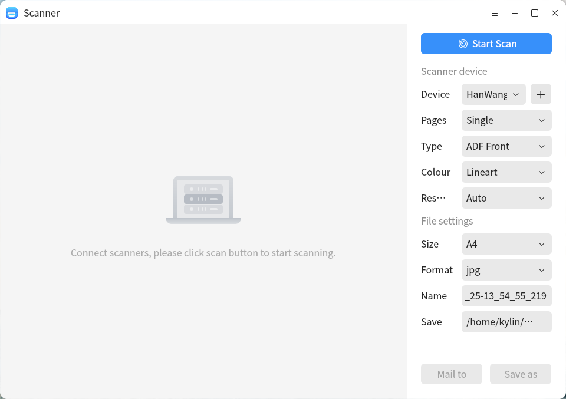
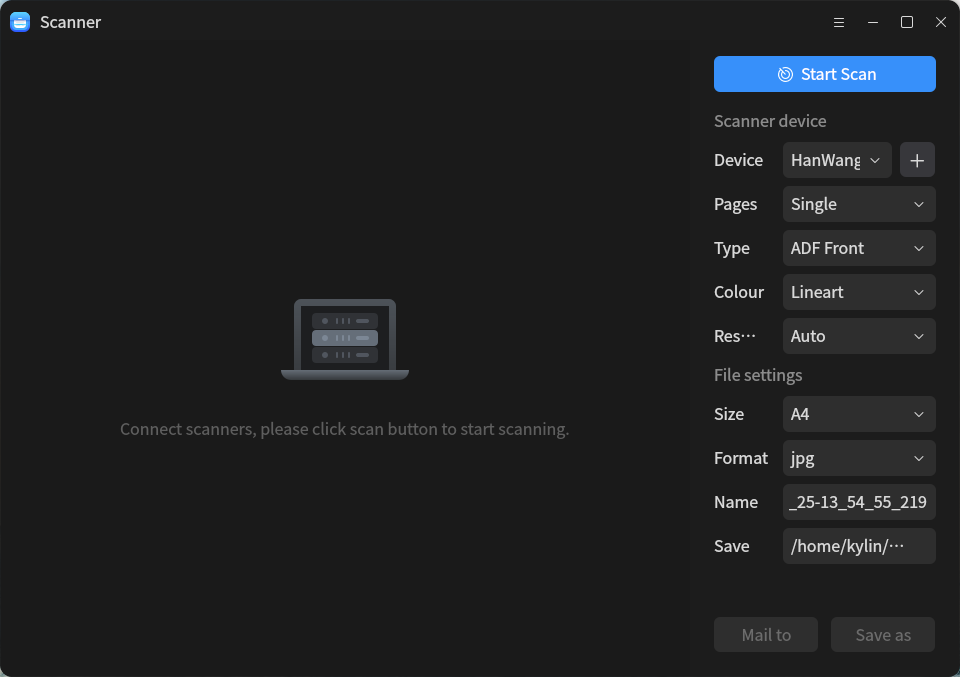
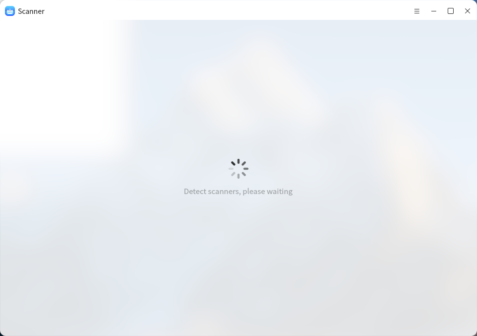
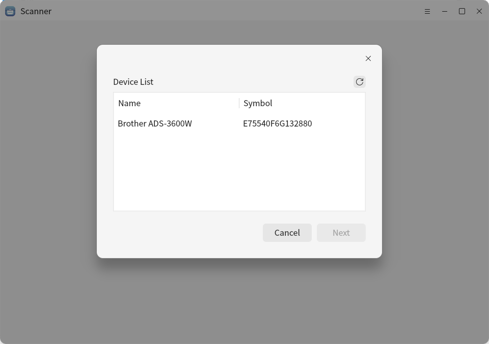

# Scanner

## summary 

​	Scanner is a convenient and fast scanning tool developed by ourselves. It can save the scanned electronic documents of paper documents to the system folder. It supports document preset, document editing, one click beautification, intelligent correction, text recognition and other operations.

 

## open

- “menu”>>“Scanner”
- "taskbar">"search"> "Scanner"

 

 

 

## Basic operation

- **Detection scanner**

​	After the scanning software is opened, it will automatically detect the scanner connected directly through USB or set up a network connection.

**Note: when the device is not detected, please confirm whether the corresponding driver has been installed or whether the USB cable used matches. Mixing will lead to unknown errors, such as IO errors**

 

 

- **Install Scanner Driver**

​	After the scanner software is opened, it will automatically detect scanners connected directly through USB or set up network connection. If no available devices are detected, a detection program for devices without drivers will be triggered. If a scanner device with drivers that can be installed is found, the corresponding driver will be recommended for automatic installation.

 

 

- **Scanner settings**

​	After the scanning device is detected and automatically connected, relevant parameters of the scanner device (device, number of pages, type, color and resolution) and file preset parameters (size, format, name and storage path) can be set in the right column. After setting, click **start scan** to scan the document.

 

 

​	After scanning, you can edit the document. After editing, you can select the method and path to save the document by clicking send to mail or save as in the right column of the interface.

​	The following table lists the scan settings and descriptions.

|     Setting     | description                                                  |
| :-------------: | :----------------------------------------------------------- |
|    equipment    | Select scanning device                                       |
| Number of pages | 1. Single page scan: only one scan can be performed. After the scan is completed, no automatic scan is performed; 2. Multi page scanning: multiple scans can be performed.  3. ADF double-sided and ADF front/back scanning: perform double-sided and front and back scanning Common exceptions include: no scannable documents in the scanner, scan parameter error, scan IO error, etc |
|      Type       | According to the selection of the specified scanner for acquisition, due to the different scanner signals, the possible selection parameters are: flat panel type, paper feeding type,  ADF double-sided and ADF front/back. Different scanners support different types of scanners： 1. Only flat type is supported: Canon Lide 210, Canon Lide 300, Canon Lide 400, etc; 2. Support paper feed: HP Officejet_ 250_ Mobile_ Series, etc; 3. Support paper feeder ADF double-sided and ADF front/back: Brother ADS-3600W, HanWang HW-3130, etc. 4. Flat panel and paper feed support: HP color LaserJet Pro MFP m281fdw, etc. |
|      Color      | Set the color, color, black and white, or grayscale of the scanned file |
|   Resolution    | Set different scanner resolutions. This parameter is also obtained according to the specified scanner. The optional resolutions are: 75,100,150,200,300,600,1200,2400. The higher the resolution, the longer the scanning time, the larger the memory occupied by the scanned image, and the later image processing operation will be too slow to load properly. When selecting a resolution greater than 600 for scanning, the system will give a corresponding prompt. |
|      Size       | The specific scanning size is obtained from the scanner equipment selected by the user. The optional parameters are A4, A5 and A6. |
|     Format      | Different scan formats can be set for storing scanned documents. The optional parameters are: JPG, PNG, PDF, BMP,TIFF. |
|      Name       | Sets the name of the scan file                               |
|     Scan to     | Set the initial save path of the scanned document, and the default is "Pictures/kylin_scanner_images" under the home directory. |
|    Send mail    | After scanning, you can send the scanned documents to the installed mail client of the system. |
|     Save As     | After scanning or editing the scanned document, you can save the scanned document as a file in different formats. |

## toolbar

The following table lists the icons and descriptions corresponding to the scan toolbar functions.

 Icons and their functions:

|           Icon           |  Function   |           Function description            |
| :----------------------: | :---------: | :---------------------------------------: |
|     |   beauty    |  One click smart beautification document  |
|    |   rectify   |     Intelligent correct document page     |
|        |     OCR     |       Extract document text content       |
|       |    crop     |            Crop document pages            |
|     |   rotate    |           Rotate document page            |
|     |   mirror    |      Flip document page horizontally      |
|  |  waterMark  |               Add watermark               |
|  | zoom in/out | Set documents with different page scaling |

 

