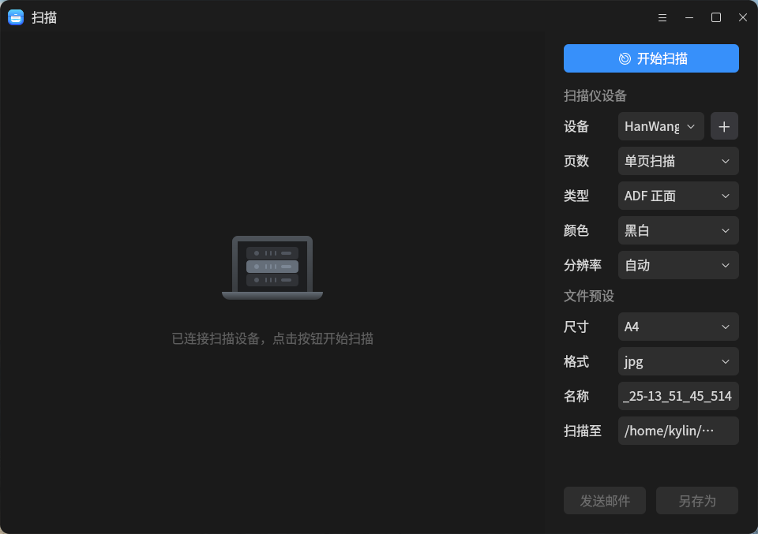
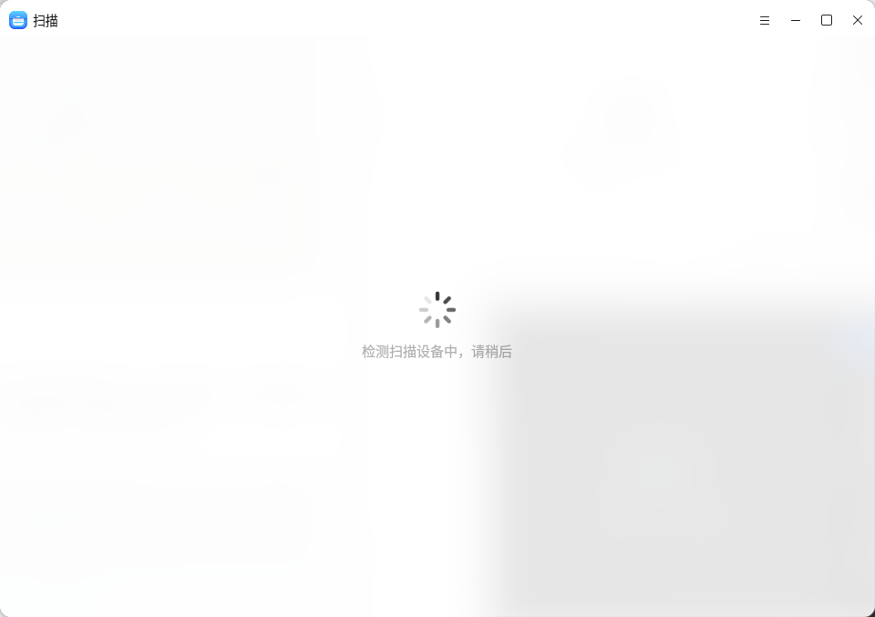
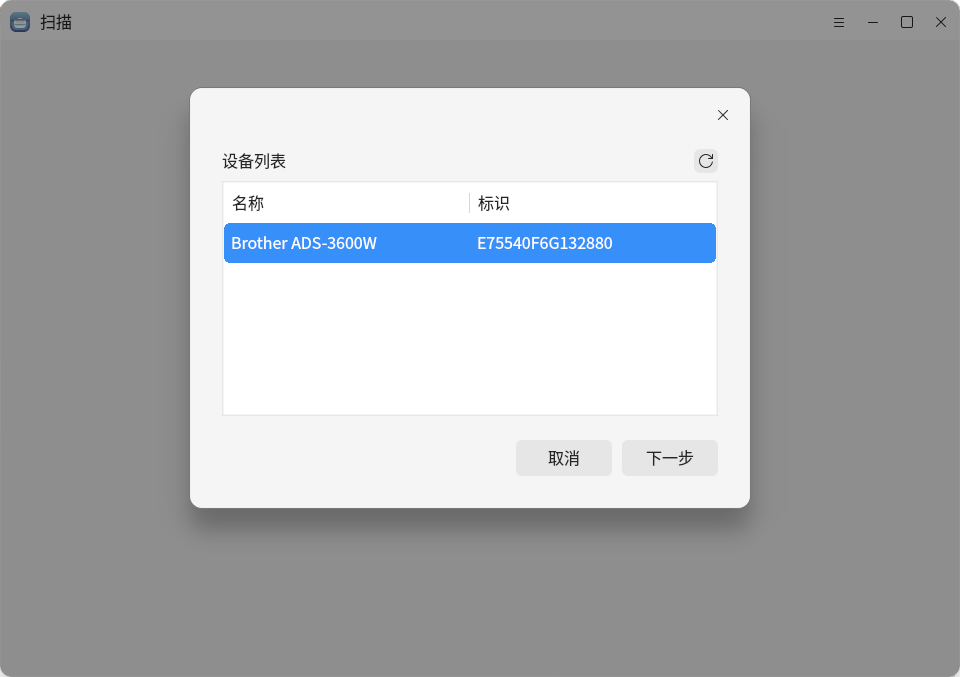
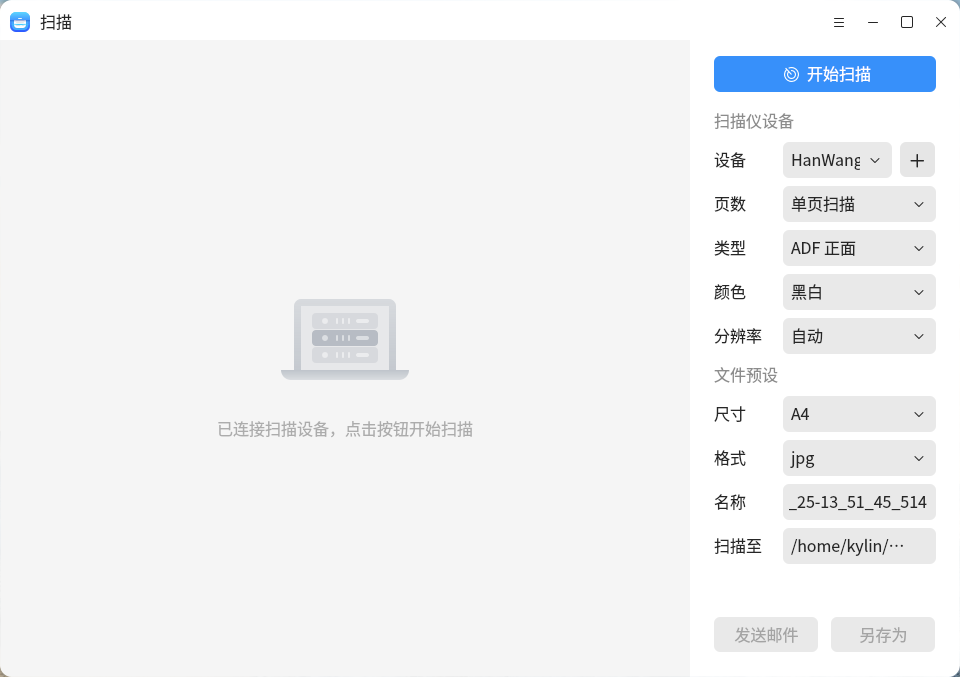

# 扫 描

## 概 述
​	扫描是自研的一款方便快捷的扫描工具，可将纸质文档扫描后的电子文档保存至系统文件夹中，支持文件预设，文档的编辑、一键美化、智能纠偏、文字识别等多种操作。

 

## 打开方式

- “开始菜单”>>“扫描”
- “任务栏”>“搜索”> “扫描”

 

 

 

 

## 基本操作

- **检测扫描仪**

​	扫描软件打开后，会自动检测通过USB直连或者设置网络连接的扫描仪。

**注意：未检测到设备时，请确认是否已经安装对应驱动，或使用的USB线是否匹配，混用会导致不可知的错误，如io错误。**

 

 

- **安装扫描仪驱动**

​	扫描软件打开后，会自动检测通过USB直连或者设置网络连接的扫描仪，未检测到可用设备时，会触发对未安装驱动设备的检测程序，若发现可安装驱动的扫描仪设备，会推荐对应的驱动进行自动安装。

 

 

- **扫描仪设置**

​	检测到并自动连接扫描设备后，右侧栏中可设置扫描仪设备相关参数（设备、页数、类型、颜色及分辨率）和文件预设参数（尺寸、格式、名称及存储路径），完成设置后，点击“**开始扫描**”将进行文档的扫描操作。

 

 

​	扫描完成后可对文档进行编辑操作。完成编辑后，可通过界面右侧栏中的“**发送邮件**”或“**另存为**”选择文档保存的方式、路径。

​	下表列出了扫描设置及描述。

|   设置   | 描述                                                         |
| :------: | :----------------------------------------------------------- |
|   设备   | 选择扫描设备                                                 |
|   页数   | 1. 单页扫描：只能进行一次扫描，扫描结束后，不自动扫描； 2. 多页扫描：可以进行多次扫描。 3. ADF双面和ADF正面/反面:可以进行双面和正反面扫描 常见异常情况有：扫描仪中无可扫描文档、扫描参数错误、扫描io错误等。 |
|   类型   | 根据选择指定的扫描仪进行获取的，由于扫描仪信号的不同，可能的选参数有：平板式\馈纸式\ADF双面\ADF正面/反面。不同的扫描仪支持的扫描仪类型不同： 1. 只支持平板式：Canon lide 210, Canon lide 300, Canon lide 400等； 2. 支持馈纸式：hp OfficeJet_250_Mobile_series等； 3. 支持馈纸式、ADF双面和ADF正面/反面：Brother ADS-3600W、HanWang HW-3130等； 4. 平板式和馈纸式都支持：hp Color LaserJet Pro MFP M281fdw等。 |
|   颜色   | 设置扫描文件颜色，彩色、黑白或灰度                           |
|  分辨率  | 设置不同扫描仪分辨率，该参数也是根据指定扫描仪进行获取，可选分辨率有： 75， 100， 150， 200， 300， 600， 1200， 2400。 分辨率越高，扫描时长越长，扫描出的图片所占内存越大，后期的图像处理操作会有适当加载过慢现象，选择大于600的分辨率进行扫描时，系统会有对应提示。 |
|   尺寸   | 从用户选定的扫描仪设备获取具体的扫描尺寸，可选参数为：A4， A5， A6。 |
|   格式   | 可设置不同的扫描格式用于存储扫描的文档。可选参数为：jpg, png, pdf, bmp,tiff。 |
|   名称   | 设置扫描文件的名称                                           |
|  扫描至  | 设置扫描文档的初始保存路径，默认为家目录下的“图片/扫描图像”。 |
| 发送邮件 | 扫描完成后，可以将扫描文档通过系统已安装的邮件客户端进行发送邮件。 |
|  另存为  | 扫描完成或通过对扫描文档编辑操作后，可以将扫描文档另存为不同格式的文件。 |

## 工具栏

下表列出了扫描工具栏功能对应的图标及说明。

图标及其功能:

|           图标           |   名称   |       功能说明       |
| :----------------------: | :------: | :------------------: |
|     | 一键美化 |   一键智能美化文档   |
|    | 智能纠偏 |   智能矫正文档页面   |
|        | 文字识别 |   提取文档文字内容   |
|       |   裁切   |     剪裁文档页面     |
|     |   旋转   |     旋转文档页面     |
|     | 水平镜像 |   水平翻转文档页面   |
|  |   水印   |       添加水印       |
|  | 页面缩放 | 选择不同页面缩放比例 |

