# 主题制作工坊软件介绍
## 软件概述  
### 背景与意义  
主题制作工坊是一款专为 openKylin 系统设计的定制主题软件。openKylin  操作系统以其开源、自由的特性受到广泛欢迎，用户系统个性化的需求也非常重要。openKylin系统主题模块致力为整个麒麟操作系统提供优质装扮服务，包括主题、壁纸、光标、高亮色等多种美化类资源。主题制作工坊旨在提供用户一个灵活且直观的工具，满足用户对系统外观的高度自定义需求，帮助用户轻松定制个性化的系统外观。  
    
### 项目描述  
本项目基于openKylin操作系统，制作一款协助用户定制打包个性化主题的UI工具，并帮助用户在使用过程中了解熟悉系统主题模块。  
主题制作工坊采用前后端分离架构：前端负责获取用户信息、协助用户导入素材、协助用户定制个性化主题；后端获取前端提供信息制作相关主题包。该架构提高了开发效率、可维护性和可扩展性，同时也提供了更好的用户体验。  
  
### 使用场景  
主题制作工坊适用于个人用户、企业用户以及 openKylin 爱好者。个人用户可以通过该工具定制个性化的桌面环境，满足自身审美需求。企业用户可以在企业环境中使用该工具，为公司或团队创建统一的视觉风格。openKylin 爱好者则可以通过该工坊深度参与系统定制，探索更多创意和可能性。  
  
### 项目功能
该工具能够合理协助用户制作个性化系统主题，其中包含壁纸、光标、图标、系统样式、开机动画、grub界面、全局主题等。用户根据个人需求选择新建全局、图标、光标、开机动画、grub界面主题。其中全局主题包含图标、光标、开机动画、grub界面、系统样式和壁纸等主题，其他四个类型仅包含各自对应类型主题。  
  
在选择完需要制作的主题后，根据界面提示补充相关素材，点击制作补充用户相关信息后稍等一段时间，在右上角选择的保存路径中会生成对应主题包，点击安装后，在控制面板中即可进行选择。  
  
同时，当用户编辑了部分素材退出后会提示保存历史记录，如果选择保存，会需要补充部分用户信息用于记录，历史记录可保存30日，历史记录会在主界面中显示，点击历史记录即可再次编辑。  
  

### 特点
#### 多元主题修改  
主题制作工坊不仅提供全局主题的修改，还涵盖图标、光标、开机动画和 grub 界面等多个方面的定制。这一全面的主题修改功能使用户能够全方位地打造独一无二的系统外观。  
    
#### 直观用户界面    
软件采用直观、用户友好的界面设计，使得即使是初学者也能轻松上手。各个主题模块的设置清晰可见，用户通过简单的点击和拖拽即可完成各项修改，无需深入了解复杂的技术细节。
  
#### 支持多种格式  
壁纸模块支持 PNG 图片格式和 JPG 图片格式、开机动画模块支持 MP4 文件格式和 PNG 图片格式，为用户提供了更大的自由度。用户可以选择符合自己审美和需求的多种媒体格式。  
  
#### 实时预览即时生效  
用户在自定义主题设置中的每次修改都会立即反映在预览界面上，可以动态地查看和评估他们对主题的各种调整。  
  
  
## 主题制作工坊软件功能概览  
主题制作工坊是专为 openKylin 系统设计的定制主题软件。它提供了修改五个主题的功能，包括全局主题、图标主题、光标主题、开机动画和 grub 主题。接下来将逐个介绍这些功能以及相关功能的使用位置以及要求限制。
  
### 全局主题

  全局主题不仅包含图标、光标、开机动画和grub主题，还包含封面、壁纸、窗口、控件等系统样式设置。打开主题制作工坊，点击制作全局主题模块即可开始全局主题制作。除了全局主题模块主界面中的系统样式，左侧导航栏可以选择对图标、光标、开机动画和grub主题进行制作。

#### 全局主题效果图
  
  系统使用位置：控制面板-个性化/主题，定制控制面板中全局主题的封面预览显示。  
  素材要求：  
   - 尺寸设置：   
     - 宽度： 1640 像素  
     - 高度： 1080 像素   
   - 文件大小限制： 5MB   
   - 文件格式：PNG   

  这样的参数设置将确保用户在定制控制面板显示时，能够上传满足特定尺寸和文件格式要求的图片。确保软件在接收用户上传的图片时，会检查并强制执行这些参数，以保证用户体验的一致性和最佳效果。在控制面板中点击全局主题效果图时可以控制一整套（图标、光标、壁纸、系统样式）的主题切换，全局主题效果图主要提供一个可选视图的作用。  
  
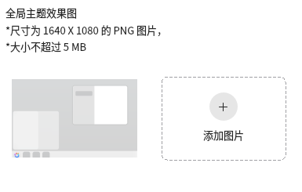  

#### 壁纸定制  
     
  系统使用位置：控制面板-个性化/主题，定制控制面板中全局主题的壁纸。  
  素材要求：
   - 尺寸设置：    
     - 宽度： 3840 像素   
     - 高度： 2160 像素    
   - 文件大小限制： 10MB  
   - 支持的文件格式：JPG  
  
  这样的参数设置确保了用户在选择壁纸时能够使用符合指定尺寸和文件格式的图片。这有助于保持壁纸的质量和兼容性，并确保在不同屏幕上都能够正常显示。在控制面板中点击全局主题效果图时会生效，该壁纸不会额外显示在控制面板-个性化/壁纸中。  
  
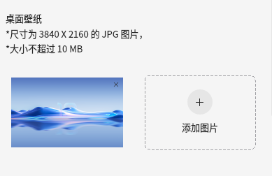  
  
  
  
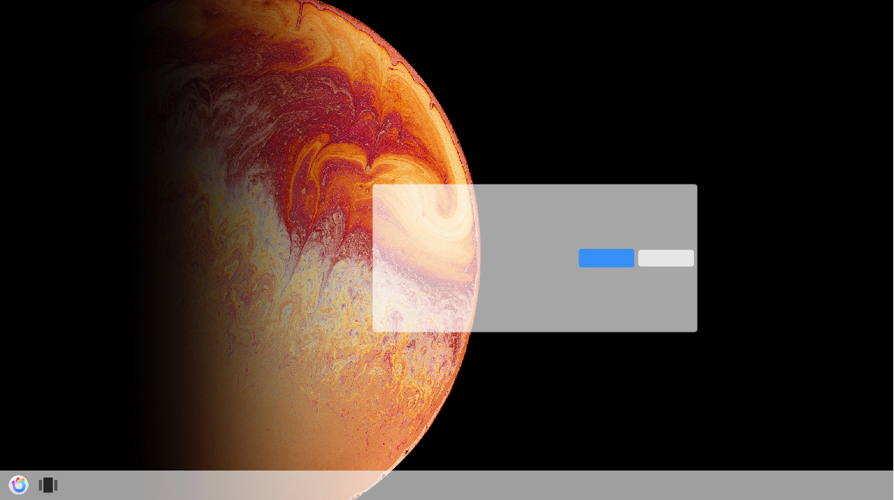  
  

#### 窗口外观
     
  系统使用位置：控制面板-个性化/主题：窗口透明度：调整窗口的透明度，实现更加个性化的窗口外观。  
  - 透明度范围：  
   - 最小值： 30  
   - 最大值： 100  
   - 默认透明度：65  
  
  这样的参数设置允许用户在一个 30 到 100 的范围内调整窗口的透明度，100 表示完全不透明。默认透明度设置为 65，以提供一个中等程度的透明效果。在控制面板-个性化/主题中可以选择设置。  
  
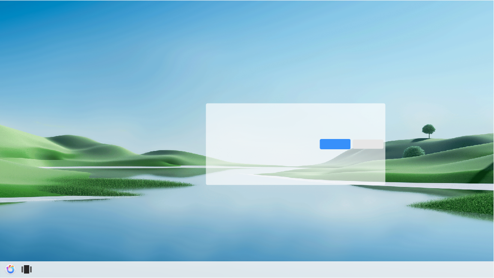  
  
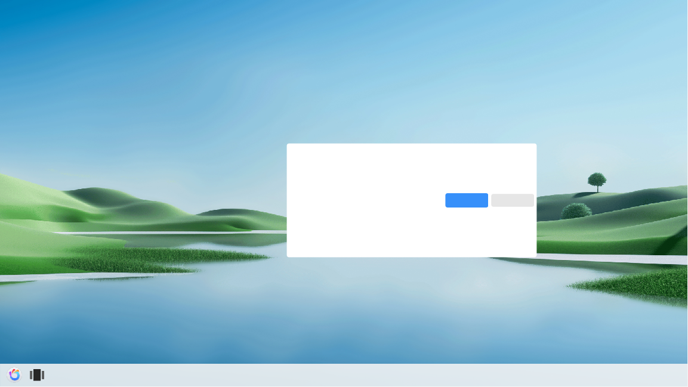  
  
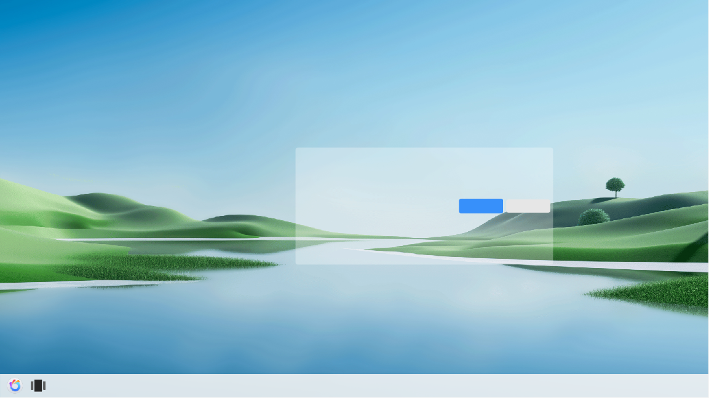  
  
  系统使用位置：控制面板-个性化/主题：窗口圆角大小：定制窗口边角的圆角大小，营造不同的窗口风格。  
  - 大小限制：  
    - 大圆角：圆角大小： 12 像素 (px)  
    - 中圆角：圆角大小： 6 像素 (px)  
    - 小圆角：圆角大小： 0 像素 (px)  
    - 默认圆角：中圆角  
  
  这样的参数设置允许用户选择不同的圆角大小，分别为大、中、小三种。在控制面板-个性化/主题中可以选择设置。  
  
  
  
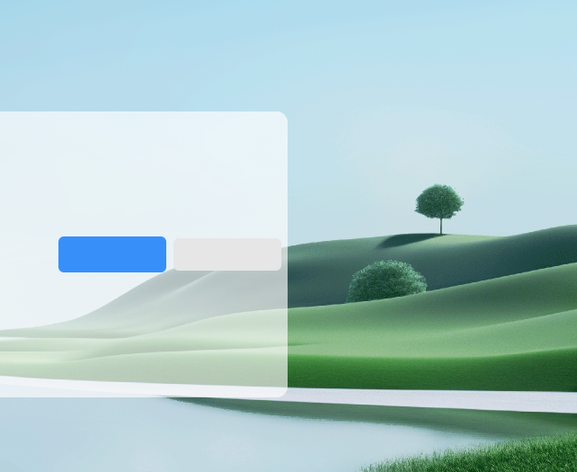  
  
  
  
  系统使用位置：控制面板-个性化/主题：窗口深浅主题：定制窗口深浅主题  
  - 深主题：  
    - 提供深色调的主题，适合喜欢暗色调的用户。  
  - 浅主题：  
    - 提供浅色调的主题，适合喜欢明亮色调的用户。  
  - 默认主题：浅主题  
  
  用户可以在这两种主题之间进行选择，以满足用户对窗口外观的个性化喜好。在控制面板-个性化/主题中可以选择设置。  
  
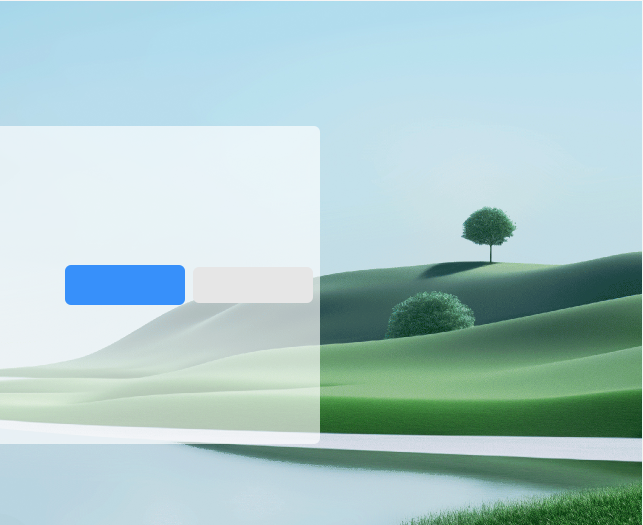  
  
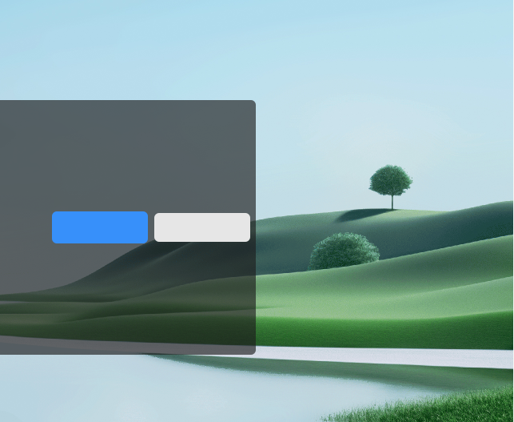  
  
#### 控件定制  
  
  系统使用位置：控制面板-个性化/主题：控件圆角大小：调整界面控件的圆角大小，增强整体视觉效果。  
  - 圆角大小范围：  
   - 最小值： 0 像素 (px)  
   - 最大值： 18 像素 (px)  
   - 默认圆角大小：6 像素 (px)  
   
  用户可以在 0 到 18 像素的范围内选择他们喜欢的圆角大小。默认圆角大小设置为 6 像素，以提供一个中等程度的圆角效果。在控制面板-个性化/主题中可以选择设置。    
  
  
  
  
  
  
  
  系统使用位置：控制面板-个性化/主题：强调色：选择强调色，用于突出显示界面中的重要元素。  
  - 可选的强调色：  
    - daybreakBlue、jamPurple、magentaSunRed、sunsetOrange、dustGold、polarGreen  
  - 默认强调色：  
    - daybreakBlue  

  用户可以在这些选项中选择他们喜欢的强调色，以使界面中的重要元素更为突出。在控制面板-个性化/主题中可以选择设置。    
  
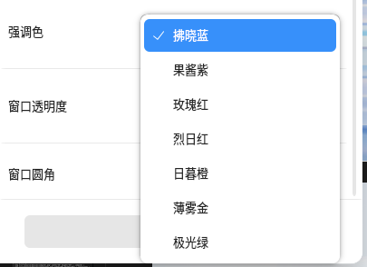  
  
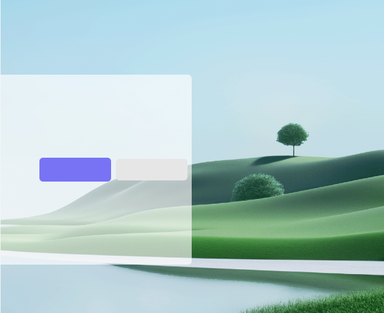  
  
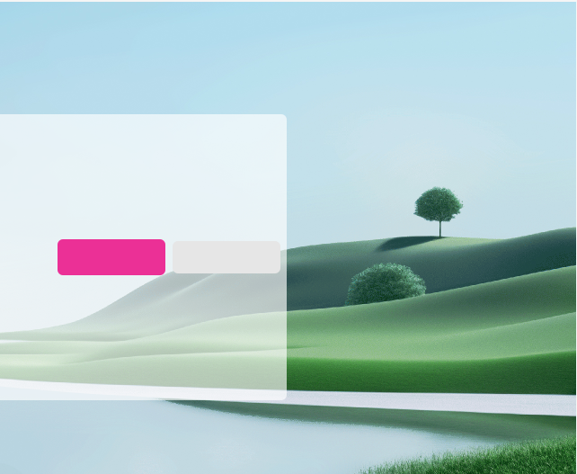  
  
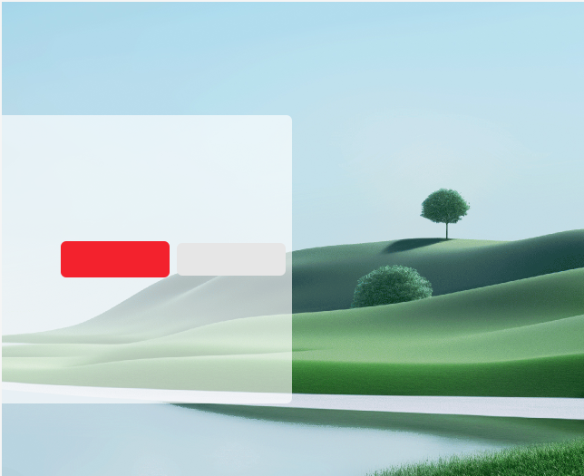  
  

### 图标主题

  打开主题制作工坊，点击制作全局主题模块或点击图标主题模块即可开始图标主题制作，点击图标主题模块制作时，无法选择其他模块进行制作。    
  系统使用位置：控制面板-个性化/主题：图标。 

  素材要求：SVG    

应用图标：定制每个应用的图标，支持常见的应用如 biometric-manager、box-manager 等。  
  
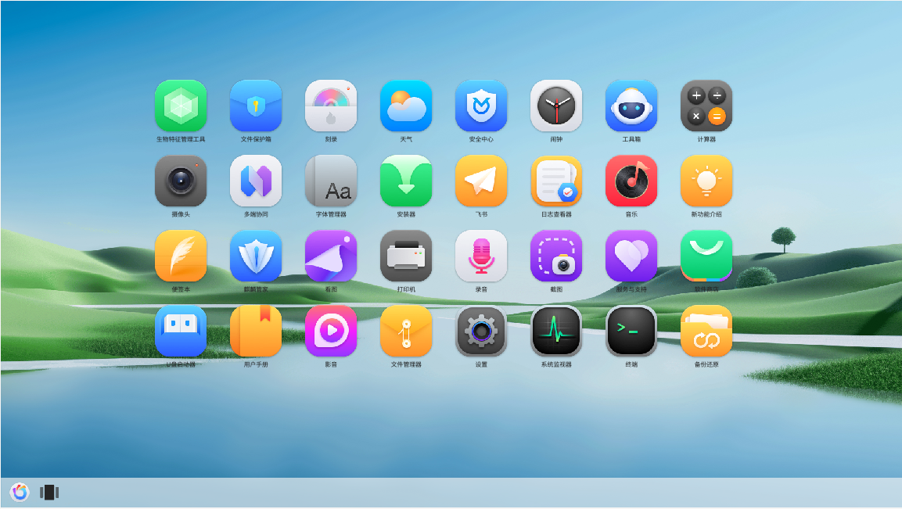  
  
  系统图标：修改系统控制面板中的图标，包括 kylin-settings-account、kylin-settings-application 等。  
  
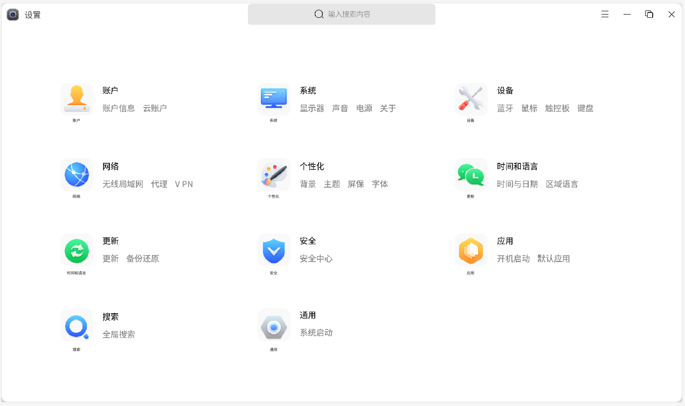  

  文件夹与设备图标：修改桌面与文件管理器内显示的文件夹图标以及设备图标，包括computer、inode-directory等。
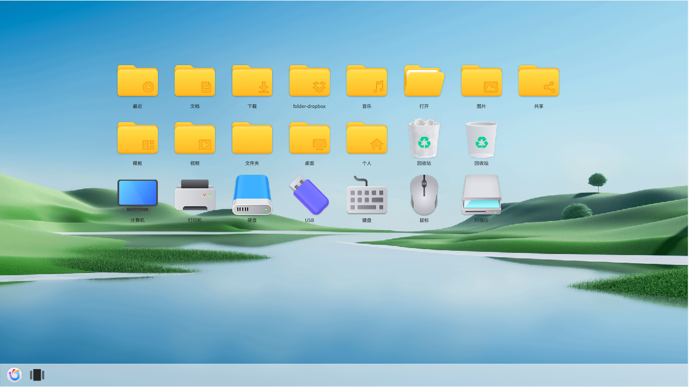 

图标规范见附录
  
### 光标主题  
  
  打开主题制作工坊，点击制作全局主题模块或点击光标主题模块即可开始光标主题制作，点击光标主题模块制作时，无法选择其他模块进行制作。   
  系统使用位置：控制面板-个性化/主题：光标。   
  素材要求：SVG  
  光标样式：从预设的光标样式中选择，也支持导入自定义的光标。  
  
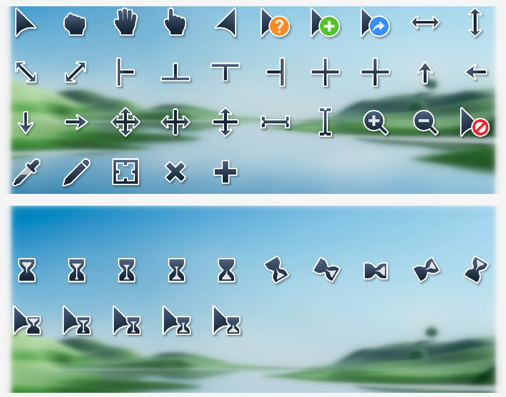  

### 开机动画  
  
  打开主题制作工坊，点击制作全局主题模块或点击开机动画模块即可开始开机动画制作，点击开机动画模块制作时，无法选择其他模块进行制作。
  - 支持的格式  

    - MP4 文件格式：允许用户上传和应用 MP4 格式的开机动画

    - 文件大小限制：10MB

    - PNG 图片：支持将一张 PNG 图片作为开机动画，为用户提供更多创意空间。

    - 文件大小限制：20KB

  
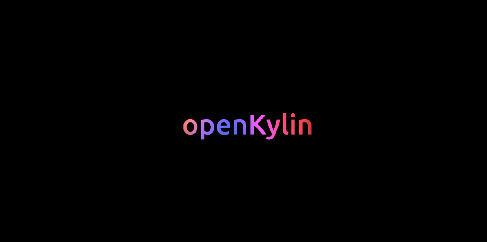

### Grub 主题
  
  打开主题制作工坊，点击制作全局主题模块或点击Grub主题模块即可开始开机动画制作，点击Grub主题模块制作时，无法选择其他模块进行制作。
  上传自定义图片：选择并上传用户喜欢的图片作为 Grub 界面的背景。

  - 尺寸设置：

    -  宽度： 3840 像素

    - 高度： 2160 像素

    - 文件大小限制： 10MB

    - 支持的文件格式：PNG
  
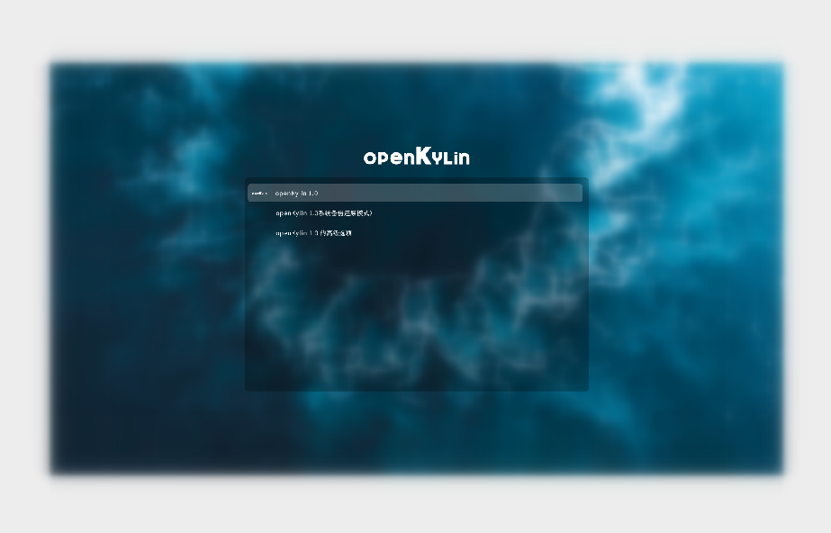
  
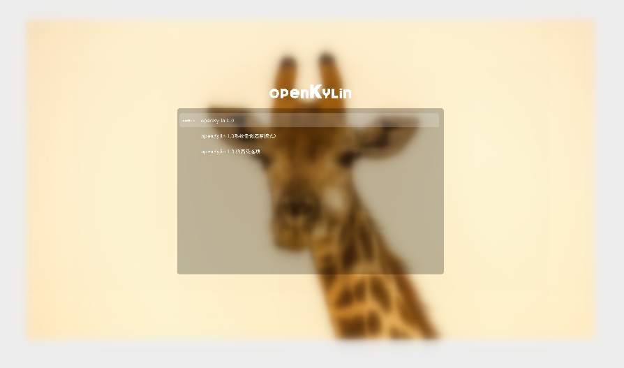
  
  
### 打包信息收集
  
  制作主题包前后、新建模块修改退出后、历史记录修改退出后会弹出相关信息收集页面  
  输入限制:  
    - 主题中文非必须内容，不可输入非中文内容、输入内容不可大于15个字节；
    - 主题英文为必须内容，不可输入非英文内容、不可输入英文大写、输入内容不可大于15个字节小于2个字节、不可输入系统中已有软件包名称；
    - 用户名为必须内容，不可输入非英文、输入内容不可大于15个字节；
    - 邮箱为必须内容，不可输入非英文，输入内容需要遵守邮箱规则不能大于35个字节不可小于6个字节；
  

    
通过主题制作工坊，用户能够将 openKylin 操作系统打造成符合自己独特品味和需求的个性化系统，从而提升整体的用户体验。  

## 关于上传
  当完成一个主题的制作后，点击上传主题平台按钮
  
  

 1、登录应用软件分发平台

  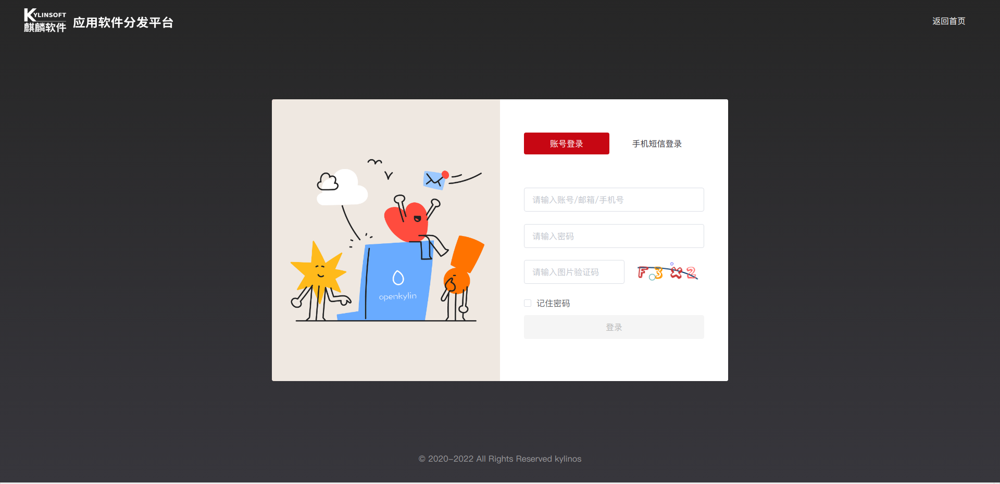

 2、点击软件上架业务

  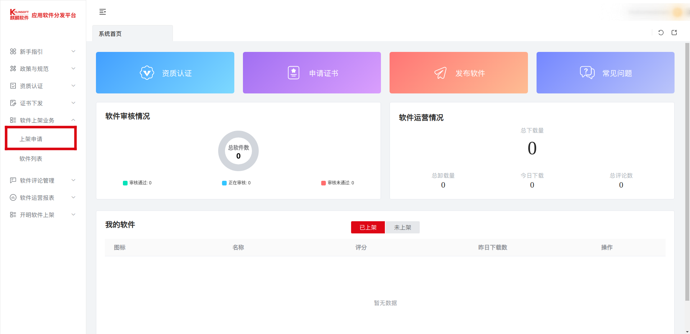

 3、填写平台相关信息

  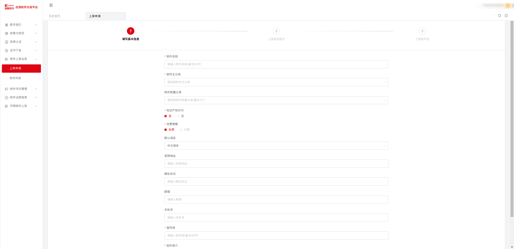

 4、上传主题包，注意：软件源选择“openKylin”

  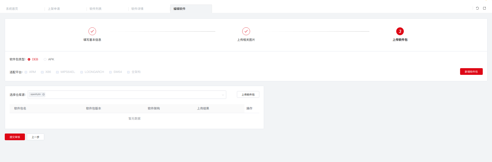

 5、等待人工审核

 审核通过后就可以在软件商店内找到自己制作的主题包！
## 附录
### 应用图标规范名
| 图标 | 图标名 | 
| ---- | ---- | 
|  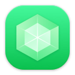 | biometric-manager   | 
|  | box-manager   | 
| 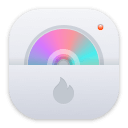  |  burner  | 
| 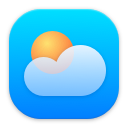  | indicator-china-weather   | 
|   | ksc-defender   | 
| 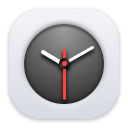  | kylin-alarm-clock  | 
|   | kylin-assistant   | 
| 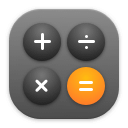  | kylin-calculator   | 
|   | kylin-camera   | 
|   | kylin-connectivity   | 
| 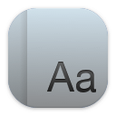  | kylin-font-viewer   | 
| 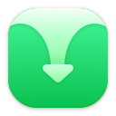  | kylin-installer   | 
|   | kylin-ipmsg   | 
|   | kylin-log-viewer   | 
|   | kylin-music   | 
| 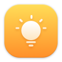  | kylin-new-function-introduction   | 
| 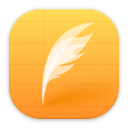  | kylin-notebook   | 
|   | kylin-os-manager   | 
| 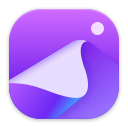  | kylin-photo-viewer   | 
| 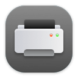  | kylin-printer   | 
|   | kylin-recorder   | 
| 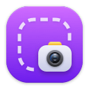  | kylin-screenshot   | 
| 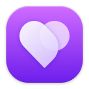  | kylin-service-support   | 
|   | kylin-software-center   | 
|   | kylin-usb-creator   | 
|   | kylin-user-guide   | 
|   | kylin-video   | 
|   | system-file-manager   | 
| 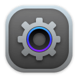  | ukui-control-center   | 
| 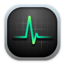  | ukui-system-monitor   | 
| 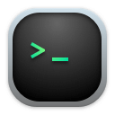  | utilities-terminal   | 
|   | yhkylin-backup-tools   | 
### 系统图标规范名
| 图标 | 图标名 | 
| ---- | ---- | 
|  | kylin-settings-account   | 
|  | kylin-settings-application   | 
|  | kylin-settings-commoninfo   | 
|  | kylin-settings-datetime   | 
|  | kylin-settings-devices   | 
|  | kylin-settings-network   | 
| 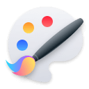 | kylin-settings-personalized   | 
|  | kylin-settings-search   |
|  | kylin-settings-security   | 
|  | kylin-settings-system   | 
|  | kylin-settings-update   | 
### 文件夹图标规范名
| 图标 | 图标名 | 
| ---- | ---- | 
|  | document-open-recent   |  
|  | folder-documents   |  
|  | folder-download   |  
|  | folder-dropbox   |  
|  | folder-music   |  
|  | folder-open   |  
|  | folder-pictures   |  
|  | folder-publicshare   |  
|  | folder-templates   |  
|  | folder-videos   |  
|  | inode-directory   |  
|  | user-desktop   |  
|  | user-home   |  
|  | user-trash-full   |  
|  | user-trash   |  
### 文件夹图标规范名
| 图标 | 图标名 | 
| ---- | ---- | 
|  | computer | 
| 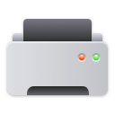 | cupsprinter |
| 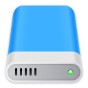 | drive-harddisk |  
| 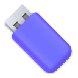 | drive-removable-media-usb | 
|  | input-keyboard | 
| 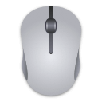 | input-mouse | 
| 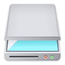 | scanner | 
### 光标图标规范名
| 图标 | 图标名 | 
| ---- | ---- | 
|  | left_ptr | 
|  | dnd-none | 
|  | hand1 | 
|  | hand2 | 
|  | right_ptr | 
|  | dnd-ask | 
|  | dnd-copy | 
|  | dnd-link | 
|  | h_double_arrow | 
|  | v_double_arrow | 
|  | ul_angle | 
|  | ur_angle | 
|  | left_tee |  
|  | bottom_tee | 
|  | top_tee | 
|  | right_tee | 
|  | cross | 
|  | tcross | 
|  | sb_up_arrow | 
|  | sb_left_arrow | 
|  | sb_down_arrow | 
|  | sb_right_arrow | 
|  | all-scroll | 
|  | sb_h_double_arrow | 
|  | sb_v_double_arrow | 
|  | vertical_text | 
|  | xterm | 
|  | zoom-in | 
|  | zoom-out | 
### 等待光标图标规范名
| 图标 | 图标名 | 
| ---- | ---- | 
|  | left_ptr_watch_1 |
|  | left_ptr_watch_2 |
|  | left_ptr_watch_3 |
|  | left_ptr_watch_4 |
|  | left_ptr_watch_5 |
|  | watch_1 |
|  | watch_2 |
|  | watch_3 |
|  | watch_4 |
|  | watch_5 |
|  | watch_6 |
|  | watch_7 |
|  | watch_8 |
|  | watch_9 |
|  | watch_10 |
