# 归档管理器
## 概 述
归档管理器主要提供压缩文件和解压文件功能。
 
## 打开方式
- **“开始菜单”**>**“归档管理器”**；
- **“任务栏”**>**“搜索”**>**“归档管理器”**；
- 选中任一压缩文件单击右键 > **“打开方式”** > **“归档管理器”**。

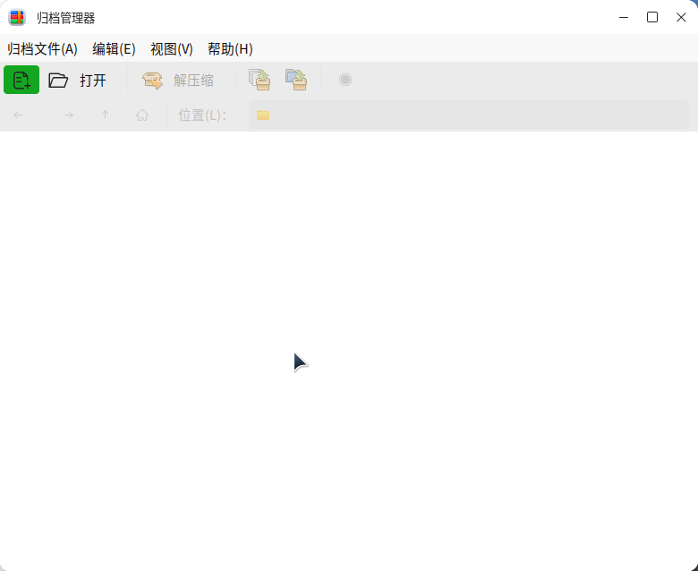

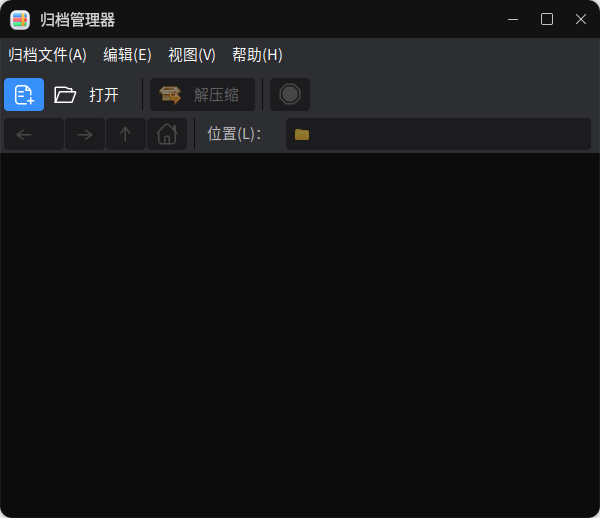

 

## 基本操作

### 创建新归档

- 直接创建

1）右键单击要压缩的文件/文件夹，选择**“压缩”**。

在弹出的压缩对话框中，输入压缩后的文件名称，并选择压缩的格式和保存的位置，在其他选项中可设定归档文件的密码及文件拆分大小。注意，Tips：目前只有zip、7z、ear、war压缩格式支持加密。

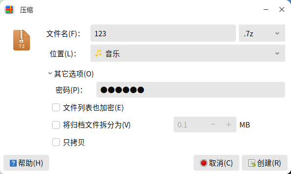

2)点击**“创建”**后，即生成压缩文件。

- 通过归档管理器创建

1)在归档管理器主界面选择**“归档文件”**>**“新建”**，或直接点击“”图标。

2)在弹出的新建对话框中，输入归档文件名称并选择保存位置，在“**文件格式**”折叠框或“**全部支持的文件**”下拉框中选择压缩格式，在其他选项可设置密码及拆分大小。

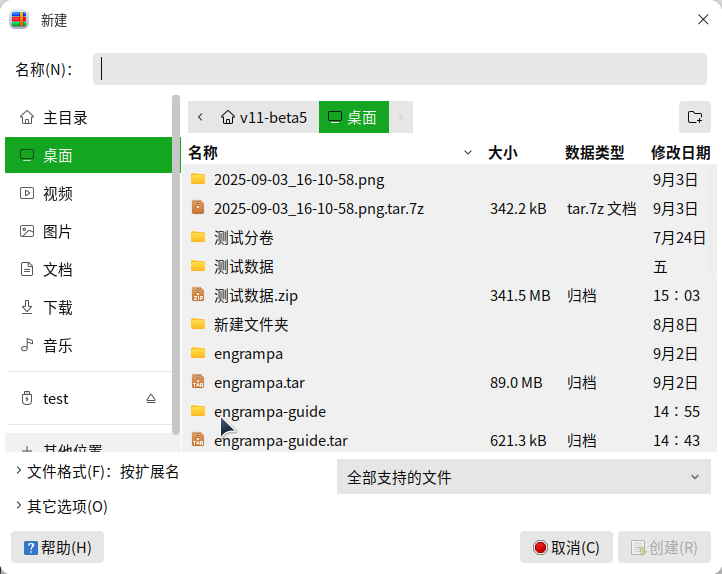

3）点击“**创建**”后，即生成压缩文件。

 

### 查看归档文件

方法1：选中归档文件右键单击 > 打开方式 > 归档管理器;

方法2：双击归档文件。

打开归档文件后，可以看到文件的名称，大小，类型，修改日期。

以下图为例，双击1.png，可以查看图片；双击“234”文件夹，会进入目录，显示该目录下的所有的文件。

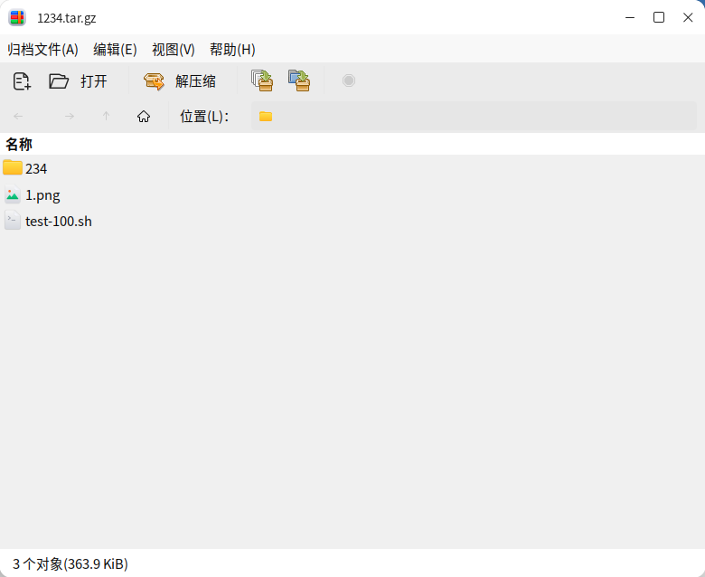

### 编辑归档文件

- 删 除

1）删除单个文件：

方式1：选中目标文件单击右键 > 选择“**删除**”> 点击“**删除**”；

方式2：选中目标文件 > 按下“Delete”键 > 点击“**删除**”

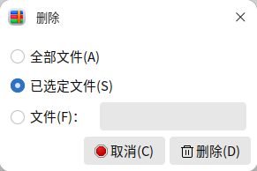

方式3：按下“Delete”键 > 选择“**文件**”> 指定文件名 > 点击“**删除**”。

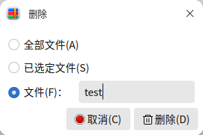

2)删除全部文件：

方式1：选中所有文件 > 单击右键 > 删除；

方式2：按下“Delete”键 > 选择“**全部文件**” >  点击“**删除**”；

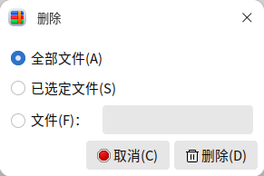

- 重命名

选中目标文件 > 单击右键 > 选择“重命名”。

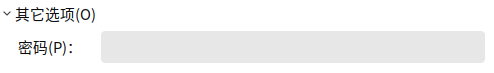

### 提取归档文件

- 直接解压

方式1：选中目标归档文件 > 右键单击 > 选择“**解压到此处**”；

方式2：选中目标归档文件 > 右键单击 > 选择“**解压到...**”> 选择路径 > 点击“**解压缩**”。

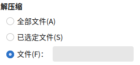

- 通过归档管理器解压

1)打开归档文件后，点击工具栏的“**解压缩**”，或右键单击归档文件，选择“**解压缩到...**” 。

2)在弹出的窗口中，指定解压文件的位置，选择“全部文件”/“已选定的文件”，或在“文件”框中输入文件名指定文件，点击“解压缩”。指定文件名提取后，归档文件中所有为该名字的文件都会被提取出来；若是在归档文件中的子目录里，提取的文件也会包含文件目录。

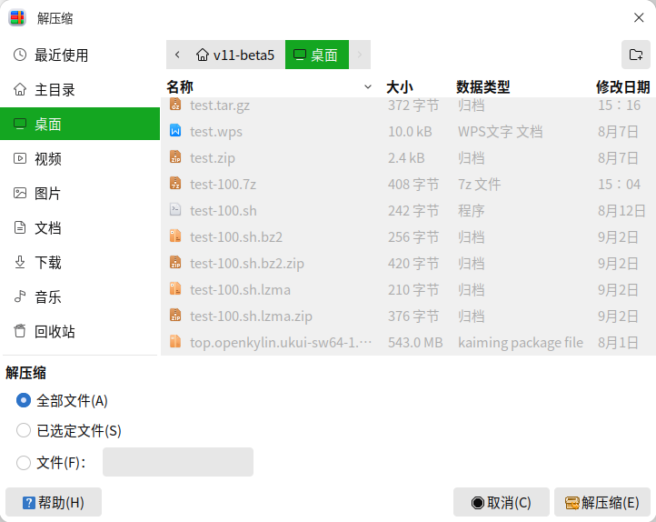

3)若归档文件受密码保护，则需要您输入目标归档文件设定的密码。

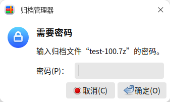