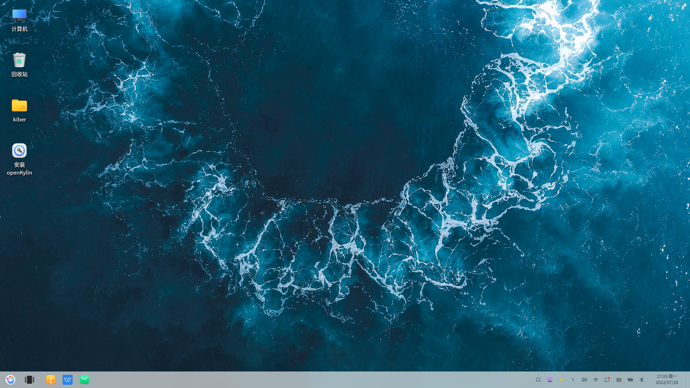
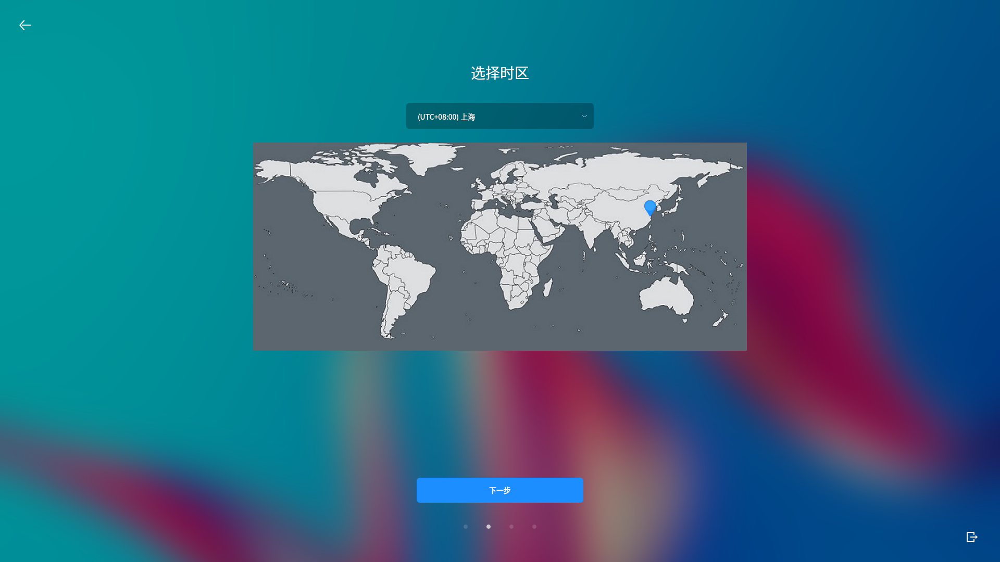
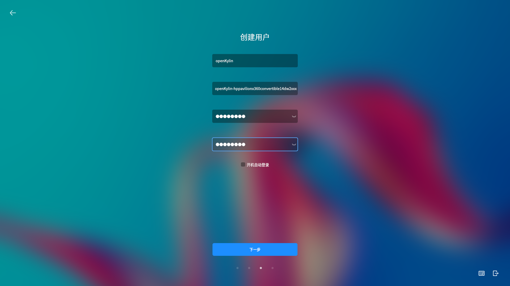
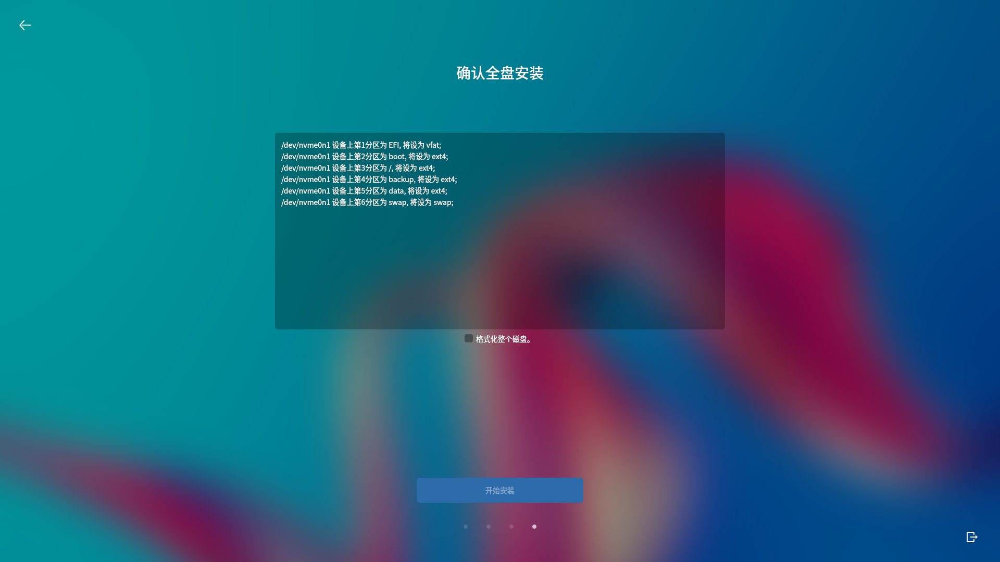
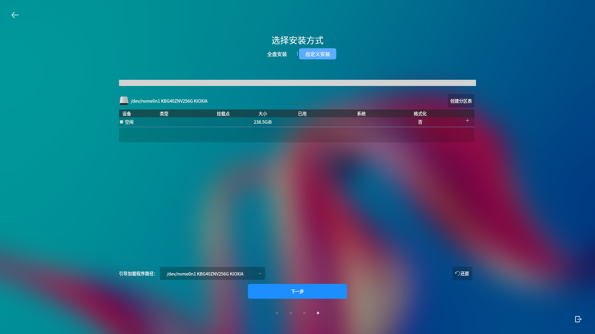
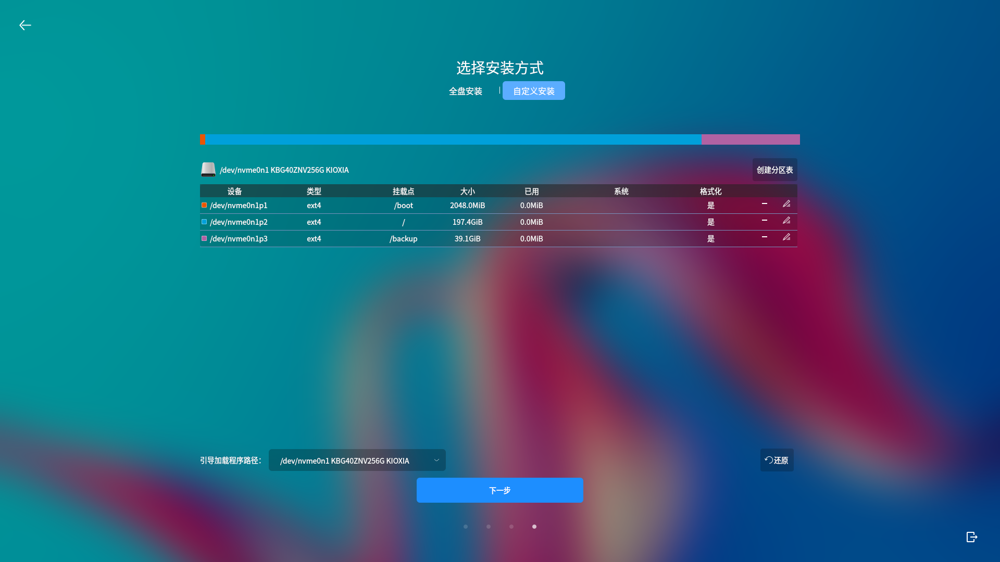
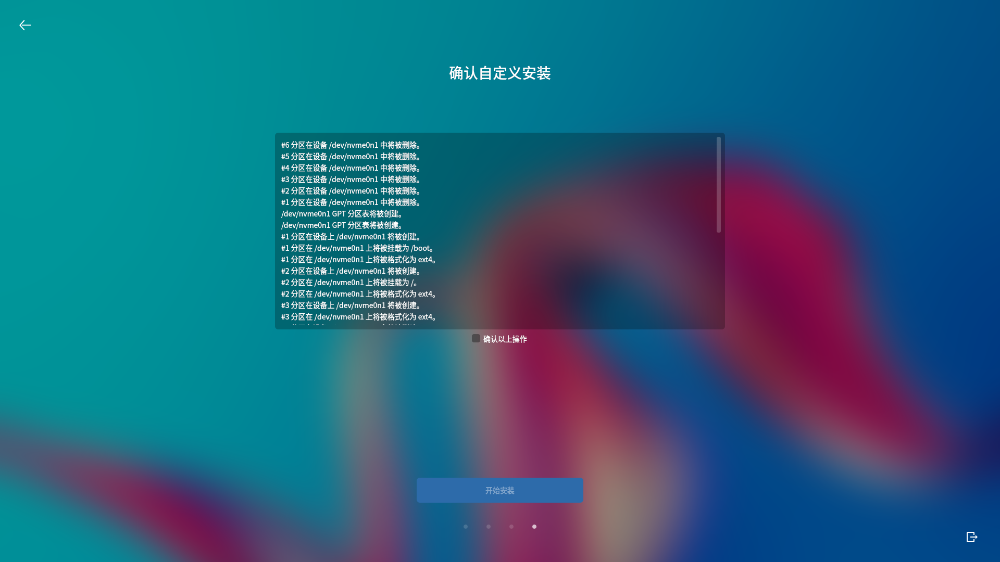

# 系统安装
## 最低配置与推荐配置

| 版本形态 | 最小内存 | 推荐内存  | 最小硬盘空间 | 推荐硬盘空间 |
|------|------|-------|--------|--------|
| 桌面系统 | 2GB  | 4GB以上 | 50GB   | 80GB以上 |

表1 最低配置与推荐配置

 

## 安装准备

1)准备所需组件

安装光盘或U盘启动器。

2)检查硬件兼容性

开放麒麟桌面操作系统具有良好的硬件兼容性，与近年来生产的大多数硬件兼容。由于硬件的技术规范改变频繁，因此可能难以保证系统会百分之百地兼容硬件。

3)备份数据

安装系统之前，请将硬盘上的重要数据备份到其他存储设备中。

4)硬盘分区

一块硬盘可以被划分为多个分区，分区之间是相互独立的，访问不同的分区如同访问不同的硬盘。一块硬盘最多可以有四个主分区，如果想在一块硬盘上拥有多于四个分区，就需要把分区类型设为逻辑分区。

## 安装引导

1)硬盘分区

将安装光盘放入光驱中，重启机器。根据固件启动时的提醒，按下相应快捷键进入固件管理界面。若使用的是内置光驱，“第一启动选项”选择“光驱”；若使用的是USB或者USB外置光驱，“第一启动选项”选择“USB”。本系统支持体验模式，可试用一个全功能的操作系统而不安装。

2)系统安装

如选择“Try  without installing”，则会进入试用界面，如下图所示：

双击图标“安装 openKylin”，开始安装引导，则直接进入安装引导界面，选择系统语言，单击“下一步”：

选择系统时区，默认为上海时区，可以在下拉列表中选择城市切换时区，或在地图中点选城市切换时区，点击“下一步”：

创建系统用户，输入用户名，系统自动填充推荐的主机名，可进行修改，设置登录密码并再次输入密码进行确认，勾选“开机自动登录”可设置开机登录系统时不需要输入密码，点击“下一步”：

选择系统的安装方式，如选择“全盘安装”，将在选择的盘符中进行全盘安装，格式化整个硬盘，并进行自动分区；如选择“自定义安装”，用户自行根据实际需求，进行分区创建和分区大小分配。

## 全盘安装

选择“全盘安装”选项，选中待安装的目标盘符：

系统在该磁盘中自动分区并显示分区结果，确认安装盘符后，选中“格式化整个磁盘”，然后点击“开始安装”：

系统将自动开始安装，安装完成后，点击“现在重启”按钮，会自动弹出光驱或提示“请取出安装介质，然后按ENTER键”

按照提示，取回光驱或U盘后，按“ENTER”（回车键），等待系统进入登录界面，进入登录界面后，输入用户密码后即可进入系统。

## 自定义安装

选择使用自定义安装可以自行设计各硬盘分区大小。在选择安装方式界面选择“自定义安装”后出现硬盘分区界面，点击“创建分区表”，弹出提示窗口，选中“空闲”所在行，选择“+添加”即可创建硬盘分区：

首先创建boot分区，/boot必须是主分区中的第一个分区；继续创建根分区（/）、backup、tmp分区，在创建分区的时候，“新分区的类型”选择“主分区”，“新分区的位置”默认为“剩余空间头部”，“用于”选择“ext4”：

若是中途需要改变已创建的分区，具体操作方式如下所示：

a)添加分区：选中空闲分区所在行，点击“+添加”按钮。

b)编辑分区：选中已创建的分区，点击“修改”按钮。

c)删除分区：选中已创建的分区，点击“-删除”按钮。

自定义分区完成后如下图所示，点击“下一步”：

查看自定义安装的盘符分配结果，勾选“确认以上操作”，点击“开始安装”：

自定义分区完成后，点击“开始安装”，后续步骤与全盘安装一致，等待完成后重启电脑即可进入系统。
