# 桌面环境

## 登录

### 概述

开机启动计算机后进入开放麒麟界面，根据设置系统会默认选择自动登录或停留在登录窗口等待登录。

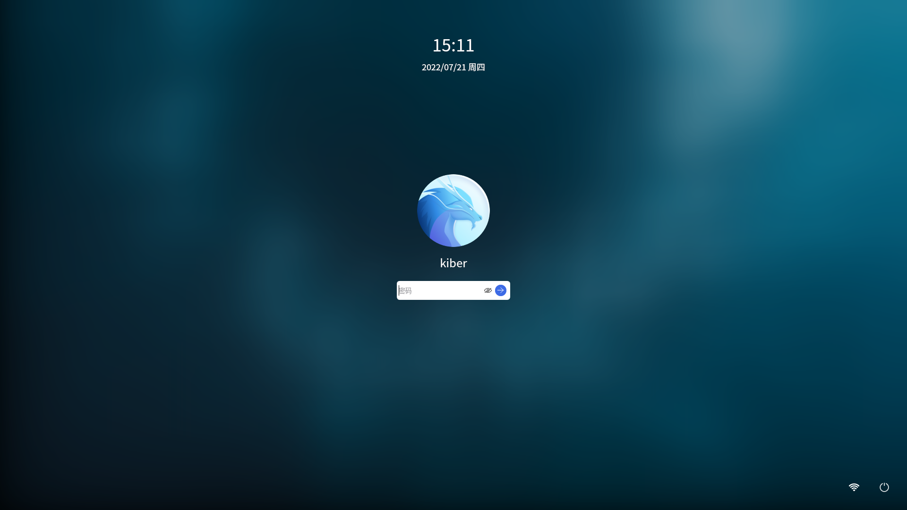
 

### 基本操作

当启动系统后，系统会提示输入密码，即系统中已创建的用户名和密码。通常用户名和密码在系统安装时进行设置，选择登录用户后，输入正确的密码，点击登录按钮即可登录桌面，点击隐藏/取消隐藏按钮即可实现密码隐藏/显示。 

## 桌面环境

### 概述

桌面是登录后主要操作的屏幕区域。在桌面上可以通过外设的鼠标和键盘对操作系统进行基本的操作，比如新建文件/文件夹、排列文件、打开终端、设置壁纸和屏保、侧边栏等，还可以向桌面添加应用的快捷方式。

开放麒麟初始桌面由图标、任务栏、桌面背景组成，默认放置了计算机、回收站、主文件夹三个图标，鼠标左键双击即可打开

|图标|	说明
| :------------ | :------------ |
|| 计算机：显示连接到本机的驱动器和硬件
|| 回收站：显示被删除到回收站的文件
|| 主文件夹：显示个人主目录

 

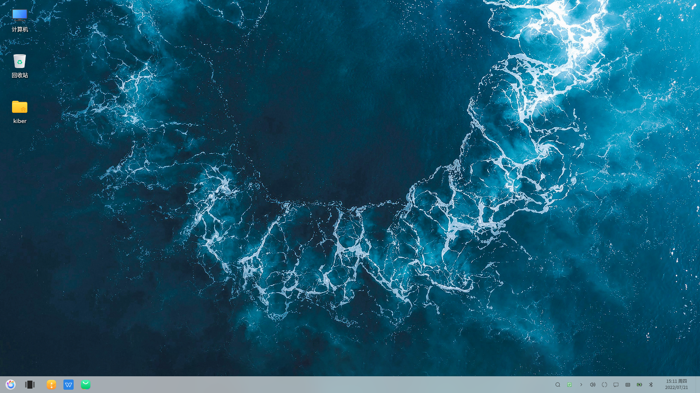

### 基本操作

（1）右键计算机点击属性，可以查看当前系统版本、内核版本、激活状态等相关信息

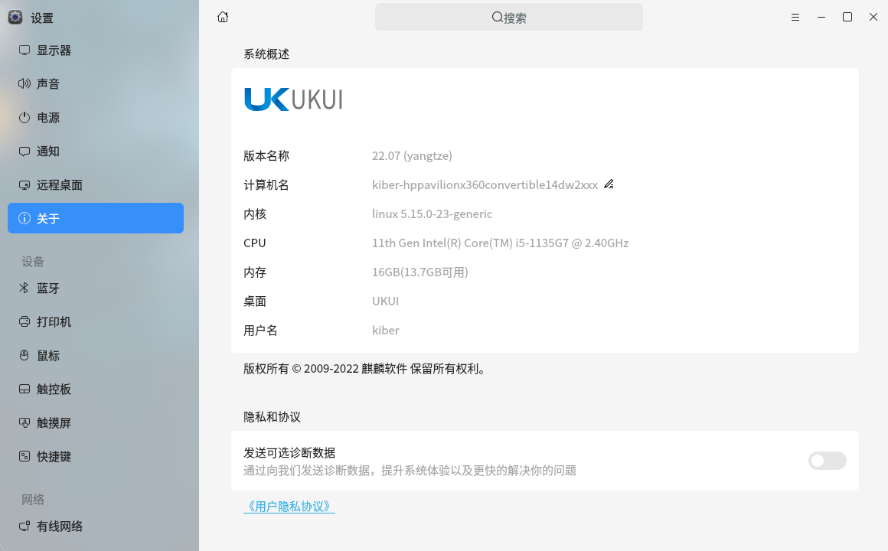

（2）在桌面右键，可以调出快捷菜单可以进行简单便捷的操作

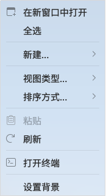

| 选项      | 说明                        |
|---------|---------------------------|
| 在新窗口中打开 | 在新窗口打开当前指定的文件或目录          |
| 全选      | 全选当前目录的文件                 |
| 新建      | 可新建文件夹、空文本、WPS文件          |
| 视图类型    | 提供四种视图类型：小图标、中图标、大图标、超大图标 |
| 排列方式    | 提供多种排列图标的方式               |
| 刷新      | 刷新界面                      |
| 打开终端    | 打开终端软件                    |
| 设置背景    | 快捷打开设置-个性化-背景，可以进行背景的相关设置 |

表 1-2 右键菜单

## 电源管理

### 概述

电源管理是对桌面操作系统最基本的功能，能够实现对当前桌面操作系统电源状态及当前账户状态的修改，包括休眠、睡眠、锁屏、注销、重启、关机。

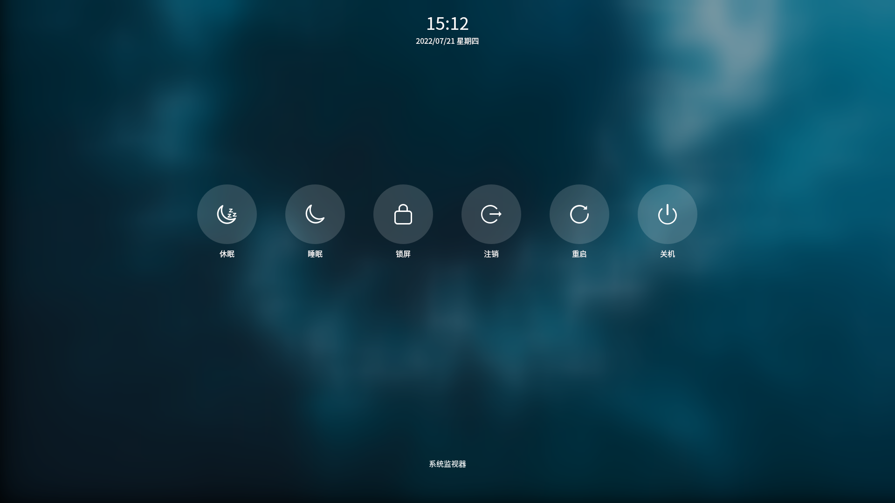

- “开始菜单”>“电源”；

- 关机

退出登录并关闭您的计算机。

- 重启

退出登录并重启您的计算机。
- 注销

清除并登出当前使用的用户，并且返回至用户登录位置，主要用于其他用户账户登录时的场景。

- 锁屏

当您暂时不需要使用计算机时，可以选择锁屏（不会影响系统当前的运行状态），防止误操作。当您返回后，输入密码即可重新进入系统。在默认设置下，系统在一段空闲时间后，将自动锁定屏幕。

- 睡眠

睡眠状态时，将切断除内存外其他配件的电源，工作状态的数据将保存在内存中，这样在重新唤醒电脑时，就可以快速恢复睡眠前的工作状态。如果您在工作过程中需要短时间离开电脑，那么可以使用睡眠功能，一方面可以节电，另外一方面又可以快速恢复工作。睡眠唤醒可通过键鼠及休眠键，电源键。

- 休眠

系统会自动将内存中的数据全部转存到硬盘上一个休眠文件中，然后切断对所有设备的供电。这样当恢复的时候，系统会从硬盘上将休眠文件的内容直接读入内存，并恢复到休眠之前的状态。休眠唤醒需要通过电源键或休眠键。

## 文件及文件夹

### 概述

通过文件夹可以收纳整理您的资料，包含桌面应用、文件及文件夹等。在桌面可新建文件或文件夹，也可以对文件/文件夹进行常规的复制、粘贴、重命名、删除等操作。 

### 基本操作

在桌面上，点击鼠标右键，点击 **“新建”**，选择新建文件类型或新建文件夹，输入新建文件/文件夹的名称。
在桌面文件或文件夹上，点击鼠标右键，可以使用文件管理器的相关功能：

| 名称     | 描述                          |
|--------|-----------------------------|
| 打开     | 打开文件/文件夹                    |
| 打开方式   | 选定系统默认打开方式，也可以选择其他关联应用程序来打开 |
| 反选     | 反向选择桌面文件/文件夹                |
| 复制     | 复制文件或文件夹                    |
| 剪切     | 移动文件或文件夹                    |
| 重命名    | 重命名文件或文件夹                   |
| 删除到回收站 | 删除文件或文件夹到回收站                |
| 创建链接   | 创建一个快捷方式                    |
| 属性     | 查看文件或文件夹的基本信息，共享方式，及其权限     |
| 设置背景   | 快捷打开设置-个性化-背景，可以进行背景的相关设置   |

表 1-3 文件管理器

## 图标排列和大小

### 概述

桌面的图标大小可以进行调节，桌面上的图标按照需要进行排序。系统默认提供4种图标大小的设置，分别为小图标、中图标（默认）、大图标和超大图标。

### 基本操作

将鼠标悬停在应用图标上，按住鼠标左键不放，将应用图标拖拽到指定的位置松开鼠标左键释放图标。在桌面右键选择<b>“视图类型”</b>，选择一个合适的图标大小。点击鼠标右键，选择<b>“排序方式”</b>，系统提供如下4种排序方式：

- 点击文件名称，将按文件的名称顺序显示；
- 点击文件大小，将按文件的大小顺序显示；
- 点击文件类型，将按文件的类型顺序显示； 
- 点击修改时间，文件将按最近一次的修改日期顺序显示。

## 任务栏

### 概述

任务栏用于查看系统启动应用、系统托盘图标，位于桌面底部。任务栏默认放置开始菜单、多窗口、文件管理器、Firefox火狐浏览器、系统托盘图标。在任务栏可打开开始菜单、显示桌面、进入工作区，对应用程序进行打开、新建、关闭、强制退出等操作，还可以设置输入法，调节音量，连接 WiFi，查看日历，进入关机界面等。

| 图标     | 名称               | 描述 |
|--------|------------------|----|
|| 开始菜单   | 启动菜单，查看系统应用      |
|| 显示任务视图 | 显示多任务视图，切换多个桌面窗口 |
|| 文件管理器  | 文件及文件夹管理         |
|| 键盘     | 切换键盘输入法，输入语言     |
|| 麒麟天气   | 查看城市天气           |
|| 网络设置   | 设置网络连接           |
|| 通知中心   | 查看系统推送通知         |
|| 声音     | 调节声音大小           |
|| 夜间模式   | 切换系统夜间模式         |

## 开始菜单

### 概述

开始菜单是使用系统的“起点”，查看并管理系统中已安装的所有应用，在菜单中使用分类导航或搜索功能可以快速定位需要的应用程序。

### 基本操作

#### 切换模式

菜单有全屏和小窗口两种模式。点击菜单界面右上角的图标来切换模式。 
两种模式均支持搜索应用、设置快捷方式等操作。 

小窗口模式还支持快速打开文件管理器，控制中心和进入关机界面等功能。

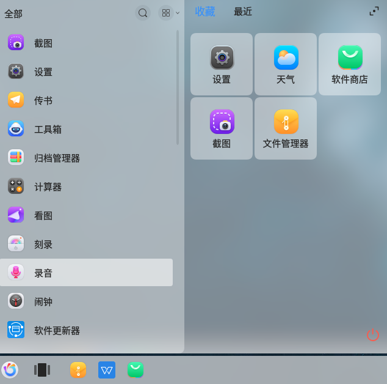

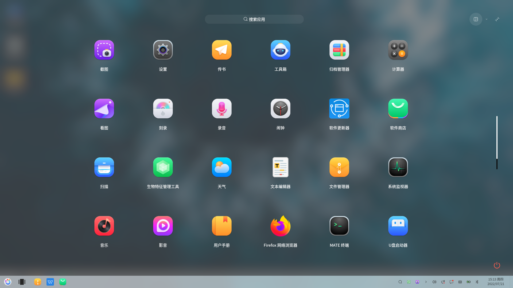

#### 查找应用

在开始菜单中，可以使用鼠标滚轮或切换分类导航查找应用。如果已知应用名称，可直接在搜索框中输入应用名称或关键字快速定位。

#### 运行应用

对于已经创建了桌面快捷方式或固定到任务栏上的应用，可以通过以下途径来打开应用：

双击桌面图标，或右键单击桌面图标选择打开。 

直接点击任务栏上的应用图标，或右键单击任务栏上的应用图标选择打开。 

单击打开开始菜单后，直接点击应用图标打开，或右键单击应用图标选择打开。

## 安装和卸载

### 概述

此操作系统提供便捷的应用软件安装卸载方式，可根据您的需求自主进行安装卸载操作。

### 基本操作

#### 安装应用

（1）软件商店安装

开放麒麟桌面操作系统自带麒麟软件商店，可支持一键下载安装应用

（2）安装器安装

方法一：双击所需要安装的deb，直接会弹窗安装器界面；

方法二：通过终端敲命令，kylin-installer + 包名，例如麒麟影音kylin-installer 	

kylin-video_3.1.0-71_amd64.deb，会弹出安装界面；

上述所说的弹出安装界面，安装器会根据包的属性，自动识别往兼容环境中安装还是往系统里面安装，直接点
击安装即可；

注：当安装完成后，才可以进行下一个包的安装；

#### 卸载应用

对于不再使用的应用，可以通过集中方式将其卸载以节省硬盘空间。

1. 在**“开始菜单”**中，右键单击应用图标。 

2. 点击**“卸载”**。

软件商店卸载

打开软件商店点击<b>“我的”</b>，进入<b>“应用卸载”</b>，选择需要卸载的应用点击卸载即可。

## 侧边栏

### 概述

侧边栏集成系统通知、账户信息、关机键、节能模式、蓝牙、飞行模式、平板模式、投屏、夜间模式、快速投屏、系统设置等功能

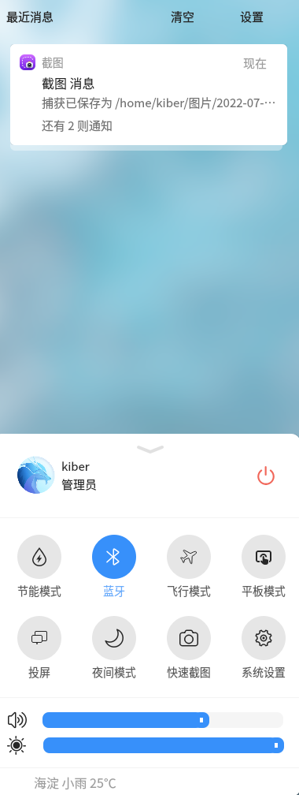

### 打开方式
点击任务栏右下角“侧边栏”图标或通过快捷键“win+A”打开侧边栏。

## 显示任务视图

### 概述

通过显示任务视图可以切换使用多个桌面，以便对桌面窗口进行分组管理，窗口管理器可以在不同的工作区内展示不同的窗口内容。

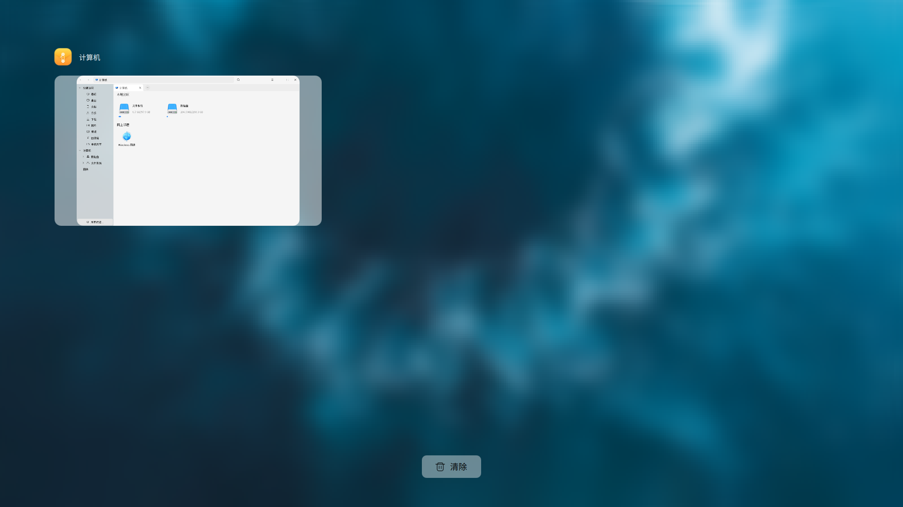

### 打开方式
点击任务栏“显示任务视图”图标，可以打开任务视图窗口管理，选择想要的桌面即可实现桌面窗口切换。

## 日历

### 概述

您可以通过日历功能查阅日期，了解节假日信息，查阅黄历禁忌。

### 打开方式

点击桌面右下角时间与日期即可弹出日历界面。

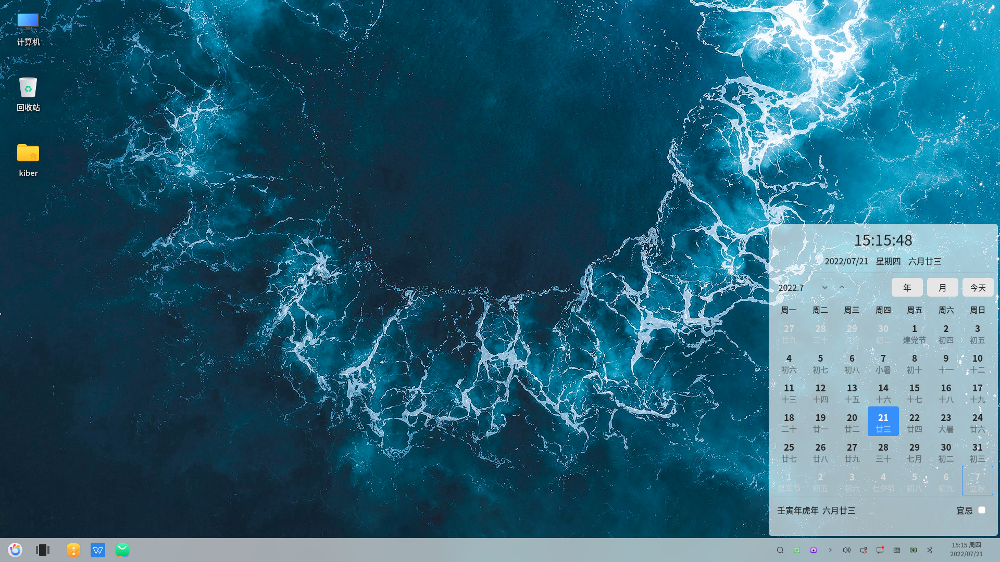

### 基本操作

- 月份切换：点击上下按钮即可实现单个月份跳转。

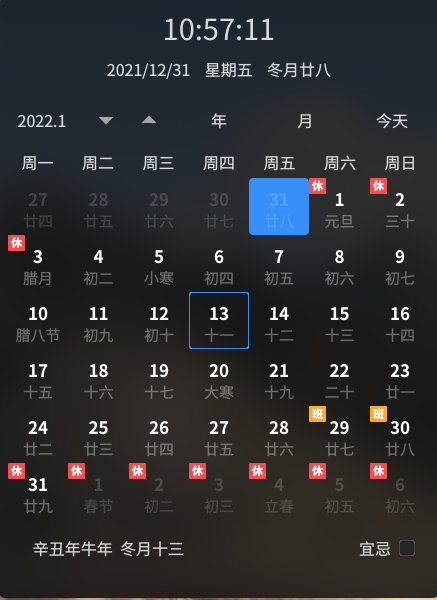

- 年份切换：点击<b>“年”</b>按钮即可跳转到选择年份日历页面，选择后实现相应跳转。

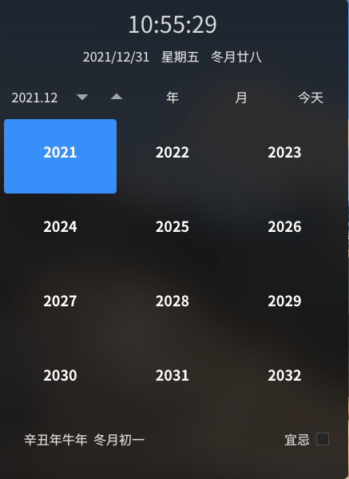

- 月份跳转：点击<b>“月”</b>按钮即可跳转到选择月份日历页面，选择后实现相应跳转。

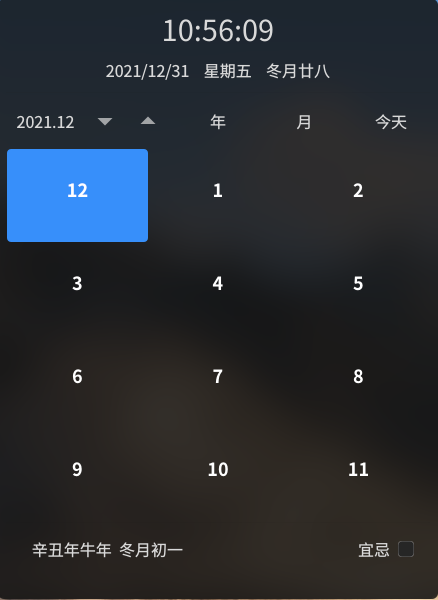

- 今天跳转：点击<b>“今天”</b>按钮即可实现跳转到今天日期日历页面。

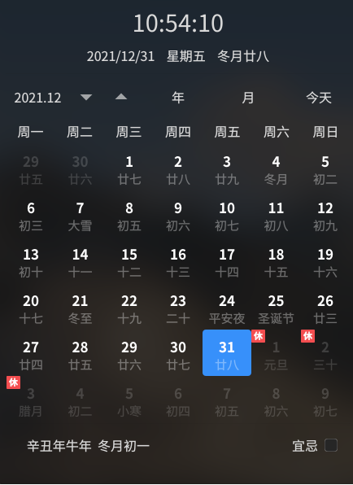

- 黄历禁忌折叠：点击禁忌折叠按钮即可实现对黄历禁忌的折叠和展开。

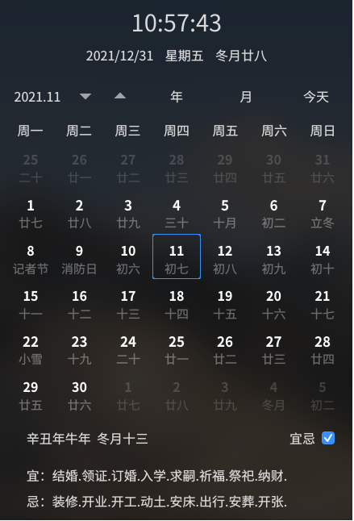

## 触控交互

### 概述

系统提供多场景的桌面触控交互，若您的设备支持触控功能，可使用多种手势操作完成与桌面的交互。

### 基本操作

#### 基础手势操作

基础手势操作如下表所示：

| 基础手势操作                         | 图示                                     | 操作说明 |
|--------------------------------|----------------------------------------|------|
|点击|  | 手指轻点触控设备，触发功能，例如：选择对象、打开菜单栏、执行按钮命令等 |
|双击|  | 手指快速点击两次触控设备，触发功能，例如：打开桌面应用、打开文件夹/文件、选择文字等 |
|滑动|  | 滑动以连续滚动列表和页面、切换页面/对象、滑动以调节滑动条数值  |
|拖动|  | 动对象移动其位置，例如：移动窗口、移动文件/图标位置 拖动进行批量操作，例如：框选文字等内容、框选图标等、刷新页面 |
|长按|  | 手指长按某个元素触发功能，例如：显示弹出菜单栏、右键菜单栏、多选、选择文字等 |
|捏合| 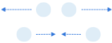 | 两个手指按住屏幕向外展开以放大内容，向内收拢以缩小内容，例如：网页、图片 |

#### 触控交互手势

- 打开多任务视图

输入设备：触摸屏/平板，交互手势：单指从屏幕底部边缘向上滑动。

输入设备：触控板，交互手势：三指向上滑动。

- 切换应用视图

输入设备：触摸屏/平板，交互手势：四指左右滑动，手指左滑或者右滑显示所

有窗口，手指不离开触控设备继续左右滑动选择窗口，手指松开为切换成功。

输入设备：触控板，交互手势：三指左右滑动。

- 切换桌面

输入设备：触控板，交互手势：四指左右滑动，向左滑，切换右侧桌面，向右滑，切换左侧桌面。

显示桌面

输入设备：触摸屏/平板，交互手势：单指从屏幕顶端向下滑动。

输入设备：触控板，交互手势：三指向下滑。

- 显示菜单栏

输入设备：触摸屏/平板，交互手势：单指长按，手指接触时间≥800ms。

输入设备：触控板，交互手势：双指单击。

- 进入全局搜索

输入设备：触摸屏/平板，交互手势：四指屏幕任意位置下滑。

输入设备：触控板，交互手势：三指单击。

- 呼出侧边栏

输入设备：触摸屏/平板，交互手势：单指屏幕右侧滑入。

输入设备：触控板，交互手势：四指点击屏幕任意位置。

- 显示任务栏

输入设备：触摸屏/平板，交互手势：单指屏幕底部短距离上滑，显示任务栏。

- 打开/切换对象

输入设备：触控板/触摸屏/平板，交互手势：单指单击（打开菜单栏、侧边栏；选择工具栏、任务栏、应用内其他功能；点击按钮/开关）。

输入设备：触控板/触摸屏，交互手势：单指双击（启动应用、文件、文件夹等）。

- 缩放页面

输入设备：触控板/触摸屏/平板，交互手势：双指捏合放大或者缩小。

- 拖拽对象

输入设备：触摸屏/平板，交互手势：单指按住拖拽，时间:接触屏幕300ms-800ms，短按拖动。

输入设备：触控板，交互手势：单指按住拖拽。

- 滑动列表&页面&对象

输入设备：触摸屏/平板，交互手势：单双指均可接触屏幕上下/左右滑动，接触屏幕≤300ms并滑动。

输入设备：触控板，交互手势：双指上下滑动(向上滑动，页面向上；向下滑动，页面向下)，双指左右滑动(向左滑动，页面向左；向右滑动，页面向右) 。

## 输入法

### 概述

系统集成了Fcitx输入法框架（小企鹅输入法），Fcitx 通过使用各种各样的输入法引擎来支持全世界大量不同种类的语言，包括五笔、拼音、二笔、区位、仓颉等输入模块，在输入法的自定义使用上也极为灵活。

### 打开方式

- 任务栏 > 选择 “” > 单击右键 > 打开<b>“配置”</b>;

- “开始菜单” ><b>“设置”</b> > <b>“键盘”</b> > <b>“输入法设置”</b>

### 基本操作

对任务栏中输入法图标右键单击后将弹出输入法菜单栏，可以进行切换输入法、配置输入法、选择/切换虚拟键盘、设置输入法皮肤、退出/重新启动输入法等设置。选择<b>“开始菜单”</b>><b>“设置”</b>><b>“键盘”</b>><b>“输入法设置”</b>也可以打开输入法配置窗口。

在输入法配置窗口中，可以进行添加/删除输入法、设置输入法顺序和全局配置的操作。在输入法列表中，在点击底部的“＋”可以选择并添加其他输入法，点击“－”可删除输入法。点击“↑”或“↓”可以设置输入法顺序。

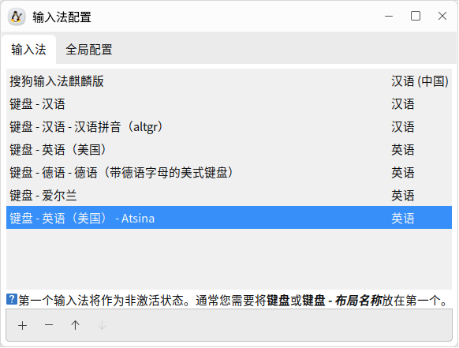

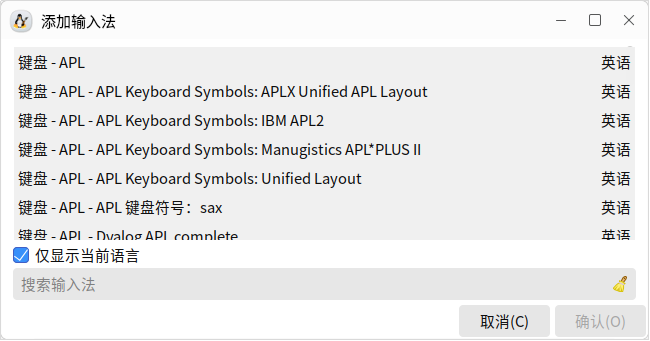

在全局配置窗口，可以设置切换输入法的快捷键，默认输入法状态、在窗口间共享的状态等配置。

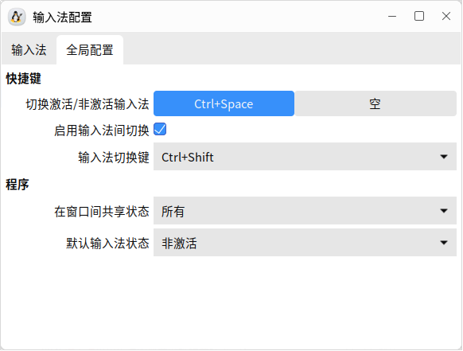
