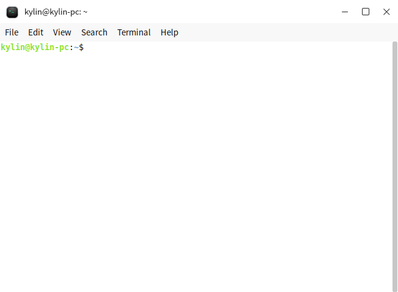
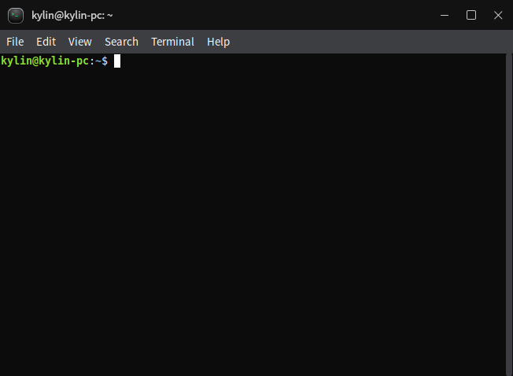
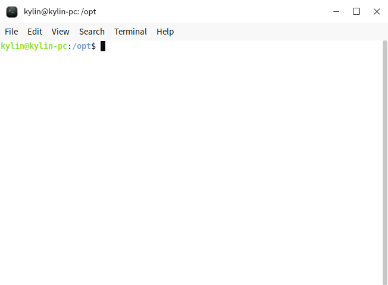
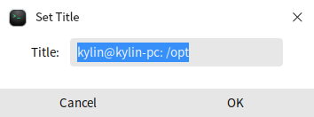
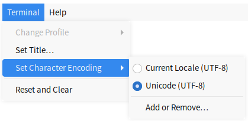
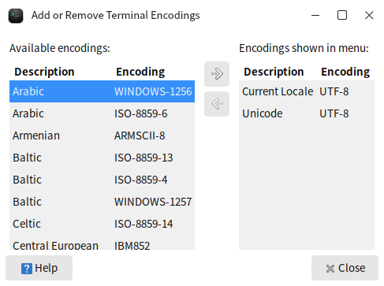
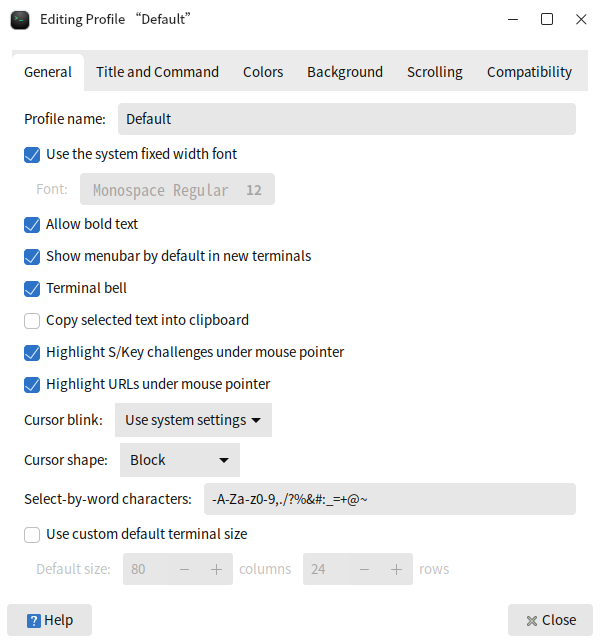
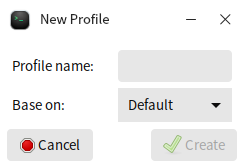

# Mate Terminal
## Overview

The terminal is the medium through which the Kylin system operates using system commands. It provides a character system window in a graphical interface. Interaction with the system can be achieved by typing system instructions in the terminal window.

 

### Opening method

- **“opening menu”**>**“mate-terminal”**
- Right-click on an empty area of the desktop > Open the right-click menu bar on the desktop > selected**“Open terminal”**
- Select the folder in the File Manager or right-click in the blank area > Open the right-click menu bar > selected**“Open terminal”**
- **“taskbar”**>**“search”** >**“mate-terminal”** > selected**“open”**

### Basic Function
After opening the terminal, based on the current user's permissions, you can directly input the corresponding system commands using the keyboard in the terminal window and press Enter. The terminal will judge the instructions and output the corresponding prompts. Multiple terminal Windows can be opened simultaneously for operation.

The basic functions provided by the terminal are:

- Charaters system
- Execute commands and scripts
- Use the applications/services only running in terminal

Take the operation window as shown in the above picture，kylin@kylin-pc:/opt$，among them:

- kylin：The username for logging into the system
- kylin-pc：Computer name
- /opt：The path when the terminal is currently opened

#### Shortcut Key

The following table lists some commonly used shortcut keys for terminal operations，More shortcuts can be seen or modified by "Edit" > "Keyboard Shortcuts".

| Shortcut          | Function           |
|--------------|--------------|
| Ctrl+Alt+T   | Open a new ternimal window      |
| Ctrl+Shift+T | Open a new tab in the current terminal window |
| Ctrl+D       | Close the current window/tab   |
| F11          | Fullscreen/Quit Fullscreen    |

### Advanced Function
Advanced Settings can be configured through the terminal menu bar options. For detailed function descriptions of the menu bar, please refer to the menu bar.

#### Single Settings

Only effective in the current window, and invalid after closing.

- Title

Click "Terminal" > "Set Title" to modify the current window's name, as shown in Fig 4.

- Charater Encoding

Character encoding, also known as character set code, is to take the character encoding in a character set as a specific object in a specified set, so that text can be displayed and transmitted in a computer.

Click "Terminal" > "Set Charater Encoding" to adjust it.

In**“Add or Remove”**，more encoding options can be seen.

- Window Size

Click "View" to set the current window "Full Screen", "Zoom In", "Zoom Out". And the words in this window will zoom in/out together.

- Profile Preferences

The settings in profile are permanent and apply to all new windows. There exist a profile "Default", and users can select "Edit" > "Profile Preferences" to modify it.

Click "File" > "New Profile" or "Edit" > "Profiles" to create a new configuration based on a existed profile.

### Menu bar

The function description of the top menu bar of the terminal is shown in the following figure.

| First-level menu | Secondary menu         | Description                                                  |
|---------|--------------------------------------|--------------|
| File   | Open Terminal          | Open a new terminal window                                   |
|   | Open Tab               | Open a new Tab in the current terminal window |
|   | New Profile | Create a new configuration file name |
|   | Close Tab              | Close the current Tab        |
|   | Close Window | Close the terminal                                           |
| Edit   | Copy                   | Copy the content |
|   | Paste  | Paste the copied content to the cursor position |
|   | Select All             | Select all the content within the terminal |
|   | Profiles...            | View the configuration file list to manage the configuration files |
|   | Keyboard Shortcuts...  | Configure whether to enable all menu access keys and whether to enable menu shortcut keys, and check the shortcut keys corresponding to each operation |
|   | Profile Preferences    | Manage the corresponding configuration of the terminal, including general Settings, title commands, colors, backgrounds, scroll bars, and compatibility Settings |
| View   | Show Menubar           | Whether to display the top menu |
|   | Full Screen | Whether it is displayed in full screen |
|   | Zoom In | Enlarge the terminal window    |
|   | Zoom Out | Reduce the terminal window     |
|   | Normal Size            | The form is restored to its original size |
| Search | Find...                        | Search by keywords |
|   | Find Next              | Retrieve the next piece of content |
|   | Find Previous          | Retrieve the previous content |
| Terminal | Change Profile         | Switch to the configuration file of other Settings |
|   | Set Title              | Modify the title text at the top of the terminal |
|   | Set Character Encoding | Switch the encoding format of the terminal content |
|   | Reset and Clear        | Restore the initial position and clear the terminal content |
|Help   |       | Check the system manual and software instructions |

Tab 1 Function Description of the Terminal Menu Bar

