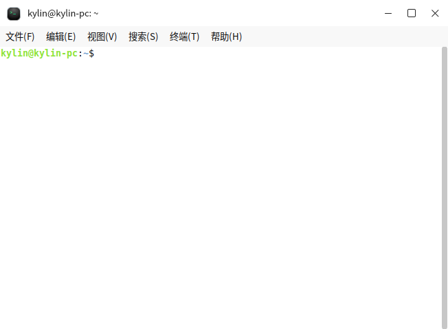
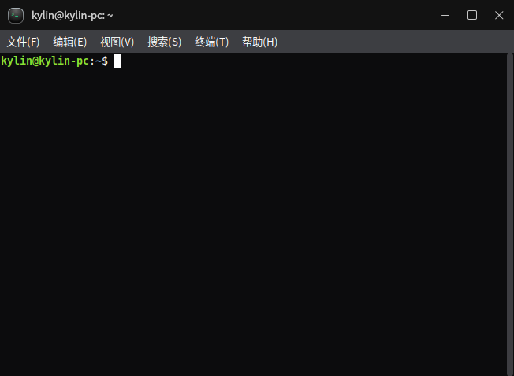
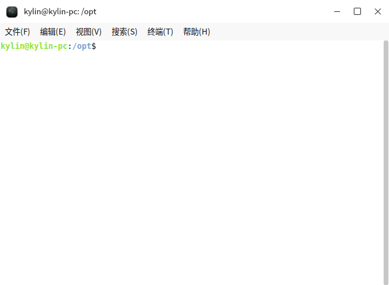
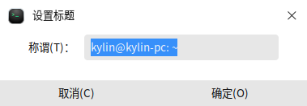
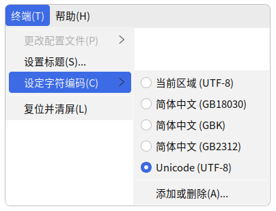
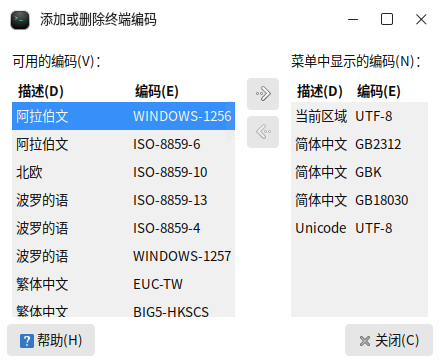
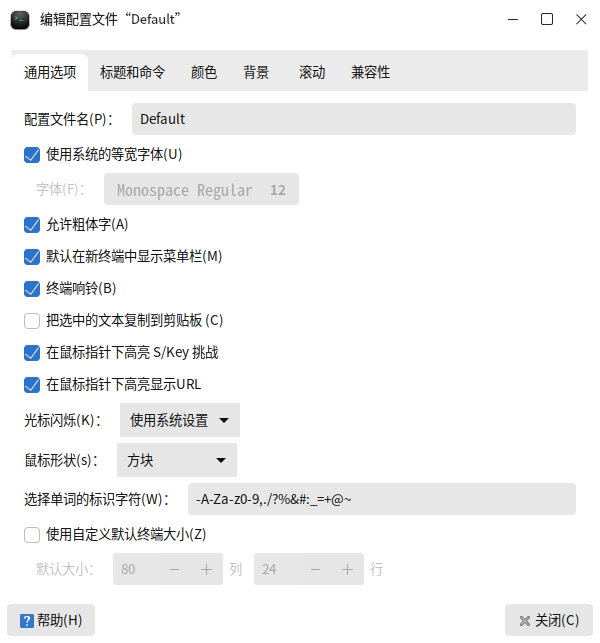
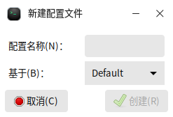

# 终端
## 概 述

终端是麒麟系统使用系统命令操作的媒介，提供了在图形化界面下的字符系统窗口，通过在终端窗口键入系统指令可以与系统进行交互。

 

### 打开方式

- **“开始菜单”**>**“终端”**
- 桌面空白处单击右键 > 打开桌面右键菜单栏 > 选择**“打开终端”**
- 选中文件管理器中的文件夹或在空白处单击右键 > 打开右键菜单栏 > 选择**“打开终端”**
- **“任务栏”**>**“搜索”** >**“终端”** > 选择**“打开”**

### 基本操作
打开终端后，根据当前用户权限，可在终端窗口使用键盘直接输入相应系统命令并且回车，终端根据指令判断并输出相应提示，可同时打开多个终端窗口进行操作。

终端提供的基本功能有：

- 字符系统
- 执行各种命令、脚本
- 使用仅在终端运行的应用/服务

操作窗口以上图为例，kylin@kylin-pc:/opt$，其中：

- kylin：登录系统的用户名
- kylin-pc：计算机名
- /opt：当前打开终端时的路径

#### 快捷键

下表列出了终端操作的部分常用快捷键，更多快捷键可通过编辑 > 键盘快捷键查看或修改。

| 快捷键          | 功能           |
|--------------|--------------|
| Ctrl+Alt+T   | 打开新终端窗口      |
| Ctrl+Shift+T | 在终端窗口中打开新标签页 |
| Ctrl+D       | 关闭当前窗口/标签页   |
| F11          | 全屏显示/退出全屏    |

### 高级设置
高级设置可通过终端菜单栏选项配置，菜单栏详细功能说明见菜单栏。

#### 单项设置

单项设置仅对当前窗口产生影响，窗口关闭后立即失效。

- 窗口标题

点击菜单栏上的终端 > 设置标题，即可修改终端窗口的名称。

- 字符编码

字符编码也称字集码，是把字符集中的字符编码作为指定集合中的某一对象，以便文本在计算机中显示和传递。

点击菜单栏上的终端 > 设定字符编码，可对编码进行调整。

在**“添加或删除”**中，可看到更多的编码选项。

- 调整窗口大小

点击菜单栏上的**“视图”**，可设置当前窗口全屏、放大、缩小。此处的放大/缩小，会连带着窗口中的文本一起放大/缩小。

- 配置文件

配置文件中的设置是永久生效的，并适用于所有新建窗口。应用自带了Default配置文件。您可通过编辑 > 配置文件首选项，修改配置。

也可通过文件 > 新建配置文件，或编辑 > 配置文件，基于某个配置文件创建新配置。

### 菜单栏

终端顶部菜单栏功能说明如下图所示。

| 一级菜单    | 二级菜单                                 | 描述           |
|---------|--------------------------------------|--------------|
| 文件      | 打开终端                                 | 打开新的终端窗口     |
|   | 打开标签    | 在当前终端窗口打开新的标签页                       |
|   | 新建配置文件  | 创建新的配置文件名称                           |
|   | 关闭标签页   | 关闭当前标签                               |
|   | 关闭窗口    | 关闭终端                                 |
| 编辑      | 复制                                   | 复制内容         |
|   | 粘贴      | 将复制内容粘贴至光标处                          |
|   | 全选      | 选择终端内全部内容                            |
|   | 配置文件    | 查看配置文件列表，可对配置文件进行管理                  |
|   | 键盘快捷键   | 配置是否启用所有菜单访问键、是否启用菜单快捷键，查看各个操作对应的快捷键 |
|   | 配置文件首选项 | 管理终端相应配置，包括通用设置、标题命令、颜色、背景、滚动条、兼容性设置 |
| 视图      | 显示菜单栏                                | 是否显示顶部菜单     |
|   | 全屏      | 是否全屏展示                               |
|   | 放大      | 放大终端窗口                               |
|   | 缩小      | 缩小终端窗口                               |
|   | 正常大小    | 窗体恢复为原来大小                            |
| 搜索      | 查找                                   | 按关键字进行检索     |
|   | 查找下一个   | 检索下一条内容                              |
|   | 查找上一个   | 检索上一条内容                              |
| 终端      | 更改配置文件                               | 切换为其他设定的配置文件 |
|   | 设置标题    | 修改终端顶部标题文字                           |
|   | 设定字符编码  | 切换终端内容编码格式                           |
|   | 复位并清屏   | 恢复初始位置并清空终端内容                        |
|帮助   |       | 查看系统手册和软件说明                          |

表 1 终端菜单栏功能说明
