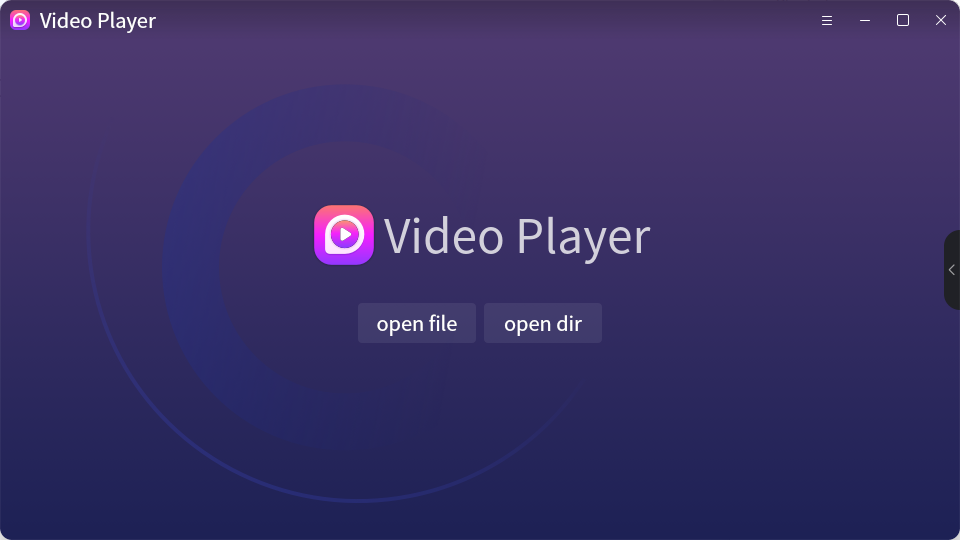
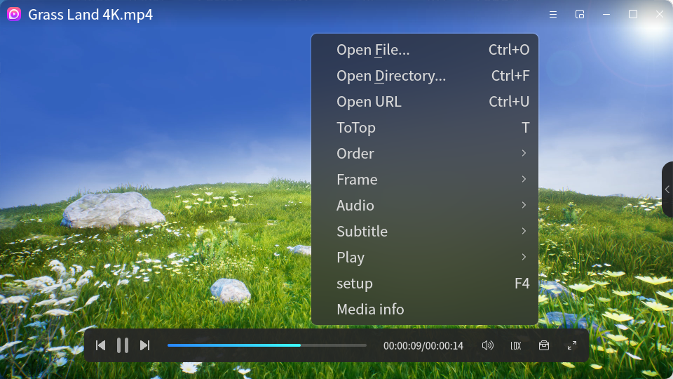
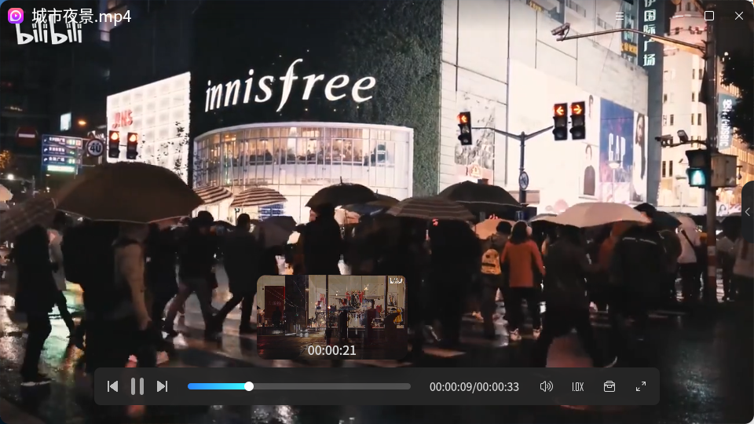
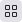
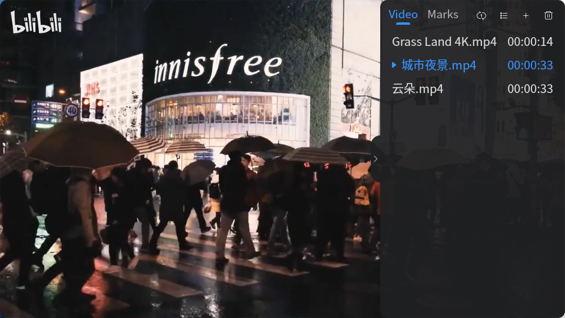
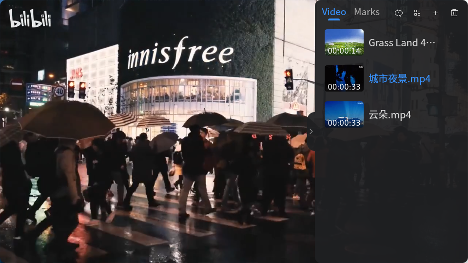
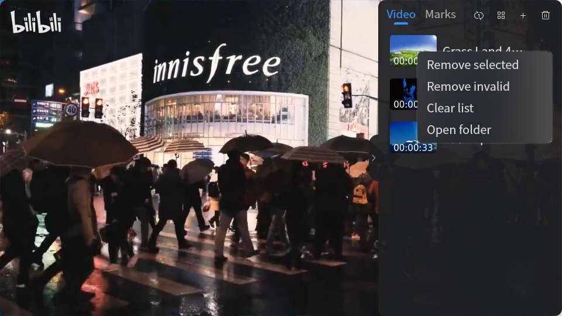
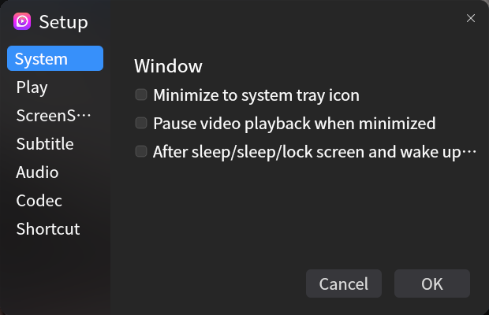
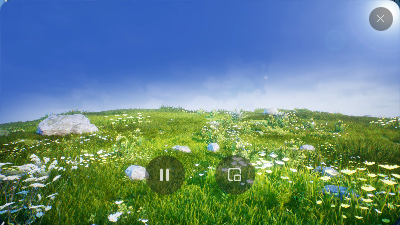

# Video Player
## Summary
Video Player is an audio and video player with beautiful interface and good interactivity,which support for .mkv, .avi, .mp4, .mp3, .wmv and other mainstream audio and video formats and have powerful decoding capabilities; complete functions, support playback order setting, screenshot, subtitle loading, screen settings, add file marks, incognito playback, etc. There are also Mini modes to meet different playback needs.

 
Table1 Audio and video formats supported by the audiovisual system 

|type  | format |
| :----: | :---- |
| video | .dvr-ms、.mp4、. avi、. rmvb、. flv、. vfw、. divx、. 264、. 265、. mpg、. mpeg、. m1v、. m2v、. mpv、. dv、. 3gp、. 3p2、. 3g2、. mov、. m4v、. mqv、. dat、. vcd、. ogg、. ogm、. ogv、. ogx、. asf、. wmv、. bin、. iso、. vob、. mkv、. nsv、. ram、. rm、. swf、. ts、. m2t、. m2ts、. mts、. rec、. wtv、. f4v、. hdmov、. webm、. vp8、. bik、. smk、. m4b、. wtv、. part、. dpg、. m2p、. tp |
| audio | .mp3、. ogg、. oga、. ac3、. aiff、.voc、. au、. m4p、. ra、. ape、. flac、. thd、. mka、. opus、. mmf、. mp2、. wv、. m4r、. wav、. dts、. wma、. m4a、. aac、. amr、. mpa |
| subtitles | .aqt、. srt、. sub、. ssa、. ass、. idx、. smi、. rt、. utf、. vtt、. sup |
| playlist | .m3u、. m3u8、. pls、. xspf | 

 

## Open Mode

● “Start menu”>“Video Player”； 
● Select video file > Double click > "Video Player" is turned on by default； 
● Select the audio and video files > Right click > “Open mode”>“Video Player”； 
● “Taskbar”>“Search”>“Video Player”> Select “open”。 

 

## Basic Operation

 

### Playback Page

After opening the Video Player, click "Open file" or "Open Directory" or press the key combination "Ctrl" + "O"/" Ctrl "+" F "to open the file or directory. After selecting the audio and video file, you can directly play it and add the file to the scalable playlist on the right. Double-click the playback interface to enlarge the window to full-screen playback, and double-click again to exit full-screen playback. When the cursor does not stop on the playback screen, the screen is simple and only the video playback window is kept. 

 

When the cursor is on the video player screen, the file name of the current file is displayed, and the player bar, playlist button, and operation bar are called. 
The operation bar is displayed at the top of the interface. You can open the menu bar, enable the mini mode, minimize/maximize the window, and close the application. 
The Playbar is suspended at the bottom of the interface. You can perform the following operations: start/pause/switch the video, select the playback progress, set the speed, adjust the volume, take a screenshot, add a mark, and set the full screen. For detailed function descriptions, see the Playbar function description table. 

 

Right-click in the playing interface to open the right-click menu bar of the playing interface, you can choose to open files, open directory, open URL, pin to top, you can set the playing order (single loop, list loop, random play), screen (clockwise/counterclockwise rotation 90°, horizontal/vertical flip, screen restoration, display introduction), Sound (tracks, channels, audio Settings), subtitles (load subtitles, subtitle selection, subtitle Settings), playback (play/pause, raise/lower volume, fast forward/rewind), open player Settings and view media information. 

 

Table2 Playback page right-click menu bar 

| First level menu | Second level menu | Description                                                  |
| :--------------: | :---------------: | :----------------------------------------------------------- |
|    Open File     |                   | Open file selection                                          |
|  Open Directory  |                   | Open file selection                                          |
|     Open URL     |                   | Open URL                                                     |
|      ToTop       |                   | Widget topping                                               |
|      Order       |     One Loop      | Loop individual videos                                       |
|                  |     List Loop     | Loop the videos in the playlist                              |
|                  |      Random       | Loop through the videos in the playlist                      |
|      Frame       |   Default frame   | Default original scale                                       |
|                  |       4：3        | Picture scale 4：3                                           |
|                  |       16：9       | Picture scale 16：9                                          |
|                  |    Full frame     | Picture proportions fill the entire screen                   |
|                  |   restore frame   | Revert to the default original screen                        |
|                  |   Along rotate    | The screen rotates clockwise 90°                             |
|                  |  Inverse rotate   | Counterclockwise rotation90°                                 |
|                  | Horizontally flip | Horizontal flip                                              |
|                  |  Vertically flip  | Vertical flip                                                |
|                  |   Show profile    | The screen displays a brief description of the file, including file name, resolution, fps, bit rate, audio, sample rate, channel, bit rate, and audio and video synchronization difference |
|      Audio       |    AudioTrack     | Saves the image content of the existing artboard             |
|                  |   AudioChannel    | Stereo、Left channel、Right channel                          |
|                  |     Audio set     | Open the Sound Settings menu bar and set the audio           |
|     Subtitle     |   Load subtitle   | Load video captions                                          |
|                  |  Subtitle select  | Select video captions                                        |
|                  |   Subtitle set    | Open subtitle Settings                                       |
|       Play       |    Play/Pause     | To play/pause a video, use the keyboard space bar shortcut   |
|                  |  volume up/down   | High or low volume, you can use the keyboard "Up"/" Down "keys to quickly operate |
|                  | forward/backward  | Fast forward/back the audio and video progress               |
|      setup       |    Play setup     | Open playback Settings                                       |
|    Media info    |                   | Type file information to view file name, file type, file size, file duration, and file location |

 

### Play Bar

The player bar is placed at the bottom of the audio and video interface. When watching videos, the mouse can avoid crossing the video interface and improve your experience. The description of the function bar of the audio and video player bar is shown in the following table. 
Table3 Video player bar function description

|                         Icon                          |   Function   | Description                                                  |
| :---------------------------------------------------: | :----------: | :----------------------------------------------------------- |
|   |   Previous   | Switch to the previous one in the playlist                   |
|   |     Next     | Switch to the next one in the playlist                       |
|        |     Play     | The current video starts to play                             |
|   |    Pause     | Pause the current video                                      |
|                                   | Progress bar | The current playback progress is displayed. You can drag the progress bar button to adjust the progress |
|                                   |   Duration   | Displays the current duration/total duration                 |
|  |    Volume    | Adjust the volume                                            |
|  |    Speed     | Set double speed playback, optional speed: 0.5X、0.75、1.0X、1.25X、1.5X、2.0X |
|  |    Tools     | Take a screenshot of the currently playing interface and add a mark. The screenshot is saved to the Picture folder by default. |
|  | Full screen  | Full screen play                                             |

 

The cursor indicates that the thumbnail of the progress can be displayed at any place in the progress bar. Drag the progress to adjust the current playback progress. 

 

### Play List

Click the button on the right of the playlist to expand the playlist. In the playlist, the "Video" screen displays the added audio and video files, and the "Marks" page displays the marked files. Double-click any file in the playlist to start playing. Click "" in the playlist to add files, click""to clear all files in the list, select any file in the playlist, click" × "to the right of the file to delete the file in the list. 
The playlist can be played in Single loop, List Loop, or Random. Select the corresponding icon to switch between them: “”，“”，“”。 
The playlist also provides two view modes: list view and thumbnail view. The ICONS at the top of the playlist are respectively “” and “”. 

 

Right-click any file in the playlist to open the right-click menu bar of the playlist. You can choose to remove selected items, remove invalid files, empty the playlist, and open the folder where the files are located. 

 

### Menu Bar

Click "" in the upper right corner of the interface to open the audio and video menu bar. The function description of the menu bar is shown in the following table. 
Table4 Video menu bar function description

| First level menu | Second level menu | Description                                                  |
| :--------------: | :---------------: | :----------------------------------------------------------- |
|     Privacy      |    Clear mark     | Clear file playback records                                  |
|                  |      No mark      | No record playing file                                       |
|       Help       |                   | Connect to the user manual and select "Video Player" to open the manual |
|      About       |                   | Video Player‘s version information                           |
|      Setup       |   System setup    | Set whether to minimize to the system tray, pause video playback while minimizing, and keep it playing after sleep, hibernate, and lock screen wake up. |
|                  |    Play setup     | Set whether to clear the playlist when exiting and automatically play from where the file was last stopped. |
|                  | Scrennshot setup  | Path and format for saving snapshots                         |
|                  |  Subtitle setup   | Whether to automatically load subtitle with the same name, set the specified path and subtitle font style. |
|                  |    Audio setup    | Set output driver                                            |
|                  |   Decoder setup   | Set the video output driver, video decoder, and decoding thread |
|                  |  Shortcut setup   | Set the button function shortcut key                         |

 

 

### Mini Mode

Tap "" at the top of the playback screen to shrink the playback screen to a more streamlined mini playback mode for other operations on the desktop. The display interface when the cursor leaves the mini playback window is as shown in the following figure:

 

 

