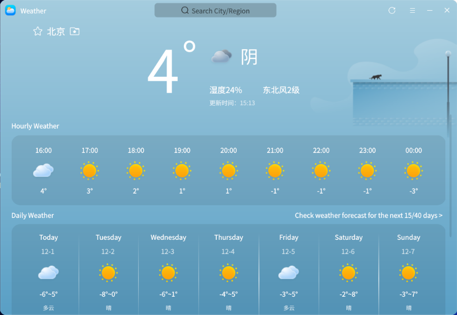
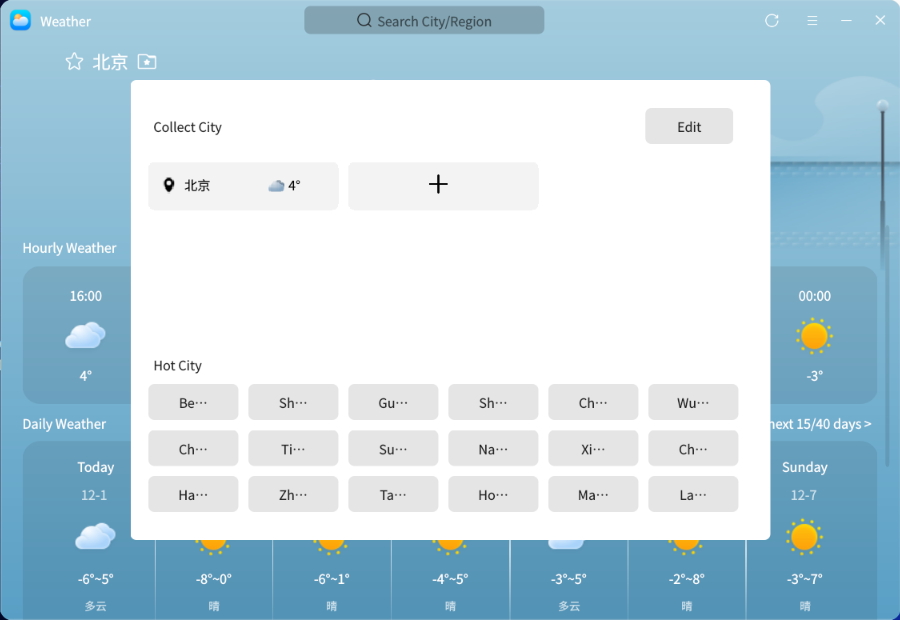
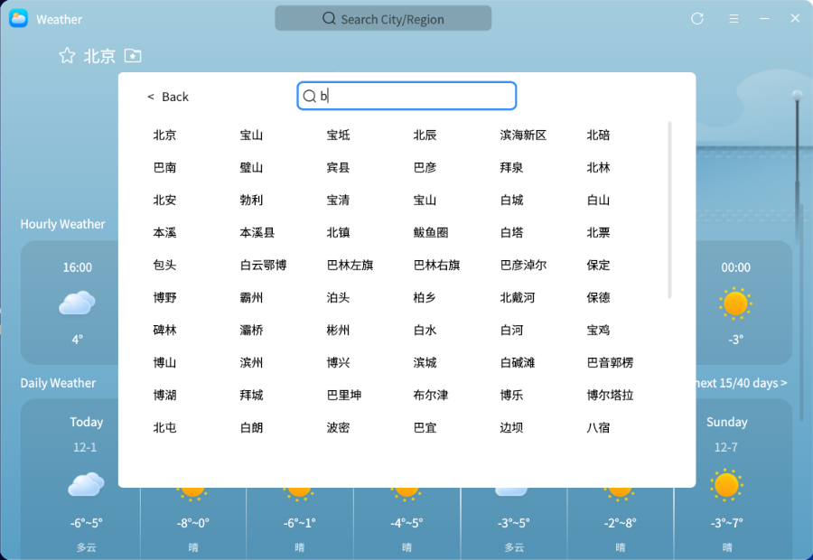
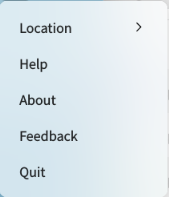

# Weather
## Summary
Weather is an app that provides weather and life index information. By obtaining the authoritative meteorological data, you can view the weather conditions and living index information (such as ultraviolet index, air index, etc.) of each city in the next week in real time. You can automatically locate the current city and add a city by yourself.

### Open mode

“open menu”>“weather” or “taskbar”>“search”>“weather”

### Basic Operation

​       When you open the app for the first time with an active network connection, it will automatically retrieve and display the weather conditions and lifestyle indices for Beijing. If the system is not connected to the internet, a network error screen will appear upon launching the app, and you can click "Network Settings" to jump to the settings interface for network configuration.

​        In the interface, after clicking the "Favorite City" button, you can select and switch between your favorite cities (displayed in the list) and popular cities. You can also click the "+" icon to search for any city across the country in the search bar, add it to your favorites by clicking, and then switch to that city by tapping on it afterward.

​        Click the navigation bar of “”can open the weather menu bar。After you choice "Allow  Locate">"Yes",the application can automatically locate the current city, obtain and display the weather conditions and life index information of the city.

​        After you click the menu bar of “help”,it will automatically jump to the user manual，and you can view the operating instructions of the application. Click "about" in the menu bar to view the current version information, and select "exit" to close the application.

