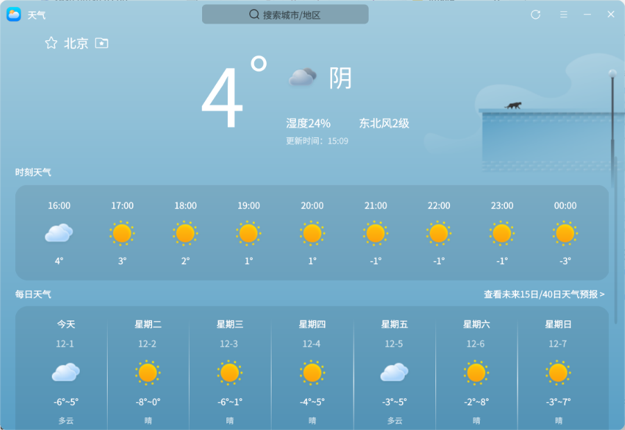
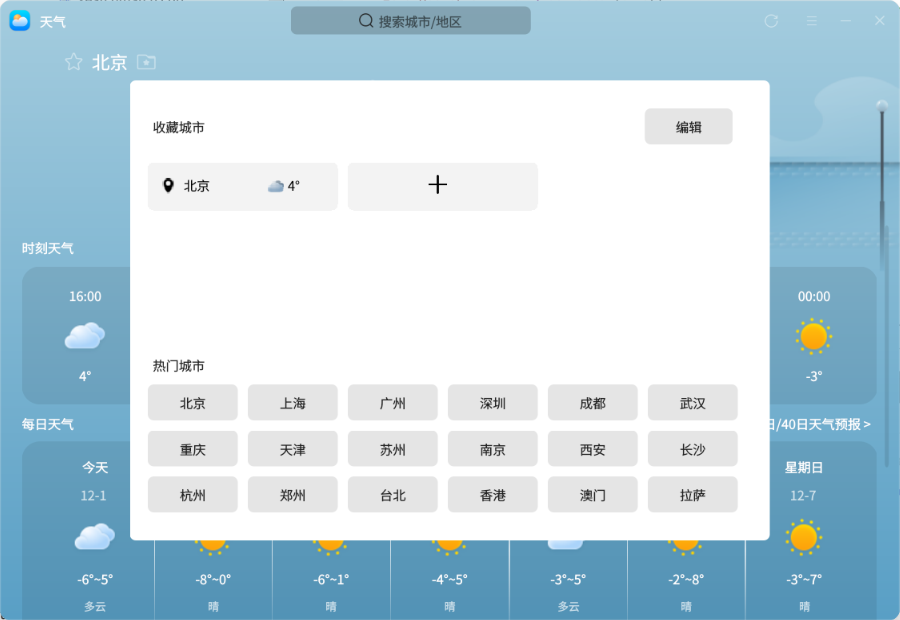
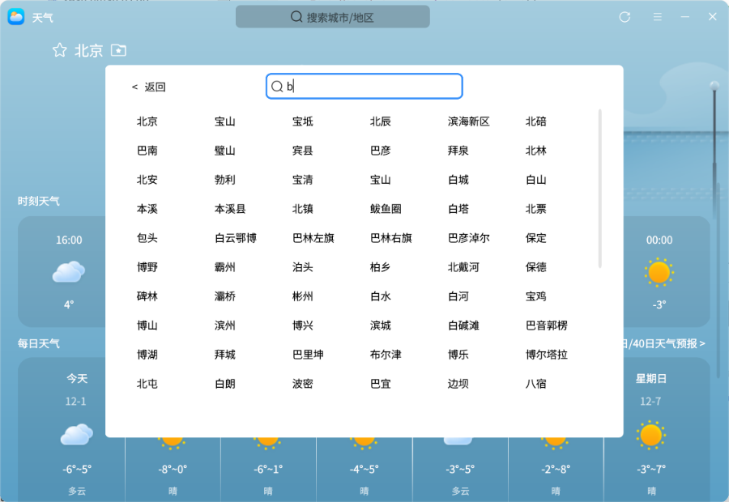
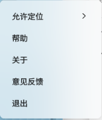

# 天气
## 概 述
天气是一款能获取天气及生活指数信息的应用软件。通过获取权威气象数据可以实时查看全国各城市未来一周的天气状况及生活指数信息（如紫外线指数、空气指数等），支持自动定位当前所在城市、自定义添加城市。

### 打开方式

“开始菜单”>“天气”或“任务栏”>“搜索”>“天气”

### 基本操作

​       首次打开应用，在已连接网络的情况下，自动获取并显示北京的天气状况及生活指数信息；若系统未连接网络，打开应用后会显示网络错误界面，可点击“网络设置”跳转至设置界面配置网络。

​        在界面中点击“收藏城市”按钮后，可以在展示的已收藏城市和热门城市中选择城市进行切换，也可以点击“+”在搜索栏中搜索全国的任一城市并点击将该城市添加到收藏城市，之后点击该城市进行切换。

​        点击导航栏中的“”可打开天气菜单栏。选择“允许定位”> “是”后，应用可以自动定位当前所在城市，获取并显示所在城市的天气状况及生活指数信息。

​        点击菜单栏中的“帮助”将自动跳转至用户手册中，可查看该应用的操作说明。点击菜单栏中的“关于”可查看当前版本信息，选择“退出”可关闭应用。

