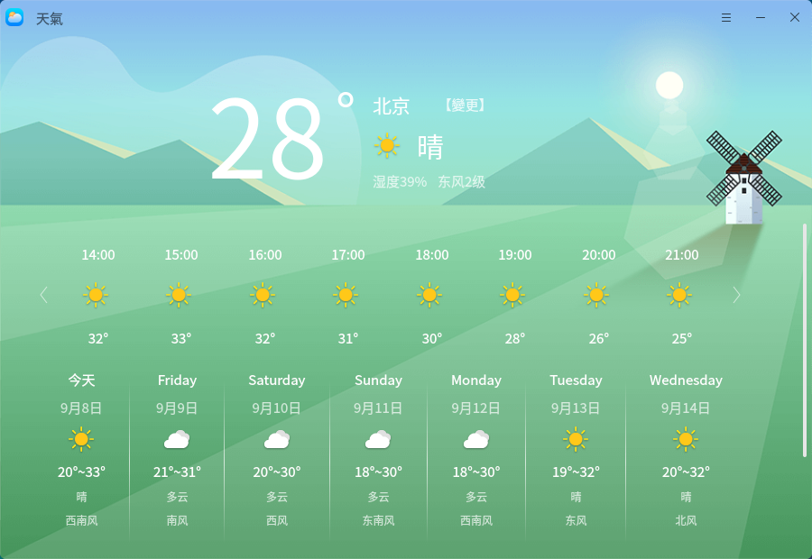
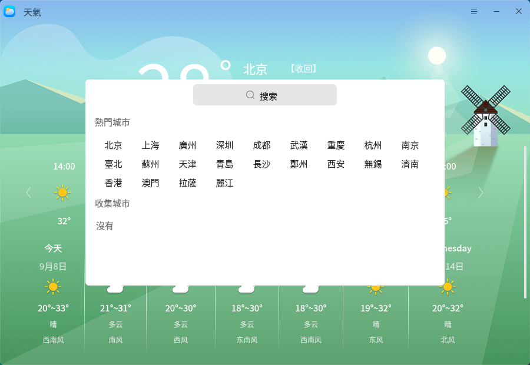
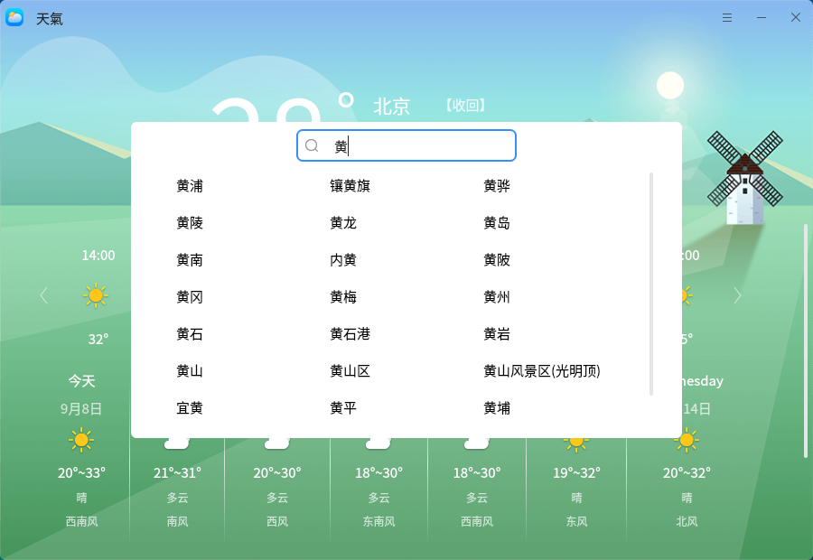

# 天氣
## 概 述
天氣是一款能獲取天氣及生活指數信息的應用軟件。通過獲取權威氣象數據可以實時查看全國各城市未來一周的天氣狀況及生活指數信息（如紫外線指數、空氣指數等），支持自動定位當前所在城市、自定義添加城市。

### 打開方式

“開始菜單”>“天氣”或“任務欄”>“搜索”>“天氣”

### 基本操作

​       首次打開應用，在已連接網絡的情況下，不開啓定位，默認显示北京的天氣狀況及生活指數信息；若系統未連接網絡，打開應用後會彈出。

​       在界面中選擇“變更”后，可以在展示的熱門城市中選擇城市進行切換，也可以在搜索欄中搜索全國的任一城市並選擇“+”將該城市添加到收藏城市，或直接點擊該城市進行切換。

​        點擊導航欄中的“”可打開天氣菜單欄。選擇“位置”> “是”後，應用可以自動定位當前所在城市，獲取並显示所在城市的天氣狀況及生活指數信息。點擊菜單欄中的“說明”將自動跳轉至用戶手冊中，可查看該應用的操作說明。點擊菜單欄中的“关於”可查看當前版本信息，選擇“退出”可關閉應用。

