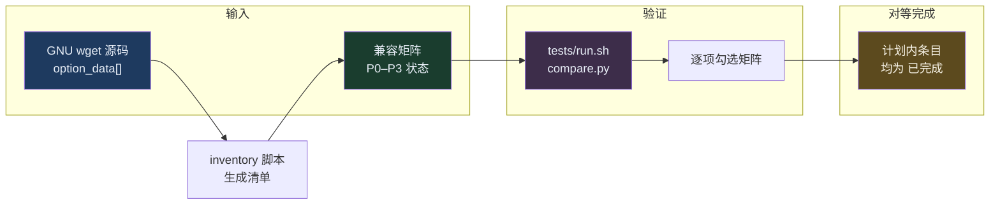

# wget-rust 与 GNU wget 功能对等目标

更新时间：2026-03-19  
基准源码：`/home/zoey/code/gerrit/wget`（可替换为你本机构建所用的同一版本/修订）

---

## 1. 目标声明（适用范围）

**项目目标**：在 `wget-rust` 完成**重构后**，对调用方可见的行为与 **GNU Wget** 保持一致，使现有脚本、打包与运维习惯可以**无感或最小改动**迁移。

「保持一致」包含：

| 维度 | 要求 |
|------|------|
| **CLI** | 同一组参数下，解析规则、互斥/依赖关系与 GNU wget 一致；未实现选项应明确报错或按文档声明等价降级（原则上不允许静默忽略）。 |
| **网络与协议** | HTTP/HTTPS 语义、重定向、Range、代理、`no_proxy`、常见 TLS 校验选项等与基准构建对齐（见下「基准构建」）。 |
| **退出码** | 与 `src/exits.h` 分类一致；至少保证脚本常用的 0/非 0、以及 2/3/4/5/6/7/8 等逐步对齐。 |
| **产物** | 默认文件名、`-O`、头部与 body 的落盘规则、递归目录结构等与 wget 一致（在实现到对应阶段时验收）。 |

---

## 2. 基准构建与差距范围

- **基准**：以你用于对照测试的 `wget` 二进制为准（当前为 `tests/compare.py` 中的 `WGET_ORIG` / 系统 `wget`）。
- **源码参考**：选项全集以 GNU 源码 `src/main.c` 中 `option_data[]` 为准；自动生成清单见  
  [`docs/gnu_wget_options_inventory.md`](gnu_wget_options_inventory.md)。
- **条件编译**：`IF_SSL`、`HAVE_METALINK`、`HAVE_LIBZ` 等导致的选项差异，在 `docs/兼容矩阵.md` 中按 **P 优先级 + 状态** 跟踪；不因未编译宏而宣称「已完成』。
- **刻意不对齐**：须在兼容矩阵中标记为 **`不计划`** 并写明理由（目前示例：`ALL_PROXY` 类系统代理，已为对齐 wget 而关闭 reqwest 隐式系统代理）。

---

## 3. 验收方式（可操作）

1. **兼容矩阵**：`docs/兼容矩阵.md` 中每一项从 `未开始` → `进行中` → `已完成`；**全功能对等**即：所有 **计划内** 条目均为 `已完成`（或等价拆分后的子项全部完成）。
2. **自动化对照**：`./tests/run.sh` 及后续扩充用例：**同一命令行**下原 wget 与 wget-rust 退出码与输出文件一致（或声明允许的差别）。
3. **选项清单回归**：更新 GNU 基准版本后重新运行：
   ```bash
   python3 scripts/inventory_gnu_wget_options.py --main-c /path/to/wget/src/main.c -o docs/gnu_wget_options_inventory.md
   ```
4. **发布前自检**（未来）：可选增加「fuzz 未知长选项」测试：未知选项须与 wget 同类错误一致（通常为退出码 2）。

---

## 4. 实施策略（说人话）

全量选项 **200+**（随宏增减），无法用一次 PR 完成。约定顺序：

1. **P0/P1**：先保证脚本与 CI 最常用路径 100% 对齐并通过对照测试。  
2. **P2**：HTTP 扩展（如 `--save-headers`、method/body）、体验类（verbose/progress）。  
3. **P3**：递归镜像、Cookie/HSTS、WARC、FTP 等大块能力，按模块拆阶段，每阶段带对照用例。  

路线图总表见根目录 **`重写计划书.md`**。

---

## 5. 与「最小化修改」原则的关系

- **代码层面**：仍以「当前阶段最小改动」提交，避免无关重构。  
- **产品层面**：**长期目标**仍是全功能对等；二者不矛盾：通过矩阵与清单把「最小改动」约束在**当前迭代范围内**，而不是缩小最终目标。

---

## 6. Mermaid：验收闭环（暗黑可读）


