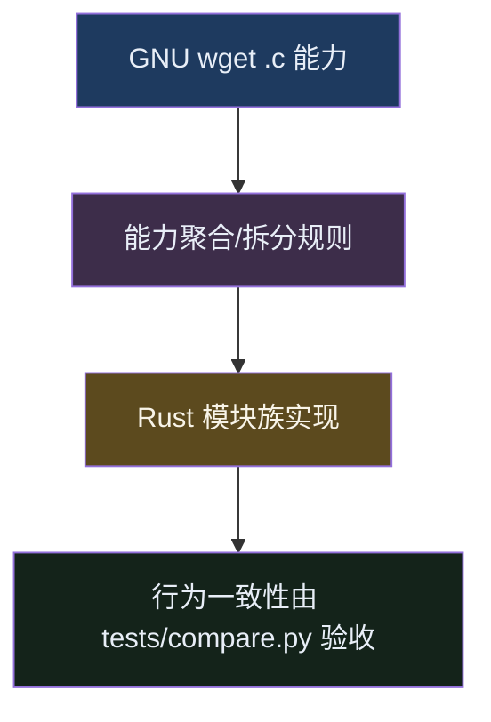

# wget-rust 模块对应关系（能力对齐视角）

更新时间：2026-03-30

## 为什么需要这份文档
在 Rust 重写里，我们追求的是**对外行为一致（能力一致）**，而不是一定要把原 GNU wget 的每个 `.c` 文件在工程里做到一一同名落地。

Rust 的模块粒度和原 C 文件结构天然不同，因此会出现：
- 一个 Rust 模块实现了多个 GNU C 文件的能力（能力聚合）
- 一个 GNU C 文件的能力拆到多个 Rust 模块里实现（能力拆分）

这份文档用“能力对齐”来说明**当前已收编完成的功能**对应到哪些 Rust 模块（文件可不必一一同名）。

> 验收口径仍以：`./tests/run.sh` + `tests/compare.py` 的对照结果为准。

---

## 本文的“模块”定义
本文中的“模块”指 `rust/src/*.rs` 这些 Rust 代码文件（也就是 crate 内的实现单元），例如：
- `rust/src/http.rs`：HTTP 主下载/重试/错误语义/`--spider` 处理等
- `rust/src/log.rs`：stderr/进度文案渲染，以及 `-o/-a` 日志落盘
- `rust/src/cli.rs`：CLI 解析与默认值/互斥校验入口

---

## GNU wget 能力簇 -> Rust 模块对应表（当前已完成部分）

说明：
1. “能力簇”是从 GNU C 文件的职责抽象出来的（比如 `log.c` + `progress.c` 都属于 stderr/进度体验）。
2. 同一个 Rust 模块可能覆盖多个 GNU C 文件的职责。

### 1) CLI 与程序主入口

| GNU C 文件 | 涉及能力（已收编） | Rust 模块 |
|---|---|---|
| `src/main.c` | CLI 参数入口、互斥/校验策略；`-n FLAGS`（`OPT__NO`）兼容与 `verbose/quiet` sanity check | `rust/src/cli.rs`、`rust/src/main.rs` |
| `src/exits.c` | 退出码分类（0/1/2/3/4/8） | `rust/src/exit.rs` |
| `src/noclobber.c`（相关职责） | `--no-clobber` / `-nc` / `--clobber` 的 argv 后者生效 | `rust/src/noclobber.rs`、`rust/src/cli.rs` |
| `src/argv-scan`（相关职责） | argv 中选项跳过（用于扫描“后者生效”顺序） | `rust/src/argv_skip.rs` |
| `src/cert_check.c`（相关职责） | `--check-certificate/--no-check-certificate` 的 argv 顺序覆盖 | `rust/src/cert_check.rs` |

### 2) HTTP 主链路（下载/重定向/Range/错误语义）

| GNU C 文件 | 涉及能力（已收编） | Rust 模块 |
|---|---|---|
| `src/http.c` | HTTP 主下载、重定向、非 2xx/206 错误语义、`--content-on-error`、`--spider` | `rust/src/http.rs` |
| `src/url.c`（相关职责） | `-P/--directory-prefix`（目录前缀落盘） | `rust/src/cli.rs`（参数）、`rust/src/http.rs`（默认名落盘前缀 + 自动建父目录）、`rust/src/recursive.rs`（递归路径加前缀） |
| `src/url.c` / `src/init.c`（相关职责） | `-x/--force-directories`（强制启用目录树 dirstruct；与 `-nd` last-wins；非递归也生效） | `rust/src/cli.rs`（参数）、`rust/src/dirstruct.rs`（argv 扫描决定最终 dirstruct）、`rust/src/pathgen.rs`（目录树路径生成）、`rust/src/http.rs`（非递归落盘）、`rust/src/recursive.rs`（递归落盘复用） |
| `src/url.c` / `src/init.c`（相关职责） | `-nd/--no-directories`（关闭目录树 dirstruct；与 `-x` last-wins；影响 `-k` 本地链接生成） | `rust/src/cli.rs`（参数）、`rust/src/dirstruct.rs`（argv 扫描 last-wins）、`rust/src/recursive.rs`（`local_href_for` 按最终 dirstruct 决策本地链接路径）、`rust/src/pathgen.rs`（落盘路径生成） |
| `src/init.c` / `src/url.c`（相关职责） | `-nH/--no-host-directories` / `--host-directories`（是否创建 host 目录；argv 后者生效） | `rust/src/cli.rs`（参数）、`rust/src/hostdir.rs`（argv 扫描决定最终状态）、`rust/src/recursive.rs`（落盘路径是否包含 host 目录） |
| `src/url.c`（相关职责） | `--protocol-directories`（目录树中插入 `http/https/ftp` 协议目录） | `rust/src/cli.rs`（参数）、`rust/src/recursive.rs`（`local_path_for_recursive` 插入 scheme 目录） |
| `src/url.c`（相关职责） | `--default-page=NAME`（目录 URL 的默认落盘名；重复指定 last-wins） | `rust/src/cli.rs`（参数与 `effective_default_page()`）、`rust/src/pathgen.rs`（目录 URL 文件名生成）、`rust/src/http.rs`（非递归默认名）、`rust/src/recursive.rs`（递归落盘复用） |
| `src/init.c` / `src/iri.c` / `src/url.c`（相关职责） | `--iri/--no-iri`（IRI 支持开关、argv last-wins） | `rust/src/cli.rs`（开关与 `effective_enable_iri()`）、`rust/src/urls.rs`（统一 URL 解析入口 `parse_url_with_iri_policy`）、`rust/src/http.rs`、`rust/src/recursive.rs` |
| `src/netrc.c` / `src/http.c` / `src/ftp.c`（相关职责） | `.netrc` / `--no-netrc`（凭据读取、HTTP/FTP 查找与优先级） | `rust/src/netrc.rs`（解析与缓存）、`rust/src/cli.rs`（开关与 last-wins）、`rust/src/auth.rs`（HTTP Basic 凭据组合与 netrc 注入）、`rust/src/ftp.rs`（FTP 登录凭据组合与 netrc 注入） |
| `src/url.c` / `src/init.c`（相关职责） | `--restrict-file-names=OS`（文件名字符限制：`unix/vms/windows`、`lowercase/uppercase`、`nocontrol`、`ascii`；以及 Windows 下 host:port 分隔符 `+`） | `rust/src/cli.rs`（参数+校验）、`rust/src/restrict_names.rs`（规则解析与转义）、`rust/src/pathgen.rs`（URL→本地路径生成时应用规则） |
| `src/retr.c` / `src/res.c`（Range/续传相关职责） | `-c/--continue`、`--start-pos`、Range 起点与继续策略 | `rust/src/http.rs`、`rust/src/resume.rs`、`rust/src/request.rs` |
| `src/timestamp.c`（相关职责） | `-N/--timestamping`（条件请求 If-Modified-Since + 304 跳过写入；服务端忽略 IMS 的跳过逻辑；按 Last-Modified 回写 mtime；`--use-server-timestamps` 开关） | `rust/src/http.rs`、`rust/src/cli.rs` |
| `src/recur.c`（相关职责） | `-m/--mirror`（完整语义：隐含 `-r -N -l 0` 与 `--dont-remove-listing`） | `rust/src/cli.rs`（effective_* 与 listing 策略）、`rust/src/recursive.rs`、`rust/src/http.rs` |
| `src/host.c` | `--retry-on-host-error`：DNS/主机解析失败识别与重试开关 | `rust/src/http.rs`（错误链遍历） |
| `src/spider.c` | `--spider`：只检查可用性、不落 body；仍按 HTTP 错误退出码返回 | `rust/src/http.rs` |
| `src/connect.c`（相关职责） | `--tries` + 网络错误重试循环的边界语义 | `rust/src/http.rs` |
| `src/http.c`（相关职责） | `--trust-server-names`（重定向后用最终 URL last component 决定本地文件名） | `rust/src/cli.rs`、`rust/src/http.rs`（根据 `resp.url()` 决策默认文件名）、`rust/src/recursive.rs`（递归落盘按最终 URL 重算路径并重命名） |

### 3) stderr/进度/日志体验

| GNU C 文件 | 涉及能力（已收编） | Rust 模块 |
|---|---|---|
| `src/log.c` | stderr 逻辑：`-q/-nv/--no-verbose`、`-S/--server-response`、重试提示 | `rust/src/log.rs` |
| `src/progress.c` | 进度渲染：已知 `Content-Length` 的百分比；未知长度的 `Length: unspecified` + 动态速率体验 | `rust/src/log.rs`、`rust/src/http.rs` |
| `src/rejected-log`（相关职责） | 本阶段未单独实现（不在当前能力收编里） | - |
| `-o/-a`（GNU 的落盘消息语义） | 成功写 `URL:... -> "..."`；错误写 `ERROR code: reason`；支持追加 | `rust/src/log.rs` |

### 4) TLS 证书校验

| GNU C 文件 | 涉及能力（已收编） | Rust 模块 |
|---|---|---|
| `src/gnutls.c` / `src/openssl.c`（相关职责） | `--check-certificate/--no-check-certificate`、HTTPS 校验证书策略 | `rust/src/cert_check.rs`、`rust/src/client.rs` |
| `src/init.c` / OpenSSL `SSL_CTX_load_verify_locations`（相关职责） | **`--ca-certificate`** / **`--ca-directory`**（信任锚） | `rust/src/tls_ca.rs`（`reqwest::Certificate` + `add_root_certificate`） |
| `src/init.c` `inet4only` / `inet6only` + 连接层地址族（相关职责） | **`-4/--inet4-only`**、**`-6/--inet6-only`** | `rust/src/dns_family.rs`（`FamilyFilterResolver` + `enforce_literal_host_policy`）；`rust/src/client.rs` 注入 `dns_resolver`；`rust/src/http.rs` 预检字面量 IP |
| `src/cookies.c` / `src/http.c:load_cookies/save_cookies`（相关职责） | **Cookie jar**：`--load-cookies` / `--save-cookies` / `--no-cookies` / `--keep-session-cookies` | `rust/src/cookies.rs`（`cookie_store::CookieStore` + `reqwest cookie_provider` + Netscape cookies.txt 子集） |
| `src/hsts.c`（相关职责） | **HSTS**：`--hsts` / `--no-hsts` / `--hsts-file` | `rust/src/hsts.rs`（GNU `.wget-hsts` 文件格式 + match 改写 http→https + STS 头更新） |

### 5) HTML 解析与 URL 抽取（`-F` + `-i` 子集）

| GNU C 文件 | 涉及能力（已收编） | Rust 模块 |
|---|---|---|
| `src/html-parse.c` | HTML DOM 抽取（子集）：链接与资源地址抽取 | `rust/src/html_urls.rs` |
| `src/html-url.c` | 从解析结果生成/规范化待下载 URL | `rust/src/urls.rs`、`rust/src/html_urls.rs` |

### 6) 递归下载（`-r` 子集）与 FTP（第二批）

| GNU C 文件 | 涉及能力（已收编） | Rust 模块 |
|---|---|---|
| `src/recur.c`（相关职责） | 递归队列、深度控制、no-parent/no-directories、同站点/端口跟随边界（以父页面 host 为准；`--no-parent` 的 scheme/port 条件） | `rust/src/recursive.rs`（队列/策略）、`rust/src/http.rs`（支持捕获 HTML body 供抽链） |
| `src/recur.c`（相关职责） | 重定向后是否继续递归（`descend_redirect`：对重定向目标复用 `download_child` 判定；LIST/REGEX 对重定向目标例外忽略；DOMAIN/SPANNEDHOST/ROBOTS/NO-PARENT 等仍会阻止继续递归；仅在“通过或仅因 LIST/REGEX 被拒绝”时将最终 URL 加入去重/黑名单；并以最终 URL 作为后续抽链的“父页面”） | `rust/src/recursive.rs`（`redirect_target_reason` + `descend_allowed_by_redirect` + `should_follow` 以 effective_url 作为 parent） |
| `src/url.c`（相关职责） | `--cut-dirs`（递归目录树落盘：裁剪远端路径前 N 段） | `rust/src/cli.rs`（参数）、`rust/src/recursive.rs`（`local_path_for_recursive` 路径生成） |
| `src/recur.c` / `src/utils.c` / `src/host.c`（相关职责） | 递归跟随策略：`-A/-R`、`--accept-regex/--reject-regex`、`-D/--exclude-domains`、`-H`、`-L`、`-I/-X`；其中 `--accept-regex/--reject-regex` 对齐 GNU `accept_url()`（URL 全串 regex；reject 覆盖 accept）；`-A/-R` 对齐 GNU `acceptable()/in_acclist()`（通配 `fnmatch`、无通配后缀 `match_tail`、reject 覆盖 accept；目录 URL 使用 `--default-page` 有效文件名参与过滤）；`-D/--exclude-domains` 对齐 GNU `host.c:sufmatch()`（大小写不敏感、支持前导点）；`-H` 对齐 GNU：默认仅当 scheme 相似（HTTP/HTTPS）时要求“子链接 host 与父页面 host 相同”；`-L` 仅跟随相对链接；`-I/-X` 对齐 GNU `utils.c:accdir()/dir_matches_p()/subdir_p()`（忽略 leading `/`；无通配前缀+边界；有通配 `fnmatch(FNM_PATHNAME)`；对 URL path 做 `%XX` 解码目录匹配） | `rust/src/recur_policy.rs`（`accept_url_regex()`、`acceptable_file()`/`in_acclist()`、`accdir()`/`dir_of()`/`dir_matches_p()`、`accept_domain()`/`sufmatch()`）、`rust/src/recursive.rs`（入队判定集成：`should_follow()` + regex/accept/reject 应用点）、`rust/src/html_urls.rs`（relative 链接判定） |
| `src/recur.c`（相关职责） | `--https-only`（深水区）：递归时只跟随 HTTPS；并禁止 **HTTPS→HTTP** 的重定向跟随（避免递归链路落到 HTTP） | `rust/src/recursive.rs`（入队前 scheme 判断）、`rust/src/client.rs`（递归 + https-only 下自定义 redirect policy） |
| `src/recur.c` / `src/res.c` / `src/html-url.c`（相关职责） | robots.txt + meta robots nofollow（不跟随页面链接）；robots.txt 深水区：UA 仅匹配 `wget`/`*`、`wget` exact 剪枝 `*`、规则顺序 first-match-wins、路径 `%XX` 解码但不解 `/`、缓存按 host:port 隔离 | `rust/src/robots.rs`（robots 规则缓存/匹配）、`rust/src/html_urls.rs`（meta nofollow 检测）、`rust/src/recursive.rs`（入队前抑制） |
| `src/convert.c`（相关职责） | `-k/--convert-links`（HTML 链接本地化） | `rust/src/recursive.rs`（递归下载后对 HTML 就地改写）、`rust/src/html_urls.rs`（保留 raw/resolved 的抽链信息 + follow/requisites 抽取） |
| `src/convert.c`（相关职责） | `--convert-file-only`（仅改写 URL basename，保留 URL dirname） | `rust/src/recursive.rs`（`convert_basename_only`）、`rust/src/cli.rs`（开关与校验） |
| `src/convert.c`（相关职责） | `-K/--backup-converted`（转换前备份为 `X.orig`） | `rust/src/backups.rs`（`backup_converted_once`）、`rust/src/recursive.rs`（`-k` 写回前触发备份） |
| `src/retr.c`（相关职责） | `--backups=N`（写入前轮转 `X -> X.1 .. X.N`） | `rust/src/backups.rs`（`rotate_backups`）、`rust/src/http.rs`（写入前触发轮转） |
| `src/http.c`（相关职责） | `-E/--adjust-extension`（HTML/CSS 扩展名补全） | `rust/src/http.rs`（`maybe_adjust_extension`） |
| `src/retr.c` / `src/recur.c`（相关职责） | `--delete-after`（成功下载后删除本地文件；递归抽链文件也删除） | `rust/src/http.rs`（非递归单 URL 成功后删除）、`rust/src/recursive.rs`（抽链后删除；并在 `--delete-after` 时跳过 `-k/--convert-links` 与 `--convert-file-only` 的转换写回） |
| `src/recur.c`（相关职责） | `-p/--page-requisites`（抓取页面内联资源 + CSS 资源） | `rust/src/recursive.rs`（inline-only 深度策略 + 资源入队 + CSS 抽取）、`rust/src/html_urls.rs`（Follow/Inline 链接分类）、`rust/src/css_urls.rs`（CSS `url(...)`/`@import` 抽取）、`rust/src/http.rs`（支持捕获 CSS body 供抽取） |

---

## 暂未收编（本阶段不在表内）
例如（以你当前矩阵为准）：
- `ftp-ls.c`：GNU 的 FTP 列表解析非常复杂；本仓库当前实现已从“最小闭环”扩展到更真实的 Unix LIST 解析（含软链接 `name -> target`），并补齐安全名过滤/重复项过滤与 `-A/-R`/regex 应用点（**TC175–TC177**）。但仍未覆盖所有非 Unix listing 格式（例如 DOS/VMS 等），后续按矩阵继续收编。
- 递归 FTP（`--follow-ftp` 等）仍未开始

这些能力的“模块对应关系”会在实现到位后继续补进本表。

---

## Mermaid：能力聚合视角（示意）

