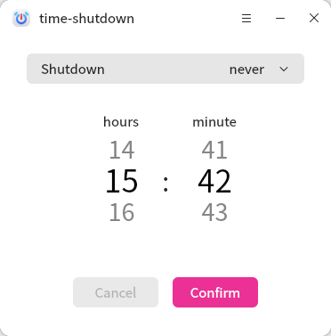
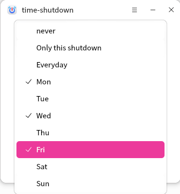
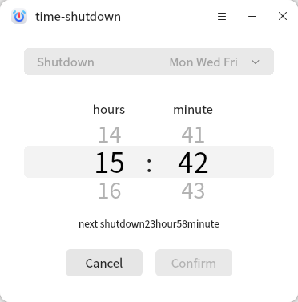

# Time Shutdown
## OverView

 

Time Shutdown is an easy to use self-developed application that supports automatic shutdown at a selected time.

 

## Open mode

 

**"menu"**right click>**"Power Options"**>**"TimeShutdown"**.

 

## Basic operation

 

Right click the timing shutdown homepage as shown in the figure below. The upper part is the time frequency display and selection area. The default is **"never"**. The lower part is the time scrolling area. The default middle position is the current system time.

 

In the timing shutdown frequency selection area, you can set the shutdown frequency. You can set **"Only this shutdown"** shutdown to make the shutdown settings take effect, or you can set a fixed day of the week or every day for shutdown.

 

Then determine the specific time of shutdown in the time scroll area below by dragging the mouse button or scrolling the wheel, and click **"Confirm"** to start the timed shutdown. Even after the interface exits, the scheduled shutdown task can continue in the background. Click **"Cancel"** to cancel the current scheduled shutdown task.

 

## Assist and About

Click in the navigation bar to open the scheduled shutdown menu bar.Select **"Assist"** to automatically jump to the user manual to view the operating instructions of the tool.
Select **"About"** to view the instructions and current version information of scheduled shutdown.Select **"Feedback"** to report issues encountered during app usage and to rate the app.Select **"Quit"** to close the application.