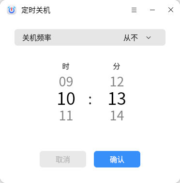
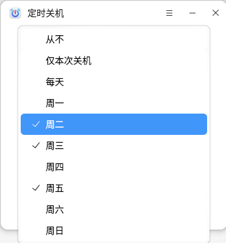
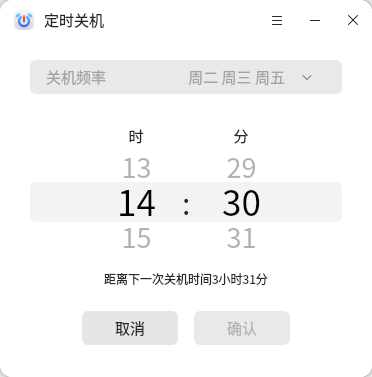

# 定时关机
## 概 述

 

定时关机是一款简单易用的自研应用，支持在选定时间进行自动关机。 

 

## 打开方式

 

**“开始菜单”**右键>**“电源”**>**“定时关机”**。

 

## 基本操作

 

定时关机首页如下图所示，上端为时间频率显示与选择区域，默认为**“从不”**。下方显示为时间滚动区域，默认中间位置为当前系统时间。

 

在定时关机频率选择区域内，可以设置关机频率。可以通过设置**“仅本次关机”**关机让此次关机设置生效，也可以设置固定周几或者每一天都进行关机操作。

 

之后通过鼠标按键拖动或者滚轮滚动的方式在下方时间滚动区域确定需要关机的具体时间，点击**“确认”**启动定时关机。即使在界面退出后，该定时关机任务也可以在后台继续进行，可以通过点击**“取消”**来取消当前定时关机任务。

 

## 帮助与关于
点击导航栏中的可打开定时关机菜单栏，选择**“帮助”**将自动跳转至用户手册中，可查看该工具的操作说明。
选择**“关于”**可查看定时关机的关于说明与当前版本信息。选择**“意见反馈”**可以反馈应用使用过程中遇到的问题，并对应用进行评分。选择**“退出”**可关闭应用。