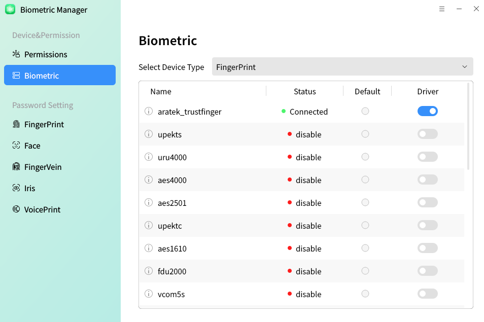
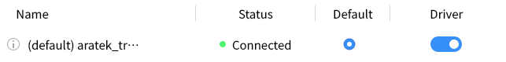
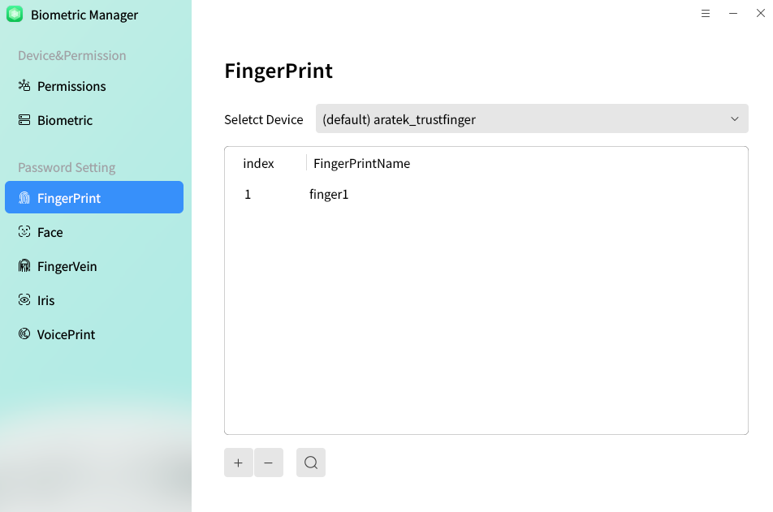
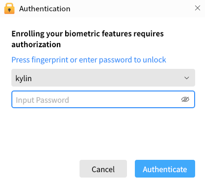
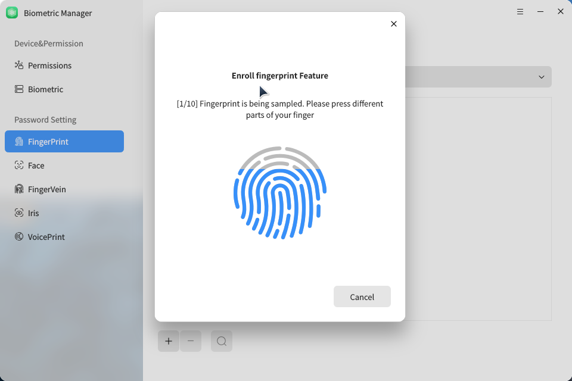
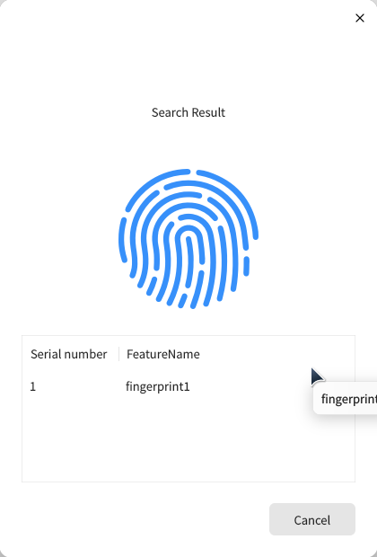
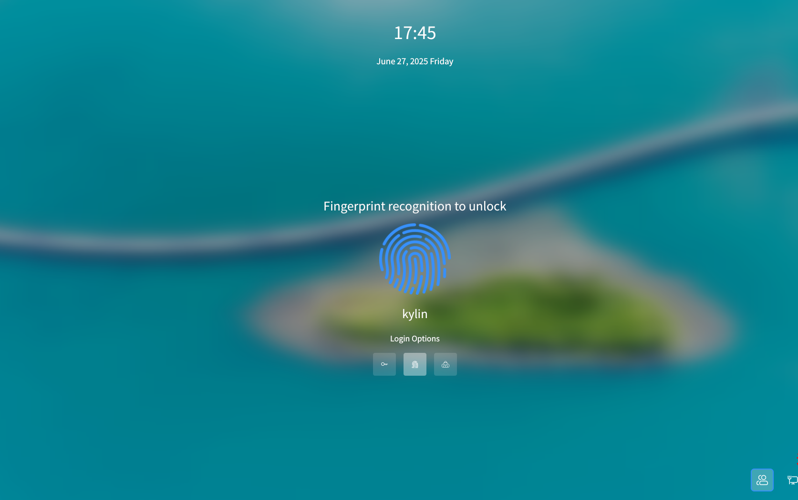
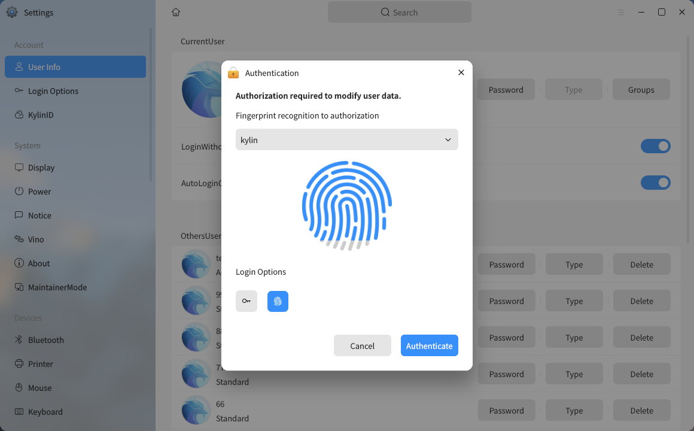
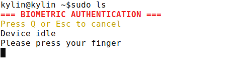

# Biometric Manager
## Overview
Biometric certification is safer and more convient than tranditional passwords. It doesn't need to remember the complex passwords.

Because each person's fingerprint is different from others', it's not easy to forge or fake. Authenticated by fingerprint is more reliable and accurate.

It supports login, lock screen and authorized certification.

In order to use biometric certification, five conditions need to be meet:

1) The device is connected and the drive status is on.

2) Permission setting - biological device switch status is on.

3) Permission setting - the switch state of the corresponding scene that biometrics will be used for is on.

4) The linked device is set as default.

5) The user's fingerprint has been recorded by this device already.

## Equipment and authority
As shown in Fig 1, the management tool biological device has five biometric selection pages: fingerprint, face recognition, finger vein, iris and voiceprint.

"Permission setting - biological device" is the main switch to turn on biometrics. Only when this switch is turned on can biometric authentication be used.

The type of biometrics is displayed above the biological equipment tab; Below is the drive device information corresponding to this type, including device name, device status, drive status, and whether it is the default device.

When you want to use a biometric device, you need to connect the device first, enter the biometric, and then set the device as the default device, as shown in Fig 3.

## Password setting
For face recognition, the page composition of vein, fingerprint, iris and voiceprint is similar. Here, take the fingerprint tab as an example.

The interface as shown in Fig 4:

- The name of the fingerprint device driver is displayed on the upper right.

- The entered fingerprint information, including fingerprint name and serial number, is displayed in the middle of the right.

- The lower right side provides the functions of entry, deletion and search.

### Enroll
Clicking "Enroll" and inputting the name, the authentication through password window will pop up, as shown in Fig 5.

The enroll window as shown in Fig 6. It needs to repeat pressing and lifting finger 5 times.

### Search
It can retrieve the index and name of the currently validated fingerprint.

### Delete
**Delete**: Delete the selected fingerprint.

## Usage Scenarios
- Login and Lock Screen:

If there exists 2 more devices, users can choose one of them to use.

- Authentication:

 

## Q&A
#### Stuck in lock screen and unable to enter password

1) Switch to teminal by "Ctrl + Alt + F1"

2) Enter the user name and password

3) Excute command "killall ukui-screensaver-dialog"

4) Switch back by "Ctrl + Alt + F7" (If multiple users logged in, the command may be Ctrl + Alt + F8 and so on)

#### Unable to use biometric authentication

1) Open biometric manager

2) Ensure the switch is on, the device is linked, and the driver status is opened

3) Check the device is set as default

4) Make sure there exits one biometric feature at least

#### How to close it
Change the switch on the main interface to "Closed".

