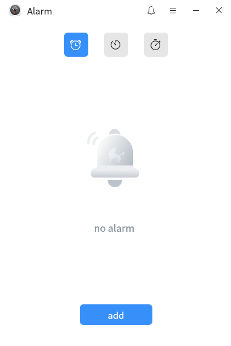
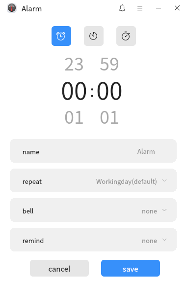
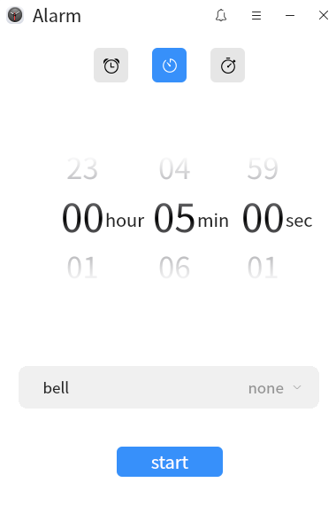
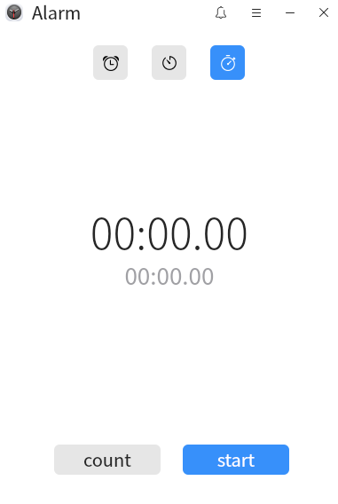
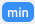

# Alarm
## Overview
​		Alarm clock is a self-developed desktop utility with simple operation. It not only supports setting alarm clock, but also is equipped with countdown and stopwatch. It can be switched through the corresponding icon at the top of the interface. Different ring reminders can be set in the alarm clock and timer.

## Open mode
​		**“menu”>“Alarm”** or**“taskbar”>“search”>“Alarm”**。

## basic operation
​		The home page of the alarm clock is shown in the figure below. Select different icons at the top of the interface to switch to the interface of alarm clock, countdown and stopwatch.

​		Click  You can set alarm mute.

​		Click  You can open the alarm menu bar. After selecting "setting" in the menu bar, a setting window will pop up. In the alarm menu bar, select **"help"** to automatically jump to the user's manual and view the operating instructions of the tool. Select **"about"** to view the current version information, and **"exit"** to close the application.

## Alarm

​		In the alarm clock interface, click **"add"**  to add an alarm clock and set the time, alarm name, repeating day, ring tone and later reminder time.

​       Double-click the alarm clock to enter the editing alarm interface. Or right-click the alarm and select **"edit"** or **"delete"** the alarm.

## Countdown

​		In the countdown setting screen, you can set the time and bell. Time settings can scroll through the dial settings or double-click to enter the number settings.

​		Click **"start"** to enter the countdown running interface, and the large scroll dial shows the estimated ringing time and remaining time.

​		Click the mini window button to hide the alarm clock  and show the mini window.

​	    In the mini window, click the Main Window button  to return to the alarm clock countdown running interface.

​	   Click **"suspend"** to pause the timer.

​	   Click **"End"** to end the timer and return to the countdown setting interface.

## Watch

​		The stopwatch can be timed and counted.

​        Click **"start"** to start the timer.

​		Click **"count"** to record the counting and counting interval time, and the timing will not be interrupted. Labels indicate the longest and shortest interval records, respectively.

​		Click **"suspend"** to record the final time.

​		Click **"reset"** to clear the stopwatch.
