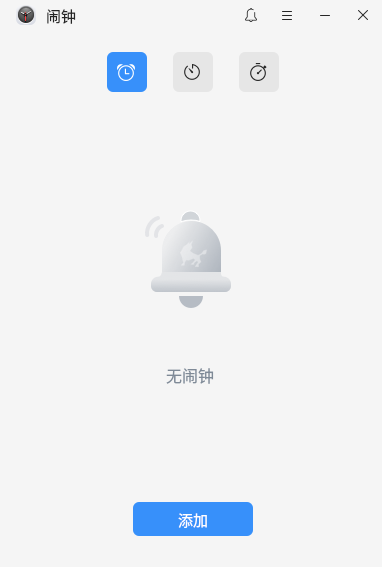
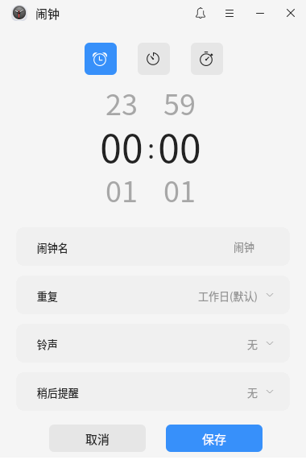
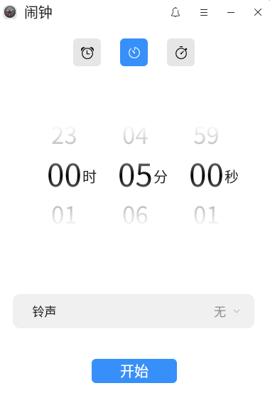
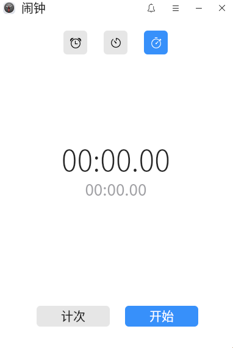

# 闹钟
## 概 述
​		闹钟是自研的一款操作简易的桌面实用工具，不仅支持设置闹钟，还配置了倒计时和秒表，通过界面顶部对应的图标可进行切换。闹钟和计时器中可设置不同的铃声提醒。

## 打开方式
​		**“开始菜单”>“闹钟”**或**“任务栏”>“搜索”>“闹钟”**。

## 基本操作
​		闹钟首页如下图所示，选择界面顶部的不同的图标可对应切换至闹钟、倒计时、秒表界面。

​	    点击导航栏中的（静音按钮)，可以设置静音。

​       点击导航栏中的可打开闹钟菜单栏，选择**“帮助”**将自动跳转至用户手册中，可查看该工具的操作说明。选择**“关于”**可查看当前版本信息，选择**“退出”**可关闭应用。

## 闹 钟

​		在闹钟界面中，点击**“添加”**可添加闹钟，并设定时间、闹钟名、重复日、铃声及稍后提醒时间。

​       双击闹钟，可进入编辑闹钟界面。或者右键点击闹钟，可选择**“编辑”**或者**“删除”**该闹钟。

## 倒计时

​		在倒计时设置界面中，可设定时间和铃声。时间设定可滚动数字盘设置，也可以双击输入数字设定。

​       点击**“开始”**进入倒计时运行界面，大滚动盘中显示预计响铃时间和剩余时间。

​       点击迷你窗口按钮，隐藏闹钟应用，显示迷你窗口。

​      在迷你窗口中，点击主窗口按钮，可回到闹钟倒计时运行界面。

​      点击**“暂停”**，计时暂停。

​      点击**“结束”**，计时结束并回到倒计时设置界面。

## 秒 表

​       秒表可以计时和计次。

​       点击**“开始”**即开始计时。

​      点击**“计次”**可记录计次、计次间隔时间，计时不中断。标签 分别表示最长和最短的间隔时间记录。

​      点击**“暂停”**可记录最终时间。

​      点击**“复位”**，清除秒表。
